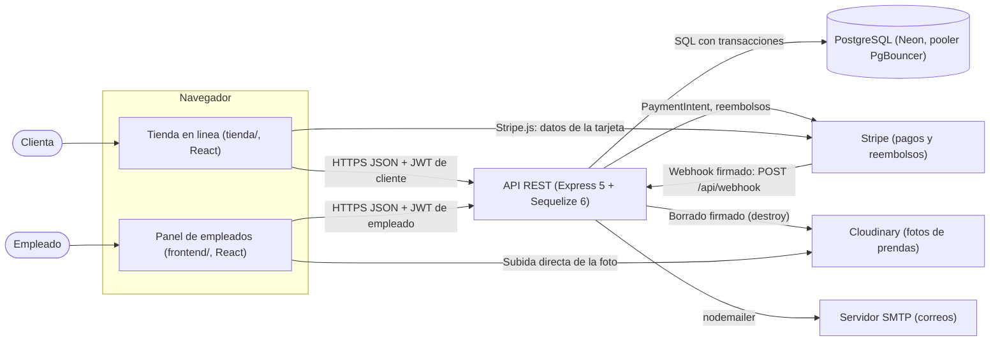
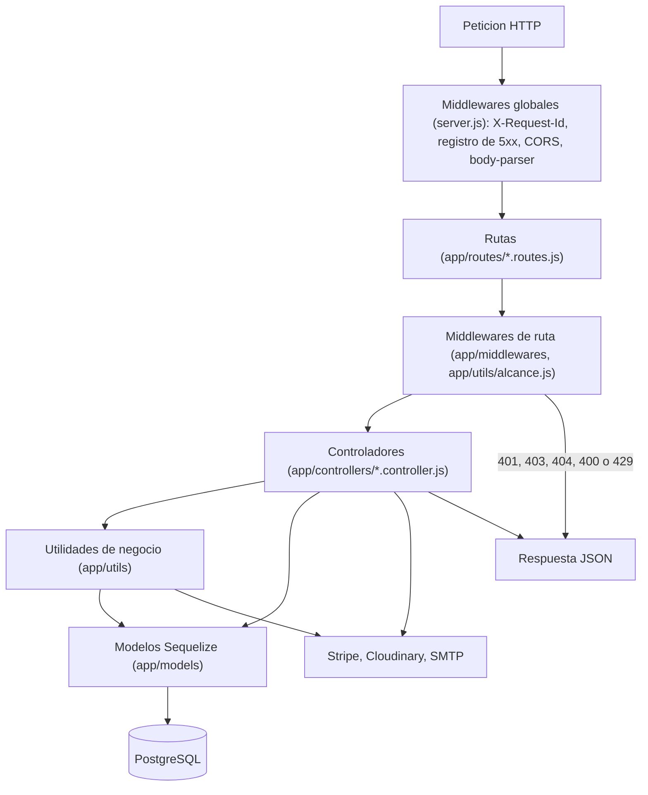
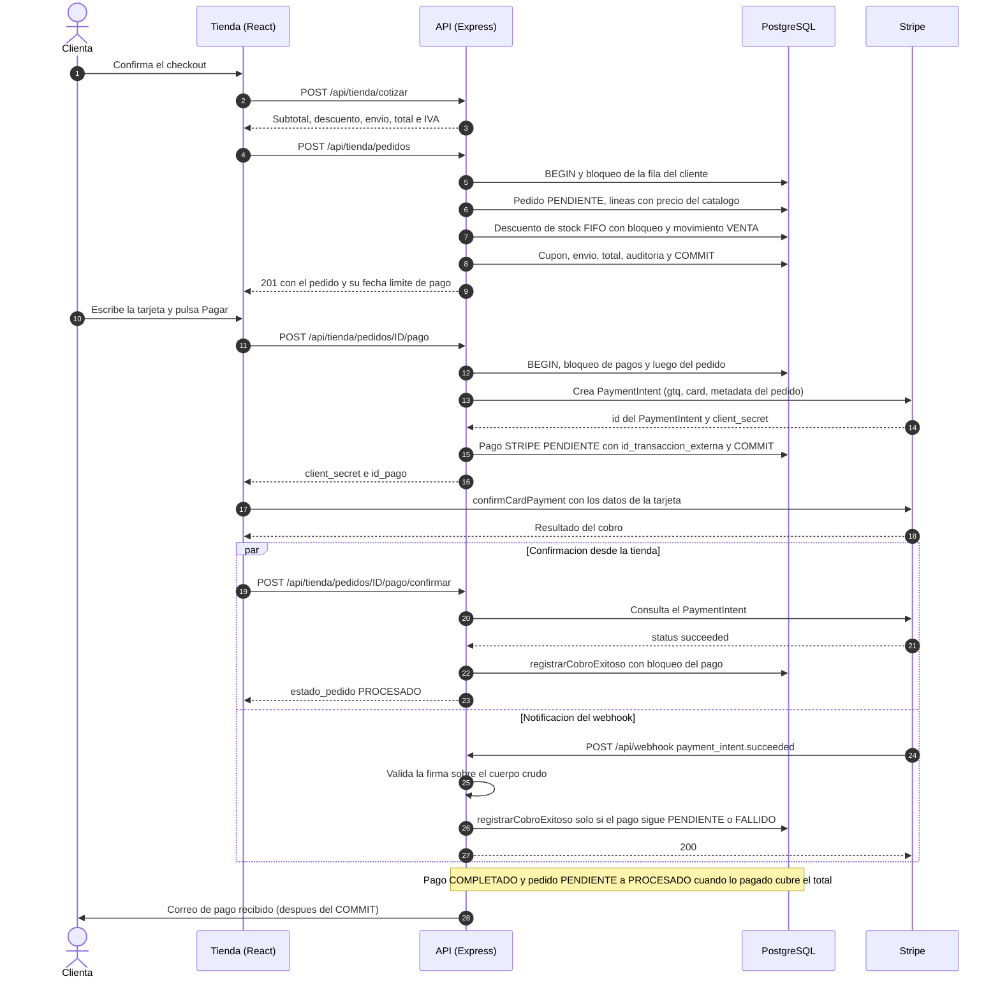
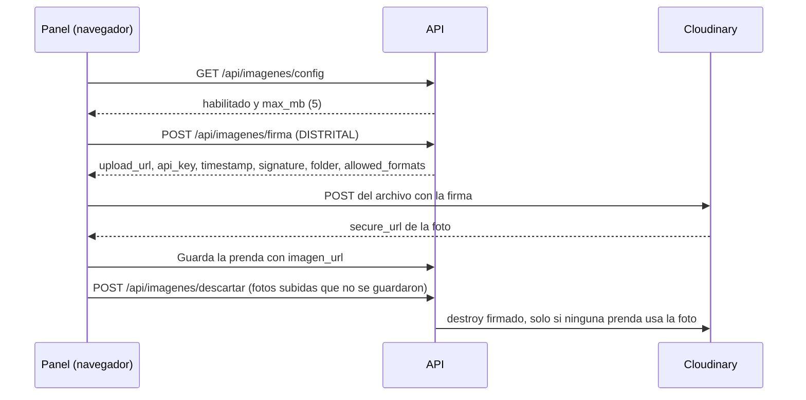
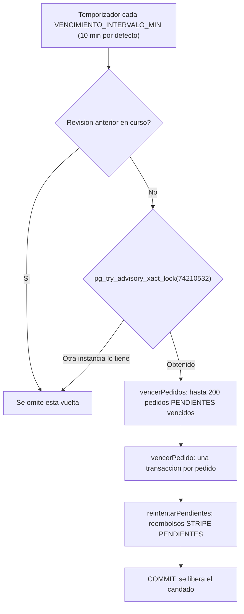
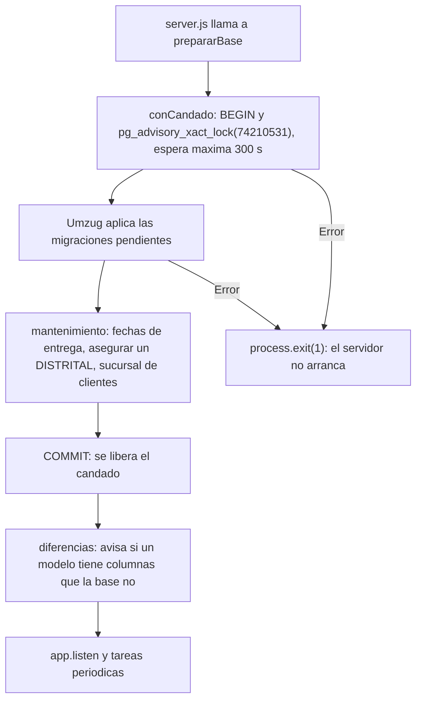

# Arquitectura del sistema

Este documento describe la arquitectura del sistema Distribuidora: los componentes que lo forman, la manera en que se comunican entre sí y con los servicios externos, la organización interna del backend y de las dos aplicaciones web, el flujo completo de una compra en línea con pago por tarjeta, las tareas que el servidor ejecuta de forma periódica, el mecanismo de migraciones de la base de datos y las decisiones técnicas que dan forma al conjunto. Todo lo descrito corresponde al código del repositorio.

## Contenido

1. [Visión general](#1-visión-general)
2. [Diagrama general](#2-diagrama-general)
3. [Capas del backend](#3-capas-del-backend)
4. [Organización de los frontends](#4-organización-de-los-frontends)
5. [Flujo de una compra con pago por tarjeta](#5-flujo-de-una-compra-con-pago-por-tarjeta)
6. [Integración con servicios externos](#6-integración-con-servicios-externos)
7. [Tareas periódicas](#7-tareas-periódicas)
8. [Migraciones al arrancar](#8-migraciones-al-arrancar)
9. [Decisiones técnicas clave](#9-decisiones-técnicas-clave)
10. [Documentos relacionados](#10-documentos-relacionados)

---

## 1. Visión general

El sistema sigue una arquitectura cliente-servidor de tres niveles: dos aplicaciones web de una sola página (SPA) consumen una única API REST, y la API es el único componente que accede a la base de datos y a los servicios externos con credenciales secretas.

| Componente | Carpeta | Tecnología | Usuarios | Publicación en Render |
|---|---|---|---|---|
| API REST | raíz del repositorio (`server.js`, `app/`) | Node.js, Express 5, Sequelize 6, PostgreSQL | Ambas aplicaciones web y Stripe (webhook) | https://distribuidora-api-r6rw.onrender.com (salud: `/api/salud`) |
| Panel de empleados | `frontend/` | React 19, Vite, React Router | Empleados con puesto DISTRITAL, ADMIN, CAJERO o BODEGUERO | https://distribuidora-panel.onrender.com |
| Tienda en línea | `tienda/` | React 19, Vite, React Router, Stripe.js | Clientas | https://distribuidora-tienda.onrender.com |
| Base de datos | — | PostgreSQL en Neon, con pooler PgBouncer | Solo la API | Servicio administrado (Neon) |
| Pruebas | `tests/` | Ejecutor propio (`tests/correr.js`), `playwright-core` para el navegador | Equipo de desarrollo | — |
| Colección de API | `postman/` | Postman | Equipo de desarrollo | — |
| Scripts de operación | `scripts/` | Node.js | Equipo de desarrollo | — |

Servicios externos que utiliza la API:

| Servicio | Uso en el sistema | Variables de entorno (ver `.env.example`) |
|---|---|---|
| Stripe | Cobro con tarjeta en la tienda (PaymentIntent) y reembolsos a tarjeta | `STRIPE_SECRET_KEY`, `STRIPE_WEBHOOK_SECRET` (API); `VITE_STRIPE_PUBLISHABLE_KEY` (tienda, en `tienda/.env.example`) |
| Cloudinary | Almacenamiento de las fotos de las prendas | `CLOUDINARY_CLOUD_NAME`, `CLOUDINARY_API_KEY`, `CLOUDINARY_API_SECRET` |
| Servidor SMTP (nodemailer) | Correos a las clientas: pago recibido, envío, entrega, cancelación, devoluciones, reembolsos y restablecimiento de contraseña | `SMTP_HOST`, `SMTP_PORT`, `SMTP_USER`, `SMTP_PASS`, `CORREO_REMITENTE`, `CORREO_MODO`, `TIENDA_URL` |
| Neon | PostgreSQL en la nube | `DB_HOST`, `DB_PORT`, `DB_USER`, `DB_PASSWORD`, `DB_NAME`, `DB_SSL`, `DB_POOL_MAX`, `DB_HOST_DIRECTO` |
| Sentry (opcional) | Envío de errores del servidor, solo si se define `SENTRY_DSN` | `SENTRY_DSN` |

## 2. Diagrama general

El diagrama muestra quién se comunica con quién. Las flechas indican el sentido en que se inicia cada comunicación.

Aspectos que conviene destacar del diagrama:

- **Ninguna aplicación web accede a la base de datos.** Toda lectura y escritura pasa por la API, que valida el token, el puesto y la sucursal del usuario en cada petición.
- **Los datos de la tarjeta nunca pasan por la API.** La tienda los entrega directamente a Stripe mediante Stripe.js (`CardElement`); la API solo crea el PaymentIntent y recibe su resultado.
- **Las fotos tampoco pasan por la API.** La API entrega una firma de subida y el navegador envía el archivo directamente a Cloudinary (ver la [sección 6](#6-integración-con-servicios-externos)).
- **Stripe se comunica con la API por dos vías:** las respuestas a las llamadas que hace la API y las notificaciones asíncronas del webhook (`/api/webhook`), cuya firma se valida con `STRIPE_WEBHOOK_SECRET`.
- **CORS:** la API solo acepta peticiones de navegador desde los orígenes listados en `CORS_ORIGIN` (por defecto `http://localhost:8081` para el panel y `http://localhost:8082` para la tienda) y expone la cabecera `X-Request-Id`.

## 3. Capas del backend

### 3.1 Recorrido de una petición

Cada petición atraviesa las mismas capas, en este orden:

### 3.2 Arranque del servidor (`server.js`)

El archivo `server.js` configura la aplicación en un orden deliberado:

| Paso | Acción | Motivo |
|---|---|---|
| 1 | Carga `.env.production` o `.env.development` según `NODE_ENV`. | Separar la configuración de cada ambiente. |
| 2 | Inicia Sentry si existe `SENTRY_DSN` (`app/utils/monitoreo.js`). | Debe iniciarse antes que Express. |
| 3 | `app.set("trust proxy", 1)`. | Detrás del proxy de Render, `req.ip` debe ser la IP real del cliente; la usa el límite de intentos. |
| 4 | Middlewares `idDePeticion` y `registrarRespuestas5xx`. | Cada respuesta lleva `X-Request-Id` y toda respuesta 5xx queda registrada en la tabla `ErrorServidor`. |
| 5 | CORS con los orígenes de `CORS_ORIGIN`. | Solo el panel y la tienda pueden llamar a la API desde el navegador. |
| 6 | Ruta del webhook de Stripe (`webhook.routes.js`). | Se registra **antes** de `bodyParser.json` porque la firma se valida sobre el cuerpo crudo (`express.raw`). |
| 7 | `bodyParser.json` y `bodyParser.urlencoded` con `inflate: false`. | No se aceptan cuerpos comprimidos (mitigación de GHSA-27r3-jxmh-p828). |
| 8 | Registro de las rutas de cada módulo. | Ver la tabla de la sección 3.3. |
| 9 | `noEncontrado` para `/api` y `manejadorDeErrores`. | Toda ruta inexistente o error no controlado responde JSON, nunca la pila de llamadas. |
| 10 | `prepararBase(db)` y luego `app.listen(PORT)` (8080 por defecto). | El servidor solo atiende con la base al día (ver la [sección 8](#8-migraciones-al-arrancar)). |
| 11 | `iniciarVencimientos()`. | Arranca las tareas periódicas (ver la [sección 7](#7-tareas-periódicas)). |

### 3.3 Rutas

Cada archivo de `app/routes` recibe la aplicación de Express, crea un `Router` y lo monta bajo un prefijo `/api/...`. Los prefijos registrados son:

| Prefijo | Archivo de rutas | Módulo |
|---|---|---|
| `/api/salud` | `salud.routes.js` | Estado de la API y de la base; detalle y errores para el DISTRITAL |
| `/api/auth` | `auth.routes.js` | Inicio de sesión y registro de empleados |
| `/api/sucursales`, `/api/clientes`, `/api/proveedores`, `/api/categorias`, `/api/empleados`, `/api/productos` | archivos homónimos | Catálogos y administración |
| `/api/inventario` | `inventario.routes.js` | Existencias por sucursal y movimientos |
| `/api/pedidos`, `/api/detalles` y `/api/pagos` | `pedido.routes.js`, `detalle_pedido.routes.js`, `pago.routes.js` | Ventas de mostrador, líneas y cobros |
| `/api/devoluciones`, `/api/reembolsos` | `devolucion.routes.js`, `reembolso.routes.js` | Logística inversa y devolución de dinero |
| `/api/cupones` | `cupon.routes.js` | Cupones de descuento |
| `/api/reportes`, `/api/auditoria` | `reporte.routes.js`, `auditoria.routes.js` | Reportes de ventas y bitácora |
| `/api/imagenes` | `imagen.routes.js` | Firma de subida y descarte de fotos en Cloudinary |
| `/api/tienda` | `tienda.routes.js` | Cuenta, catálogo, pedidos, pagos y devoluciones de la clienta |
| `/api/webhook` | `webhook.routes.js` | Notificaciones de Stripe |

El detalle de cada endpoint se encuentra en [API](05-api.md).

### 3.4 Middlewares

Los middlewares se encadenan por ruta, por ejemplo `[verificarToken, isCajero]` o `[verificarToken, deMiSucursal]`.

| Middleware | Archivo | Función |
|---|---|---|
| `verificarToken` | `app/middlewares/authJwt.js` | Valida el JWT de un **empleado**, rechaza los tokens de clientas, comprueba que la cuenta exista y esté activa, y que `token_version` coincida (un cambio de contraseña o una desactivación invalida las sesiones anteriores). Deja el empleado en `req.empleado`. |
| `verificarCliente` | `app/middlewares/authJwt.js` | Equivalente para la tienda: exige un token de tipo `CLIENTE` de una cuenta activa y con `token_version` vigente. Deja `req.clienteId`. |
| `isDistrital`, `isAdmin`, `isCajero`, `isBodeguero` | `app/middlewares/authJwt.js` | Controles de rol construidos con `exigirPuesto`. El puesto se lee de la base en cada petición, de modo que un cambio de puesto aplica de inmediato. `isAdmin` admite ADMIN y DISTRITAL; `isCajero` admite CAJERO, ADMIN y DISTRITAL; `isBodeguero` admite BODEGUERO, ADMIN y DISTRITAL. |
| `permitirRegistro` | `app/middlewares/authJwt.js` | Con la tabla de empleados vacía permite registrar al primer empleado sin token (queda como DISTRITAL, sin sucursal); después exige un empleado autenticado con puesto ADMIN o DISTRITAL (`isAdmin`). |
| `exigirAlcance(cargador)` | `app/utils/alcance.js` | Alcance por sucursal: si el registro solicitado pertenece a otra sucursal responde 404 ("No se encontró el registro en tu sucursal"). El DISTRITAL ve todas las sucursales; ADMIN, CAJERO y BODEGUERO solo la propia. |
| `validarId` | `app/middlewares/validarId.js` | Se registra con `router.param("id", ...)`. Rechaza con 400 los identificadores no numéricos o fuera del rango de `INTEGER` de PostgreSQL antes de consultar la base. |
| `limitarIntentos({ max, ventanaMs })` | `app/middlewares/limitador.js` | Límite de intentos por IP y ruta (ventana de 15 minutos por defecto). Los contadores se guardan en la tabla `IntentoLimite`, de modo que sobreviven a reinicios y se comparten entre instancias; si la base no responde se usa un contador en memoria. Al superarse responde 429 con la cabecera `Retry-After`. |

El detalle de qué puede hacer cada puesto se encuentra en [Roles y permisos](03-roles-y-permisos.md), y las medidas de seguridad asociadas en [Seguridad](07-seguridad.md).

### 3.5 Controladores

Los controladores (`app/controllers/*.controller.js`) reciben la petición ya autenticada, validan los datos de entrada, abren la transacción cuando la operación modifica varias tablas, delegan las reglas compartidas en `app/utils` y construyen la respuesta. Existe un controlador por módulo; la tienda tiene dos propios: `tienda_auth.controller.js` (cuentas de clientas) y `tienda.controller.js` (catálogo, pedidos, pagos y devoluciones), que reutilizan la misma lógica de negocio que el mostrador. El webhook de Stripe se atiende en `webhook.controller.js` y el estado del sistema en `salud.controller.js`.

### 3.6 Utilidades de negocio (`app/utils`)

Las reglas que comparten varios controladores viven en módulos de utilidades, de modo que cada regla tiene una sola implementación:

| Módulo | Responsabilidad |
|---|---|
| `facturacion.js` | Núcleo de ventas: `crearPedido` (pedido PENDIENTE, líneas con precio del catálogo y descuento de stock por FIFO con bloqueo), `cancelarPedido`, `descontarStockVenta`, `reintegrarStockVenta`, `totalPagado`, `procesarPedidoSiEstaPagado` (paso automático a PROCESADO) y `registrarCobroExitoso`. |
| `totales.js` | `recalcularPedido`: fórmula única del total, `max(0, líneas − descuento) + envío`, usada por los hooks de `DetallePedido` y por la creación de pedidos. |
| `precios.js` | Costo de envío (`ENVIO_COSTO`, 25 por defecto; gratis desde `ENVIO_GRATIS_DESDE`, 300 por defecto), descuento de un cupón y desglose del IVA (`IVA_PORCENTAJE`, 12 por defecto) incluido en el precio. |
| `cupones.js` | Validación de cupones (vigencia, usos, sucursal, compra mínima), registro de su uso y liberación al cancelar. |
| `cotizacion.js` | Cotización de un carrito antes de crear el pedido (subtotal, descuento, envío, total e IVA) sin reservar nada. |
| `reembolsos.js` | Cálculo del monto a devolver por una devolución aceptada, creación de reembolsos (primero a la tarjeta por Stripe y el resto en caja), procesamiento en Stripe y reintento de los pendientes. |
| `pagosStripe.js` | Ayudas de pago con tarjeta: identificar un pago real de Stripe, conversión a centavos, anular un pago pendiente y cancelar un PaymentIntent consultando su estado real. |
| `vencimientos.js` | Vencimiento automático de pedidos pendientes de pago y ciclo de tareas periódicas. |
| `notificaciones.js` | Avisos por correo a la clienta. Se invocan después del `COMMIT` (`t.afterCommit`) y nunca lanzan excepciones. |
| `correo.js` | Envío de correos en modo `smtp`, `consola` o `archivo` (`CORREO_MODO`); un correo fallido nunca interrumpe una venta ni un pago. |
| `monitoreo.js` | Identificador por petición, registro de errores 5xx y excepciones no controladas en `ErrorServidor`, manejador final de errores y Sentry opcional. |
| `migrador.js` | Migraciones con Umzug, candado de transacción `conCandado` y `prepararBase`. |
| `esquema.js` | Herramientas de esquema de "solo agregar" para las migraciones y detección de columnas de los modelos que faltan en la base. |
| `mantenimiento.js` | Correcciones de datos idempotentes que se ejecutan en cada arranque. |
| `alcance.js` | Alcance por sucursal de cada empleado (`sucursalDe`, `whereSucursal`, `exigirAlcance` y sus cargadores). |
| `estadosDevolucion.js` | Máquina de estados de devoluciones y cambios (transiciones válidas). |
| `plazos.js` | Plazo para solicitar un cambio o devolución (`HORAS_PLAZO_DEVOLUCION`, 24 horas por defecto desde la entrega). |
| `auditoria.js` | Registro en la tabla de auditoría dentro de la misma transacción de la operación. |
| `empleados.js`, `paginacion.js` | Reglas de alta y edición de empleados; paginación y búsqueda de listados del panel. |

### 3.7 Modelos

Los modelos Sequelize se definen en `app/models/*.model.js` y se registran, junto con sus asociaciones, en `app/models/index.js`: Sucursal, Cliente, Empleado, Proveedor, Categoria, Producto (con variantes mediante `id_producto_padre`), Inventario, Pedido, DetallePedido, Pago, Devolucion, DetalleDevolucion, MovimientoInventario, Auditoria, Reembolso y Cupon. La conexión usa SSL salvo `DB_SSL=false` y un pool de hasta `DB_POOL_MAX` conexiones (5 por defecto). El modelo `DetallePedido` contiene hooks que calculan el subtotal de cada línea y recalculan el total del pedido al crear, modificar o eliminar líneas. El diagrama entidad-relación completo está en [Modelo de datos](02-modelo-de-datos.md).

## 4. Organización de los frontends

Las dos aplicaciones web comparten la misma estructura de carpetas dentro de `src/`, lo que facilita moverse de una a otra:

| Carpeta | Panel de empleados (`frontend/src`) | Tienda en línea (`tienda/src`) |
|---|---|---|
| `pages/` | Una carpeta por pantalla: Devoluciones, DevolucionDetalle, NuevaSolicitud, Trazabilidad, Inventario, Catalogo, Reportes, Pedidos, NuevaVenta, PedidoDetalle, Clientes, Proveedores, Sucursales, Promociones, Sistema, Empleados y Login. Los diálogos de cada pantalla viven junto a ella. | Catalogo, Prenda, Carrito, Checkout, Pedido (incluye `PagoTarjeta.jsx`), Pedidos, Devoluciones y Cuenta (inicio de sesión, registro, activación, recuperación de contraseña y perfil). |
| `components/` | Piezas reutilizables: `AppLayout`, `Rail` (navegación lateral), `RoleRoute` (muestra la pantalla solo a los puestos permitidos), `Modal`, `Paginador`, `Timeline`, `FotoPrenda`, `Reembolsos`, entre otras. | `Layout`, `RutaPrivada` (exige sesión de clienta), `SelectorSucursal`, `PasosPedido`, `Desglose`, `ReembolsosCliente`, `Cantidad`, entre otras. |
| `services/` | `api.js` (cliente HTTP común: agrega el token, convierte errores en mensajes y cierra la sesión ante un 401), `session.js` y un servicio por módulo de la API (pedidos, pagos, inventario, imágenes, reportes, salud, etc.). | `api.js`, `session.js`, `authService.js`, `catalogoService.js`, `pedidosService.js` y `devolucionesService.js`. |
| `context/` | `AuthContext` (sesión y puesto del empleado) y `ToastContext` (avisos). | `AuthContext`, `ToastContext` y `CartContext` (carrito guardado en `localStorage`, ligado a una sola sucursal de despacho). |
| `hooks/` | `useFetch` (carga de datos con recarga), `useSubmit` (envío de formularios) y `useDebounced` (búsqueda). | `useFetch`, `useSubmit` y `useRevisionCarrito` (contrasta el carrito con el catálogo vigente: precios, existencias y prendas retiradas). |
| `utils/` | `permisos.js` (puestos permitidos por acción, reflejo de los roles del backend), `constants.js`, `format.js`, `cambios.js` (envía solo los campos modificados) y `reportePdf.js` (reportes en PDF con jsPDF). | `constants.js` y `format.js`. |
| `config/env.js` | `API_URL` desde `VITE_API_URL`. | `API_URL` desde `VITE_API_URL` y la clave publicable de Stripe desde `VITE_STRIPE_PUBLISHABLE_KEY`. |
| `styles/` | Hojas de estilo globales. | Hojas de estilo globales. |

Principios comunes a ambas aplicaciones:

- **El servidor siempre decide.** Los permisos de `frontend/src/utils/permisos.js` solo ocultan opciones; la API vuelve a validar el puesto y la sucursal en cada petición.
- **Los precios los calcula el backend.** El carrito de la tienda guarda una copia de los datos visibles de cada prenda, pero el total definitivo se obtiene de `POST /api/tienda/cotizar` y de la creación del pedido.
- **Sesiones separadas.** El panel guarda su sesión bajo la clave `sesion` y la tienda bajo `sesion_tienda`, de modo que pueden convivir en el mismo dominio.

## 5. Flujo de una compra con pago por tarjeta

El siguiente diagrama de secuencia describe una compra en la tienda pagada con tarjeta. Las rutas son las de `app/routes/tienda.routes.js` y la lógica corresponde a `tienda.controller.js`, `webhook.controller.js` y `app/utils/facturacion.js`.

Detalles del flujo:

- **Reserva de prendas.** Al crear el pedido el stock se descuenta de inmediato, por lotes en orden FIFO y con bloqueo de filas, por lo que las prendas quedan apartadas para la clienta. Si el pedido no se paga dentro del plazo, la tarea de vencimientos lo cancela y el stock vuelve a estar disponible (ver la [sección 7](#7-tareas-periódicas)).
- **Límites de la tienda.** Una clienta puede tener como máximo 3 pedidos pendientes de pago y comprar como máximo 20 unidades de cada prenda por pedido; un pedido admite hasta 50 prendas distintas.
- **Reanudación del pago.** Si ya existe un PaymentIntent pendiente que cobra exactamente el saldo, `iniciarPago` lo reutiliza (doble clic, recarga de la página). Si Stripe ya está cobrando, responde `procesando` y la tienda solo consulta la confirmación.
- **Doble confirmación idempotente.** La confirmación llega por dos caminos (la tienda y el webhook). Ambos bloquean la fila del pago y solo registran el cobro si el pago no está ya COMPLETADO, por lo que el cobro nunca se cuenta dos veces. El camino de la tienda permite operar en local sin recibir webhooks; el webhook garantiza el registro aunque la clienta cierre el navegador.
- **Cobros que ya no corresponden.** Si Stripe confirma un cobro cuando el pedido ya fue cancelado, vencido o cubierto, `registrarCobroExitoso` registra el pago, deja constancia en la auditoría (`PAGO_REQUIERE_REEMBOLSO`) y solicita automáticamente el reembolso a la tarjeta.
- **Tarjeta rechazada.** El evento `payment_intent.payment_failed` no es definitivo: el pago sigue PENDIENTE para que la clienta reintente con otra tarjeta. El evento `payment_intent.canceled` marca el pago como FALLIDO.
- **Modo simulado.** Cuando `STRIPE_SECRET_KEY` contiene la clave de pruebas reservada que reconoce `app/config/stripe.config.js`, el pago se registra como COMPLETADO al instante sin contactar a Stripe; lo usan las pruebas automatizadas.

*Pantalla de pago de un pedido pendiente: indica hasta cuándo están reservadas las prendas, muestra el campo de tarjeta de Stripe, el desglose con envío e IVA incluido, y la opción de cancelar el pedido.*

Los estados del pedido y del pago, así como las reglas de cancelación y devolución, se detallan en [Reglas de negocio](04-reglas-de-negocio.md).

## 6. Integración con servicios externos

### 6.1 Stripe

El cliente de Stripe es único para todo el backend (`app/config/stripe.config.js`) y se configura con un tiempo de espera de 15 segundos y un solo reintento de red, porque varias llamadas a Stripe ocurren mientras la transacción mantiene filas bloqueadas y una conexión de la base ocupada. La API usa Stripe para crear, consultar y cancelar PaymentIntents y para crear y consultar reembolsos. El webhook atiende los eventos `payment_intent.succeeded`, `payment_intent.payment_failed`, `payment_intent.canceled` y los eventos de reembolso (`refund.created`, `refund.updated`, `refund.failed`, `charge.refund.updated`); ante un error de base responde 500 para que Stripe reintente la notificación.

### 6.2 Cloudinary

La subida de fotos de prendas está reservada al DISTRITAL y sigue este flujo:

La firma restringe la subida a la carpeta `distribuidora/prendas` y a los formatos jpg, jpeg, png y webp; el panel verifica además el tamaño máximo de 5 MB. El secreto de Cloudinary nunca sale del backend. La API solo borra fotos de su propia nube y carpeta, y solo cuando ninguna prenda las utiliza (las variantes pueden compartir foto). Si las variables `CLOUDINARY_*` no están definidas, el panel permite únicamente pegar un enlace a la imagen. Para mostrar las fotos, el panel solicita a Cloudinary versiones optimizadas (`f_auto,q_auto` y ancho limitado).

### 6.3 Correo (SMTP)

`app/utils/correo.js` envía los correos con nodemailer cuando existe `SMTP_HOST` (modo `smtp`); en otro caso los muestra en consola (modo `consola`), y las pruebas los guardan como archivos JSON (modo `archivo`). En producción, la ausencia de SMTP o de `TIENDA_URL` produce un aviso al arrancar. Los avisos de `notificaciones.js` se programan con `t.afterCommit`, de modo que solo se envían si la operación se confirmó, y además verifican que el pedido esté realmente en el estado que anuncian.

### 6.4 Base de datos en Neon

La API se conecta a PostgreSQL en Neon con SSL a través del endpoint con pooler (PgBouncer en modo transacción). Esta característica condiciona el diseño de los candados descritos en las secciones 7 y 8. Los scripts de respaldo y restauración (`npm run respaldo`, `npm run restaurar`) requieren en cambio la conexión directa, que se toma de `DB_HOST_DIRECTO` o, en Neon, del mismo host sin el sufijo `-pooler` (`scripts/pg.js`).

## 7. Tareas periódicas

El módulo `app/utils/vencimientos.js` ejecuta, dentro del mismo proceso del servidor, una revisión periódica que se inicia con `iniciarVencimientos()` inmediatamente después de invocar `app.listen`, una vez que `prepararBase` terminó.

**Vencimiento de pedidos sin pago.** Un pedido PENDIENTE vence cuando transcurren `PLAZO_PEDIDO_PENDIENTE_HORAS` (24 por defecto; el valor 0 desactiva el vencimiento) desde su creación. Para cada candidato, `vencerPedido` abre su propia transacción, bloquea los pagos pendientes y luego el pedido (el mismo orden que usan la tienda y el webhook), vuelve a validar todo con las filas ya bloqueadas y entonces:

| Situación del pedido | Resultado |
|---|---|
| Tiene algún pago COMPLETADO (pago parcial) | Se omite; lo resuelve caja. |
| Tiene un pago de caja pendiente de confirmar | Se omite. |
| Tiene un cobro con tarjeta iniciado hace menos de 30 minutos | Se omite; la clienta podría estar escribiendo la tarjeta. |
| Stripe ya había cobrado el PaymentIntent | Se registra el cobro y el pedido pasa a PROCESADO. |
| Stripe está procesando el cobro | Se omite hasta la siguiente revisión. |
| Ninguna de las anteriores | Se cancela el PaymentIntent en Stripe, el pago queda FALLIDO, el pedido pasa a CANCELADO, el stock vuelve a estar disponible, se registra la auditoría y, tras el `COMMIT`, se envía un correo a la clienta. |

Un error en un pedido no detiene a los demás: se revierte su transacción y se reintenta en la siguiente vuelta.

**Reintento de reembolsos.** En la misma vuelta, `reintentarPendientes` (de `app/utils/reembolsos.js`) vuelve a consultar o solicitar en Stripe hasta 50 reembolsos a tarjeta que siguen PENDIENTES desde hace más de 5 minutos, sin esperar a que caja pulse "Reintentar en Stripe".

**Coordinación entre instancias.** Toda la revisión se ejecuta dentro de `conCandado` con la clave 74210532 en modo `intentar`: si hay varias instancias del servidor, solo una revisa y las demás no esperan, lo intentan en la siguiente vuelta. Dentro del proceso, una bandera evita que dos revisiones se solapen. La primera revisión se ejecuta pocos segundos después del arranque (el menor entre 5 segundos y el intervalo) y los temporizadores no impiden que el proceso termine (`unref`).

## 8. Migraciones al arrancar

El esquema de la base se gestiona con migraciones controladas mediante Umzug (`app/utils/migrador.js`). Cada archivo de `app/migraciones` cuyo nombre sigue el patrón `NNNN-nombre.js` se aplica una sola vez, en orden, y queda anotado en la tabla `SequelizeMeta`.

| Migración | Contenido |
|---|---|
| `0001-esquema-base.js` | Línea base: crea las tablas, columnas y valores de ENUM que falten según los modelos actuales y los índices únicos sin distinguir mayúsculas (correos de empleados y clientes, nombres de tipos de prenda). Es idempotente y solo agrega. |
| `0002-intentos-limite.js` | Tabla `IntentoLimite` para el límite de intentos (clave SHA-256 de IP y ruta). |
| `0003-errores-servidor.js` | Tabla `ErrorServidor` para el panel "Estado del sistema"; nunca guarda el cuerpo de la petición. |
| `0004-envio-cupones.js` | Tabla `Cupon` y columnas `costo_envio`, `descuento` e `id_cupon` en `Pedido`. |
| `0005-cupon-en-pedido.js` | Copia del cupón en el pedido (tipo, valor y compra mínima) para que editar un cupón no altere pedidos existentes. |

Secuencia de `prepararBase(db)`, invocada por `server.js` antes de `app.listen`:

- **Candado de arranque.** Si dos instancias arrancan a la vez, la segunda espera a que la primera termine; así las migraciones no se ejecutan dos veces ni se promueven dos DISTRITAL.
- **Mantenimiento.** Después de las migraciones se ejecutan correcciones de datos idempotentes: completar `fecha_entrega` de pedidos entregados antiguos a partir de la auditoría, si no existe ningún DISTRITAL activo, promover a DISTRITAL a los ADMIN activos sin sucursal o, si no hay ninguno, al ADMIN activo más antiguo, y asignar sucursal a clientes de mostrador antiguos.
- **Detección de olvidos.** Si un modelo tiene columnas o valores de ENUM que la base no tiene, se muestra una advertencia indicando que falta escribir una migración; la base no se modifica.
- **Falla segura.** Si una migración falla, el proceso termina con código 1: el servidor no atiende con un esquema a medias.
- **Uso manual.** `npm run migrar` aplica las pendientes, `npm run migrar:estado` lista las aplicadas y pendientes, y `node scripts/migrar.js deshacer` revierte la última (si tiene `down`).

*Pantalla "Estado del sistema" del panel (solo DISTRITAL): muestra si la base responde, su latencia, el número de migraciones aplicadas y la última, los pedidos sin pagar, los reembolsos pendientes, el plazo para pagar un pedido, el modo de correo, Stripe, Cloudinary, Sentry y los errores recientes del servidor.*

## 9. Decisiones técnicas clave

| Decisión | Alternativa descartada | Justificación |
|---|---|---|
| **Transacciones y bloqueos de fila** (`lock: t.LOCK.UPDATE`) en ventas, pagos, cancelaciones, vencimientos y webhook, con un orden de bloqueo fijo: pagos y luego pedido; inventario por `id_producto` ascendente. | Operaciones sueltas sin transacción. | Una venta modifica varias tablas (pedido, líneas, inventario, movimientos, cupón, auditoría) que deben confirmarse o revertirse juntas. Los bloqueos impiden vender el mismo stock dos veces, contar dos veces un cobro que llega por la tienda y por el webhook, o superar el límite de pedidos pendientes con dos checkouts simultáneos. El orden fijo evita interbloqueos (deadlocks). |
| **Migraciones con Umzug** y herramientas de "solo agregar". | `sequelize.sync({ alter: true })` en cada arranque. | `sync alter` compara modelos y base en cada arranque y puede borrar columnas o cambiar tipos sin aviso, con pérdida de datos. Las migraciones son explícitas, se aplican una sola vez, quedan registradas en `SequelizeMeta`, se revisan en el código y pueden consultarse con `migrar:estado`. |
| **Subida directa del navegador a Cloudinary** con firma emitida por la API. | Subir el archivo a la API y reenviarlo a Cloudinary. | El secreto de Cloudinary permanece en el backend; la API no recibe ni procesa archivos binarios (solo interpreta cuerpos JSON o de formulario) ni consume memoria y ancho de banda del servidor; la firma limita carpeta y formatos. |
| **Candados de transacción** (`pg_advisory_xact_lock` y `pg_try_advisory_xact_lock`) en una conexión dedicada. | Candados de sesión (`pg_advisory_lock` y `pg_advisory_unlock`). | Neon se usa a través de PgBouncer en modo transacción: entre transacciones el pooler puede cambiar de proceso servidor, de modo que el `unlock` de un candado de sesión podía ejecutarse en otro proceso y dejar el candado tomado. Un candado de transacción se libera solo con `COMMIT` o `ROLLBACK`, y durante la transacción el pooler no cambia de proceso. |
| **Webhook registrado antes de `bodyParser.json`**. | Webhook con el cuerpo ya interpretado. | La firma de Stripe se valida sobre el cuerpo crudo; si el JSON ya fue interpretado la validación siempre falla. |
| **Confirmación del pago por dos caminos idempotentes** (tienda y webhook). | Depender solo del webhook. | El pedido se actualiza en cuanto la clienta paga, incluso en desarrollo local sin webhooks, y el webhook asegura el registro si la clienta cierra la página. El bloqueo del pago y la verificación de su estado evitan el doble registro. |
| **Precios y totales calculados solo en el backend**, con una fórmula única en `totales.js` y la copia del cupón guardada en el pedido. | Aceptar precios o totales enviados por el navegador. | Impide manipular precios desde el cliente y garantiza que el panel, la tienda y los reportes muestren el mismo total; editar un cupón no altera pedidos existentes. |
| **Puesto, estado y `token_version` leídos de la base en cada petición**. | Confiar solo en los datos del JWT. | Desactivar a un empleado, cambiar su puesto o su contraseña surte efecto de inmediato, aunque su token aún no haya expirado. |
| **Límite de intentos en la tabla `IntentoLimite`** con respaldo en memoria. | Contador únicamente en memoria. | Los contadores sobreviven a reinicios y valen para varias instancias del servidor; si la base no responde, la ruta sigue protegida. |
| **Correos después del `COMMIT`** y que nunca lanzan excepciones. | Enviar el correo dentro de la operación. | No se notifica algo que finalmente se revirtió, y una falla del servidor de correo no interrumpe una venta ni un pago. |
| **Tiempo de espera corto para Stripe** (15 segundos, un reintento). | Valores por defecto de la librería (80 segundos y 2 reintentos). | Varias llamadas a Stripe ocurren con filas bloqueadas y una conexión ocupada; una caída de Stripe no debe agotar el pool de conexiones. |

## 10. Documentos relacionados

- [Modelo de datos](02-modelo-de-datos.md): diagrama entidad-relación y descripción de las tablas.
- [Roles y permisos](03-roles-y-permisos.md): qué puede hacer cada puesto y el alcance por sucursal.
- [Reglas de negocio](04-reglas-de-negocio.md): estados de pedidos, pagos, devoluciones y reembolsos.
- [API](05-api.md): endpoints, autenticación y errores.
- [Seguridad](07-seguridad.md): contraseñas, sesiones, límite de intentos y protección de pagos.
- [Pruebas](08-pruebas.md): estrategia y ejecución de las pruebas.
- [Despliegue y operación](09-despliegue-y-operacion.md): publicación en Render, variables de entorno, respaldos y monitoreo.
