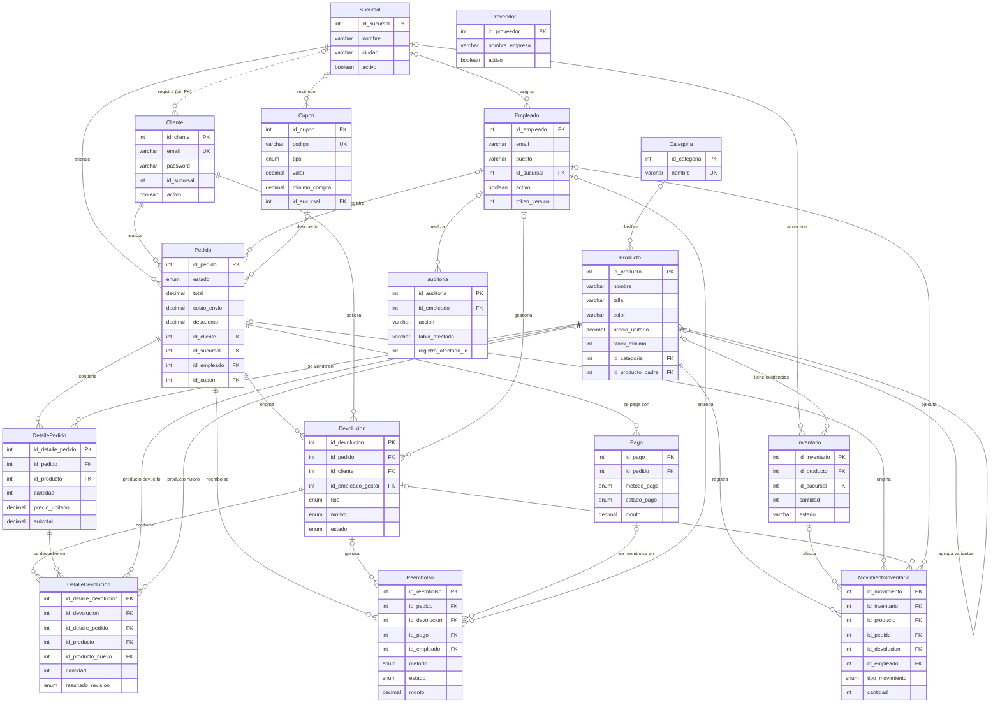
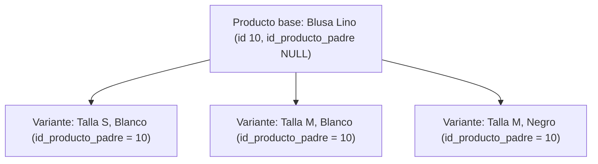
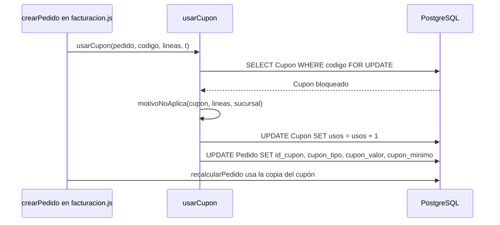

# Modelo de datos

Este documento describe la estructura de la base de datos PostgreSQL del sistema Distribuidora: las entidades definidas como modelos de Sequelize en `app/models/`, sus relaciones (declaradas en `app/models/index.js`), las tablas auxiliares que crean las migraciones de `app/migraciones/` sin tener un modelo asociado, los índices únicos y la fórmula con la que se calcula el total de un pedido. Toda la información se obtuvo del código fuente del proyecto.

## Contenido

- [1. Visión general](#1-visión-general)
- [2. Diagrama entidad-relación](#2-diagrama-entidad-relación)
- [3. Convenciones de tipos](#3-convenciones-de-tipos)
- [4. Tablas del modelo](#4-tablas-del-modelo)
  - [4.1 Sucursal](#41-sucursal)
  - [4.2 Cliente](#42-cliente)
  - [4.3 Empleado](#43-empleado)
  - [4.4 Proveedor](#44-proveedor)
  - [4.5 Categoria](#45-categoria)
  - [4.6 Producto](#46-producto)
  - [4.7 Inventario](#47-inventario)
  - [4.8 Pedido](#48-pedido)
  - [4.9 DetallePedido](#49-detallepedido)
  - [4.10 Pago](#410-pago)
  - [4.11 Devolucion](#411-devolucion)
  - [4.12 DetalleDevolucion](#412-detalledevolucion)
  - [4.13 MovimientoInventario](#413-movimientoinventario)
  - [4.14 auditoria](#414-auditoria)
  - [4.15 Reembolso](#415-reembolso)
  - [4.16 Cupon](#416-cupon)
- [5. Tablas creadas por migraciones sin modelo](#5-tablas-creadas-por-migraciones-sin-modelo)
- [6. Llaves foráneas y acciones referenciales](#6-llaves-foráneas-y-acciones-referenciales)
- [7. Índices únicos e índices adicionales](#7-índices-únicos-e-índices-adicionales)
- [8. Cálculo del total del pedido](#8-cálculo-del-total-del-pedido)
- [9. Copia del cupón en el pedido](#9-copia-del-cupón-en-el-pedido)
- [10. Evolución del esquema (migraciones)](#10-evolución-del-esquema-migraciones)

## 1. Visión general

La base de datos se organiza en cinco grupos funcionales:

| Grupo | Tablas | Propósito |
|---|---|---|
| Organización | `Sucursal`, `Empleado`, `Proveedor` | Tiendas físicas, personal del panel y catálogo de proveedores. |
| Catálogo e inventario | `Categoria`, `Producto`, `Inventario` | Tipos de prenda, prendas con sus variantes (talla/color) y existencias por sucursal. |
| Ventas | `Cliente`, `Pedido`, `DetallePedido`, `Pago`, `Cupon` | Clientas, pedidos de mostrador y de la tienda en línea, sus líneas, pagos y cupones de descuento. |
| Logística inversa | `Devolucion`, `DetalleDevolucion`, `Reembolso` | Devoluciones, cambios de talla o variante y devolución de dinero. |
| Trazabilidad y operación | `MovimientoInventario`, `auditoria`, `IntentoLimite`, `ErrorServidor`, `SequelizeMeta` | Historial de movimientos de stock, bitácora de acciones, límite de intentos, registro de errores y control de migraciones. |

El esquema no se sincroniza con `sync({ alter: true })`. Al arrancar, `server.js` invoca `prepararBase` (`app/utils/migrador.js`), que aplica con Umzug las migraciones pendientes bajo un candado de PostgreSQL (`pg_advisory_xact_lock`) y luego ejecuta el mantenimiento de datos. Los detalles de operación se describen en [Despliegue y operación](09-despliegue-y-operacion.md).

## 2. Diagrama entidad-relación

El diagrama muestra todas las entidades con sus llaves primarias (PK), llaves foráneas (FK) y los atributos más relevantes. La lista completa de columnas de cada tabla se encuentra en la [sección 4](#4-tablas-del-modelo). La relación entre `Cliente` y `Sucursal` se dibuja con línea punteada porque la columna existe, pero no hay una asociación declarada en `index.js` y, por lo tanto, tampoco una llave foránea.



`Proveedor` no tiene relaciones declaradas con otras tablas: funciona como un catálogo independiente de empresas proveedoras.

## 3. Convenciones de tipos

Las tablas de columnas de la sección 4 usan los tipos de Sequelize y su equivalente en PostgreSQL:

| Tipo en el modelo | Tipo en PostgreSQL | Observación |
|---|---|---|
| `INTEGER` | `integer` | Las llaves primarias usan `autoIncrement` (`serial`). |
| `STRING` | `varchar(255)` | Sin longitud explícita. |
| `STRING(n)` | `varchar(n)` | Longitud máxima `n`. |
| `TEXT` | `text` | Texto sin límite de longitud. |
| `DECIMAL(10, 2)` | `numeric(10,2)` | Montos en quetzales con dos decimales. |
| `BOOLEAN` | `boolean` | |
| `DATE` | `timestamp with time zone` | Fecha y hora. |
| `DATEONLY` | `date` | Solo fecha. |
| `ENUM(...)` | Tipo enumerado `enum_<Tabla>_<campo>` | Ejemplo: `enum_Pedido_estado`. Las migraciones solo agregan valores, nunca los eliminan. |

En las tablas, la columna "Nulo" indica si la columna admite `NULL`. Cuando el modelo no especifica `allowNull`, Sequelize la crea como anulable. El valor `NOW` como valor por defecto corresponde a la fecha y hora del momento de inserción.

La mayoría de los modelos declaran `timestamps: false`, por lo que no tienen las columnas `createdAt` y `updatedAt`. La única excepción es `auditoria`.

## 4. Tablas del modelo

### 4.1 Sucursal

Archivo: `app/models/sucursal.model.js`. Tabla: `Sucursal`. Representa cada tienda física de la distribuidora.

| Columna | Tipo | Nulo | Por defecto | Descripción |
|---|---|---|---|---|
| `id_sucursal` | INTEGER (PK, autoincremental) | No | | Identificador de la sucursal. |
| `nombre` | STRING(100) | No | | Nombre de la sucursal. |
| `direccion` | STRING(200) | No | | Dirección física. |
| `ciudad` | STRING(80) | No | | Ciudad. |
| `telefono` | STRING(20) | Sí | | Teléfono de contacto. |
| `activo` | BOOLEAN | No | `true` | Indica si la sucursal está en operación. |

### 4.2 Cliente

Archivo: `app/models/cliente.model.js`. Tabla: `Cliente`. Almacena tanto a las clientas registradas en mostrador como a las que tienen cuenta en la tienda en línea.

| Columna | Tipo | Nulo | Por defecto | Descripción |
|---|---|---|---|---|
| `id_cliente` | INTEGER (PK, autoincremental) | No | | Identificador de la clienta. |
| `nombre` | STRING(80) | No | | Nombre. |
| `apellido` | STRING(80) | No | | Apellido. |
| `telefono` | STRING(20) | Sí | | Teléfono. |
| `email` | STRING(120), único | Sí | | Correo electrónico. Único también sin distinguir mayúsculas (índice `cliente_email_lower_unico`). |
| `direccion` | STRING(200) | Sí | | Dirección de la clienta. |
| `fecha_registro` | DATEONLY | Sí | `NOW` | Fecha de registro. |
| `activo` | BOOLEAN | No | `true` | Indica si la clienta está activa. |
| `id_sucursal` | INTEGER | Sí | | Sucursal donde se registró en mostrador; `NULL` si se registró en la tienda en línea. Cada sucursal ve a las clientas que registró y a las que le han comprado. No tiene llave foránea declarada. |
| `password` | STRING | Sí | | Hash bcrypt de la contraseña de la tienda en línea. `NULL` indica una clienta de mostrador sin cuenta web. |
| `codigo_activacion` | STRING(64) | Sí | | Hash SHA-256 del código de un solo uso que entrega caja para que una clienta de mostrador active su cuenta web conservando su historial. |
| `codigo_activacion_expira` | DATE | Sí | | Vencimiento del código de activación. |
| `reset_token_hash` | STRING(64) | Sí | | Hash SHA-256 del enlace de un solo uso de "Olvidé mi contraseña". |
| `reset_expira` | DATE | Sí | | Vencimiento del enlace de restablecimiento. |
| `token_version` | INTEGER | No | `0` | Versión de sesión incluida en el token de la tienda. Aumenta al cambiar o restablecer la contraseña, lo que invalida las sesiones abiertas en otros dispositivos. |

**Alcances (scopes).** El `defaultScope` excluye `password`, `codigo_activacion`, `codigo_activacion_expira`, `reset_token_hash`, `reset_expira` y `token_version`, de modo que estos datos nunca aparecen en listados ni en consultas con `include`. El inicio de sesión usa el alcance `conPassword`, la activación de cuenta usa `conCodigo` y el restablecimiento de contraseña usa `conReset`. Cada uno incluye únicamente los campos que necesita.

### 4.3 Empleado

Archivo: `app/models/empleado.model.js`. Tabla: `Empleado` (`freezeTableName`). Personal que accede al panel.

| Columna | Tipo | Nulo | Por defecto | Descripción |
|---|---|---|---|---|
| `id_empleado` | INTEGER (PK, autoincremental) | No | | Identificador del empleado. |
| `nombre` | STRING | Sí | | Nombre. |
| `apellido` | STRING | Sí | | Apellido. |
| `puesto` | STRING | Sí | | Rol del empleado. Los valores válidos (`PUESTOS_VALIDOS` en `app/middlewares/authJwt.js`) son `DISTRITAL`, `ADMIN`, `CAJERO` y `BODEGUERO`. |
| `email` | STRING | Sí | | Correo de acceso. Único sin distinguir mayúsculas (índice `empleado_email_lower_unico`). |
| `password` | STRING | Sí | | Hash de la contraseña. |
| `id_sucursal` | INTEGER (FK a `Sucursal`) | Sí | | Sucursal asignada. Puede ser `NULL` (por ejemplo, un DISTRITAL trabaja con todas). |
| `activo` | BOOLEAN | No | `true` | Un empleado que deja la empresa se desactiva en lugar de borrarse, porque su identificador queda en pedidos, movimientos y auditoría. Desactivado no puede iniciar sesión. |
| `token_version` | INTEGER | No | `0` | Versión de las sesiones incluida en el JWT. Se incrementa al cambiar o restablecer la contraseña o al desactivar la cuenta, de modo que los tokens emitidos antes dejan de ser válidos. |

El puesto no es un ENUM en la base: se valida en la aplicación. Los permisos de cada puesto se describen en [Roles y permisos](03-roles-y-permisos.md).

### 4.4 Proveedor

Archivo: `app/models/proveedor.model.js`. Tabla: `Proveedor`.

| Columna | Tipo | Nulo | Por defecto | Descripción |
|---|---|---|---|---|
| `id_proveedor` | INTEGER (PK, autoincremental) | No | | Identificador del proveedor. |
| `nombre_empresa` | STRING(120) | No | | Razón o nombre comercial. |
| `nombre_contacto` | STRING(100) | Sí | | Persona de contacto. |
| `telefono` | STRING(20) | Sí | | Teléfono. |
| `email` | STRING(120) | Sí | | Correo. |
| `direccion` | STRING(200) | Sí | | Dirección. |
| `activo` | BOOLEAN | No | `true` | Indica si el proveedor está vigente. |

### 4.5 Categoria

Archivo: `app/models/categoria.model.js`. Tabla: `Categoria`. En el panel se presenta como "tipos de prenda".

| Columna | Tipo | Nulo | Por defecto | Descripción |
|---|---|---|---|---|
| `id_categoria` | INTEGER (PK, autoincremental) | No | | Identificador de la categoría. |
| `nombre` | STRING(60), único | No | | Nombre del tipo de prenda. Único también sin distinguir mayúsculas (índice `categoria_nombre_lower_unico`). |
| `descripcion` | STRING(200) | Sí | | Descripción. |

### 4.6 Producto

Archivo: `app/models/producto.model.js`. Tabla: `Producto`. Cada fila es una prenda concreta (una combinación de talla y color).

| Columna | Tipo | Nulo | Por defecto | Descripción |
|---|---|---|---|---|
| `id_producto` | INTEGER (PK, autoincremental) | No | | Identificador del producto. |
| `nombre` | STRING(120) | No | | Nombre de la prenda. |
| `descripcion` | STRING(255) | Sí | | Descripción. |
| `talla` | STRING(10) | Sí | | Talla de la variante. |
| `color` | STRING(40) | Sí | | Color de la variante. |
| `precio_unitario` | DECIMAL(10,2) | No | | Precio de venta con IVA incluido. |
| `stock_minimo` | INTEGER | No | `5` | Umbral del reporte de stock crítico (`GET /api/reportes/stock-critico`): se alerta cuando la suma de inventario `DISPONIBLE` del producto en una sucursal es igual o menor a este valor. |
| `activo` | BOOLEAN | No | `true` | Indica si el producto está a la venta. |
| `id_categoria` | INTEGER (FK a `Categoria`) | Sí | | Tipo de prenda. |
| `id_producto_padre` | INTEGER (FK a `Producto`) | Sí | | Agrupa las variantes de una misma prenda. `NULL` indica un producto base o que no pertenece a un grupo. |
| `imagen_url` | STRING(500) | Sí | | URL (http/https) de la foto que muestra la tienda en línea. |

**Variantes.** La relación reflexiva se declara con dos asociaciones: `Producto.belongsTo(Producto, { as: 'ProductoPadre' })` y `Producto.hasMany(Producto, { as: 'Variantes' })`, ambas sobre `id_producto_padre`. La raíz de un grupo es `id_producto_padre` si existe o, en caso contrario, el propio `id_producto` (función `raizDeGrupo` en `devolucion.controller.js`). Esta agrupación permite ofrecer un cambio de talla o de variante dentro de la misma prenda. El siguiente diagrama es un ejemplo ilustrativo con identificadores ficticios:



### 4.7 Inventario

Archivo: `app/models/inventario.model.js`. Tabla: `Inventario` (`freezeTableName`). Existencias de un producto en una sucursal, organizadas en filas (lotes) con un estado.

| Columna | Tipo | Nulo | Por defecto | Descripción |
|---|---|---|---|---|
| `id_inventario` | INTEGER (PK, autoincremental) | No | | Identificador de la fila de inventario. |
| `cantidad` | INTEGER | Sí | | Unidades en la fila. |
| `id_producto` | INTEGER (FK a `Producto`) | Sí | | Producto. |
| `id_sucursal` | INTEGER (FK a `Sucursal`) | Sí | | Sucursal donde están las unidades. |
| `lote` | STRING | Sí | | Identificador del lote. |
| `estado` | STRING | Sí | `'DISPONIBLE'` | Estado de las unidades. |

El campo `estado` es texto libre en la base, pero el código usa tres valores, que son también los únicos admitidos al ingresar stock desde el panel (`ESTADOS_INGRESO` en `inventario.controller.js`):

| Valor | Uso |
|---|---|
| `DISPONIBLE` | Unidades a la venta. Es el único estado que descuentan las ventas y que cuentan los reportes de stock. |
| `DANADA` | Unidades dañadas: ingresadas con ese estado o devueltas con revisión `DANADO`. |
| `DEFECTUOSA` | Unidades defectuosas: ingresadas con ese estado o devueltas con revisión `DEFECTUOSO`. |

Un mismo producto puede tener varias filas en una sucursal. Al reingresar unidades de una devolución, la función `reingresarAInventario` busca la fila con el mismo producto, sucursal y estado y le suma la cantidad; si no existe, la crea.

### 4.8 Pedido

Archivo: `app/models/pedido.model.js`. Tabla: `Pedido`. Representa tanto las ventas de mostrador como las compras de la tienda en línea.

| Columna | Tipo | Nulo | Por defecto | Descripción |
|---|---|---|---|---|
| `id_pedido` | INTEGER (PK, autoincremental) | No | | Identificador del pedido. |
| `fecha_pedido` | DATE | Sí | `NOW` | Fecha y hora de creación. |
| `estado` | ENUM | No | `'PENDIENTE'` | Estado del pedido (valores abajo). |
| `total` | DECIMAL(10,2) | No | `0` | Total a pagar. Lo calcula el sistema (ver [sección 8](#8-cálculo-del-total-del-pedido)); nunca se recibe del cliente. |
| `id_cliente` | INTEGER (FK a `Cliente`) | No | | Clienta del pedido. |
| `id_sucursal` | INTEGER (FK a `Sucursal`) | No | | Sucursal que atiende el pedido. |
| `id_empleado` | INTEGER (FK a `Empleado`) | Sí | | Empleado que registró la venta. `NULL` en los pedidos de la tienda en línea. |
| `direccion_entrega` | STRING(200) | Sí | | Dirección de despacho de un pedido en línea a domicilio. `NULL` en ventas de mostrador y en retiro en sucursal. |
| `fecha_entrega` | DATE | Sí | | Momento en que el pedido pasó a `ENTREGADO`. Desde allí corre el plazo para solicitar cambio o devolución (`HORAS_PLAZO_DEVOLUCION`, 24 horas por defecto). |
| `costo_envio` | DECIMAL(10,2) | No | `0` | Costo de envío a domicilio; `0` en retiro en sucursal y en mostrador. |
| `descuento` | DECIMAL(10,2) | No | `0` | Monto que descontó el cupón sobre las prendas. |
| `id_cupon` | INTEGER (FK a `Cupon`) | Sí | | Cupón aplicado. |
| `cupon_tipo` | STRING(12) | Sí | | Copia del tipo del cupón al momento de usarlo. |
| `cupon_valor` | DECIMAL(10,2) | Sí | | Copia del valor del cupón. |
| `cupon_minimo` | DECIMAL(10,2) | Sí | | Copia de la compra mínima del cupón. |

Valores del ENUM `estado`:

| Valor | Significado |
|---|---|
| `PENDIENTE` | Pedido creado y pendiente de pago. |
| `PROCESADO` | Pedido pagado: el pedido pasa automáticamente a este estado cuando los pagos completados cubren el total. |
| `ENVIADO` | Pedido despachado. |
| `ENTREGADO` | Pedido recibido por la clienta; se registra `fecha_entrega`. |
| `CANCELADO` | Pedido anulado; las unidades vuelven al inventario y se libera el uso del cupón. |

Las transiciones permitidas entre estados se describen en [Reglas de negocio](04-reglas-de-negocio.md).

### 4.9 DetallePedido

Archivo: `app/models/detalle_pedido.model.js`. Tabla: `DetallePedido`. Cada fila es una línea del pedido.

| Columna | Tipo | Nulo | Por defecto | Descripción |
|---|---|---|---|---|
| `id_detalle_pedido` | INTEGER (PK, autoincremental) | No | | Identificador de la línea. |
| `cantidad` | INTEGER | No | | Unidades. Validación: mínimo 1. |
| `precio_unitario` | DECIMAL(10,2) | No | | Precio de la prenda al momento de la venta. Validación: mínimo 0. |
| `subtotal` | DECIMAL(10,2) | No | | `cantidad × precio_unitario`, redondeado a dos decimales. |
| `id_pedido` | INTEGER (FK a `Pedido`) | No | | Pedido al que pertenece la línea. |
| `id_producto` | INTEGER (FK a `Producto`) | No | | Producto vendido. |

**Hooks del modelo.** El subtotal nunca se confía a quien envía la petición:

| Hook | Acción |
|---|---|
| `beforeValidate` | Calcula `subtotal = round(cantidad × precio_unitario × 100) / 100`. |
| `beforeUpdate` | Recalcula el subtotal y, si la actualización usa `fields`, agrega `subtotal` para que se guarde. |
| `afterCreate`, `afterDestroy` | Recalculan el total del pedido con `recalcularPedido`. |
| `afterUpdate` | Recalcula el total del pedido y, si la línea se movió a otro pedido, también el del pedido anterior. |
| `beforeBulkCreate`, `afterBulkCreate` | Calculan el subtotal de cada línea y recalculan una sola vez cada pedido afectado. |
| `beforeBulkDestroy`, `beforeBulkUpdate` | Activan `individualHooks` para que las operaciones masivas también actualicen el total. |

### 4.10 Pago

Archivo: `app/models/pago.model.js`. Tabla: `Pago`.

| Columna | Tipo | Nulo | Por defecto | Descripción |
|---|---|---|---|---|
| `id_pago` | INTEGER (PK, autoincremental) | No | | Identificador del pago. |
| `metodo_pago` | ENUM | No | | Medio de pago (valores abajo). |
| `monto` | DECIMAL(10,2) | No | | Monto pagado. |
| `fecha_pago` | DATE | Sí | `NOW` | Fecha y hora del pago. |
| `estado_pago` | ENUM | No | `'PENDIENTE'` | Estado del pago (valores abajo). |
| `id_transaccion_externa` | STRING(150) | Sí | | Identificador del pago en el proveedor externo (por ejemplo, Stripe). |
| `id_pedido` | INTEGER (FK a `Pedido`) | No | | Pedido pagado. |

| ENUM `metodo_pago` | Significado |
|---|---|
| `STRIPE` | Tarjeta en la tienda en línea, procesada por Stripe. |
| `PAYPAL` | Queda pendiente hasta que caja lo confirma. |
| `EFECTIVO` | Pago en efectivo en la tienda física; el pago nace `COMPLETADO`. |
| `TARJETA` | Terminal POS de la tienda física; el pago nace `COMPLETADO`. |

| ENUM `estado_pago` | Significado |
|---|---|
| `PENDIENTE` | Pago iniciado sin confirmar. |
| `COMPLETADO` | Pago confirmado. |
| `FALLIDO` | Pago rechazado o fallido. |
| `REEMBOLSADO` | Pago devuelto. |

### 4.11 Devolucion

Archivo: `app/models/devolucion.model.js`. Tabla: `Devolucion`. Solicitud de devolución o cambio sobre un pedido.

| Columna | Tipo | Nulo | Por defecto | Descripción |
|---|---|---|---|---|
| `id_devolucion` | INTEGER (PK, autoincremental) | No | | Identificador de la solicitud. |
| `id_pedido` | INTEGER (FK a `Pedido`) | No | | Pedido sobre el que se solicita. |
| `id_cliente` | INTEGER (FK a `Cliente`) | No | | Clienta que solicita. |
| `tipo` | ENUM | No | | Tipo de solicitud. |
| `motivo` | ENUM | No | | Motivo declarado. |
| `estado` | ENUM | No | `'SOLICITADA'` | Estado del proceso. |
| `observacion` | STRING(255) | Sí | | Comentario del gestor o de la clienta. |
| `id_empleado_gestor` | INTEGER (FK a `Empleado`) | Sí | | Empleado que gestiona la solicitud. |
| `fecha_solicitud` | DATE | Sí | `NOW` | Fecha de la solicitud. |
| `fecha_actualizacion` | DATE | Sí | | Última actualización de estado. |

| ENUM `tipo` | Significado |
|---|---|
| `DEVOLUCION` | Devolución de la prenda con reembolso. |
| `CAMBIO_TALLA` | Cambio por otra talla de la misma prenda. |
| `CAMBIO_VARIANTE` | Cambio por otra variante (por ejemplo, color) de la misma prenda. |

| ENUM `motivo` | Significado |
|---|---|
| `DEFECTUOSO` | La prenda presenta un defecto. |
| `TALLA_INCORRECTA` | La talla no corresponde. |
| `PRODUCTO_INCORRECTO` | Se entregó una prenda distinta. |
| `DANADO_ENVIO` | La prenda se dañó durante el envío. |
| `OTRO` | Otro motivo. |

| ENUM `estado` | Significado |
|---|---|
| `SOLICITADA` | Solicitud registrada. |
| `APROBADA` | Solicitud aceptada para recibir las prendas. |
| `RECHAZADA` | Solicitud denegada antes de recibir las prendas. |
| `RECIBIDA` | Prendas recibidas en la sucursal. |
| `EN_REVISION` | Prendas en inspección. |
| `ACEPTADA` | Revisión favorable. |
| `RECHAZADA_EN_REVISION` | Revisión desfavorable. |
| `REINTEGRADA` | Prendas reintegradas al inventario (cierre de una devolución). |
| `CAMBIADA` | Cambio de talla o variante completado. |

El diagrama de estados y las condiciones de cada transición están en [Reglas de negocio](04-reglas-de-negocio.md).

### 4.12 DetalleDevolucion

Archivo: `app/models/detalle_devolucion.model.js`. Tabla: `DetalleDevolucion`. Cada fila indica qué línea del pedido se devuelve o se cambia, y en qué cantidad.

| Columna | Tipo | Nulo | Por defecto | Descripción |
|---|---|---|---|---|
| `id_detalle_devolucion` | INTEGER (PK, autoincremental) | No | | Identificador. |
| `id_devolucion` | INTEGER (FK a `Devolucion`) | No | | Solicitud a la que pertenece. |
| `id_detalle_pedido` | INTEGER (FK a `DetallePedido`) | No | | Línea del pedido original. |
| `id_producto` | INTEGER (FK a `Producto`) | No | | Producto devuelto. |
| `cantidad` | INTEGER | No | | Unidades devueltas o cambiadas. |
| `id_producto_nuevo` | INTEGER (FK a `Producto`) | Sí | | Variante que se entrega a cambio; solo en `CAMBIO_TALLA` y `CAMBIO_VARIANTE`. |
| `precio_unitario_nuevo` | DECIMAL(10,2) | Sí | | Precio de la variante nueva cuando se pidió el cambio. La diferencia a reembolsar se calcula con este valor aunque después cambie el precio del catálogo. |
| `resultado_revision` | ENUM | No | `'PENDIENTE'` | Resultado de la inspección. |

| ENUM `resultado_revision` | Significado | Estado de inventario al reingresar |
|---|---|---|
| `PENDIENTE` | Sin revisar. | |
| `BUEN_ESTADO` | Prenda en buen estado. | `DISPONIBLE` |
| `DANADO` | Prenda dañada. | `DANADA` |
| `DEFECTUOSO` | Prenda con defecto de fábrica. | `DEFECTUOSA` |

El modelo declara dos asociaciones con `Producto`: una por `id_producto` y otra por `id_producto_nuevo` (alias `ProductoNuevo` en el detalle y `DetallesComoProductoNuevo` en el producto).

### 4.13 MovimientoInventario

Archivo: `app/models/movimiento_inventario.model.js`. Tabla: `MovimientoInventario`. Historial inmutable de cada entrada y salida de stock: solo se crean registros y el controlador no expone operaciones de actualización ni eliminación.

| Columna | Tipo | Nulo | Por defecto | Descripción |
|---|---|---|---|---|
| `id_movimiento` | INTEGER (PK, autoincremental) | No | | Identificador del movimiento. |
| `id_inventario` | INTEGER (FK a `Inventario`) | Sí | | Fila de inventario afectada. |
| `id_producto` | INTEGER (FK a `Producto`) | No | | Producto movido. |
| `id_pedido` | INTEGER (FK a `Pedido`) | Sí | | Pedido que originó el movimiento. |
| `id_devolucion` | INTEGER (FK a `Devolucion`) | Sí | | Devolución que originó el movimiento. |
| `id_empleado` | INTEGER (FK a `Empleado`) | Sí | | Empleado responsable. `NULL` cuando lo origina la propia clienta (por ejemplo, al solicitar una devolución) o el sistema. |
| `tipo_movimiento` | ENUM | No | | Tipo de movimiento (valores abajo). |
| `cantidad` | INTEGER | No | | Unidades movidas. |
| `estado_anterior` | STRING(30) | Sí | | Estado de las unidades antes del movimiento. |
| `estado_nuevo` | STRING(30) | Sí | | Estado de las unidades después del movimiento. |
| `observacion` | STRING(255) | Sí | | Comentario. |
| `fecha_movimiento` | DATE | Sí | `NOW` | Fecha y hora del movimiento. |

| ENUM `tipo_movimiento` | Significado |
|---|---|
| `VENTA` | Salida de stock por una venta. |
| `DEVOLUCION_SOLICITADA` | Registro de la solicitud de devolución. |
| `DEVOLUCION_RECIBIDA` | Recepción de las prendas devueltas. |
| `EN_REVISION` | Revisión de una prenda devuelta con resultado `BUEN_ESTADO`. |
| `REINTEGRACION` | Reingreso de unidades al inventario tras la revisión. |
| `CAMBIO_SALIDA` | Reingreso al inventario de la variante original que la clienta devuelve en un cambio, con el estado que corresponde a su revisión. |
| `CAMBIO_ENTRADA` | Descuento del stock `DISPONIBLE` de la variante nueva que se entrega a la clienta en un cambio. |
| `PRODUCTO_DANADO` | Revisión de una prenda devuelta con resultado `DANADO`. |
| `PRODUCTO_DEFECTUOSO` | Revisión de una prenda devuelta con resultado `DEFECTUOSO`. |
| `CANCELACION` | Unidades devueltas a stock al quitar un producto de un pedido `PENDIENTE` o al cancelarlo. |
| `AJUSTE_SALIDA` | Baja manual de stock desde el panel (Sucursales, ajuste): conteo, pérdida, daño u otra causa. |

### 4.14 auditoria

Archivo: `app/models/auditoria.model.js`. Tabla: `auditoria` (en minúsculas). Bitácora genérica de acciones administrativas. Es el único modelo con las columnas automáticas `createdAt` y `updatedAt`.

| Columna | Tipo | Nulo | Por defecto | Descripción |
|---|---|---|---|---|
| `id_auditoria` | INTEGER (PK, autoincremental) | No | | Identificador del registro. |
| `accion` | STRING | No | | Código de la acción, por ejemplo `CLIENTE_REGISTRADO`, `PEDIDO_ESTADO_ACTUALIZADO`, `CLIENTE_CUENTA_WEB_ACTIVADA` o `EMPLEADO_PROMOVIDO_DISTRITAL`. |
| `tabla_afectada` | STRING | No | | Tabla sobre la que se actuó (por ejemplo, `Pedido`, `Cliente`, `Empleado`). |
| `registro_afectado_id` | INTEGER | Sí | | Identificador del registro afectado. |
| `detalles` | TEXT | Sí | | Descripción legible de la acción. |
| `id_empleado` | INTEGER (FK a `Empleado`) | Sí | | Empleado que realizó la acción; `NULL` si la realizó una clienta o el sistema. Columna agregada por la asociación `Empleado.hasMany(auditoria)`. |
| `createdAt` | DATE | No | Automático | Fecha y hora de creación. |
| `updatedAt` | DATE | No | Automático | Fecha y hora de última modificación. |

El mantenimiento de arranque (`app/utils/mantenimiento.js`) consulta esta tabla para completar datos antiguos: la sucursal de clientas registradas en mostrador (acción `CLIENTE_REGISTRADO`) y la `fecha_entrega` de pedidos entregados (acción `PEDIDO_ESTADO_ACTUALIZADO`).

### 4.15 Reembolso

Archivo: `app/models/reembolso.model.js`. Tabla: `Reembolso`. Dinero que se devuelve a la clienta por una devolución o por la diferencia de un cambio hacia una variante más barata. Con tarjeta en línea (`STRIPE`) el reembolso se procesa automáticamente en Stripe; con `EFECTIVO`, `TARJETA` (POS) o `PAYPAL` queda `PENDIENTE` hasta que caja lo entrega y lo confirma.

| Columna | Tipo | Nulo | Por defecto | Descripción |
|---|---|---|---|---|
| `id_reembolso` | INTEGER (PK, autoincremental) | No | | Identificador del reembolso. |
| `id_devolucion` | INTEGER (FK a `Devolucion`) | Sí | | Devolución que lo origina. |
| `id_pedido` | INTEGER (FK a `Pedido`) | No | | Pedido reembolsado. |
| `id_pago` | INTEGER (FK a `Pago`) | Sí | | Pago de Stripe sobre el que se hace el reembolso (solo método `STRIPE`). |
| `metodo` | ENUM | No | | Medio de devolución del dinero. |
| `monto` | DECIMAL(10,2) | No | | Monto a devolver. |
| `estado` | ENUM | No | `'PENDIENTE'` | Estado del reembolso. |
| `id_transaccion_externa` | STRING(150) | Sí | | Identificador del reembolso en Stripe (`re_...`) o referencia del comprobante en caja. |
| `id_empleado` | INTEGER (FK a `Empleado`) | Sí | | Empleado que lo entregó en caja o que lo reintentó en Stripe. |
| `observacion` | STRING(255) | Sí | | Comentario. |
| `procesando_desde` | DATE | Sí | | Reserva mientras se comunica con Stripe: impide que dos reintentos simultáneos procesen el mismo reembolso. Una reserva de más de 2 minutos se considera abandonada. |
| `fecha_creacion` | DATE | No | `NOW` | Fecha de creación. |
| `fecha_completado` | DATE | Sí | | Fecha en que se completó. |

| ENUM `metodo` | Significado |
|---|---|
| `STRIPE` | Reembolso automático a la tarjeta usada en la tienda en línea. |
| `EFECTIVO` | Entrega en efectivo en caja. |
| `TARJETA` | Devolución a través de la terminal POS. |
| `PAYPAL` | Devolución por PayPal, confirmada por caja. |

| ENUM `estado` | Significado |
|---|---|
| `PENDIENTE` | Por entregar o por procesar. |
| `COMPLETADO` | Dinero devuelto. |
| `FALLIDO` | El procesamiento falló; puede reintentarse. |

### 4.16 Cupon

Archivo: `app/models/cupon.model.js`. Tabla: `Cupon` (la agrega la migración `0004` a las bases existentes; en una base nueva la crea la línea base `0001`). Cupón de descuento creado por el DISTRITAL; la clienta lo escribe al comprar en la tienda y caja lo aplica en una venta de mostrador. El código se guarda en mayúsculas y debe cumplir la expresión `^[A-Z0-9_-]{3,30}$` (`app/utils/cupones.js`).

| Columna | Tipo | Nulo | Por defecto | Descripción |
|---|---|---|---|---|
| `id_cupon` | INTEGER (PK, autoincremental) | No | | Identificador del cupón. |
| `codigo` | STRING(30), único | No | | Código que escribe la clienta. Único también sin distinguir mayúsculas (índice `cupon_codigo_lower_unico`). |
| `descripcion` | STRING(150) | Sí | | Descripción visible. |
| `tipo` | ENUM | No | | `PORCENTAJE` o `MONTO`. |
| `valor` | DECIMAL(10,2) | No | | Con `PORCENTAJE`, porcentaje mayor que 0 y hasta 100; con `MONTO`, quetzales de descuento. Admite como máximo dos decimales (`cupon.controller.js`). |
| `minimo_compra` | DECIMAL(10,2) | No | `0` | Suma mínima de prendas para que el cupón aplique. |
| `desde` | DATEONLY | Sí | | Primer día de vigencia (hora de Guatemala, incluido). `NULL` = sin límite. |
| `hasta` | DATEONLY | Sí | | Último día de vigencia (incluido). `NULL` = sin límite. |
| `usos_maximos` | INTEGER | Sí | | Usos permitidos en total. `NULL` = ilimitado. |
| `usos` | INTEGER | No | `0` | Usos realizados (pedidos no cancelados). Se incrementa al crear el pedido y se reduce al cancelarlo. |
| `id_sucursal` | INTEGER (FK a `Sucursal`) | Sí | | Restringe el cupón a una sucursal. `NULL` = todas. |
| `activo` | BOOLEAN | No | `true` | Permite desactivar el cupón. |
| `fecha_creacion` | DATE | No | `NOW` | Fecha de creación. |

| ENUM `tipo` | Significado |
|---|---|
| `PORCENTAJE` | Descuento proporcional a la suma de prendas. |
| `MONTO` | Descuento fijo en quetzales, sin superar la suma de prendas. |

## 5. Tablas creadas por migraciones sin modelo

Estas tablas no tienen un modelo en `app/models/`; se crean y consultan con SQL directo.

### 5.1 SequelizeMeta

La crea Umzug (`SequelizeStorage`, configurado en `app/utils/migrador.js`) para registrar qué migraciones ya se aplicaron. Cada archivo de `app/migraciones/` se aplica una sola vez.

| Columna | Tipo | Nulo | Por defecto | Descripción |
|---|---|---|---|---|
| `name` | varchar(255) (PK) | No | | Nombre del archivo de migración aplicado, por ejemplo `0001-esquema-base.js`. |

### 5.2 IntentoLimite (migración 0002)

Contadores del límite de intentos (inicio de sesión, registro, "Olvidé mi contraseña", entre otros). Se guardan en la base para que sobrevivan a un reinicio y se compartan entre varias instancias del servidor. La clave es un hash SHA-256 de la IP y la ruta, de modo que la IP no se almacena en claro.

| Columna | Tipo | Nulo | Por defecto | Descripción |
|---|---|---|---|---|
| `clave` | varchar(64) (PK) | No | | Hash SHA-256 de IP + ruta. |
| `n` | integer | No | | Número de intentos en la ventana actual. |
| `desde` | timestamptz | No | | Inicio de la ventana de conteo. |

Índice: `intento_limite_desde` sobre `desde`.

### 5.3 ErrorServidor (migración 0003)

Registro de errores del servidor (respuestas 5xx y excepciones no controladas) que se muestra en el panel "Estado del sistema". Nunca se guarda el cuerpo de la petición, porque puede contener contraseñas.

| Columna | Tipo | Nulo | Por defecto | Descripción |
|---|---|---|---|---|
| `id` | serial (PK) | No | Secuencia | Identificador del error. |
| `fecha` | timestamptz | No | `now()` | Fecha y hora del error. |
| `request_id` | varchar(36) | Sí | | Identificador de la petición. |
| `metodo` | varchar(10) | Sí | | Método HTTP. |
| `ruta` | varchar(300) | Sí | | Ruta solicitada. |
| `estado` | integer | Sí | | Código de estado HTTP. |
| `mensaje` | text | Sí | | Mensaje del error. |
| `pila` | text | Sí | | Pila de llamadas. |
| `usuario` | varchar(60) | Sí | | Usuario asociado a la petición, si lo hay. |

Índice: `error_servidor_fecha` sobre `fecha DESC`.

## 6. Llaves foráneas y acciones referenciales

Las llaves foráneas las genera Sequelize a partir de las asociaciones de `app/models/index.js` cuando la migración base crea cada tabla (`modelo.sync()`). Todas usan `ON UPDATE CASCADE`. La acción `ON DELETE` la asigna Sequelize según cómo declara el modelo la columna: `SET NULL` cuando el modelo indica `allowNull: true` (o cuando la columna la agrega la propia asociación, como `auditoria.id_empleado`) y `CASCADE` cuando indica `allowNull: false` o no especifica `allowNull`. Por esta razón `Producto.id_categoria`, `Inventario.id_producto`, `Inventario.id_sucursal` y `Pedido.id_empleado` usan `CASCADE` aunque admitan `NULL`:

| Tabla.columna | Referencia | ON DELETE |
|---|---|---|
| `Empleado.id_sucursal` | `Sucursal` | SET NULL |
| `Producto.id_categoria` | `Categoria` | CASCADE |
| `Producto.id_producto_padre` | `Producto` | SET NULL |
| `Inventario.id_producto` | `Producto` | CASCADE |
| `Inventario.id_sucursal` | `Sucursal` | CASCADE |
| `Cupon.id_sucursal` | `Sucursal` | SET NULL |
| `Pedido.id_cliente` | `Cliente` | CASCADE |
| `Pedido.id_sucursal` | `Sucursal` | CASCADE |
| `Pedido.id_empleado` | `Empleado` | CASCADE |
| `Pedido.id_cupon` | `Cupon` | SET NULL |
| `DetallePedido.id_pedido` | `Pedido` | CASCADE |
| `DetallePedido.id_producto` | `Producto` | CASCADE |
| `Pago.id_pedido` | `Pedido` | CASCADE |
| `Devolucion.id_pedido` | `Pedido` | CASCADE |
| `Devolucion.id_cliente` | `Cliente` | CASCADE |
| `Devolucion.id_empleado_gestor` | `Empleado` | SET NULL |
| `DetalleDevolucion.id_devolucion` | `Devolucion` | CASCADE |
| `DetalleDevolucion.id_detalle_pedido` | `DetallePedido` | CASCADE |
| `DetalleDevolucion.id_producto` | `Producto` | CASCADE |
| `DetalleDevolucion.id_producto_nuevo` | `Producto` | SET NULL |
| `MovimientoInventario.id_inventario` | `Inventario` | SET NULL |
| `MovimientoInventario.id_producto` | `Producto` | CASCADE |
| `MovimientoInventario.id_pedido` | `Pedido` | SET NULL |
| `MovimientoInventario.id_devolucion` | `Devolucion` | SET NULL |
| `MovimientoInventario.id_empleado` | `Empleado` | SET NULL |
| `auditoria.id_empleado` | `Empleado` | SET NULL |
| `Reembolso.id_devolucion` | `Devolucion` | SET NULL |
| `Reembolso.id_pedido` | `Pedido` | CASCADE |
| `Reembolso.id_pago` | `Pago` | SET NULL |
| `Reembolso.id_empleado` | `Empleado` | SET NULL |

En la práctica, la aplicación no elimina empleados, sucursales, productos ni clientas: los desactiva con su campo `activo`, de modo que el historial de pedidos, movimientos y auditoría se conserva. `Cliente.id_sucursal` no tiene llave foránea porque no existe una asociación declarada para esa columna.

## 7. Índices únicos e índices adicionales

Además de las restricciones `UNIQUE` declaradas en los modelos (`Categoria.nombre`, `Cliente.email` y `Cupon.codigo`), las migraciones crean índices únicos sobre `lower(...)` para que no existan dos valores que solo se diferencien en mayúsculas y minúsculas (por ejemplo, `Ana@correo.com` y `ana@correo.com`).

| Índice | Tabla | Expresión | Migración | Propósito |
|---|---|---|---|---|
| `empleado_email_lower_unico` | `Empleado` | `lower(email)` | 0001 | Correos de empleados únicos sin distinguir mayúsculas. |
| `categoria_nombre_lower_unico` | `Categoria` | `lower(nombre)` | 0001 | Nombres de tipos de prenda únicos sin distinguir mayúsculas. |
| `cliente_email_lower_unico` | `Cliente` | `lower(email)` | 0001 | Correos de clientas únicos sin distinguir mayúsculas. |
| `cupon_codigo_lower_unico` | `Cupon` | `lower(codigo)` | 0004 | Códigos de cupón únicos sin distinguir mayúsculas. |
| `intento_limite_desde` | `IntentoLimite` | `desde` | 0002 | Índice no único para depurar contadores vencidos. |
| `error_servidor_fecha` | `ErrorServidor` | `fecha DESC` | 0003 | Índice no único para listar los errores más recientes. |

Todos se crean con `CREATE ... INDEX IF NOT EXISTS`. Si la base ya contiene valores repetidos, la migración 0001 no puede crear el índice correspondiente: muestra una advertencia y el sistema continúa, ya que la aplicación también valida los duplicados sin distinguir mayúsculas antes de guardar.

## 8. Cálculo del total del pedido

El total de un pedido se calcula en un único lugar, la función `recalcularPedido` de `app/utils/totales.js`, que utilizan los hooks de `DetallePedido` y la creación de pedidos. Las reglas de precio auxiliares están en `app/utils/precios.js`.

**Fórmula:**

```text
lineas     = suma de DetallePedido.subtotal del pedido
descuento  = descuentoDeCupon(copia del cupón del pedido, lineas)
envio      = 0                                   si lineas <= 0
           = costoEnvio(lineas - descuento)      si es pedido en línea a domicilio
           = Pedido.costo_envio (sin cambios)    en otro caso
total      = max(0, lineas - descuento) + envio
```

Todos los montos se redondean a dos decimales. La función guarda `total`, `descuento` y `costo_envio` en el pedido.

**Descuento del cupón (`descuentoDeCupon`).** Es 0 si no hay cupón, si la suma de líneas es 0 o si no alcanza `cupon_minimo`. Con `PORCENTAJE` vale `lineas × valor / 100`; con `MONTO` vale `valor`. En ambos casos se limita al rango entre 0 y la suma de líneas, por lo que el descuento nunca supera el valor de las prendas.

**Envío (`costoEnvio`).** Un pedido se considera "en línea a domicilio" cuando `id_empleado` es `NULL` y tiene `direccion_entrega`. En ese caso el envío se recalcula cada vez que cambian las líneas, porque agregar o quitar prendas puede alcanzar el umbral de envío gratis o dejar de alcanzarlo. La comparación con el umbral se hace en centavos para evitar errores de coma flotante. Las ventas de mostrador y los retiros en sucursal no pagan envío.

| Variable de entorno | Valor por defecto | Uso |
|---|---|---|
| `ENVIO_COSTO` | `25` | Costo del envío a domicilio, en quetzales. |
| `ENVIO_GRATIS_DESDE` | `300` | Monto de prendas (después del descuento) desde el cual el envío es gratis; `0` significa que nunca es gratis. |
| `IVA_PORCENTAJE` | `12` | Porcentaje de IVA que se desglosa del total. |

**IVA.** Los precios del catálogo ya incluyen IVA. El sistema no lo suma: lo desglosa a partir del total con `desgloseIva`, donde `base_imponible = total / (1 + IVA/100)` e `iva = total − base_imponible`.

**Ejemplo.** Una compra en línea con retiro en sucursal de 2 unidades de una blusa de Q100.00, con un cupón `PORCENTAJE` del 10 %:

| Concepto | Cálculo | Monto |
|---|---|---|
| Suma de líneas | 2 × 100.00 | Q200.00 |
| Descuento | 200.00 × 10 / 100 | Q20.00 |
| Envío | Retiro en sucursal | Q0.00 |
| Total | max(0, 200.00 − 20.00) + 0.00 | Q180.00 |
| IVA incluido (12 %) | 180.00 − 180.00 / 1.12 | Q19.29 |


*Pantalla "Finalizar compra" de la tienda en línea: subtotal de Q200.00, descuento de Q20.00 del cupón BIENVENIDA (10 %), envío gratis por retiro en sucursal, total de Q180.00 e IVA incluido de Q19.29.*

## 9. Copia del cupón en el pedido

Cuando un pedido usa un cupón, la función `crearPedido` (`app/utils/facturacion.js`) guarda primero las líneas y luego invoca `usarCupon` (`app/utils/cupones.js`), que realiza, dentro de la transacción de creación del pedido, los siguientes pasos:

1. Bloquea la fila del cupón (`SELECT ... FOR UPDATE`) para que dos compras simultáneas no superen el límite de usos.
2. Valida que el cupón exista, esté activo, esté vigente según la fecha de Guatemala, tenga usos disponibles, corresponda a la sucursal del pedido y que la suma de prendas alcance la compra mínima.
3. Incrementa `Cupon.usos` en 1.
4. Copia en el pedido `id_cupon`, `cupon_tipo` (desde `tipo`), `cupon_valor` (desde `valor`) y `cupon_minimo` (desde `minimo_compra`).



`recalcularPedido` utiliza exclusivamente la copia guardada en el pedido (`cupon_tipo`, `cupon_valor`, `cupon_minimo`) y no la fila actual de `Cupon`. Por ello, si el DISTRITAL edita el valor o la compra mínima de un cupón después de usado, los pedidos ya creados conservan su precio. La copia solo se usa si el pedido tiene `id_cupon` y `cupon_tipo`.

Al cancelar un pedido con cupón, `liberarCupon` devuelve el uso con `usos = GREATEST(usos - 1, 0)`. Para no revelar qué códigos existen, un cupón inexistente, inactivo, fuera de vigencia, agotado o de otra sucursal recibe el mismo mensaje ("Ese cupón no es válido para esta compra."); solo la falta de la compra mínima se explica con el monto requerido.

La migración `0005-cupon-en-pedido.js` agregó las tres columnas de copia y rellenó los pedidos que ya tenían cupón con los datos vigentes en ese momento.

## 10. Evolución del esquema (migraciones)

Las migraciones están en `app/migraciones/`, se ejecutan en orden por nombre y deben poder ejecutarse dos veces sin fallar. Las herramientas de `app/utils/esquema.js` solo agregan tablas, columnas y valores de ENUM; nunca eliminan ni cambian el tipo de una columna existente.

| Migración | Cambios |
|---|---|
| `0001-esquema-base.js` | Línea base: crea las tablas, columnas y valores de ENUM que falten a partir de los modelos, y los índices únicos `lower()` de `Empleado.email`, `Categoria.nombre` y `Cliente.email`. No se puede deshacer. |
| `0002-intentos-limite.js` | Crea la tabla `IntentoLimite` y su índice. |
| `0003-errores-servidor.js` | Crea la tabla `ErrorServidor` y su índice. |
| `0004-envio-cupones.js` | Crea la tabla `Cupon`, agrega a `Pedido` las columnas `costo_envio`, `descuento` e `id_cupon`, y crea el índice `cupon_codigo_lower_unico`. |
| `0005-cupon-en-pedido.js` | Agrega a `Pedido` las columnas `cupon_tipo`, `cupon_valor` y `cupon_minimo` y las rellena en los pedidos existentes con cupón. |

Después de aplicar las migraciones, el servidor compara los modelos con la base (`diferencias`) y emite una advertencia si algún modelo tiene columnas o valores de ENUM que la base no tiene, lo que indica que falta escribir una migración. El procedimiento de ejecución, respaldo y restauración se describe en [Despliegue y operación](09-despliegue-y-operacion.md).
