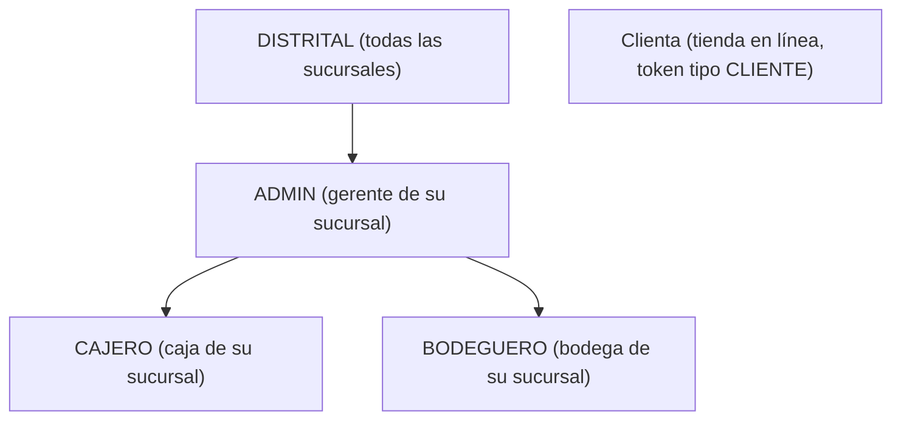
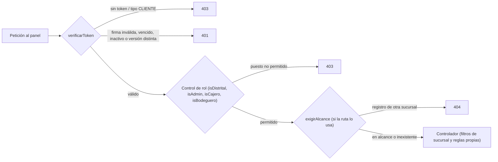
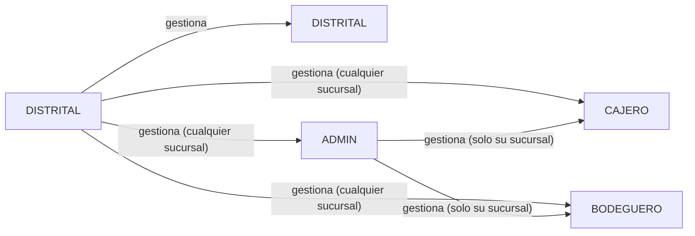
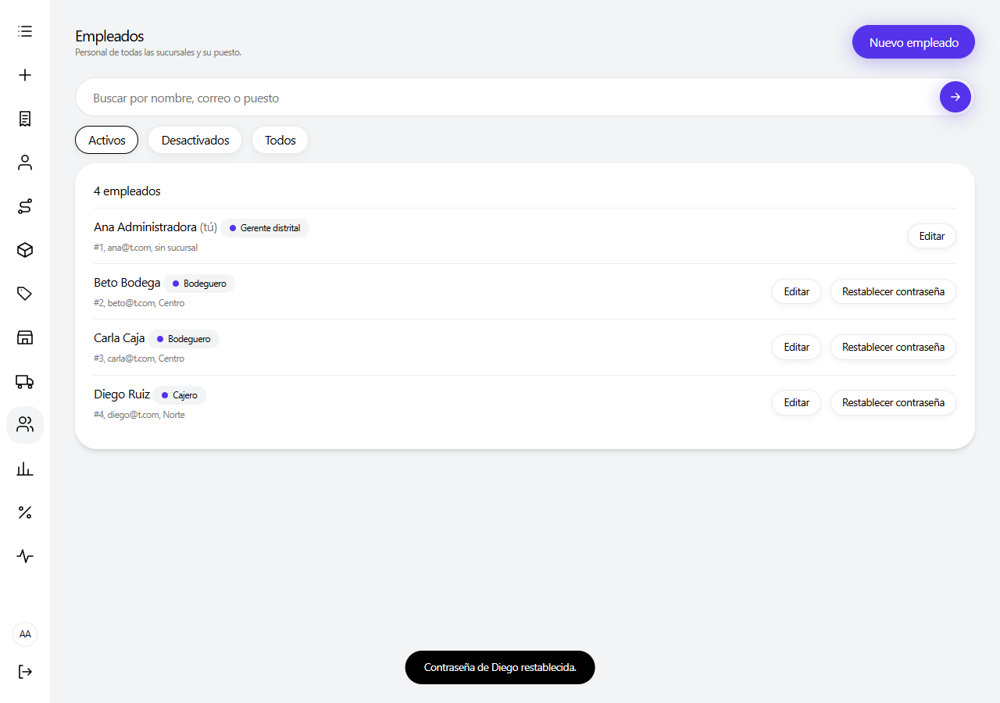
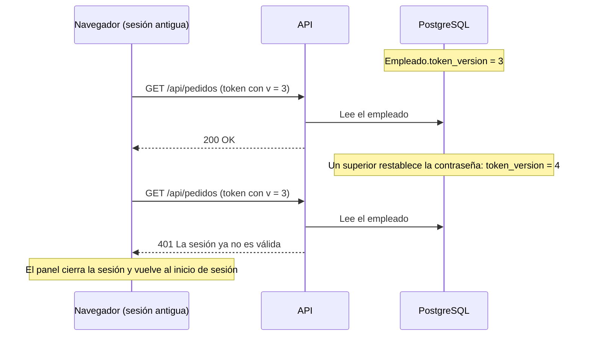

# Roles y permisos

Este documento describe el modelo de autorización del sistema Distribuidora: los puestos de empleado que reconoce la API, la cuenta de la clienta de la tienda en línea, el alcance de datos por sucursal, las reglas para gestionar empleados, la matriz completa de permisos por endpoint, el menú del panel según el rol y el mecanismo de invalidación de sesiones. Todo lo expuesto se obtuvo de `app/middlewares/authJwt.js`, `app/utils/alcance.js`, `app/utils/empleados.js`, los archivos `app/routes/*.js`, los controladores que aplican reglas adicionales y `frontend/src/utils/permisos.js`.

## Contenido

1. [Principios generales](#1-principios-generales)
2. [Roles del sistema](#2-roles-del-sistema)
3. [Autenticación y controles de rol](#3-autenticación-y-controles-de-rol)
4. [Alcance por sucursal](#4-alcance-por-sucursal)
5. [Gestión de empleados](#5-gestión-de-empleados)
6. [Matriz de permisos](#6-matriz-de-permisos)
7. [Menú del panel por rol](#7-menú-del-panel-por-rol)
8. [Invalidación de sesiones (token_version)](#8-invalidación-de-sesiones-token_version)
9. [Códigos de respuesta de autorización](#9-códigos-de-respuesta-de-autorización)

---

## 1. Principios generales

- **El servidor decide.** El panel oculta opciones según el rol (`frontend/src/utils/permisos.js` indica expresamente: "el servidor siempre valida"), pero cada endpoint aplica sus propios middlewares de autenticación, de rol y de alcance.
- **Dos tipos de token separados.** El token de empleado (panel) y el token de clienta (tienda) se firman con el mismo secreto `JWT_SECRET`, pero el contenido los distingue: un token de clienta lleva `tipo: "CLIENTE"` y es rechazado en las rutas de empleados, y un token de empleado es rechazado en las rutas de la tienda.
- **El puesto se lee de la base de datos en cada petición.** Los controles de rol no confían en el contenido del token: consultan el registro `Empleado` vigente, de modo que un cambio de puesto o una desactivación se aplican de inmediato.
- **Jerarquía de puestos.** Los controles se construyen de forma acumulativa: el DISTRITAL satisface cualquier control de rol; el ADMIN satisface los de ADMIN, CAJERO y BODEGUERO; CAJERO y BODEGUERO solo el suyo.
- **Fuera de alcance equivale a inexistente.** Un registro de otra sucursal responde `404`, igual que uno que no existe, para no revelar información de otras sucursales.

## 2. Roles del sistema

Los puestos válidos se definen en `PUESTOS_VALIDOS = ["DISTRITAL", "ADMIN", "CAJERO", "BODEGUERO"]` (`app/middlewares/authJwt.js`). El valor se normaliza a mayúsculas y sin espacios antes de compararlo.

| Rol | Descripción | Sucursal | Responsabilidades principales |
|---|---|---|---|
| **DISTRITAL** | Gerente distrital. Está por encima de todos los demás puestos. | No tiene sucursal (`id_sucursal = null`). Ve y opera todas. | Catálogo único (prendas, tipos de prenda y fotos), sucursales, promociones (cupones), auditoría, estado del sistema y gestión de cualquier empleado. Puede realizar además todo lo que hacen los demás puestos, en cualquier sucursal. |
| **ADMIN** | Gerente de una sucursal. | Obligatoria. Solo opera la suya. | Aprobar o rechazar devoluciones, gestionar cajeros y bodegueros de su sucursal, reportes de ventas de su sucursal, activar o desactivar clientes, eliminar proveedores. Además puede realizar las tareas de caja y de bodega. |
| **CAJERO** | Personal de caja. | Obligatoria. | Ventas de mostrador, cobros, anulación y devolución de pagos, cancelación de pedidos pendientes, alta y edición de clientes, códigos de activación web, registro de solicitudes de devolución, entrega de reembolsos. |
| **BODEGUERO** | Personal de bodega. | Obligatoria. | Ingreso y bajas de stock, despacho y entrega de pedidos, recepción, revisión, reintegro o cambio en devoluciones, alta y edición de proveedores. |
| **Clienta** | Usuaria de la tienda en línea. No es un empleado. | Ninguna (su ficha puede registrar la sucursal donde se dio de alta en mostrador). | Gestionar su perfil y contraseña, comprar, pagar con tarjeta, cancelar sus pedidos pendientes y solicitar devoluciones o cambios de sus propios pedidos. |

La flecha indica que el puesto superior satisface los controles de rol del inferior. La clienta queda fuera de esa jerarquía: su token solo es válido en `/api/tienda`.

## 3. Autenticación y controles de rol

### 3.1 Token de empleado (`verificarToken`)

El token se envía en la cabecera `Authorization: Bearer <token>` y se emite en `POST /api/auth/login` mediante `firmarToken` (`app/utils/empleados.js`). Su contenido es `{ id, id_sucursal, v }` y vence a las 24 horas (`expiresIn: 86400`).

El middleware `verificarToken` realiza, en orden:

1. Sin cabecera `Authorization`: responde `403`.
2. Firma inválida o token vencido: responde `401`.
3. Token con `tipo: "CLIENTE"` o sin `id`: responde `403` ("Este token no pertenece a un empleado").
4. Empleado inexistente o con `activo = false`: responde `401`.
5. Versión del token (`v`) distinta de `Empleado.token_version`: responde `401` ("La sesión ya no es válida").
6. Si todo es correcto, deja el empleado en `req.empleado` y su id en `req.empleadoId`.

### 3.2 Token de clienta (`verificarCliente`)

Se emite en `POST /api/tienda/auth/login` (y también al registrarse, al activar la cuenta, al restablecer la contraseña y al cambiarla desde el perfil). Su contenido es `{ id_cliente, tipo: "CLIENTE", v }`, con vigencia de 24 horas. El middleware rechaza con `403` cualquier token que no sea de tipo `CLIENTE`, con `401` una cuenta inexistente o desactivada y con `401` una versión de sesión desactualizada. Deja el id en `req.clienteId`.

Las rutas de la tienda solo devuelven datos de la propia clienta: un pedido o una devolución de otra clienta responde `404` ("No se encontró el pedido." o "No se encontró la devolución."), sin revelar su existencia.

### 3.3 Controles de rol

Los controles se generan con la función `exigirPuesto(puestos, mensaje)`, que lee el puesto del empleado ya cargado y responde `403` si no está en la lista.

| Middleware | Puestos aceptados | Uso típico |
|---|---|---|
| `isDistrital` | DISTRITAL | Catálogo, sucursales, cupones, auditoría, estado del sistema, fotos. |
| `isAdmin` | ADMIN, DISTRITAL | Empleados, aprobación de devoluciones, tablero de ventas, eliminar proveedores. |
| `isCajero` | CAJERO, ADMIN, DISTRITAL | Ventas, pagos, clientes, solicitudes de devolución, reembolsos. |
| `isBodeguero` | BODEGUERO, ADMIN, DISTRITAL | Inventario, proveedores, etapas físicas de las devoluciones. |
| `permitirRegistro` | Sin token si la tabla `Empleado` está vacía; en otro caso `verificarToken` + `isAdmin`. | `POST /api/auth/registro`. |

Algunos controladores aplican reglas adicionales de rol dentro de la lógica:

- `PUT /api/pedidos/:id/estado` usa `PUESTOS_POR_ESTADO` (`pedido.controller.js`): `PROCESADO` y `CANCELADO` los pueden asignar DISTRITAL, ADMIN y CAJERO; `ENVIADO` y `ENTREGADO`, DISTRITAL, ADMIN y BODEGUERO.
- `PUT /api/clientes/:id` con el campo `activo` exige ADMIN o DISTRITAL aunque la ruta acepte a CAJERO.
- Las reglas de gestión de empleados se describen en la [sección 5](#5-gestión-de-empleados).

## 4. Alcance por sucursal

El módulo `app/utils/alcance.js` define qué datos ve y opera cada empleado.

| Puesto | Alcance (`sucursalDe(req)`) | Efecto |
|---|---|---|
| DISTRITAL | `null` (todas) | Sin filtro. En listados y reportes puede elegir una sucursal con `?id_sucursal=`. |
| ADMIN, CAJERO, BODEGUERO con sucursal | Su `id_sucursal` | Solo datos de esa sucursal, aunque se pida otra por filtro. |
| Cualquier puesto distinto de DISTRITAL sin sucursal | `-1` (`SIN_SUCURSAL`) | No ve datos de ninguna sucursal. |

Las funciones del módulo se aplican de tres formas:

1. **`whereSucursal(req)`** agrega la condición `id_sucursal = <propia>` a las consultas de listados: pedidos, detalles, pagos, devoluciones, reembolsos, inventario, stock y empleados. Los reportes y la trazabilidad de una prenda aplican el mismo filtro leyendo directamente `sucursalDe(req)`.
2. **`exigirAlcance(cargador)`** es un middleware que, antes del controlador, obtiene la sucursal del registro afectado (pedido, pago, detalle o devolución, siempre a través del pedido) y responde `404` ("No se encontró el registro en tu sucursal") si pertenece a otra. Si el registro no existe, deja pasar la petición para que el controlador responda su propio `404`.
3. **`enAlcance(req, idSucursal)`** se usa cuando la sucursal llega en el cuerpo de la petición (registrar una venta, ingresar o ajustar stock). En ese caso la respuesta es `403` con un mensaje explícito ("Solo puedes registrar ventas en tu sucursal", "Solo puedes ingresar stock en tu sucursal", "Solo puedes ajustar el stock de tu sucursal").

### 4.1 Clientes visibles para una sucursal

Las clientas no pertenecen de forma exclusiva a una sucursal. La función `whereClientesDeSucursal(idSucursal)` considera que una clienta es visible para una sucursal cuando se cumple al menos una de estas condiciones:

- se registró en esa sucursal (`Cliente.id_sucursal`), o
- tiene algún pedido en esa sucursal cuyo estado no sea `CANCELADO`.

`clienteEnAlcance(req, idCliente)` aplica esta regla al editar una clienta o generar su código web (fuera de alcance: `404`). Existen dos excepciones controladas:

- `GET /api/clientes?email=<correo exacto>` busca en todas las sucursales y devuelve solo datos básicos (id, nombre, apellido, correo, estado y si tiene cuenta web), para atender a una clienta registrada en otra sucursal.
- Al registrar una venta para una clienta de otra sucursal, la API la acepta solo si la petición incluye `email_cliente` igual al correo de la clienta; así no es posible descubrir clientas ajenas probando identificadores. Tras la venta la clienta pasa a ser visible para la sucursal.

### 4.2 Datos globales

Algunos datos son comunes a todas las sucursales y no se filtran: el catálogo de prendas y tipos de prenda (consulta pública), la lista de sucursales (consulta pública), los proveedores (cualquier empleado autenticado los consulta) y los cupones (solo DISTRITAL).

## 5. Gestión de empleados

Las reglas se implementan en `aplicarReglasDeGestion` (`app/utils/empleados.js`) y en `empleado.controller.js` / `auth.controller.js`. Solo pueden gestionar empleados los puestos ADMIN y DISTRITAL (`isAdmin` en todas las rutas de `/api/empleados` y en el registro).

### 5.1 Quién gestiona a quién

| Quien opera | Puede crear, editar, desactivar y restablecer la contraseña de | Restricciones |
|---|---|---|
| DISTRITAL | Cualquier empleado de cualquier sucursal y con cualquier puesto, incluido otro DISTRITAL. | Un DISTRITAL siempre queda sin sucursal (`id_sucursal` se fuerza a `null`). Cualquier otro puesto requiere sucursal; si falta, la API responde `400` ("Asigna una sucursal: solo el puesto DISTRITAL trabaja sin sucursal"). |
| ADMIN | Solo CAJERO y BODEGUERO de su propia sucursal. | Solo puede asignar los puestos CAJERO o BODEGUERO y solo a su sucursal (`403` en otro caso). En un alta, la sucursal del nuevo empleado se fija en la del ADMIN. Si el ADMIN no tiene sucursal asignada, responde `403`. Un empleado de otra sucursal no existe para él (`404`). |
| CAJERO, BODEGUERO | Nadie. | Las rutas de empleados responden `403`. |

### 5.2 Altas

- **`POST /api/auth/registro`** crea un empleado con contraseña, que puede iniciar sesión de inmediato. Valida la contraseña (mínimo 8 caracteres y máximo 72 bytes), el nombre, el correo (único, sin distinguir mayúsculas) y el puesto.
- **`POST /api/empleados`** crea una ficha **sin contraseña**: el empleado no puede iniciar sesión hasta que un superior le asigne una con `PUT /api/empleados/:id/password`.
- No existe eliminación de empleados: quien deja la empresa se desactiva (`activo = false`) para conservar su historial en pedidos, movimientos y auditoría.

### 5.3 Primer registro

Con la tabla `Empleado` vacía, `permitirRegistro` deja pasar `POST /api/auth/registro` sin token. El controlador fuerza el puesto **DISTRITAL** y la sucursal `null`, independientemente de lo enviado, y registra en auditoría la acción `EMPLEADO_REGISTRO_INICIAL`. Para evitar que dos registros simultáneos creen dos cuentas iniciales, la transacción toma un candado consultivo de PostgreSQL (`pg_advisory_xact_lock`) y vuelve a contar los empleados; si otro registro ganó, responde `403`. A partir de ese momento solo un ADMIN o DISTRITAL autenticado puede registrar empleados.

### 5.4 Reglas al editar (`PUT /api/empleados/:id`)

- Ningún empleado puede desactivarse ni cambiarse el puesto a sí mismo (`400`); tampoco cambiarse de sucursal. Sí puede editar su nombre, apellido y correo.
- **Siempre debe existir al menos un DISTRITAL activo con contraseña.** Si el cambio desactivaría o quitaría el puesto al último DISTRITAL utilizable, la API responde `400` ("Debe quedar al menos un DISTRITAL activo").
- La operación se ejecuta en una transacción que bloquea (`SELECT ... FOR UPDATE`) a todos los empleados activos con acceso antes de leer al empleado editado. Esto impide que dos cambios simultáneos dejen el sistema sin DISTRITAL y verifica que quien edita siga siendo ADMIN o DISTRITAL activo en el momento de aplicar el cambio.
- Cada cambio efectivo queda en la auditoría (`EMPLEADO_ACTUALIZADO`) con el detalle de los valores anteriores y nuevos.

### 5.5 Restablecer contraseña (`PUT /api/empleados/:id/password`)

El DISTRITAL puede asignar una contraseña temporal a cualquier empleado; el ADMIN, solo a cajeros y bodegueros de su sucursal (otro ADMIN de su sucursal: `403`; un empleado de otra sucursal: `404`). Se rechaza si el empleado no tiene correo, porque no podría iniciar sesión. La operación cierra todas las sesiones abiertas de ese empleado (ver [sección 8](#8-invalidación-de-sesiones-token_version)).

*Figura 1. Pantalla Empleados vista por el gerente distrital: lista el personal de todas las sucursales con su puesto y sucursal; en su propia fila solo aparece "Editar", mientras que en las demás se ofrecen "Editar" y "Restablecer contraseña". La barra lateral muestra el menú completo del rol DISTRITAL.*

## 6. Matriz de permisos

Convenciones:

- **Sí**: permitido sin restricción de sucursal.
- **Su sucursal**: permitido solo sobre datos de la sucursal del empleado (los registros de otras sucursales no aparecen en listados o responden `404`/`403`, según la [sección 4](#4-alcance-por-sucursal)).
- **—**: denegado (`403`, o `401`/`403` por tipo de token).
- **Público**: no requiere token.
- La columna DISTRITAL siempre abarca todas las sucursales.
- La columna Clienta se refiere al token de la tienda; en las rutas del panel ese token es rechazado.

### 6.1 Autenticación de empleados (`/api/auth`)

| Acción | Endpoint | DISTRITAL | ADMIN | CAJERO | BODEGUERO | Clienta |
|---|---|---|---|---|---|---|
| Iniciar sesión en el panel | `POST /api/auth/login` | Público | Público | Público | Público | Público |
| Registrar empleado con contraseña | `POST /api/auth/registro` | Sí | Su sucursal (solo CAJERO/BODEGUERO) | — | — | — |
| Registrar el primer empleado (solo con la tabla `Empleado` vacía; queda como DISTRITAL) | `POST /api/auth/registro` | Público | Público | Público | Público | Público |
| Consultar la sesión actual | `GET /api/auth/yo` | Sí | Sí | Sí | Sí | — |
| Cambiar la propia contraseña | `PUT /api/auth/password` | Sí | Sí | Sí | Sí | — |

### 6.2 Empleados (`/api/empleados`)

| Acción | Endpoint | DISTRITAL | ADMIN | CAJERO | BODEGUERO | Clienta |
|---|---|---|---|---|---|---|
| Listar empleados | `GET /api/empleados` | Sí | Su sucursal | — | — | — |
| Crear ficha sin contraseña | `POST /api/empleados` | Sí | Su sucursal (solo CAJERO/BODEGUERO) | — | — | — |
| Editar o desactivar empleado | `PUT /api/empleados/:id` | Sí | Su sucursal (solo CAJERO/BODEGUERO) | — | — | — |
| Restablecer contraseña | `PUT /api/empleados/:id/password` | Sí | Su sucursal (solo CAJERO/BODEGUERO) | — | — | — |

### 6.3 Sucursales (`/api/sucursales`)

| Acción | Endpoint | DISTRITAL | ADMIN | CAJERO | BODEGUERO | Clienta |
|---|---|---|---|---|---|---|
| Listar sucursales | `GET /api/sucursales` | Público | Público | Público | Público | Público |
| Crear sucursal | `POST /api/sucursales` | Sí | — | — | — | — |
| Editar sucursal | `PUT /api/sucursales/:id` | Sí | — | — | — | — |
| Eliminar sucursal (solo sin historial; con historial responde `409` y corresponde desactivarla) | `DELETE /api/sucursales/:id` | Sí | — | — | — | — |

### 6.4 Catálogo: prendas, tipos de prenda y fotos

| Acción | Endpoint | DISTRITAL | ADMIN | CAJERO | BODEGUERO | Clienta |
|---|---|---|---|---|---|---|
| Listar prendas | `GET /api/productos` | Público | Público | Público | Público | Público |
| Crear, editar o eliminar prenda | `POST`, `PUT`, `DELETE /api/productos[/:id]` | Sí | — | — | — | — |
| Trazabilidad de una prenda | `GET /api/productos/:id/historial` | Sí | Su sucursal | Su sucursal | Su sucursal | — |
| Listar tipos de prenda | `GET /api/categorias` | Público | Público | Público | Público | Público |
| Crear, editar o eliminar tipo de prenda | `POST`, `PUT`, `DELETE /api/categorias[/:id]` | Sí | — | — | — | — |
| Configuración de fotos (Cloudinary) | `GET /api/imagenes/config` | Sí | Sí | Sí | Sí | — |
| Firmar subida de foto | `POST /api/imagenes/firma` | Sí | — | — | — | — |
| Descartar foto subida | `POST /api/imagenes/descartar` | Sí | — | — | — | — |

### 6.5 Inventario y proveedores

| Acción | Endpoint | DISTRITAL | ADMIN | CAJERO | BODEGUERO | Clienta |
|---|---|---|---|---|---|---|
| Consultar inventario | `GET /api/inventario` | Sí | Su sucursal | Su sucursal | Su sucursal | — |
| Consultar stock disponible | `GET /api/inventario/stock` | Sí | Su sucursal | Su sucursal | Su sucursal | — |
| Ingresar stock | `POST /api/inventario` | Sí | Su sucursal | — | Su sucursal | — |
| Ajuste (baja) de stock | `POST /api/inventario/ajustes` | Sí | Su sucursal | — | Su sucursal | — |
| Listar proveedores | `GET /api/proveedores` | Sí | Sí | Sí | Sí | — |
| Crear o editar proveedor | `POST /api/proveedores`, `PUT /api/proveedores/:id` | Sí | Sí | — | Sí | — |
| Eliminar proveedor | `DELETE /api/proveedores/:id` | Sí | Sí | — | — | — |

### 6.6 Clientes (`/api/clientes`)

| Acción | Endpoint | DISTRITAL | ADMIN | CAJERO | BODEGUERO | Clienta |
|---|---|---|---|---|---|---|
| Listar clientes | `GET /api/clientes` | Sí | Su sucursal | Su sucursal | Su sucursal | — |
| Buscar por correo exacto (todas las sucursales, datos básicos) | `GET /api/clientes?email=` | Sí | Sí | Sí | Sí | — |
| Alta en mostrador | `POST /api/clientes` | Sí (puede indicar sucursal) | Su sucursal | Su sucursal | — | — |
| Editar datos de contacto | `PUT /api/clientes/:id` | Sí | Su sucursal | Su sucursal | — | — |
| Activar o desactivar cliente | `PUT /api/clientes/:id` con `activo` | Sí | Su sucursal | — | — | — |
| Generar código de activación web | `POST /api/clientes/:id/codigo-web` | Sí | Su sucursal | Su sucursal | — | — |

### 6.7 Pedidos y detalle de pedido

| Acción | Endpoint | DISTRITAL | ADMIN | CAJERO | BODEGUERO | Clienta |
|---|---|---|---|---|---|---|
| Listar pedidos | `GET /api/pedidos` | Sí | Su sucursal | Su sucursal | Su sucursal | — |
| Ver pedido | `GET /api/pedidos/:id` | Sí | Su sucursal | Su sucursal | Su sucursal | — |
| Historial del pedido | `GET /api/pedidos/:id/historial` | Sí | Su sucursal | Su sucursal | Su sucursal | — |
| Cotizar venta de mostrador | `POST /api/pedidos/cotizar` | Sí | Su sucursal | Su sucursal | — | — |
| Registrar venta de mostrador | `POST /api/pedidos` | Sí | Su sucursal | Su sucursal | — | — |
| Cambiar estado a PROCESADO o CANCELADO | `PUT /api/pedidos/:id/estado` | Sí | Su sucursal | Su sucursal | — | — |
| Cambiar estado a ENVIADO o ENTREGADO | `PUT /api/pedidos/:id/estado` | Sí | Su sucursal | — | Su sucursal | — |
| Listar o ver líneas de pedido | `GET /api/detalles`, `GET /api/detalles/:id` | Sí | Su sucursal | Su sucursal | Su sucursal | — |
| Agregar o quitar líneas | `POST /api/detalles`, `DELETE /api/detalles/:id` | Sí | Su sucursal | Su sucursal | — | — |

### 6.8 Pagos y reembolsos

| Acción | Endpoint | DISTRITAL | ADMIN | CAJERO | BODEGUERO | Clienta |
|---|---|---|---|---|---|---|
| Listar pagos | `GET /api/pagos` | Sí | Su sucursal | Su sucursal | Su sucursal | — |
| Registrar cobro | `POST /api/pagos` | Sí | Su sucursal | Su sucursal | — | — |
| Confirmar pago | `PUT /api/pagos/:id/confirmar` | Sí | Su sucursal | Su sucursal | — | — |
| Anular pago | `PUT /api/pagos/:id/anular` | Sí | Su sucursal | Su sucursal | — | — |
| Devolver cobro presencial de un pedido pendiente | `PUT /api/pagos/:id/devolver` | Sí | Su sucursal | Su sucursal | — | — |
| Listar reembolsos | `GET /api/reembolsos` | Sí | Su sucursal | Su sucursal | Su sucursal | — |
| Completar reembolso (entrega en caja) | `PUT /api/reembolsos/:id/completar` | Sí | Su sucursal | Su sucursal | — | — |
| Reintentar reembolso en Stripe | `POST /api/reembolsos/:id/reintentar` | Sí | Su sucursal | Su sucursal | — | — |
| Webhook de Stripe (sin token; lo invoca Stripe y se valida con su firma) | `POST /api/webhook` | No aplica | No aplica | No aplica | No aplica | No aplica |

### 6.9 Devoluciones y cambios (`/api/devoluciones`)

| Acción | Endpoint | DISTRITAL | ADMIN | CAJERO | BODEGUERO | Clienta |
|---|---|---|---|---|---|---|
| Listar devoluciones | `GET /api/devoluciones` | Sí | Su sucursal | Su sucursal | Su sucursal | — |
| Ver devolución y su historial | `GET /api/devoluciones/:id`, `GET /api/devoluciones/:id/historial` | Sí | Su sucursal | Su sucursal | Su sucursal | — |
| Cantidades devolvibles de un pedido | `GET /api/devoluciones/pedido/:id_pedido/devolvible` | Sí | Su sucursal | Su sucursal | Su sucursal | — |
| Registrar solicitud en mostrador | `POST /api/devoluciones` | Sí | Su sucursal | Su sucursal | — | — |
| Aprobar o rechazar | `PUT /api/devoluciones/:id/aprobar`, `/rechazar` | Sí | Su sucursal | — | — | — |
| Recibir y revisar mercadería | `PUT /api/devoluciones/:id/recibir`, `/revisar` | Sí | Su sucursal | — | Su sucursal | — |
| Reintegrar al stock o entregar cambio | `PUT /api/devoluciones/:id/reintegrar`, `/cambiar` | Sí | Su sucursal | — | Su sucursal | — |

### 6.10 Reportes, promociones, auditoría y sistema

| Acción | Endpoint | DISTRITAL | ADMIN | CAJERO | BODEGUERO | Clienta |
|---|---|---|---|---|---|---|
| Historial de ventas | `GET /api/reportes/ventas` | Sí | Su sucursal | Su sucursal | Su sucursal | — |
| Stock crítico | `GET /api/reportes/stock-critico` | Sí | Su sucursal | Su sucursal | Su sucursal | — |
| Tablero de ventas para gerentes | `GET /api/reportes/resumen` | Sí | Su sucursal | — | — | — |
| Listar, crear, editar o eliminar cupones | `GET`, `POST`, `PUT`, `DELETE /api/cupones[/:id]` | Sí | — | — | — | — |
| Consultar o registrar auditoría | `GET`, `POST /api/auditoria` | Sí | — | — | — | — |
| Salud básica de la API | `GET /api/salud` | Público | Público | Público | Público | Público |
| Detalle del sistema y errores recientes | `GET /api/salud/detalle`, `GET /api/salud/errores` | Sí | — | — | — | — |

### 6.11 Tienda en línea (`/api/tienda`)

Estas rutas no aceptan tokens de empleado. Las operaciones con sesión actúan únicamente sobre los datos de la clienta autenticada.

| Acción | Endpoint | Sin sesión | Clienta | Empleados |
|---|---|---|---|---|
| Registrarse | `POST /api/tienda/auth/registro` | Sí | Sí | No aplica |
| Iniciar sesión | `POST /api/tienda/auth/login` | Sí | Sí | No aplica |
| Activar cuenta con código de caja | `POST /api/tienda/auth/activar` | Sí | Sí | No aplica |
| Solicitar enlace de restablecimiento | `POST /api/tienda/auth/olvide` | Sí | Sí | No aplica |
| Restablecer contraseña con el enlace | `POST /api/tienda/auth/restablecer` | Sí | Sí | No aplica |
| Ver o editar su perfil | `GET`, `PUT /api/tienda/perfil` | — | Sí (propio) | — |
| Cambiar su contraseña | `PUT /api/tienda/perfil/password` | — | Sí (propio) | — |
| Ver catálogo y detalle de prenda | `GET /api/tienda/catalogo`, `GET /api/tienda/catalogo/:id` | Sí | Sí | Sí |
| Cotizar carrito | `POST /api/tienda/cotizar` | — | Sí | — |
| Crear pedido | `POST /api/tienda/pedidos` | — | Sí | — |
| Ver sus pedidos | `GET /api/tienda/pedidos`, `GET /api/tienda/pedidos/:id` | — | Sí (propios) | — |
| Cancelar su pedido | `POST /api/tienda/pedidos/:id/cancelar` | — | Sí (propios) | — |
| Iniciar y confirmar pago con tarjeta | `POST /api/tienda/pedidos/:id/pago`, `/pago/confirmar` | — | Sí (propios) | — |
| Cantidades devolvibles | `GET /api/tienda/pedidos/:id/devolvible` | — | Sí (propios) | — |
| Solicitar devolución o cambio | `POST /api/tienda/devoluciones` | — | Sí (propios) | — |
| Ver sus devoluciones | `GET /api/tienda/devoluciones`, `GET /api/tienda/devoluciones/:id` | — | Sí (propias) | — |

Las rutas de cuenta de la tienda tienen límite de intentos por IP (`limitarIntentos`): registro, activación y restablecimiento 10, inicio de sesión 20, solicitud de enlace 5 y cambio de contraseña desde el perfil 10; la cotización del carrito admite 300. En el panel, el inicio de sesión admite 20 intentos y el cambio de contraseña 10.

## 7. Menú del panel por rol

La barra lateral del panel (`frontend/src/components/Rail.jsx`) construye sus enlaces a partir de `PERMISOS` (`frontend/src/utils/permisos.js`). Las rutas protegidas se envuelven además en `RoleRoute` (`frontend/src/App.jsx`), que muestra un mensaje de acceso denegado si el rol no corresponde, aunque se escriba la dirección a mano.

| Opción del menú | Ruta | Permiso en `PERMISOS` | DISTRITAL | ADMIN | CAJERO | BODEGUERO |
|---|---|---|---|---|---|---|
| Devoluciones | `/` | Siempre visible | Sí | Sí | Sí | Sí |
| Nueva solicitud | `/nueva` | Siempre visible; el envío exige `crear` | Sí | Sí | Sí | Visible, sin poder registrar |
| Pedidos | `/pedidos` | Siempre visible | Sí | Sí | Sí | Sí |
| Clientes | `/clientes` | `clientes` | Sí | Sí | Sí | — |
| Trazabilidad | `/trazabilidad` | Siempre visible | Sí | Sí | Sí | Sí |
| Inventario | `/inventario` | Siempre visible | Sí | Sí | Sí | Sí |
| Catálogo y stock | `/catalogo` | `catalogo` | Sí | Sí | — | Sí |
| Sucursales | `/sucursales` | `sucursales` | Sí | Sí | — | Sí |
| Proveedores | `/proveedores` | `proveedores` | Sí | Sí | — | Sí |
| Empleados | `/empleados` | `empleados` | Sí | Sí | — | — |
| Reportes de ventas | `/reportes` | `reportes` | Sí | Sí | — | — |
| Promociones | `/promociones` | `promociones` | Sí | — | — | — |
| Estado del sistema | `/sistema` | `sistema` | Sí | — | — | — |

Dentro de cada pantalla, los botones también dependen del rol:

| Permiso | Roles | Efecto en el panel |
|---|---|---|
| `editarCatalogo` | DISTRITAL | Crear y editar prendas y tipos de prenda en "Catálogo y stock". |
| `gestionarSucursales` | DISTRITAL | Abrir, editar o cerrar sucursales. |
| `ajustarStock` | DISTRITAL, ADMIN, BODEGUERO | Registrar bajas de stock desde Sucursales. |
| `vender`, `cobrar` | DISTRITAL, ADMIN, CAJERO | Botón "Nueva venta", cobros en el detalle del pedido y entrega de reembolsos. |
| `CANCELADO` | DISTRITAL, ADMIN, CAJERO | Cancelar un pedido pendiente. |
| `ENVIADO`, `ENTREGADO` | DISTRITAL, ADMIN, BODEGUERO | Avanzar el pedido en el despacho; a los demás se les indica "Este paso lo hace bodega (ADMIN o BODEGUERO)." |
| `aprobar`, `rechazar` | DISTRITAL, ADMIN | Decisión sobre una devolución en estado SOLICITADA. |
| `recibir`, `revisar`, `reintegrar`, `cambiar` | DISTRITAL, ADMIN, BODEGUERO | Etapas físicas de la devolución, según su estado. |
| `activarCliente` | DISTRITAL, ADMIN | Casilla "Cliente activo" al editar una clienta. |
| `eliminarProveedor` | DISTRITAL, ADMIN | Botón "Eliminar" en Proveedores. |
| `todasLasSucursales` | DISTRITAL | Filtros y selectores de sucursal en Pedidos, Nueva venta, Reportes, Sucursales, Catálogo y Clientes; en Empleados, gestión del personal de todas las sucursales. |

El ícono de la cuenta, al pie de la barra, muestra el nombre, el puesto y la sucursal del empleado (o "todas las sucursales" para el DISTRITAL) y abre el diálogo para cambiar la contraseña. Al cargar, el panel consulta `GET /api/auth/yo` para refrescar el puesto y la sucursal en caso de que hayan cambiado después del inicio de sesión.

## 8. Invalidación de sesiones (token_version)

Tanto `Empleado` como `Cliente` tienen la columna `token_version` (entero, valor por defecto `0`). Su valor se copia en el token como `v` al emitirlo, y los middlewares `verificarToken` y `verificarCliente` rechazan con `401` cualquier token cuyo `v` no coincida con el valor actual en la base de datos. Incrementar `token_version` invalida, por lo tanto, todos los tokens emitidos antes, sin necesidad de una lista de revocación.

| Evento | Cuenta | Efecto |
|---|---|---|
| Cambio de la propia contraseña (`PUT /api/auth/password`) | Empleado | Cierra las demás sesiones; la respuesta incluye un token nuevo para la sesión actual. |
| Restablecimiento por un superior (`PUT /api/empleados/:id/password`) | Empleado | Cierra todas sus sesiones. |
| Desactivación (`activo = false`) | Empleado | Cierra todas sus sesiones (además, `verificarToken` rechaza cuentas inactivas). |
| Cambio de puesto o de sucursal | Empleado | Cierra sus sesiones, para que al volver a entrar el panel muestre lo que corresponde a su nuevo puesto y sucursal. |
| Cambio de contraseña desde el perfil (`PUT /api/tienda/perfil/password`) | Clienta | Cierra sus sesiones en otros dispositivos; devuelve un token nuevo. |
| Restablecimiento con enlace de correo (`POST /api/tienda/auth/restablecer`) | Clienta | Cierra todas sus sesiones. |
| Activación de la cuenta web con código de caja (`POST /api/tienda/auth/activar`) | Clienta | Incrementa la versión al asignar la contraseña. |
| Desactivación desde el panel (`PUT /api/clientes/:id` con `activo: false`) | Clienta | Cierra sus sesiones; si luego se reactiva, los tokens anteriores siguen sin valer. |

En ambos clientes web (`frontend/src/services/api.js` y `tienda/src/services/api.js`), una respuesta `401`, o un `403` cuyo mensaje se refiera al token, ejecuta el cierre de sesión local y devuelve al usuario a la pantalla de ingreso.

## 9. Códigos de respuesta de autorización

| Código | Situación |
|---|---|
| `401` | Token con firma inválida o vencido; cuenta inexistente o desactivada; versión de sesión desactualizada. |
| `403` | No se envió token; token del tipo equivocado (clienta en el panel o empleado en la tienda); el puesto no está autorizado para la acción; la sucursal indicada en el cuerpo de la petición no es la del empleado; reglas de gestión de empleados no cumplidas. |
| `404` | El registro pertenece a otra sucursal (se trata como inexistente); el pedido o la devolución pertenece a otra clienta. |
| `400` | Reglas de negocio de la gestión de empleados: desactivarse o cambiarse el puesto a sí mismo, dejar el sistema sin DISTRITAL activo, puesto distinto de DISTRITAL sin sucursal. |

Para el detalle de cada endpoint y sus parámetros, consulte [API](05-api.md); para las medidas de seguridad asociadas (contraseñas, límite de intentos), consulte [Seguridad](07-seguridad.md); y para las tablas `Empleado` y `Cliente`, consulte [Modelo de datos](02-modelo-de-datos.md).
