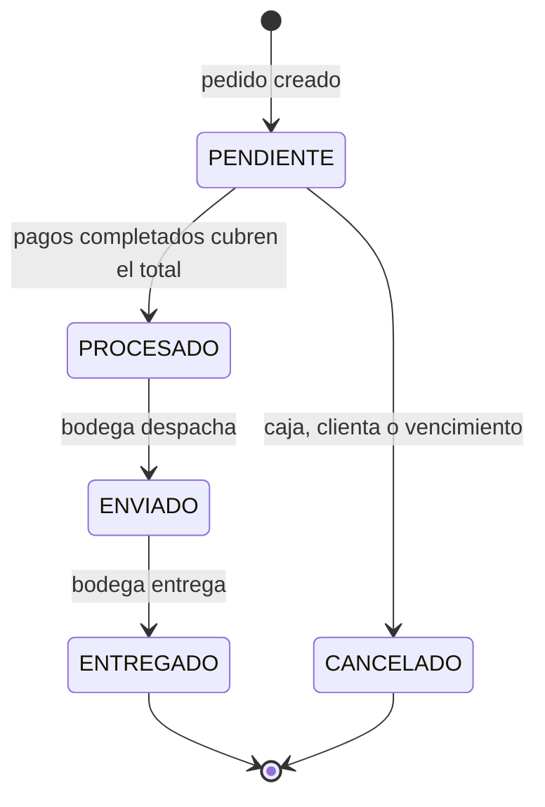
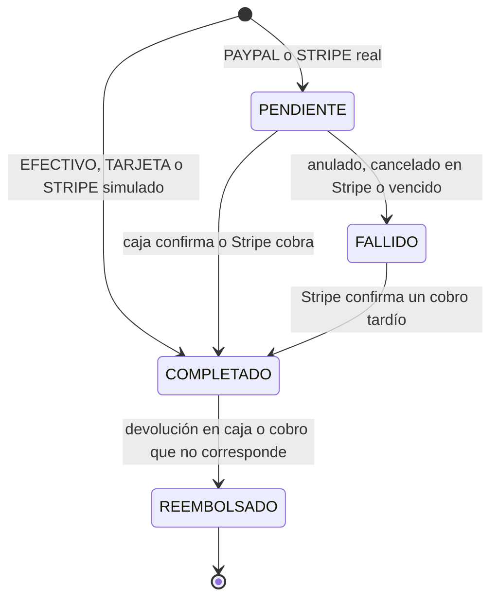
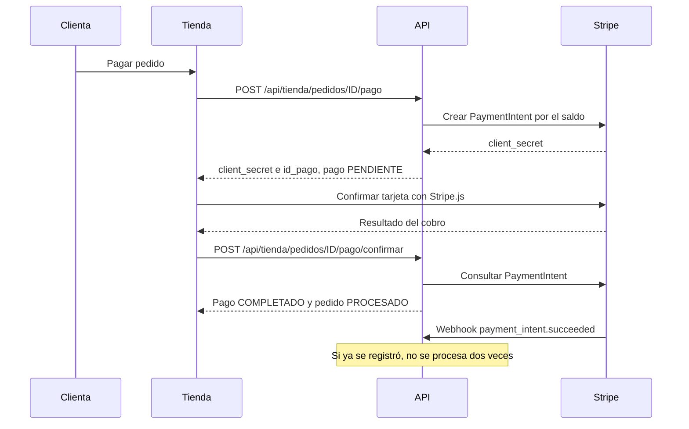
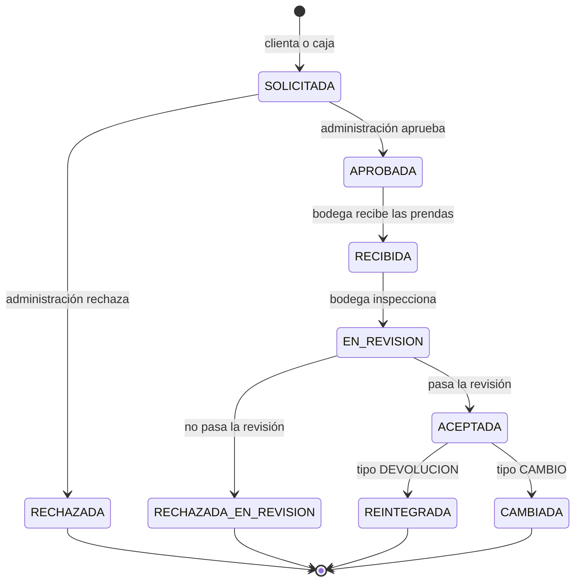
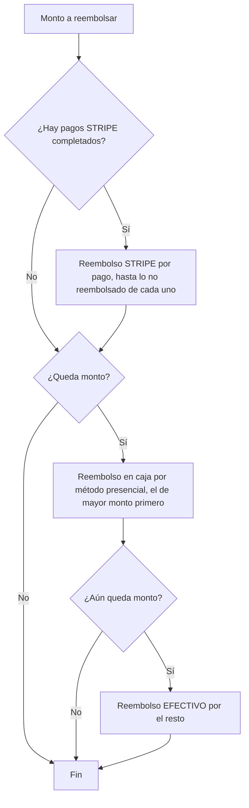
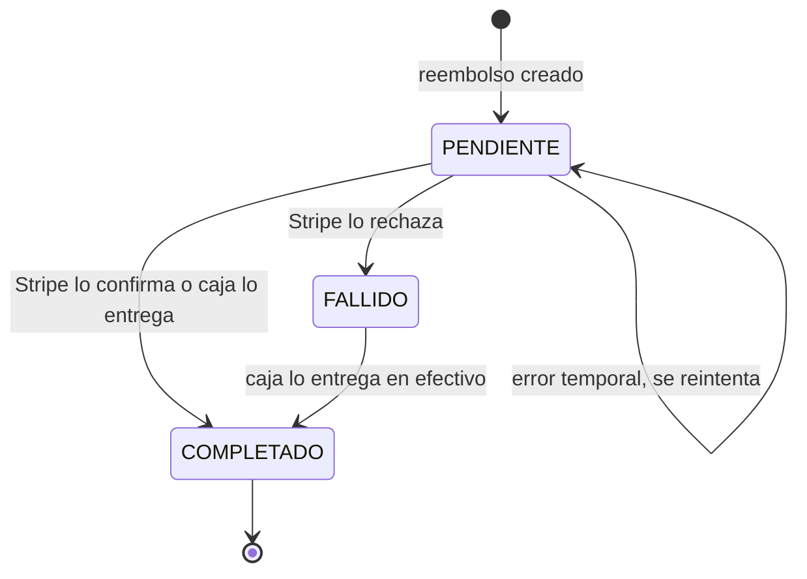

# Reglas de negocio y flujos

Este documento describe las reglas que el sistema aplica a las ventas, el inventario, los pagos, las devoluciones, los reembolsos y las promociones, junto con las máquinas de estados que gobiernan cada proceso. Todas las reglas descritas se obtuvieron del código del backend (principalmente `app/controllers/` y `app/utils/`); cuando se cita un valor por defecto, corresponde al que el código usa si la variable de entorno no está definida.

## Contenido

- [1. Parámetros configurables](#1-parámetros-configurables)
- [2. Pedidos](#2-pedidos)
  - [2.1 Venta de mostrador y venta en la tienda en línea](#21-venta-de-mostrador-y-venta-en-la-tienda-en-línea)
  - [2.2 Estados del pedido](#22-estados-del-pedido)
  - [2.3 Modificación de un pedido pendiente](#23-modificación-de-un-pedido-pendiente)
- [3. Stock por sucursal](#3-stock-por-sucursal)
- [4. Pagos](#4-pagos)
  - [4.1 Métodos de pago](#41-métodos-de-pago)
  - [4.2 Saldo, por confirmar y por cobrar](#42-saldo-por-confirmar-y-por-cobrar)
  - [4.3 Estados del pago](#43-estados-del-pago)
  - [4.4 Pago con tarjeta en la tienda en línea](#44-pago-con-tarjeta-en-la-tienda-en-línea)
  - [4.5 Cobros de Stripe que no corresponden](#45-cobros-de-stripe-que-no-corresponden)
- [5. Vencimiento de pedidos pendientes](#5-vencimiento-de-pedidos-pendientes)
- [6. Devoluciones y cambios](#6-devoluciones-y-cambios)
  - [6.1 Política de solicitud](#61-política-de-solicitud)
  - [6.2 Estados de la devolución](#62-estados-de-la-devolución)
  - [6.3 Inspección y destino en inventario](#63-inspección-y-destino-en-inventario)
  - [6.4 Cambios de talla o variante](#64-cambios-de-talla-o-variante)
- [7. Reembolsos](#7-reembolsos)
  - [7.1 Cálculo del monto](#71-cálculo-del-monto)
  - [7.2 Reparto entre Stripe y caja](#72-reparto-entre-stripe-y-caja)
  - [7.3 Estados del reembolso](#73-estados-del-reembolso)
- [8. Cupones de descuento](#8-cupones-de-descuento)
- [9. Envío](#9-envío)
- [10. IVA incluido](#10-iva-incluido)
- [11. Trazabilidad](#11-trazabilidad)
- [12. Correos a la clienta](#12-correos-a-la-clienta)

---

## 1. Parámetros configurables

Las reglas que dependen de un valor numérico se configuran con variables de entorno (ver `.env.example`). La siguiente tabla resume las que afectan a este documento.

| Variable | Valor por defecto | Archivo que la lee | Efecto |
|---|---|---|---|
| `PLAZO_PEDIDO_PENDIENTE_HORAS` | 24 | `app/utils/vencimientos.js` | Horas para pagar un pedido pendiente antes de que se cancele automáticamente. `0` desactiva el vencimiento. |
| `VENCIMIENTO_INTERVALO_MIN` | 10 | `app/utils/vencimientos.js` | Cada cuántos minutos se revisan pedidos vencidos y reembolsos a tarjeta pendientes. |
| `HORAS_PLAZO_DEVOLUCION` | 24 | `app/utils/plazos.js` | Horas desde la entrega durante las cuales se admite una solicitud de cambio o devolución. |
| `ENVIO_COSTO` | 25 | `app/utils/precios.js` | Costo del envío a domicilio de la tienda en línea, en quetzales. |
| `ENVIO_GRATIS_DESDE` | 300 | `app/utils/precios.js` | Monto de prendas (después del descuento) desde el cual el envío es gratis. `0` significa que nunca es gratis. |
| `IVA_PORCENTAJE` | 12 | `app/utils/precios.js` | Porcentaje de IVA incluido en los precios; se usa para desglosarlo. |
| `ZONA_HORARIA_NOMBRE` | `America/Guatemala` | `app/utils/cupones.js` | Zona usada para evaluar la vigencia de los cupones por día. |
| `ZONA_HORARIA_TIENDA` | `-06:00` | `app/controllers/pedido.controller.js` | Desfase usado en los filtros de fecha de pedidos. |
| `STRIPE_SECRET_KEY` | (sin valor) | `app/config/stripe.config.js` | Con el valor de pruebas `sk_test_clave_de_prueba_universidad` el backend simula los cobros con tarjeta (se completan al instante sin llamar a Stripe). |

Además, el código define constantes fijas: 30 minutos de gracia para cobros con tarjeta en curso (`MINUTOS_GRACIA`), un máximo de 3 pedidos pendientes por clienta en la tienda (`MAX_PEDIDOS_PENDIENTES`) y un máximo de 20 unidades por prenda en un pedido de la tienda (`MAX_UNIDADES_POR_LINEA`).

---

## 2. Pedidos

### 2.1 Venta de mostrador y venta en la tienda en línea

Ambos tipos de venta usan la misma función de creación (`crearPedido` en `app/utils/facturacion.js`), por lo que comparten las reglas de precio, stock y cupones. Se distinguen por el campo `id_empleado`: un pedido con empleado es de **mostrador** y uno sin empleado es de la **tienda en línea** (el panel lo muestra como `origen`).

| Aspecto | Venta de mostrador | Venta en la tienda en línea |
|---|---|---|
| Endpoint | `POST /api/pedidos` | `POST /api/tienda/pedidos` |
| Quién la registra | CAJERO, ADMIN o DISTRITAL | La clienta autenticada |
| Sucursal | La del empleado (el DISTRITAL elige cualquiera) | La elegida por la clienta |
| Clienta | De la propia sucursal; una clienta de otra sucursal solo si se la buscó por su correo exacto | La de la sesión |
| Entrega | Sin costo de envío | Envío a domicilio o retiro en sucursal (ver [Envío](#9-envío)) |
| Cupón | Opcional | Opcional |
| Límites adicionales | Ninguno | Máximo 3 pedidos pendientes por clienta, 50 líneas de productos distintos y 20 unidades por prenda |

Reglas comunes de creación:

- Todo pedido nace en estado `PENDIENTE` de pago.
- El precio de cada línea se toma siempre del catálogo (`Producto.precio_unitario`); los valores de precio, total o estado enviados en la petición se ignoran.
- La clienta y la sucursal deben existir y estar activas; cada producto debe existir y estar activo.
- Las líneas repetidas del mismo producto se suman y se procesan en orden de `id_producto`, de modo que todas las ventas bloquean el inventario en el mismo orden y se evitan bloqueos mutuos entre transacciones.
- El stock se descuenta al crear el pedido (las prendas quedan reservadas aunque el pedido aún no esté pagado).
- El subtotal de cada línea es `cantidad × precio_unitario` y el total del pedido lo recalculan los *hooks* del modelo `DetallePedido` con la fórmula:

```
total = max(0, suma de líneas − descuento del cupón) + costo de envío
```

- Si un cupón cubre toda la compra y el total queda en 0, el pedido pasa directamente a `PROCESADO`, porque no hay nada que cobrar.
- Antes de confirmar, la cotización (`POST /api/pedidos/cotizar` y `POST /api/tienda/cotizar`) calcula subtotal, descuento, envío, total e IVA sin reservar stock ni consumir el cupón.


*Figura 1. Finalización de compra en la tienda con retiro en sucursal y un cupón de 10 % aplicado.*

### 2.2 Estados del pedido

La máquina de estados está definida en `validarTransicionPedido` (`app/controllers/pedido.controller.js`).



| Estado | Significado |
|---|---|
| `PENDIENTE` | Pedido creado con stock reservado, pendiente de pago. Es el único estado en que se pueden registrar pagos, modificar líneas o cancelar. |
| `PROCESADO` | Pagado por completo. |
| `ENVIADO` | Despachado a la dirección de entrega o, en ventas sin dirección, listo para recoger en la sucursal. |
| `ENTREGADO` | Entregado a la clienta. Se registra `fecha_entrega`, desde la cual corre el plazo de devolución. Estado final. |
| `CANCELADO` | Cancelado antes del pago; el stock vuelve a estar disponible. Estado final. |

Reglas de transición:

- Un pedido no puede regresar a `PENDIENTE` ni cambiar desde `ENTREGADO` o `CANCELADO`. Lo que ocurre después de la entrega se gestiona como devolución.
- Un pedido `PENDIENTE` no puede marcarse como `ENVIADO` ni `ENTREGADO`.
- Un pedido `PROCESADO` debe pasar por `ENVIADO` antes de `ENTREGADO` y no puede cancelarse (ya fue pagado).
- `PENDIENTE → PROCESADO` solo se acepta si el total es mayor que 0 y los pagos `COMPLETADO` cubren el total. Normalmente ocurre de forma automática al completarse el último pago (`procesarPedidoSiEstaPagado` en `app/utils/facturacion.js`).
- `PENDIENTE → CANCELADO` exige que el pedido no tenga pagos completados ni pagos pendientes; un pago pendiente debe anularse antes (`PUT /api/pagos/:id/anular`). Al cancelar, todas las líneas se reintegran al stock y se libera el uso del cupón.
- La fila del pedido se bloquea durante la transición para que dos peticiones simultáneas no apliquen cambios a la vez.

Puestos autorizados para cada transición manual (`PUT /api/pedidos/:id/estado`), siempre dentro de la sucursal del empleado salvo el DISTRITAL:

| Estado destino | Puestos autorizados |
|---|---|
| `PROCESADO` | DISTRITAL, ADMIN, CAJERO |
| `CANCELADO` | DISTRITAL, ADMIN, CAJERO |
| `ENVIADO` | DISTRITAL, ADMIN, BODEGUERO |
| `ENTREGADO` | DISTRITAL, ADMIN, BODEGUERO |

La clienta también puede cancelar su propio pedido desde la tienda (`POST /api/tienda/pedidos/:id/cancelar`) mientras siga pendiente, no tenga pagos completados ni pagos de caja por confirmar. Si había iniciado un cobro con tarjeta, este se cancela en Stripe; si Stripe ya lo había cobrado, el pago se registra, el pedido pasa a `PROCESADO` y la cancelación se rechaza con código 409.

### 2.3 Modificación de un pedido pendiente

Caja (CAJERO, ADMIN o DISTRITAL) puede agregar (`POST /api/detalles`) o quitar (`DELETE /api/detalles/:id`) prendas de un pedido mientras esté `PENDIENTE`:

- Al agregar, el stock se descuenta de la sucursal del pedido (no se permite tomarlo de otra) y el precio sale del catálogo.
- Al quitar, las unidades vuelven a stock disponible con un movimiento `CANCELACION`.
- El total se recalcula, incluidos el descuento del cupón (que puede dejar de aplicar si no se alcanza la compra mínima) y el envío a domicilio (que puede volverse gratis o dejar de serlo).
- La operación se rechaza si lo ya pagado o en proceso de pago quedaría por encima del nuevo total.
- Si con el nuevo total lo pagado ya lo cubre, el pedido pasa a `PROCESADO`.

---

## 3. Stock por sucursal

El inventario se guarda por producto, sucursal, lote y estado en la tabla `Inventario`. Solo las filas con estado `DISPONIBLE` se pueden vender; las filas `DANADA` y `DEFECTUOSA` existen para registrar prendas no aptas para la venta. El catálogo de la tienda muestra únicamente el stock disponible de sucursales activas.

**Descuento por venta (FIFO por lote).** La función `descontarStockVenta` (`app/utils/facturacion.js`):

1. Bloquea las filas `DISPONIBLE` con cantidad mayor que 0 del producto en la sucursal del pedido, ordenadas por `id_inventario` ascendente (primero el lote que ingresó primero).
2. Si la suma no alcanza la cantidad solicitada, rechaza la venta con el mensaje de stock insuficiente.
3. Descuenta lote por lote hasta completar la cantidad.
4. Registra un movimiento `VENTA` por cada lote afectado; si el lote queda en 0, el movimiento indica `AGOTADO` como estado nuevo.

**Reintegro por cancelación o por quitar una línea.** La función `reintegrarStockVenta` suma las unidades a la primera fila `DISPONIBLE` del producto en la sucursal (o crea una si no existe) y registra un movimiento `CANCELACION`.

**Otras entradas y salidas:**

| Operación | Endpoint | Regla |
|---|---|---|
| Ingreso de stock | `POST /api/inventario` | BODEGUERO, ADMIN o DISTRITAL de la sucursal. Cantidad entera mayor que 0 y estado `DISPONIBLE`, `DANADA` o `DEFECTUOSA`. |
| Ajuste de salida | `POST /api/inventario/ajustes` | Solo reduce stock. Motivos: `CORRECCION_CONTEO`, `PERDIDA`, `ROBO`, `DANO`, `DESCARTE`, `OTRO` (este último exige observación). Si la cantidad cambió mientras se editaba, responde 409 sin aplicar nada. Registra un movimiento `AJUSTE_SALIDA` por fila y una auditoría `INVENTARIO_AJUSTADO`. |
| Devoluciones y cambios | Ver [sección 6](#6-devoluciones-y-cambios) | Las prendas devueltas entran a `DISPONIBLE`, `DANADA` o `DEFECTUOSA` según la inspección. |

---

## 4. Pagos

### 4.1 Métodos de pago

| Método | Uso | Estado inicial del pago |
|---|---|---|
| `EFECTIVO` | Cobro en caja | `COMPLETADO` (el dinero se recibe en el momento) |
| `TARJETA` | Terminal POS de la tienda física; admite una referencia opcional (autorización o voucher, máximo 150 caracteres) | `COMPLETADO` |
| `PAYPAL` | Pago que caja verifica después | `PENDIENTE` hasta que caja lo confirma (`PUT /api/pagos/:id/confirmar`) |
| `STRIPE` | Tarjeta en línea; se crea un PaymentIntent en Stripe en moneda `gtq` | `PENDIENTE` hasta que Stripe confirma el cobro. En modo simulado nace `COMPLETADO`. |

Reglas para registrar un pago (`POST /api/pagos`, CAJERO, ADMIN o DISTRITAL de la sucursal del pedido):

- El pedido debe estar `PENDIENTE` y tener total mayor que 0.
- El monto debe ser mayor que 0 y tener como máximo 2 decimales.
- El monto no puede superar el saldo pendiente, descontando tanto los pagos completados como los pendientes de confirmar, para que al confirmarse todos no se supere el total.
- Si con el pago el pedido queda cubierto, pasa a `PROCESADO` en la misma transacción.

Un pago `STRIPE` solo puede confirmarse manualmente si Stripe reporta el PaymentIntent como `succeeded`.


*Figura 2. Registro de un cobro en efectivo desde el detalle del pedido en el panel. El recuadro superior del pedido indica la fecha en que se cancelará si no se paga.*

### 4.2 Saldo, por confirmar y por cobrar

El detalle del pedido en el panel (`GET /api/pedidos/:id`) calcula los siguientes valores:

| Campo | Cálculo |
|---|---|
| `pagado` | Suma de los pagos `COMPLETADO`. |
| `por_confirmar` | Suma de los pagos `PENDIENTE`. |
| `saldo` | `max(0, total − pagado)`. |
| `por_cobrar` | `max(0, saldo − por_confirmar)`: lo que todavía se puede cobrar sin pasarse del total. |
| `pago_vence` | Fecha límite de pago si el pedido sigue pendiente (ver [sección 5](#5-vencimiento-de-pedidos-pendientes)). |

En la tienda, el detalle del pedido muestra además `a_pagar_con_tarjeta`, que es el saldo menos los pagos de caja pendientes de confirmar.

### 4.3 Estados del pago



| Transición | Origen en el código |
|---|---|
| `PENDIENTE → COMPLETADO` | `PUT /api/pagos/:id/confirmar`; webhook `payment_intent.succeeded`; confirmación desde la tienda (`POST /api/tienda/pedidos/:id/pago/confirmar`). |
| `PENDIENTE → FALLIDO` | `PUT /api/pagos/:id/anular`; webhook `payment_intent.canceled`; cancelación del pedido por la clienta; vencimiento del pedido; reemplazo de un intento de pago por otro nuevo. |
| `FALLIDO → COMPLETADO` | Webhook `payment_intent.succeeded` o confirmación desde la tienda sobre un pago que había quedado fallido. |
| `COMPLETADO → REEMBOLSADO` | `PUT /api/pagos/:id/devolver`: caja devuelve un cobro presencial (`EFECTIVO` o `TARJETA`) de un pedido que sigue `PENDIENTE`; o un cobro de Stripe que no corresponde (ver [4.5](#45-cobros-de-stripe-que-no-corresponden)). |

El evento `payment_intent.payment_failed` no cambia el estado: la clienta puede reintentar con otra tarjeta sobre el mismo PaymentIntent, por lo que el pago sigue `PENDIENTE` y solo se registra la auditoría `PAGO_INTENTO_FALLIDO`.

Un pago `REEMBOLSADO` deja de contar como pagado. Si un pedido `PROCESADO` necesita devolver dinero, se gestiona mediante una devolución, no desde el pago.

### 4.4 Pago con tarjeta en la tienda en línea



Reglas del inicio de pago (`POST /api/tienda/pedidos/:id/pago`):

- El pedido debe estar `PENDIENTE`. Si su plazo de pago ya venció y no hay un cobro en curso, se rechaza y se indica a la clienta que haga un pedido nuevo.
- Si ya existe un cobro con tarjeta en curso, se reutiliza en lugar de crear otro (doble clic o recarga de la página), siempre que cobre exactamente lo que falta pagar. Si Stripe ya lo está procesando o lo cobró, se informa que está en proceso.
- Un intento que ya no corresponde (cancelado o con monto distinto) se cancela en Stripe y el pago se anula antes de crear uno nuevo.
- El monto del nuevo PaymentIntent es el total menos lo ya pagado y lo pendiente de confirmar.
- En modo simulado se crea directamente un pago `STRIPE` `COMPLETADO` por el saldo.

### 4.5 Cobros de Stripe que no corresponden

Cuando Stripe confirma un cobro (`registrarCobroExitoso` en `app/utils/facturacion.js`), el pago se marca `COMPLETADO` porque el dinero ya ingresó. Si en ese momento el pedido ya no está `PENDIENTE` (fue cancelado, venció o ya estaba pagado) o el monto supera el saldo:

1. Se registra la auditoría `PAGO_REQUIERE_REEMBOLSO`.
2. El pago pasa a `REEMBOLSADO`, por lo que no cuenta como pagado.
3. Se crea un reembolso `STRIPE` por el monto completo del pago (`reembolsarPagoStripe` en `app/utils/reembolsos.js`), con su auditoría `REEMBOLSO_CREADO`.
4. Al confirmarse la transacción, el reembolso se solicita a Stripe y se avisa a la clienta del resultado.

Solo se crea un reembolso de este tipo por pago, aunque el cobro se notifique varias veces.

---

## 5. Vencimiento de pedidos pendientes

El módulo `app/utils/vencimientos.js` cancela automáticamente los pedidos que no se pagan a tiempo para liberar el stock reservado.

- **Plazo:** un pedido `PENDIENTE` vence `PLAZO_PEDIDO_PENDIENTE_HORAS` horas (24 por defecto) después de `fecha_pedido`. Con valor `0` no vence nunca.
- **Frecuencia:** la revisión corre cada `VENCIMIENTO_INTERVALO_MIN` minutos (10 por defecto); la primera se ejecuta pocos segundos después de arrancar el servidor. Cada vuelta procesa hasta 200 pedidos, cada uno en su propia transacción.
- **Instancia única:** la revisión usa un candado de PostgreSQL, de modo que si hay varias instancias del servidor solo una revisa a la vez.

No se cancela un pedido vencido en los siguientes casos:

| Situación | Motivo |
|---|---|
| Tiene algún pago `COMPLETADO` (pago parcial) | Lo resuelve caja. |
| Tiene un pago de caja (`PAYPAL`, por ejemplo) pendiente de confirmar | Lo resuelve caja. |
| Tiene un cobro `STRIPE` iniciado hace menos de 30 minutos | Periodo de gracia: la clienta podría estar escribiendo los datos de la tarjeta. |
| Stripe reporta el cobro como en proceso | Se reintenta en la siguiente revisión. |

Cuando el pedido sí vence, cada cobro con tarjeta pendiente se cancela en Stripe y el pago queda `FALLIDO`. Si Stripe ya había cobrado, en vez de cancelar se registra el cobro y el pedido pasa a `PROCESADO`. En caso contrario, el pedido pasa a `CANCELADO`, el stock vuelve a `DISPONIBLE`, se libera el cupón, se registra la auditoría y se envía a la clienta el correo de pedido cancelado indicando que no se recibió el pago dentro del plazo.

En la misma vuelta se reintentan los reembolsos a tarjeta que siguen `PENDIENTE` con más de 5 minutos de antigüedad (hasta 50 por vuelta).

---

## 6. Devoluciones y cambios

### 6.1 Política de solicitud

La función `politicaDevolucion` (`app/controllers/devolucion.controller.js`) decide si un pedido admite una solicitud:

| Regla | Código de motivo si no se cumple |
|---|---|
| El pedido debe estar `ENTREGADO`. | `NO_ENTREGADO` |
| Solo se admite **una solicitud por pedido**, aunque la anterior haya sido rechazada. | `YA_SOLICITADO` |
| La solicitud debe hacerse dentro de `HORAS_PLAZO_DEVOLUCION` horas (24 por defecto) desde `fecha_entrega`. | `PLAZO_VENCIDO` |

Otras reglas de la solicitud:

- **Tipos:** `DEVOLUCION`, `CAMBIO_TALLA` y `CAMBIO_VARIANTE`.
- **Motivos:** `DEFECTUOSO`, `TALLA_INCORRECTA`, `PRODUCTO_INCORRECTO`, `DANADO_ENVIO` y `OTRO`.
- El pedido debe pertenecer a la clienta indicada y cada línea debe pertenecer al pedido.
- La cantidad solicitada de cada línea no puede superar lo comprado menos lo ya solicitado en solicitudes no rechazadas.
- La solicitud la registra la clienta desde la tienda (`POST /api/tienda/devoluciones`) o caja a su nombre desde el panel (`POST /api/devoluciones`, CAJERO, ADMIN o DISTRITAL).
- Cada línea solicitada genera un movimiento `DEVOLUCION_SOLICITADA`.


*Figura 3. Pedido entregado en la tienda: la clienta ve el plazo exacto para su única solicitud de cambio o devolución.*

### 6.2 Estados de la devolución

Las transiciones válidas están centralizadas en `app/utils/estadosDevolucion.js`, de modo que ningún controlador puede omitir pasos del proceso.



| Acción | Endpoint | Puestos | Resultado |
|---|---|---|---|
| Aprobar | `PUT /api/devoluciones/:id/aprobar` | ADMIN, DISTRITAL | `APROBADA` |
| Rechazar | `PUT /api/devoluciones/:id/rechazar` | ADMIN, DISTRITAL | `RECHAZADA` (final) |
| Recibir | `PUT /api/devoluciones/:id/recibir` | BODEGUERO, ADMIN, DISTRITAL | `RECIBIDA`; movimiento `DEVOLUCION_RECIBIDA` por línea |
| Revisar | `PUT /api/devoluciones/:id/revisar` | BODEGUERO, ADMIN, DISTRITAL | `ACEPTADA` o `RECHAZADA_EN_REVISION` |
| Reintegrar | `PUT /api/devoluciones/:id/reintegrar` | BODEGUERO, ADMIN, DISTRITAL | `REINTEGRADA` y reembolso (solo tipo `DEVOLUCION`) |
| Cambiar | `PUT /api/devoluciones/:id/cambiar` | BODEGUERO, ADMIN, DISTRITAL | `CAMBIADA` y, si aplica, reembolso de la diferencia (solo tipos de cambio) |

`EN_REVISION` es un paso que la operación de revisión valida (`RECIBIDA → EN_REVISION → resultado`) en una sola transacción: la devolución queda guardada directamente en `ACEPTADA` o `RECHAZADA_EN_REVISION`. Los estados `RECHAZADA`, `RECHAZADA_EN_REVISION`, `REINTEGRADA` y `CAMBIADA` son finales. Cada empleado solo gestiona devoluciones de pedidos de su sucursal, salvo el DISTRITAL. Las acciones aprobar, rechazar, recibir y revisar aceptan una observación opcional de hasta 255 caracteres que queda en la auditoría (y, al recibir o revisar, también en el movimiento de inventario).


*Figura 4. Seguimiento de una solicitud de cambio de talla desde la tienda.*

### 6.3 Inspección y destino en inventario

La revisión debe incluir el resultado de **todas** las líneas de la devolución, sin repetidas, e indicar si se acepta (`aceptar: true`) o no. Cada línea recibe uno de tres resultados, que determinan el movimiento registrado y el estado de inventario al que vuelve la prenda al reintegrarla o cambiarla:

| Resultado de revisión | Movimiento al revisar | Estado de inventario al reintegrar | ¿Vendible? |
|---|---|---|---|
| `BUEN_ESTADO` | `EN_REVISION` | `DISPONIBLE` | Sí |
| `DANADO` | `PRODUCTO_DANADO` | `DANADA` | No |
| `DEFECTUOSO` | `PRODUCTO_DEFECTUOSO` | `DEFECTUOSA` | No |

Al reintegrar una devolución de tipo `DEVOLUCION`, cada prenda se suma a la fila de inventario de la sucursal del pedido con el estado correspondiente (o se crea una) y se registra un movimiento `REINTEGRACION`. Una devolución `RECHAZADA_EN_REVISION` no mueve inventario ni genera reembolso.

### 6.4 Cambios de talla o variante

- Cada línea de un cambio debe indicar `id_producto_nuevo`.
- El producto nuevo debe existir, estar activo, ser distinto del original y pertenecer al mismo grupo de variantes (mismo producto padre).
- **Solo se admiten variantes de igual o menor precio** que lo pagado por la prenda original. El sistema nunca cobra una diferencia; si la variante cuesta menos, la diferencia se reembolsa. En la tienda, una variante más cara se rechaza indicando que la clienta debe acudir a una sucursal.
- El precio de la variante nueva se guarda en la solicitud (`precio_unitario_nuevo`), de modo que el reembolso se calcula con ese precio aunque después cambie el catálogo.
- Al ejecutar el cambio, primero se verifica que haya stock disponible de **todas** las variantes nuevas en la sucursal del pedido; si alguna no alcanza, no se mueve nada.
- Después, por cada línea, la prenda original entra al inventario según su resultado de revisión (movimiento `CAMBIO_SALIDA`) y la variante nueva se descuenta del stock disponible por orden de ingreso (movimiento `CAMBIO_ENTRADA`).

---

## 7. Reembolsos

Los reembolsos se crean automáticamente al reintegrar una devolución o al completar un cambio por una variante más barata (`crearReembolsosDeDevolucion` en `app/utils/reembolsos.js`), y también para los cobros de Stripe que no corresponden ([4.5](#45-cobros-de-stripe-que-no-corresponden)).

### 7.1 Cálculo del monto

1. **Monto bruto por línea:**
   - `DEVOLUCION`: precio unitario pagado en la línea × cantidad devuelta.
   - `CAMBIO_TALLA` y `CAMBIO_VARIANTE`: `max(0, precio pagado − precio de la variante nueva)` × cantidad.
2. **Prorrateo del descuento:** el bruto se multiplica por el factor `(suma de líneas − descuento del pedido) / suma de líneas`, limitado entre 0 y 1. Así la clienta recibe lo que realmente pagó por cada prenda después del cupón.
3. **El envío no se devuelve:** el cálculo solo considera las líneas de prendas.
4. **Tope:** el monto nunca supera lo cobrado al pedido (pagos `COMPLETADO`) menos lo ya reembolsado o pendiente de reembolsar.

Ejemplo: un pedido con prendas por Q200.00, un cupón de Q20.00 y envío de Q25.00 tiene un factor de 0.9. Si se devuelve una prenda de Q100.00, el reembolso es Q90.00; los Q25.00 del envío no se devuelven.

### 7.2 Reparto entre Stripe y caja



- Primero se reembolsa a la tarjeta con la que se pagó en línea, pago por pago.
- El resto se asigna a los métodos presenciales del pedido (`EFECTIVO`, `TARJETA`, `PAYPAL`), empezando por el de mayor monto disponible, sin superar lo cobrado con cada método (un terminal POS no puede revertir más de lo que cobró).
- Todos los reembolsos nacen `PENDIENTE`. Los de Stripe se solicitan inmediatamente después de confirmar la transacción; los de caja quedan pendientes hasta que caja entrega el dinero (`PUT /api/reembolsos/:id/completar`, con referencia opcional de hasta 150 caracteres).

### 7.3 Estados del reembolso



| Situación | Comportamiento |
|---|---|
| Stripe responde `succeeded` | `COMPLETADO`, se guarda el identificador del reembolso de Stripe y se avisa a la clienta. |
| Stripe responde `failed` o `canceled`, o devuelve un error definitivo (HTTP 400, 402 o 404) | `FALLIDO`; la observación indica que debe entregarse en efectivo en caja y se avisa a la clienta. |
| Error de red, 409, 429, 5xx o configuración | Sigue `PENDIENTE`; se reintenta en la revisión periódica, con el botón «Reintentar en Stripe» del panel (`POST /api/reembolsos/:id/reintentar`) o al recibir el webhook de reembolso. |
| `FALLIDO` entregado en caja | `PUT /api/reembolsos/:id/completar` lo marca `COMPLETADO` y cambia su método a `EFECTIVO`, conservando la referencia al pago de Stripe. |

Protecciones contra reembolsos dobles: la fila se reserva mientras se habla con Stripe (una reserva de más de 2 minutos se considera abandonada), se usa una clave de idempotencia por reembolso, antes de crear uno nuevo se busca en Stripe un reembolso ya hecho con el mismo identificador interno y el resultado solo se escribe si la fila sigue `PENDIENTE`. Los reembolsos `STRIPE` pendientes no pueden completarse manualmente en caja; solo pueden reintentarse.

---

## 8. Cupones de descuento

Los cupones los crea, edita y elimina únicamente el DISTRITAL (`/api/cupones`). La clienta los escribe al comprar en la tienda y caja los aplica en ventas de mostrador.

**Tipos:**

| Tipo | Valor | Descuento sobre la suma de prendas |
|---|---|---|
| `PORCENTAJE` | Entre 0 y 100 (mayor que 0) | `suma × valor / 100` |
| `MONTO` | Quetzales, mayor que 0 | `valor` |

El descuento nunca supera la suma de prendas y es 0 si no se alcanza la compra mínima. El código del cupón tiene de 3 a 30 caracteres (letras, números, guion o guion bajo) y se guarda en mayúsculas.

**Validaciones al aplicar un cupón** (`motivoNoAplica` en `app/utils/cupones.js`):

- Debe existir y estar activo.
- La fecha actual de Guatemala debe estar dentro de la vigencia `desde`–`hasta` (ambos días incluidos; un valor nulo significa sin límite).
- No debe haber agotado sus `usos_maximos` (nulo significa ilimitado).
- Si está restringido a una sucursal, el pedido debe ser de esa sucursal.
- La suma de prendas debe alcanzar `minimo_compra`.

Para no revelar qué códigos existen, todas las causas de rechazo devuelven el mismo mensaje («Ese cupón no es válido para esta compra»), excepto la compra mínima, que se explica porque la clienta puede cumplirla. En la cotización, un cupón que no aplica no es un error: se informa en `cupon_error` y se cotiza sin descuento.

**Usos:**

- Al crear el pedido, el cupón se bloquea, se valida y se incrementa `usos` en la misma transacción, de modo que dos compras simultáneas no superan el límite.
- Al cancelar el pedido (por caja, por la clienta o por vencimiento), el uso se libera (`usos − 1`, sin bajar de 0).

**Copia en el pedido:** el pedido guarda `cupon_tipo`, `cupon_valor` y `cupon_minimo` al momento de la compra. Si después el DISTRITAL edita el cupón, los pedidos ya creados no cambian de precio; los recálculos por agregar o quitar prendas usan esa copia.

**Total 0:** si el descuento cubre toda la compra y no hay envío, el pedido pasa directamente a `PROCESADO`.

**Edición y eliminación:**

- Un cupón ya usado no puede cambiar su código ni su tipo.
- `usos_maximos` no puede fijarse por debajo de los usos ya realizados.
- Solo puede eliminarse un cupón que no se haya usado en pedidos no cancelados; en caso contrario debe desactivarse.

---

## 9. Envío

Las reglas están en `costoEnvio` (`app/utils/precios.js`) y `recalcularPedido` (`app/utils/totales.js`):

| Tipo de entrega | Costo de envío |
|---|---|
| Venta de mostrador | 0 |
| Tienda en línea con retiro en sucursal | 0 (sin dirección de entrega) |
| Tienda en línea a domicilio, prendas después del descuento menores que `ENVIO_GRATIS_DESDE` | `ENVIO_COSTO` (Q25.00 por defecto) |
| Tienda en línea a domicilio, prendas después del descuento iguales o mayores que `ENVIO_GRATIS_DESDE` (Q300.00 por defecto) | 0 |

- El umbral de envío gratis se compara con el monto **después del descuento del cupón**, en centavos para evitar errores de redondeo.
- Con `ENVIO_GRATIS_DESDE = 0` el envío nunca es gratis.
- En un pedido a domicilio de la tienda, el envío se recalcula cada vez que cambian las líneas; un pedido sin prendas no paga envío.
- Para envío a domicilio se usa la dirección indicada o, si no se indica, la registrada en el perfil de la clienta (máximo 200 caracteres). Si no hay dirección y no se eligió retiro, el pedido se rechaza.
- El costo de envío no se devuelve en los reembolsos.

---

## 10. IVA incluido

Los precios del catálogo ya incluyen IVA. El sistema no lo suma: lo desglosa a partir del total (`desgloseIva` en `app/utils/precios.js`) con `IVA_PORCENTAJE` (12 por defecto):

```
base_imponible = redondear(total / (1 + IVA_PORCENTAJE / 100), 2)
iva            = total − base_imponible
```

Por ejemplo, un total de Q200.00 tiene una base imponible de Q178.57 y un IVA incluido de Q21.43. El desglose (`subtotal`, `descuento`, `costo_envio`, `total`, `base_imponible`, `iva`, `porcentaje`) se muestra en el detalle del pedido del panel, en el detalle del pedido de la tienda y en las cotizaciones. Los reportes desglosan con el mismo porcentaje el IVA incluido en el total vendido.

---

## 11. Trazabilidad

El sistema mantiene dos registros complementarios.

**Movimientos de inventario (`MovimientoInventario`).** Historial de solo inserción: se crea y nunca se modifica ni se elimina desde los controladores. Cada fila guarda producto, lote (`id_inventario`), pedido, devolución, empleado responsable (nulo si lo originó la clienta o el sistema), tipo, cantidad, estado anterior, estado nuevo y observación.

| Tipo de movimiento | Cuándo se registra |
|---|---|
| `VENTA` | Por cada lote descontado al vender o agregar una prenda a un pedido. |
| `CANCELACION` | Al quitar una prenda de un pedido pendiente o al cancelarlo. |
| `DEVOLUCION_SOLICITADA` | Por cada línea de una solicitud de devolución o cambio. |
| `DEVOLUCION_RECIBIDA` | Al recibir físicamente las prendas en la sucursal. |
| `EN_REVISION`, `PRODUCTO_DANADO`, `PRODUCTO_DEFECTUOSO` | Al revisar cada línea, según su resultado. |
| `REINTEGRACION` | Al reintegrar una devolución al inventario. |
| `CAMBIO_SALIDA`, `CAMBIO_ENTRADA` | Al completar un cambio: entra la prenda original y sale la variante nueva. |
| `AJUSTE_SALIDA` | Baja manual de stock desde el panel. |

Las consultas `GET /api/pedidos/:id/historial` y `GET /api/devoluciones/:id/historial` devuelven estos movimientos en orden cronológico; la segunda incluye también la auditoría de la devolución.

**Auditoría (`auditoria`).** Registra cada acción con el empleado (cuando lo hay), la acción, la tabla afectada, el identificador del registro y un detalle legible, con su fecha de creación. Se escribe dentro de la misma transacción que la operación, por lo que no queda una auditoría de algo que falló ni una operación sin auditoría. La excepción es el resultado de un reembolso procesado en Stripe (`REEMBOLSO_COMPLETADO` o `REEMBOLSO_FALLIDO`), que se registra después de actualizar el reembolso, fuera de una transacción. Algunas acciones registradas son:

| Ámbito | Acciones |
|---|---|
| Pedidos | `PEDIDO_CREADO`, `PEDIDO_ESTADO_ACTUALIZADO`, `DETALLE_PEDIDO_AGREGADO`, `DETALLE_PEDIDO_ELIMINADO` |
| Pagos | `PAGO_REGISTRADO`, `PAGO_CONFIRMADO`, `PAGO_ANULADO`, `PAGO_DEVUELTO`, `PAGO_INTENTO_FALLIDO`, `PAGO_REQUIERE_REEMBOLSO` |
| Devoluciones | `DEVOLUCION_APROBADA`, `DEVOLUCION_RECHAZADA`, `DEVOLUCION_RECIBIDA`, `DEVOLUCION_ACEPTADA`, `DEVOLUCION_RECHAZADA_EN_REVISION`, `DEVOLUCION_REINTEGRADA`, `DEVOLUCION_CAMBIADA` |
| Reembolsos | `REEMBOLSO_CREADO`, `REEMBOLSO_COMPLETADO`, `REEMBOLSO_FALLIDO` |
| Cupones | `CUPON_CREADO`, `CUPON_ACTUALIZADO`, `CUPON_ELIMINADO` |
| Inventario | `INVENTARIO_AJUSTADO` |

La línea de tiempo que la clienta ve de su solicitud en la tienda se construye con la fecha de solicitud y las acciones de auditoría de esa devolución, sin mostrar notas internas.

---

## 12. Correos a la clienta

Los avisos están en `app/utils/notificaciones.js`. Se envían **después** de confirmar la operación y nunca la hacen fallar: si un envío falla, solo se registra en consola. Además, cada aviso de pedido verifica que el pedido esté realmente en el estado que anuncia, y solo se envía si la clienta tiene correo registrado.

| Aviso | Cuándo se envía | Contenido |
|---|---|---|
| Pago recibido | El pedido pasa a `PROCESADO` (manualmente o al completarse el último pago) | Monto pagado y si se prepara para envío o en la sucursal. |
| Pedido enviado | El pedido pasa a `ENVIADO` | «Va en camino» con la dirección, o «listo para recoger» si no tiene dirección de entrega. |
| Pedido entregado | El pedido pasa a `ENTREGADO` | Fecha y hora límite para pedir un cambio o una devolución (una sola solicitud). |
| Pedido cancelado | Caja cancela el pedido o este vence sin pago | Motivo de la cancelación e indicación de que las prendas volvieron a estar disponibles. |
| Solicitud de devolución o cambio | Al registrarse y en cada avance: aprobada, rechazada, recibida, aceptada, rechazada en revisión, reintegrada o cambiada | Estado de la solicitud y enlace a su seguimiento. |
| Reembolso en proceso | Al crearse un reembolso de caja, o uno a tarjeta que Stripe no completó al momento | Qué debe hacer la clienta según el método (recoger efectivo, reversión en POS, PayPal o esperar a la tarjeta). |
| Reembolso completado | Stripe confirma el reembolso o caja lo entrega | Monto devuelto y forma en que se devolvió. |
| Reembolso fallido | Stripe rechaza el reembolso | Indicación de pasar a la sucursal a recogerlo en efectivo. |
| Restablecer contraseña | La clienta usa «¿Olvidaste tu contraseña?» | Enlace de un solo uso que vence en 1 hora. |
| Contraseña cambiada | Se cambia la contraseña de la cuenta | Aviso de que se cerraron las sesiones abiertas. |

La cancelación hecha por la propia clienta desde la tienda no genera correo. El modo de envío se define con `CORREO_MODO`: `smtp` (por defecto si existe `SMTP_HOST`), `consola` (por defecto sin SMTP; solo muestra el aviso en la consola) o `archivo` (guarda cada correo como JSON en `CORREO_CARPETA`, usado por las pruebas). Los enlaces de los correos apuntan a `TIENDA_URL`.

---

Documentos relacionados: [Modelo de datos](02-modelo-de-datos.md) · [Roles y permisos](03-roles-y-permisos.md) · [API](05-api.md) · [Manual de usuario](06-manual-de-usuario.md)
