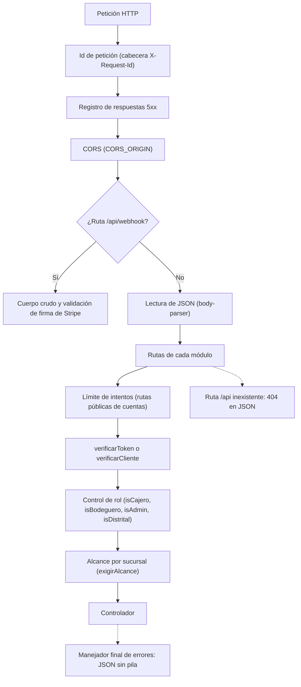
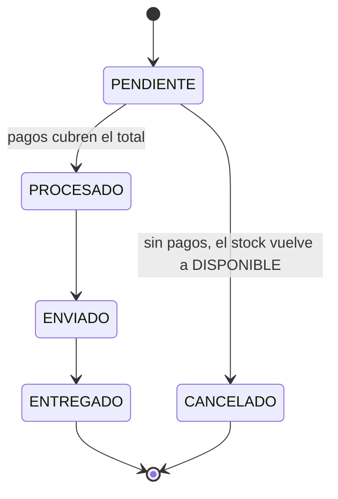
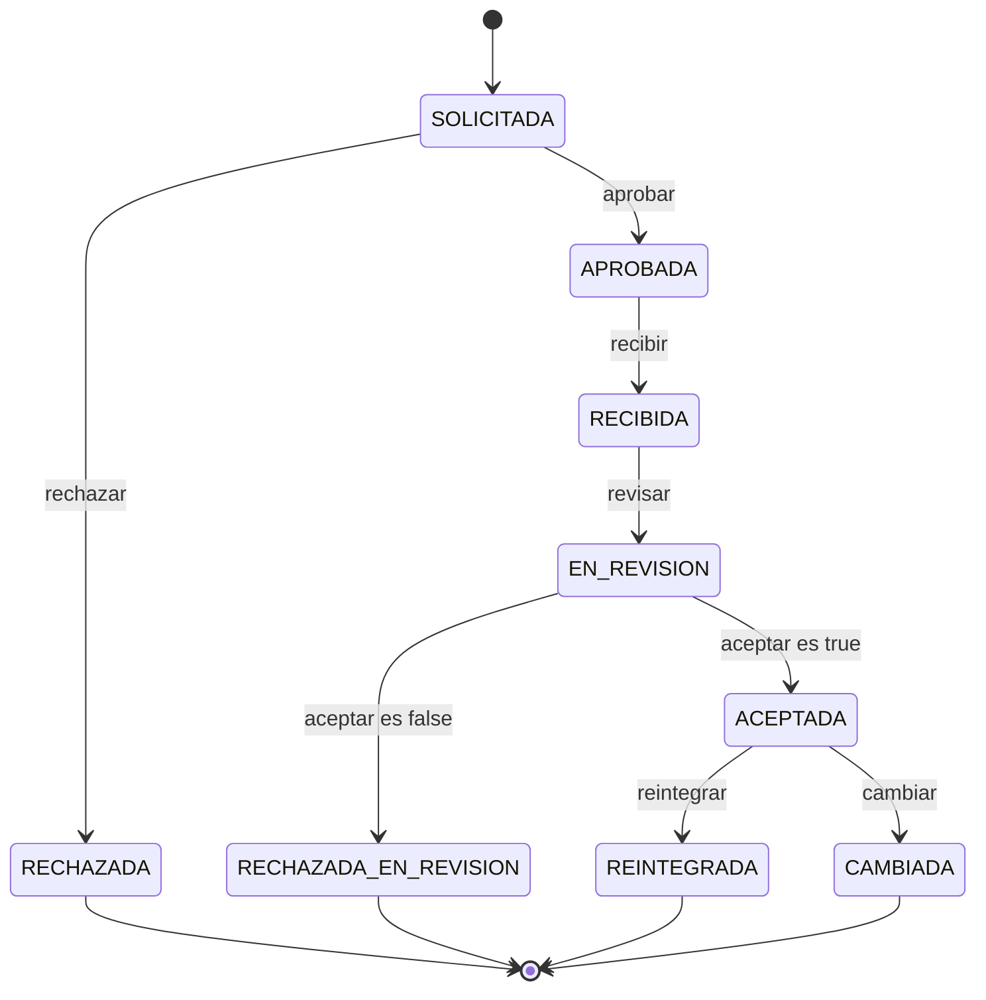
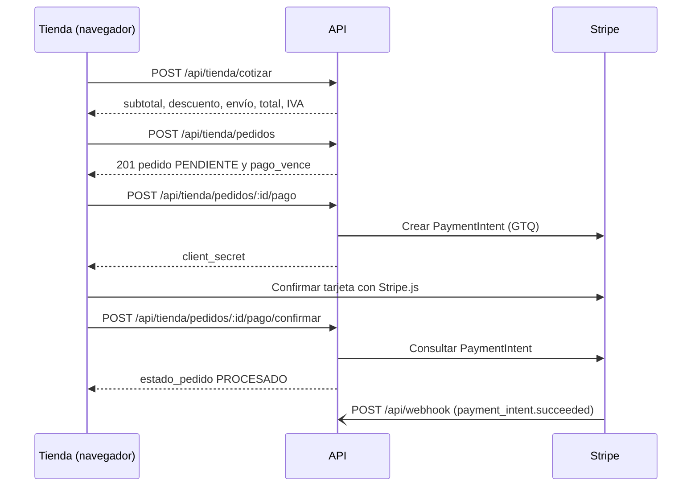

# Referencia de la API REST

Este documento describe la API REST del sistema Distribuidora: las URL base, el mecanismo de autenticación de empleados y de clientas, el formato de los errores, la paginación, el límite de intentos y la lista completa de endpoints agrupados por módulo, con el rol que exige cada uno. Incluye ejemplos de petición y respuesta para las operaciones más representativas y explica el uso de la colección de Postman incluida en el repositorio. Todo lo descrito corresponde a `server.js`, a los archivos de `app/routes/` y a los controladores de `app/controllers/`.

## Contenido

- [1. URL base](#1-url-base)
- [2. Recorrido de una petición](#2-recorrido-de-una-petición)
- [3. Autenticación](#3-autenticación)
- [4. Formato de errores](#4-formato-de-errores)
- [5. Paginación y búsqueda](#5-paginación-y-búsqueda)
- [6. Límite de intentos](#6-límite-de-intentos)
- [7. Convenciones de las tablas de endpoints](#7-convenciones-de-las-tablas-de-endpoints)
- [8. Endpoints por módulo](#8-endpoints-por-módulo)
- [9. Ejemplos de petición y respuesta](#9-ejemplos-de-petición-y-respuesta)
- [10. Colección de Postman](#10-colección-de-postman)
- [Documentos relacionados](#documentos-relacionados)

---

## 1. URL base

| Entorno | URL base de la API | Observaciones |
|---|---|---|
| Local (desarrollo) | `http://localhost:8080` | Puerto definido por la variable `PORT` (8080 por defecto). |
| Pública (Render) | `https://distribuidora-api-r6rw.onrender.com` | Comprobación de salud en `https://distribuidora-api-r6rw.onrender.com/api/salud`. |

Todas las rutas de negocio cuelgan del prefijo `/api`. La raíz `GET /` responde un JSON informativo con el nombre del proyecto y el ambiente (`development` o `production`).

Los clientes web autorizados por CORS se configuran en la variable `CORS_ORIGIN` (lista separada por comas). Por defecto se permiten `http://localhost:8081` (panel de empleados) y `http://localhost:8082` (tienda en línea). En producción se configuran los orígenes del panel (`https://distribuidora-panel.onrender.com`) y de la tienda (`https://distribuidora-tienda.onrender.com`). La cabecera `X-Request-Id` está expuesta a los navegadores mediante CORS.

Los cuerpos de las peticiones se envían en JSON (`Content-Type: application/json`). El servidor no acepta cuerpos comprimidos.

## 2. Recorrido de una petición

El siguiente diagrama resume el orden en que `server.js` registra los componentes que atienden una petición.



No todas las rutas aplican todos los pasos: las rutas públicas omiten la verificación del token, y el alcance por sucursal solo se aplica a las rutas que operan sobre un registro concreto (pedidos, pagos, detalles y devoluciones). En el resto de listados el filtro por sucursal se aplica dentro del propio controlador.

## 3. Autenticación

La API utiliza JSON Web Tokens (JWT) firmados con la variable `JWT_SECRET`. Existen dos tipos de token que no son intercambiables.

| Tipo | Cómo se obtiene | Contenido del token | Middleware que lo valida | Rutas donde sirve |
|---|---|---|---|---|
| Empleado | `POST /api/auth/login` con `{ email, password }` | `id`, `id_sucursal`, `v` (versión de sesión) | `verificarToken` | Todas las rutas protegidas del panel (`/api/...` excepto `/api/tienda/...`) |
| Clienta | `POST /api/tienda/auth/login`, `POST /api/tienda/auth/registro`, `POST /api/tienda/auth/activar` o `POST /api/tienda/auth/restablecer` | `id_cliente`, `tipo: "CLIENTE"`, `v` | `verificarCliente` | Rutas protegidas de `/api/tienda/...` |

El token se envía en la cabecera:

```
Authorization: Bearer <token>
```

Reglas de validación aplicadas por el código:

- Los tokens tienen una vigencia de 24 horas (86400 segundos).
- Un token de clienta presentado en una ruta de empleado se rechaza con `403` ("Este token no pertenece a un empleado"), y viceversa.
- En cada petición se consulta la base de datos: si la cuenta del empleado o de la clienta ya no existe o está desactivada, se responde `401`.
- Cada cuenta guarda un contador `token_version`. Cambiar o restablecer la contraseña, activar la cuenta web de una clienta, desactivar a un empleado o a una clienta, o cambiar el puesto o la sucursal de un empleado incrementa ese contador; los tokens emitidos antes dejan de ser válidos (`401`). Por esa razón los endpoints de cambio de contraseña devuelven un token nuevo.
- El puesto del empleado se lee de la base en cada petición, no del token: un cambio de puesto se aplica de inmediato.
- Si falta la cabecera `Authorization`, la respuesta es `403` ("No se proporcionó un token de seguridad"). Si el token es inválido o expiró, la respuesta es `401`.

Alcance por sucursal: el puesto DISTRITAL opera sobre todas las sucursales; ADMIN, CAJERO y BODEGUERO solo sobre la sucursal asignada en su ficha (`Empleado.id_sucursal`). Cuando un empleado intenta acceder a un pedido, pago, detalle o devolución de otra sucursal, la API responde `404` ("No se encontró el registro en tu sucursal."), de modo que el registro ajeno no se revela. El detalle de los permisos se encuentra en [Roles y permisos](03-roles-y-permisos.md).

## 4. Formato de errores

Todas las respuestas de error de la API se devuelven en JSON con un campo `message` en español (la única excepción es `POST /api/webhook`, que ante una firma inválida responde texto plano y ante un error de base de datos responde `500` sin cuerpo):

```json
{ "message": "El email y la contraseña son obligatorios." }
```

Cuando el error lo produce el manejador final de Express (JSON mal formado, cuerpo demasiado grande, excepción no controlada), la respuesta incluye además el campo `referencia`, que coincide con el identificador de la petición:

```json
{
  "message": "Error interno del servidor (referencia 3f1c9a52-7b0e-4d6a-9a43-2c1e8f0b6d21).",
  "referencia": "3f1c9a52-7b0e-4d6a-9a43-2c1e8f0b6d21"
}
```

Cabecera `X-Request-Id`: toda respuesta, exitosa o no, incluye esta cabecera con un UUID generado para la petición. Toda respuesta con código 5xx se registra en la tabla `ErrorServidor` junto con ese identificador, el método, la ruta (sin parámetros de consulta) y el usuario (`empleado:N` o `cliente:N`). El DISTRITAL puede consultar ese registro en `GET /api/salud/errores`, y el identificador permite relacionar el error que vio un usuario con su entrada en el registro. Al cliente nunca se le envía la pila de la excepción.

Códigos de estado utilizados:

| Código | Significado en esta API | Ejemplos |
|---|---|---|
| 200 | Operación exitosa. | Consultas, cambios de estado. |
| 201 | Registro creado. | Venta, pago, devolución, cupón, inicio de pago con tarjeta. |
| 400 | Datos inválidos o regla de negocio incumplida. | Campo obligatorio ausente, stock insuficiente, transición de estado no permitida, `:id` no numérico ("El identificador no es válido."), JSON mal formado. |
| 401 | Credenciales o sesión inválidas. | Contraseña incorrecta, token expirado, cuenta desactivada, sesión cerrada por cambio de contraseña. |
| 403 | Sin permiso para la acción. | Falta el token, puesto insuficiente, token de clienta en ruta de empleado, venta en otra sucursal. |
| 404 | Registro o ruta inexistente. | Pedido de otra sucursal o de otra clienta, ruta `/api` desconocida ("No existe la ruta GET /api/..."). |
| 409 | Conflicto con el estado actual de los datos. | Eliminar una sucursal, prenda, tipo de prenda o proveedor con registros asociados; ajuste de inventario sobre stock que cambió; pago con tarjeta ya cobrado por Stripe. |
| 413 | Cuerpo de la petición demasiado grande. | Manejador final de errores. |
| 415 | Cuerpo comprimido no admitido. | Manejador final de errores. |
| 429 | Demasiados intentos. | Inicio de sesión, registro, recuperación de contraseña (ver [sección 6](#6-límite-de-intentos)). |
| 500 | Error interno. | Falla inesperada; queda registrada en `ErrorServidor`. |
| 502 | Error al comunicarse con Stripe. | La pasarela no respondió al crear o consultar un cobro. |
| 503 | Servicio no disponible. | La base de datos no responde (`/api/salud`) o Cloudinary no está configurado (`/api/imagenes/firma`). |

Particularidad del módulo de devoluciones: los endpoints de `/api/devoluciones` que modifican datos (registro, aprobación, rechazo, recepción, revisión, reintegro y cambio) responden `400` ante cualquier error, incluido el caso de una devolución inexistente.

## 5. Paginación y búsqueda

La paginación es opcional y la implementa `app/utils/paginacion.js`. Sin el parámetro `pagina`, el endpoint responde el arreglo completo como siempre; con `pagina`, responde un objeto con metadatos.

| Parámetro | Descripción | Valores |
|---|---|---|
| `pagina` | Número de página. | Entero desde 1 (máximo 100000). |
| `por_pagina` | Registros por página. | Entero de 1 a 100; 25 por defecto. |
| `q` | Texto de búsqueda (sin distinguir mayúsculas). | Hasta 80 caracteres. Un valor como `123` o `#123` también busca por número de registro. |

Respuesta paginada:

```json
{
  "datos": [ { "id_pedido": 58, "estado": "PENDIENTE" } ],
  "total": 134,
  "pagina": 1,
  "por_pagina": 25,
  "paginas": 6
}
```

Endpoints que admiten paginación:

| Endpoint | Campos sobre los que busca `q` | Filtros adicionales |
|---|---|---|
| `GET /api/pedidos` | Número de pedido, nombre y apellido de la clienta. | `estado`, `id_cliente`, `id_sucursal`, `origen` (`TIENDA` o `MOSTRADOR`), `desde`, `hasta` (AAAA-MM-DD, hora de Guatemala). |
| `GET /api/clientes` | Número de cliente, nombre, apellido, correo y teléfono. | `filtro` (`web`, `mostrador` o `inactivos`; por defecto, activas). |
| `GET /api/devoluciones` | Número de devolución o de pedido, nombre y apellido de la clienta. | `estado`, `tipo`, `motivo`, `id_pedido`, `id_cliente`, `desde`, `hasta`. |
| `GET /api/salud/errores` | No aplica. | Siempre paginado (página 1 por defecto). |

Un valor inválido de `pagina` o `por_pagina` produce `400` con el mensaje correspondiente.

## 6. Límite de intentos

El middleware `limitarIntentos` (`app/middlewares/limitador.js`) protege los endpoints de cuentas frente a ataques de adivinación de contraseñas y abuso del envío de correos. Características:

- El contador se lleva por dirección IP y por ruta, en una ventana de 15 minutos. Las direcciones IPv6 se agrupan por su red /64. Las variantes de una misma ruta (mayúsculas o barra final) comparten el contador.
- Los contadores se guardan en la tabla `IntentoLimite`, de modo que sobreviven a reinicios y son comunes a varias instancias del servidor. Si la base no responde, se usa un contador en memoria.
- Al superar el máximo se responde `429` con la cabecera `Retry-After` (segundos) y el mensaje "Demasiados intentos. Vuelve a intentarlo en N minuto(s)."

| Endpoint | Máximo de peticiones por IP cada 15 minutos |
|---|---|
| `POST /api/auth/login` | 20 |
| `PUT /api/auth/password` | 10 |
| `POST /api/imagenes/firma` | 60 |
| `POST /api/tienda/auth/registro` | 10 |
| `POST /api/tienda/auth/login` | 20 |
| `POST /api/tienda/auth/activar` | 10 |
| `POST /api/tienda/auth/olvide` | 5 |
| `POST /api/tienda/auth/restablecer` | 10 |
| `PUT /api/tienda/perfil/password` | 10 |
| `POST /api/tienda/cotizar` | 300 |

Además, `POST /api/tienda/auth/olvide` envía como máximo 3 enlaces por correo electrónico por hora; a partir del cuarto la respuesta es la misma, pero no se envía otro correo. Ver también [Seguridad](07-seguridad.md).

## 7. Convenciones de las tablas de endpoints

La columna "Rol requerido" usa la siguiente notación, que corresponde a los middlewares de `app/middlewares/authJwt.js`:

| Notación | Quién puede invocar el endpoint |
|---|---|
| Pública | Cualquiera, sin token. |
| Empleado | Cualquier empleado autenticado y activo (DISTRITAL, ADMIN, CAJERO o BODEGUERO). |
| CAJERO+ | CAJERO, ADMIN o DISTRITAL (`isCajero`). |
| BODEGUERO+ | BODEGUERO, ADMIN o DISTRITAL (`isBodeguero`). |
| ADMIN+ | ADMIN o DISTRITAL (`isAdmin`). |
| DISTRITAL | Solo el gerente distrital (`isDistrital`). |
| Clienta | Clienta de la tienda con token de tipo CLIENTE (`verificarCliente`). |
| Stripe | Invocado por Stripe; se valida la firma `stripe-signature`. |

La marca "(sucursal)" indica que, además del rol, se exige que el registro pertenezca a la sucursal del empleado (salvo DISTRITAL), ya sea mediante `exigirAlcance` o mediante un filtro dentro del controlador. Los parámetros `:id` se validan antes de consultar la base (middleware `validarId`): un valor no numérico o fuera del rango de un entero de PostgreSQL produce `400`. Esta validación se aplica en todos los módulos con `:id` excepto `/api/devoluciones`, cuyo archivo de rutas no registra `validarId`.

## 8. Endpoints por módulo

### 8.1 Autenticación de empleados (`/api/auth`)

| Método | Ruta | Rol requerido | Descripción |
|---|---|---|---|
| POST | `/api/auth/registro` | Pública solo con la base vacía; después ADMIN+ | Registra un empleado con contraseña. Con la base sin empleados, el primero queda siempre como DISTRITAL sin sucursal. Después, el ADMIN solo registra cajeros y bodegueros de su sucursal; el DISTRITAL, cualquier puesto. Responde `201` con `{ message, id, puesto }`. |
| POST | `/api/auth/login` | Pública (límite 20) | Inicia sesión con `{ email, password }`. Devuelve los datos del empleado y el `token`. Mismo mensaje para correo inexistente y contraseña incorrecta. |
| GET | `/api/auth/yo` | Empleado | Datos actuales del empleado del token, incluido el nombre de su sucursal. |
| PUT | `/api/auth/password` | Empleado (límite 10) | Cambia la propia contraseña con `{ actual, nueva }`. Cierra las demás sesiones y devuelve un token nuevo. |

### 8.2 Sucursales (`/api/sucursales`)

| Método | Ruta | Rol requerido | Descripción |
|---|---|---|---|
| GET | `/api/sucursales` | Pública | Lista todas las sucursales (la usan el panel y la tienda). |
| POST | `/api/sucursales` | DISTRITAL | Crea una sucursal. |
| PUT | `/api/sucursales/:id` | DISTRITAL | Edita los campos enviados (incluido `activo`); cada cambio queda en auditoría. |
| DELETE | `/api/sucursales/:id` | DISTRITAL | Elimina una sucursal sin actividad. Con empleados, clientes registrados, inventario o pedidos asociados responde `409`; en ese caso debe desactivarse con `PUT` (`activo: false`). |

### 8.3 Clientes (`/api/clientes`)

| Método | Ruta | Rol requerido | Descripción |
|---|---|---|---|
| GET | `/api/clientes` | Empleado (sucursal) | Lista las clientas registradas en la sucursal o que le han comprado (el DISTRITAL, todas). Admite paginación, `q` y `filtro`. Con `?email=` busca por correo exacto en todas las sucursales y devuelve solo datos básicos. |
| POST | `/api/clientes` | CAJERO+ | Alta de una clienta en mostrador, sin contraseña. |
| PUT | `/api/clientes/:id` | CAJERO+ (sucursal) | Edita nombre, apellido, teléfono y dirección; el correo solo si aún no tiene cuenta web. Activar o desactivar (`activo`) es exclusivo de ADMIN o DISTRITAL. |
| POST | `/api/clientes/:id/codigo-web` | CAJERO+ (sucursal) | Genera el código de activación de la cuenta web (8 caracteres, válido 72 horas). Se muestra una sola vez; responde `{ codigo, expira, email }`. |

### 8.4 Proveedores (`/api/proveedores`)

| Método | Ruta | Rol requerido | Descripción |
|---|---|---|---|
| GET | `/api/proveedores` | Empleado | Lista los proveedores. |
| POST | `/api/proveedores` | BODEGUERO+ | Crea un proveedor (`nombre_empresa` obligatorio). |
| PUT | `/api/proveedores/:id` | BODEGUERO+ | Edita los campos enviados; cada cambio queda en auditoría. |
| DELETE | `/api/proveedores/:id` | ADMIN+ | Elimina un proveedor; si tiene registros asociados responde `409`. |

### 8.5 Categorías o tipos de prenda (`/api/categorias`)

| Método | Ruta | Rol requerido | Descripción |
|---|---|---|---|
| GET | `/api/categorias` | Pública | Lista los tipos de prenda. |
| POST | `/api/categorias` | DISTRITAL | Crea un tipo (nombre único sin distinguir mayúsculas, hasta 60 caracteres). |
| PUT | `/api/categorias/:id` | DISTRITAL | Edita nombre y descripción. |
| DELETE | `/api/categorias/:id` | DISTRITAL | Elimina un tipo; si alguna prenda lo usa responde `409`. |

### 8.6 Empleados (`/api/empleados`)

| Método | Ruta | Rol requerido | Descripción |
|---|---|---|---|
| GET | `/api/empleados` | ADMIN+ (sucursal) | Lista empleados (el DISTRITAL, todos; el ADMIN, los de su sucursal). Nunca expone contraseñas; indica `tiene_acceso`. |
| POST | `/api/empleados` | ADMIN+ | Crea la ficha de un empleado sin contraseña (no puede iniciar sesión hasta que se le asigne una). |
| PUT | `/api/empleados/:id` | ADMIN+ | Edita nombre, apellido, correo, puesto, sucursal y `activo`. Nadie puede desactivarse ni cambiarse el puesto a sí mismo, y siempre debe quedar un DISTRITAL activo. Desactivar al empleado o cambiarle el puesto o la sucursal cierra sus sesiones. |
| PUT | `/api/empleados/:id/password` | ADMIN+ | Asigna una contraseña temporal con `{ password }` y cierra las sesiones de ese empleado. |

No existe `DELETE`: un empleado que deja la empresa se desactiva para conservar su historial.

### 8.7 Productos o prendas (`/api/productos`)

| Método | Ruta | Rol requerido | Descripción |
|---|---|---|---|
| GET | `/api/productos` | Pública | Lista todos los productos del catálogo. |
| POST | `/api/productos` | DISTRITAL | Crea un producto o variante (`nombre`, `precio_unitario` e `id_categoria` obligatorios; `id_producto_padre` para variantes; `imagen_url` opcional). |
| PUT | `/api/productos/:id` | DISTRITAL | Edita los campos enviados; cada cambio queda en auditoría. |
| DELETE | `/api/productos/:id` | DISTRITAL | Elimina una prenda sin actividad; con historial responde `409` y debe desactivarse. |
| GET | `/api/productos/:id/historial` | Empleado (sucursal) | Trazabilidad de la prenda: ventas, devoluciones, revisiones, reintegros y ajustes de la sucursal del empleado. |

### 8.8 Inventario (`/api/inventario`)

| Método | Ruta | Rol requerido | Descripción |
|---|---|---|---|
| GET | `/api/inventario` | Empleado (sucursal) | Filas de inventario; filtro opcional `?id_sucursal=` (fuera del DISTRITAL siempre se limita a la propia sucursal). |
| GET | `/api/inventario/stock` | Empleado (sucursal) | Stock DISPONIBLE agregado por producto y sucursal (`stock_total`). |
| POST | `/api/inventario` | BODEGUERO+ (sucursal) | Ingreso de stock: `{ id_producto, id_sucursal, cantidad, estado?, lote? }`. `estado` admite `DISPONIBLE` (por defecto), `DANADA` o `DEFECTUOSA`. |
| POST | `/api/inventario/ajustes` | BODEGUERO+ (sucursal) | Baja de stock: `{ id_sucursal, motivo, observacion?, ajustes: [{ id_inventario, cantidad_actual, cantidad_nueva }] }`. Motivos: `CORRECCION_CONTEO`, `PERDIDA`, `ROBO`, `DANO`, `DESCARTE`, `OTRO` (este exige observación). Si el stock cambió desde que se leyó, responde `409`. |

### 8.9 Pedidos (`/api/pedidos`)

| Método | Ruta | Rol requerido | Descripción |
|---|---|---|---|
| GET | `/api/pedidos` | Empleado (sucursal) | Lista pedidos con cliente, sucursal, vendedor y `origen` (`TIENDA` o `MOSTRADOR`). Admite paginación, `q` y filtros (ver [sección 5](#5-paginación-y-búsqueda)). |
| GET | `/api/pedidos/:id` | Empleado (sucursal) | Detalle completo: líneas, pagos, devoluciones, cupón y saldos calculados (`pagado`, `por_confirmar`, `saldo`, `por_cobrar`, `pago_vence`, `desglose`). |
| POST | `/api/pedidos/cotizar` | CAJERO+ | Calcula el total de una venta de mostrador antes de crearla: `{ id_sucursal, detalles, cupon? }`. Sin costo de envío. |
| POST | `/api/pedidos` | CAJERO+ (sucursal) | Registra una venta de mostrador: `{ id_cliente, id_sucursal, detalles: [{ id_producto, cantidad }], cupon?, direccion_entrega?, email_cliente? }`. El pedido nace `PENDIENTE`; los precios salen del catálogo. Una clienta de otra sucursal solo puede atenderse si se envía su correo exacto en `email_cliente`. |
| PUT | `/api/pedidos/:id/estado` | Empleado (sucursal), según el estado destino | Avanza el estado con `{ estado }`. `PROCESADO` y `CANCELADO`: CAJERO, ADMIN o DISTRITAL. `ENVIADO` y `ENTREGADO`: BODEGUERO, ADMIN o DISTRITAL. `PROCESADO` exige que los pagos completados cubran el total. |
| GET | `/api/pedidos/:id/historial` | Empleado (sucursal) | Movimientos de inventario del pedido y de sus devoluciones. |

Transiciones admitidas por `PUT /api/pedidos/:id/estado` (cualquier otra responde `400`):



Las reglas completas se describen en [Reglas de negocio](04-reglas-de-negocio.md).

### 8.10 Detalles de pedido (`/api/detalles`)

| Método | Ruta | Rol requerido | Descripción |
|---|---|---|---|
| GET | `/api/detalles` | Empleado (sucursal) | Líneas de pedido; filtro opcional `?id_pedido=`. |
| GET | `/api/detalles/:id` | Empleado (sucursal) | Una línea de pedido. |
| POST | `/api/detalles` | CAJERO+ (sucursal) | Agrega un producto a un pedido `PENDIENTE`: `{ id_pedido, id_producto, cantidad }`. Descuenta stock y recalcula el total. |
| DELETE | `/api/detalles/:id` | CAJERO+ (sucursal) | Quita una línea de un pedido `PENDIENTE`; las unidades vuelven a stock DISPONIBLE. |

### 8.11 Pagos (`/api/pagos`)

| Método | Ruta | Rol requerido | Descripción |
|---|---|---|---|
| GET | `/api/pagos` | Empleado (sucursal) | Lista los pagos de pedidos de la sucursal. |
| POST | `/api/pagos` | CAJERO+ (sucursal) | Registra un cobro: `{ id_pedido, metodo_pago, monto, referencia? }`. Métodos: `EFECTIVO` y `TARJETA` (POS) nacen `COMPLETADO`; `PAYPAL` nace `PENDIENTE`; `STRIPE` crea un PaymentIntent y nace `PENDIENTE` (en modo simulado nace `COMPLETADO`). El monto no puede superar el saldo. Si el pedido queda cubierto pasa a `PROCESADO`. |
| PUT | `/api/pagos/:id/confirmar` | CAJERO+ (sucursal) | Confirma un pago `PENDIENTE` (un pago STRIPE solo si Stripe reporta el cobro). |
| PUT | `/api/pagos/:id/anular` | CAJERO+ (sucursal) | Anula un pago `PENDIENTE` que no se completará; en STRIPE cancela el PaymentIntent. Si Stripe ya cobró responde `409` y registra el pago como completado. |
| PUT | `/api/pagos/:id/devolver` | CAJERO+ (sucursal) | Devuelve a la clienta un cobro presencial (EFECTIVO o TARJETA) de un pedido que sigue `PENDIENTE`; el pago queda `REEMBOLSADO`. |

### 8.12 Reportes (`/api/reportes`)

| Método | Ruta | Rol requerido | Descripción |
|---|---|---|---|
| GET | `/api/reportes/ventas` | Empleado (sucursal) | Historial de pedidos con sucursal, clienta, total y estado. El DISTRITAL puede filtrar con `?id_sucursal=`. |
| GET | `/api/reportes/stock-critico` | Empleado (sucursal) | Productos cuyo stock DISPONIBLE por sucursal es igual o menor que su `stock_minimo`. |
| GET | `/api/reportes/resumen` | ADMIN+ (sucursal) | Tablero de ventas del periodo `?desde=&hasta=` (AAAA-MM-DD, máximo un año; por defecto, el día actual en Guatemala). Cuenta como venta un pedido `PROCESADO`, `ENVIADO` o `ENTREGADO`. |

### 8.13 Devoluciones y cambios (`/api/devoluciones`)

| Método | Ruta | Rol requerido | Descripción |
|---|---|---|---|
| GET | `/api/devoluciones` | Empleado (sucursal) | Lista devoluciones; admite paginación, `q` y filtros. |
| GET | `/api/devoluciones/pedido/:id_pedido/devolvible` | Empleado (sucursal) | Cantidades aún devolvibles por línea y política vigente (`permite_devolucion`, `motivo_no_permite`, `plazo_vence`, `horas_plazo`). |
| GET | `/api/devoluciones/:id` | Empleado (sucursal) | Detalle de una devolución. |
| GET | `/api/devoluciones/:id/historial` | Empleado (sucursal) | Línea de tiempo: movimientos de inventario y auditoría. |
| POST | `/api/devoluciones` | CAJERO+ (sucursal) | Registra una solicitud: `{ id_pedido, id_cliente, tipo, motivo, observacion?, detalles: [{ id_detalle_pedido, cantidad, id_producto_nuevo? }] }`. Tipos: `DEVOLUCION`, `CAMBIO_TALLA`, `CAMBIO_VARIANTE`. Motivos: `DEFECTUOSO`, `TALLA_INCORRECTA`, `PRODUCTO_INCORRECTO`, `DANADO_ENVIO`, `OTRO`. Solo pedidos `ENTREGADO`, una solicitud por pedido y dentro del plazo. |
| PUT | `/api/devoluciones/:id/aprobar` | ADMIN+ (sucursal) | `SOLICITADA` a `APROBADA`. Admite `{ observacion? }`. |
| PUT | `/api/devoluciones/:id/rechazar` | ADMIN+ (sucursal) | `SOLICITADA` a `RECHAZADA`. Admite `{ observacion? }`. |
| PUT | `/api/devoluciones/:id/recibir` | BODEGUERO+ (sucursal) | `APROBADA` a `RECIBIDA`: las prendas llegaron a la sucursal. |
| PUT | `/api/devoluciones/:id/revisar` | BODEGUERO+ (sucursal) | Revisión física: `{ aceptar, detalles: [{ id_detalle_devolucion, resultado_revision }] }` con `BUEN_ESTADO`, `DANADO` o `DEFECTUOSO` para cada prenda. Resultado `ACEPTADA` o `RECHAZADA_EN_REVISION`. |
| PUT | `/api/devoluciones/:id/reintegrar` | BODEGUERO+ (sucursal) | Solo `DEVOLUCION` en estado `ACEPTADA`: reingresa las prendas al inventario según su condición y crea los reembolsos. Estado final `REINTEGRADA`. |
| PUT | `/api/devoluciones/:id/cambiar` | BODEGUERO+ (sucursal) | Solo `CAMBIO_TALLA` o `CAMBIO_VARIANTE` en estado `ACEPTADA`: entrega la variante nueva y, si cuesta menos, reembolsa la diferencia. Estado final `CAMBIADA`. |



El paso por `EN_REVISION` ocurre dentro de la misma petición `revisar`, que deja la devolución directamente en `ACEPTADA` o `RECHAZADA_EN_REVISION`.

### 8.14 Reembolsos (`/api/reembolsos`)

| Método | Ruta | Rol requerido | Descripción |
|---|---|---|---|
| GET | `/api/reembolsos` | Empleado (sucursal) | Reembolsos de la sucursal. Filtros: `estado` (uno o varios separados por coma entre `PENDIENTE`, `COMPLETADO`, `FALLIDO`), `id_pedido`, `id_devolucion`. |
| PUT | `/api/reembolsos/:id/completar` | CAJERO+ (sucursal) | Caja confirma que entregó el dinero (efectivo, reversión en POS o PayPal), con `{ referencia? }`. Un reembolso STRIPE solo se completa aquí si Stripe lo rechazó (`FALLIDO`). |
| POST | `/api/reembolsos/:id/reintentar` | CAJERO+ (sucursal) | Vuelve a solicitar o consultar en Stripe un reembolso a tarjeta que quedó `PENDIENTE`. Es idempotente. |

### 8.15 Cupones o promociones (`/api/cupones`)

| Método | Ruta | Rol requerido | Descripción |
|---|---|---|---|
| GET | `/api/cupones` | DISTRITAL | Lista los cupones con su sucursal. |
| POST | `/api/cupones` | DISTRITAL | Crea un cupón: `codigo` (3 a 30 letras, números, guion o guion bajo), `tipo` (`PORCENTAJE` o `MONTO`), `valor`, y opcionales `descripcion`, `minimo_compra`, `desde`, `hasta`, `usos_maximos`, `id_sucursal`, `activo`. |
| PUT | `/api/cupones/:id` | DISTRITAL | Edita un cupón; el código y el tipo no cambian si ya se usó. |
| DELETE | `/api/cupones/:id` | DISTRITAL | Elimina un cupón que nunca se usó; si ya se usó, debe desactivarse. |

### 8.16 Imágenes de prendas (`/api/imagenes`)

| Método | Ruta | Rol requerido | Descripción |
|---|---|---|---|
| GET | `/api/imagenes/config` | Empleado | Indica si la subida a Cloudinary está habilitada y el tamaño máximo (`{ habilitado, max_mb }`). |
| POST | `/api/imagenes/firma` | DISTRITAL (límite 60) | Devuelve una firma para subir una foto directamente a Cloudinary. Sin las variables `CLOUDINARY_*` responde `503`. |
| POST | `/api/imagenes/descartar` | DISTRITAL | Borra de Cloudinary fotos subidas que no se guardaron (`{ urls: [...] }`, hasta 20), solo si ninguna prenda las usa. Responde `{ borradas }`. |

### 8.17 Auditoría (`/api/auditoria`)

| Método | Ruta | Rol requerido | Descripción |
|---|---|---|---|
| GET | `/api/auditoria` | DISTRITAL | Registros de auditoría, del más reciente al más antiguo. Filtros: `tabla_afectada`, `registro_afectado_id`, `id_empleado`. |
| POST | `/api/auditoria` | DISTRITAL | Registro manual de auditoría: `{ accion, tabla_afectada, registro_afectado_id?, detalles? }`. Normalmente los controladores registran la auditoría de forma interna. |

### 8.18 Salud del sistema (`/api/salud`)

| Método | Ruta | Rol requerido | Descripción |
|---|---|---|---|
| GET | `/` | Pública | Mensaje informativo y ambiente. |
| GET | `/api/salud` | Pública | `200` con `{ estado: "ok", base: "ok", latencia_base_ms, hora }` si la API y la base responden; `503` con `estado: "degradado"` si la base no responde. Lo usa el monitor del hosting. |
| GET | `/api/salud/detalle` | DISTRITAL | Tiempo en marcha, versión de Node, memoria, migraciones aplicadas y pendientes, diferencias de esquema, conteo de errores (24 horas y 7 días), pendientes (pedidos sin pagar, reembolsos pendientes y fallidos) y estado de los servicios (correo, Stripe, Cloudinary, Sentry). |
| GET | `/api/salud/errores` | DISTRITAL | Errores registrados en `ErrorServidor`, paginados. |


*Figura 1. La pantalla "Estado del sistema" del panel consume `GET /api/salud/detalle` y `GET /api/salud/errores`.*

### 8.19 Webhook de Stripe (`/api/webhook`)

| Método | Ruta | Rol requerido | Descripción |
|---|---|---|---|
| POST | `/api/webhook` | Stripe | Recibe eventos de Stripe con el cuerpo sin procesar y valida la cabecera `stripe-signature` con `STRIPE_WEBHOOK_SECRET` (firma inválida: `400`). Atiende `payment_intent.succeeded` (registra el cobro y procesa el pedido), `payment_intent.payment_failed` (deja constancia en auditoría; el pago sigue `PENDIENTE`), `payment_intent.canceled` (el pago pasa a `FALLIDO`) y los eventos de reembolso `refund.created`, `refund.updated`, `refund.failed` y `charge.refund.updated`. Responde `500` ante un error de base de datos para que Stripe reintente. |

Esta ruta se registra antes del lector de JSON, porque la firma se valida sobre el cuerpo original.

### 8.20 Tienda en línea (`/api/tienda`)

Cuenta de la clienta:

| Método | Ruta | Rol requerido | Descripción |
|---|---|---|---|
| POST | `/api/tienda/auth/registro` | Pública (límite 10) | Crea una cuenta: `{ nombre, apellido, email, password, telefono?, direccion? }`. Contraseña de 8 caracteres como mínimo. Si el correo ya existe como clienta de mostrador, indica usar "Activar cuenta". Responde `201` con `{ token, cliente }`. |
| POST | `/api/tienda/auth/login` | Pública (límite 20) | Inicia sesión con `{ email, password }`; responde `{ token, cliente }`. |
| POST | `/api/tienda/auth/activar` | Pública (límite 10) | Una clienta de mostrador crea su contraseña con el código de caja: `{ email, codigo, password }`. |
| POST | `/api/tienda/auth/olvide` | Pública (límite 5) | Solicita un enlace de restablecimiento con `{ email }` (válido una hora). La respuesta es siempre la misma, exista o no la cuenta. |
| POST | `/api/tienda/auth/restablecer` | Pública (límite 10) | Define una contraseña nueva con el enlace: `{ email, token, password }`. Cierra las demás sesiones. |
| GET | `/api/tienda/perfil` | Clienta | Datos del perfil (nunca contraseñas ni códigos). |
| PUT | `/api/tienda/perfil` | Clienta | Edita `nombre`, `apellido`, `telefono`, `direccion` (el correo no se cambia). |
| PUT | `/api/tienda/perfil/password` | Clienta (límite 10) | Cambia la contraseña con `{ actual, nueva }`; devuelve un token nuevo. |

Catálogo:

| Método | Ruta | Rol requerido | Descripción |
|---|---|---|---|
| GET | `/api/tienda/catalogo` | Pública | Prendas activas agrupadas con sus variantes, precio mínimo y máximo, y stock DISPONIBLE en sucursales activas. Filtros: `q`, `id_categoria`, `id_sucursal`. |
| GET | `/api/tienda/catalogo/:id` | Pública | Una prenda (cualquier id de su grupo) con sus variantes, stock por sucursal y lista de sucursales activas. |

Pedidos, pagos y devoluciones de la clienta:

| Método | Ruta | Rol requerido | Descripción |
|---|---|---|---|
| POST | `/api/tienda/cotizar` | Clienta (límite 300) | Calcula `subtotal`, `descuento`, `costo_envio`, `total`, `base_imponible`, `iva` y `porcentaje` de un carrito: `{ id_sucursal, detalles, cupon?, retiro_en_sucursal? }`. No reserva stock ni consume el cupón. |
| POST | `/api/tienda/pedidos` | Clienta | Crea un pedido `PENDIENTE`: `{ id_sucursal, detalles, direccion_entrega?, retiro_en_sucursal?, cupon? }`. Máximo 50 productos distintos, 20 unidades por prenda y 3 pedidos pendientes por cuenta. Incluye `pago_vence`. |
| GET | `/api/tienda/pedidos` | Clienta | Pedidos de la clienta, del más reciente al más antiguo. |
| GET | `/api/tienda/pedidos/:id` | Clienta | Detalle con líneas, pagos, devoluciones, reembolsos, cupón, `desglose`, saldo, `a_pagar_con_tarjeta` y si admite devolución. Un pedido ajeno responde `404`. |
| POST | `/api/tienda/pedidos/:id/cancelar` | Clienta | Cancela un pedido aún `PENDIENTE` y sin pagos. Si Stripe ya cobró, responde `409`. |
| POST | `/api/tienda/pedidos/:id/pago` | Clienta | Inicia o retoma el pago con tarjeta del saldo. Responde `{ modo: "stripe", client_secret, id_pago, monto }`, `{ modo: "stripe", procesando: true, id_pago }` o, en modo simulado, `{ modo: "simulado", id_pago, monto, estado_pedido }`. |
| POST | `/api/tienda/pedidos/:id/pago/confirmar` | Clienta | Tras confirmar la tarjeta con Stripe.js, consulta el PaymentIntent y registra el cobro sin esperar al webhook: `{ id_pago? }`. |
| GET | `/api/tienda/pedidos/:id/devolvible` | Clienta | Cantidades devolvibles por línea y política vigente. |
| POST | `/api/tienda/devoluciones` | Clienta | Solicita devolución o cambio: `{ id_pedido, tipo, motivo, observacion?, detalles }`. El `id_cliente` se toma del token. Un cambio no puede ser por una variante más cara que la pagada. |
| GET | `/api/tienda/devoluciones` | Clienta | Devoluciones de la clienta con sus prendas. |
| GET | `/api/tienda/devoluciones/:id` | Clienta | Detalle con reembolsos y `historial` de estados (sin notas internas). |

Flujo de compra en la tienda:



El cobro se registra una sola vez: si el webhook llega antes que la confirmación desde la tienda, la segunda operación no repite el registro.

## 9. Ejemplos de petición y respuesta

Los valores de los ejemplos son ilustrativos. Los campos de tipo DECIMAL de los modelos (por ejemplo `total`, `descuento` o `monto`) se devuelven como texto, tal como los entrega PostgreSQL; los montos calculados por la cotización se devuelven como números.

### 9.1 Inicio de sesión de un empleado

Petición:

```http
POST /api/auth/login
Content-Type: application/json

{
  "email": "cajera.centro@distribuidora.com",
  "password": "********"
}
```

Respuesta `200`:

```json
{
  "id": 5,
  "email": "cajera.centro@distribuidora.com",
  "nombre": "Ana",
  "apellido": "López",
  "puesto": "CAJERO",
  "id_sucursal": 2,
  "token": "eyJhbGciOiJIUzI1NiIsInR5cCI6IkpXVCJ9..."
}
```

Con credenciales incorrectas la respuesta es `401` con `{ "token": null, "message": "Correo o contraseña incorrectos." }`; con la cuenta desactivada, `403`. El valor de `token` se envía en las peticiones siguientes como `Authorization: Bearer <token>`.

### 9.2 Venta de mostrador con cupón

Se recomienda cotizar primero con `POST /api/pedidos/cotizar` (mismo cuerpo, sin `id_cliente`) para mostrar el total con el descuento. Luego se crea la venta:

```http
POST /api/pedidos
Authorization: Bearer <token de empleado>
Content-Type: application/json

{
  "id_cliente": 14,
  "id_sucursal": 2,
  "detalles": [
    { "id_producto": 31, "cantidad": 2 }
  ],
  "cupon": "OTONO10"
}
```

Respuesta `201` (dos unidades de Q175.00 con un cupón de 10 %; en mostrador no se cobra envío):

```json
{
  "message": "Venta procesada exitosamente",
  "pedido": {
    "id_pedido": 58,
    "fecha_pedido": "2026-10-30T16:20:11.000Z",
    "estado": "PENDIENTE",
    "total": "315.00",
    "id_cliente": 14,
    "id_sucursal": 2,
    "id_empleado": 5,
    "direccion_entrega": null,
    "fecha_entrega": null,
    "costo_envio": "0.00",
    "descuento": "35.00",
    "id_cupon": 3,
    "cupon_tipo": "PORCENTAJE",
    "cupon_valor": "10.00",
    "cupon_minimo": "0.00"
  }
}
```

El pedido nace `PENDIENTE`. Para cobrarlo se registra el pago con `POST /api/pagos` y `{ "id_pedido": 58, "metodo_pago": "EFECTIVO", "monto": 315 }`; si el pago cubre el total, la respuesta indica `"estado_pedido": "PROCESADO"`. Si el cupón no aplica, la venta se rechaza con `400` y el mensaje "Ese cupón no es válido para esta compra." (o el de compra mínima).

### 9.3 Cotización en la tienda en línea

```http
POST /api/tienda/cotizar
Authorization: Bearer <token de clienta>
Content-Type: application/json

{
  "id_sucursal": 1,
  "detalles": [
    { "id_producto": 12, "cantidad": 1 }
  ],
  "cupon": "bienvenida",
  "retiro_en_sucursal": false
}
```

Respuesta `200` (prenda de Q189.00, cupón de monto fijo Q20.00 y envío a domicilio de Q25.00, porque la compra después del descuento no alcanza el monto de envío gratis):

```json
{
  "subtotal": 189,
  "descuento": 20,
  "costo_envio": 25,
  "total": 194,
  "base_imponible": 173.21,
  "iva": 20.79,
  "porcentaje": 12,
  "cupon": {
    "codigo": "BIENVENIDA",
    "descripcion": "Descuento de bienvenida"
  },
  "cupon_error": null,
  "codigo": "BIENVENIDA"
}
```

Un cupón que no aplica no produce error: la cotización se calcula sin descuento, `cupon` es `null` y `cupon_error` contiene el motivo. El costo de envío y el monto mínimo para envío gratis dependen de `ENVIO_COSTO` y `ENVIO_GRATIS_DESDE` (25 y 300 por defecto); el IVA incluido, de `IVA_PORCENTAJE` (12 por defecto). Con `"retiro_en_sucursal": true` el envío es 0.

### 9.4 Reintegro de una devolución aceptada

La devolución debe ser de tipo `DEVOLUCION` y estar en estado `ACEPTADA` (ya revisada). La petición no requiere cuerpo:

```http
PUT /api/devoluciones/7/reintegrar
Authorization: Bearer <token de bodeguero, admin o distrital>
```

Respuesta `200` (respuesta abreviada: se omiten las relaciones `DetalleDevolucions` y `Pedido` que acompañan al objeto `devolucion`, y algunos campos de cada reembolso, como `id_empleado`, `fecha_creacion` y `fecha_completado`):

```json
{
  "message": "Devolución reintegrada al inventario. Se reembolsaron Q189.00 a la tarjeta.",
  "devolucion": {
    "id_devolucion": 7,
    "id_pedido": 41,
    "id_cliente": 9,
    "tipo": "DEVOLUCION",
    "motivo": "DEFECTUOSO",
    "estado": "REINTEGRADA",
    "observacion": null,
    "id_empleado_gestor": 6,
    "fecha_solicitud": "2026-10-29T15:02:40.000Z",
    "fecha_actualizacion": "2026-10-30T17:45:12.000Z"
  },
  "reembolsos": [
    {
      "id_reembolso": 4,
      "id_devolucion": 7,
      "id_pedido": 41,
      "id_pago": 37,
      "metodo": "STRIPE",
      "monto": "189.00",
      "estado": "COMPLETADO",
      "id_transaccion_externa": "re_simulado_4",
      "observacion": "Reembolso a la tarjeta con la que pagó en línea."
    }
  ]
}
```

Cada prenda vuelve al inventario de la sucursal del pedido según el resultado de la revisión: `BUEN_ESTADO` a `DISPONIBLE`, `DANADO` a `DANADA` y `DEFECTUOSO` a `DEFECTUOSA`. El monto reembolsado es lo pagado por las prendas devueltas con el descuento del pedido prorrateado; el envío no se devuelve. Se reembolsa primero a la tarjeta con la que se pagó en línea y el resto queda `PENDIENTE` en caja por el método presencial usado, para completarse con `PUT /api/reembolsos/:id/completar`. Si la devolución no está en `ACEPTADA`, la respuesta es `400` con el mensaje "Transición inválida: no se puede pasar de ... a REINTEGRADA."

## 10. Colección de Postman

El directorio `postman/` contiene una colección lista para importar con los endpoints reales del backend.

| Archivo | Función |
|---|---|
| `postman/distribuidora-backend.postman_collection.json` | Colección en formato Postman v2.1 con 118 peticiones agrupadas en 18 carpetas (autenticación, sucursales, clientes, proveedores, categorías, empleados, productos, inventario, pedidos, detalle de pedido, pagos, estados del pedido, reportes, devoluciones, auditoría, webhook, tienda en línea, y promociones, salud, reembolsos y cuentas). Todas las peticiones incluyen pruebas automáticas que verifican el código de estado. |
| `postman/generate-collection.js` | Script que genera el archivo JSON anterior a partir de una definición declarativa de cada endpoint. El JSON no se edita a mano: cuando se agrega o cambia un endpoint, se modifica el script y se regenera con `node postman/generate-collection.js`. |

Variables de colección principales:

| Variable | Uso |
|---|---|
| `baseUrl` | URL base de la API. Por defecto `http://localhost:8080`; para probar el servidor publicado se cambia a `https://distribuidora-api-r6rw.onrender.com`. |
| `token` | Token del empleado. La petición "Login" lo guarda automáticamente y las peticiones protegidas lo envían en `Authorization: Bearer {{token}}`. |
| `token_cliente` | Token de la clienta, usado por las peticiones de la carpeta de tienda en línea. |
| `token_cajero` | Token de un cajero, usado en las pruebas de permisos por puesto. |
| `admin_email`, `admin_password` | Credenciales con las que se ejecutan "Registro inicial (primer ADMIN)" y "Login". Deben reemplazarse por las de la cuenta DISTRITAL propia. |
| `id_sucursal`, `id_cliente`, `id_producto`, `id_pedido`, `id_pago`, `id_devolucion`, `id_cupon` y similares | Identificadores que las propias peticiones capturan de las respuestas de creación y reutilizan en las siguientes. |

Procedimiento para importarla y usarla:

1. Iniciar el backend (`npm start`) o decidir usar el servidor publicado.
2. En Postman, seleccionar **Import**, elegir el archivo `postman/distribuidora-backend.postman_collection.json` y confirmar.
3. Abrir la colección, pestaña **Variables**, y ajustar `baseUrl`, `admin_email` y `admin_password`.
4. Ejecutar la carpeta "0. Autenticación": "Registro inicial (primer ADMIN)" crea el primer empleado solo si la base está vacía (si ya hay empleados responde `403`, lo cual es esperado) y "Login" guarda el `token`.
5. Ejecutar el resto de carpetas en orden, de forma individual o con **Run collection**, ya que cada carpeta reutiliza los identificadores creados por las anteriores.

La petición de la carpeta "15. Webhook (Stripe)" se incluye por completitud con una firma de ejemplo inválida, por lo que la respuesta esperada es `400`; los eventos reales los envía Stripe.

## Documentos relacionados

- [Arquitectura](01-arquitectura.md)
- [Modelo de datos](02-modelo-de-datos.md)
- [Roles y permisos](03-roles-y-permisos.md)
- [Reglas de negocio](04-reglas-de-negocio.md)
- [Seguridad](07-seguridad.md)
- [Pruebas](08-pruebas.md)
- [Despliegue y operación](09-despliegue-y-operacion.md)
