# Manual de usuario

Este manual explica, paso a paso y sin términos técnicos, cómo se usa el sistema Distribuidora. La **Parte A** está dirigida a las clientas que compran en la tienda en línea. La **Parte B** está dirigida al personal de las sucursales que trabaja en el panel de empleados y se organiza por tarea, indicando en cada caso qué puesto puede realizarla. Los nombres de botones, pestañas y mensajes que aparecen entre comillas son los mismos que muestra la pantalla.

| Aplicación | Dirección | Quién la usa |
|---|---|---|
| Tienda en línea | https://distribuidora-tienda.onrender.com | Clientas |
| Panel de empleados | https://distribuidora-panel.onrender.com | Gerente distrital, administradores de sucursal, cajeros y bodegueros |

## Contenido

- [Conceptos básicos](#conceptos-básicos)
- [Parte A. Tienda en línea (clientas)](#parte-a-tienda-en-línea-clientas)
  - [A1. Crear una cuenta](#a1-crear-una-cuenta)
  - [A2. Activar la cuenta con el código de caja](#a2-activar-la-cuenta-con-el-código-de-caja)
  - [A3. Olvidé mi contraseña](#a3-olvidé-mi-contraseña)
  - [A4. Catálogo y ficha de la prenda](#a4-catálogo-y-ficha-de-la-prenda)
  - [A5. Carrito](#a5-carrito)
  - [A6. Finalizar compra: entrega y cupón](#a6-finalizar-compra-entrega-y-cupón)
  - [A7. Pagar con tarjeta](#a7-pagar-con-tarjeta)
  - [A8. Seguimiento del pedido y plazo de pago](#a8-seguimiento-del-pedido-y-plazo-de-pago)
  - [A9. Solicitar un cambio o una devolución](#a9-solicitar-un-cambio-o-una-devolución)
  - [A10. Seguimiento de la solicitud y reembolsos](#a10-seguimiento-de-la-solicitud-y-reembolsos)
  - [A11. Perfil y cambio de contraseña](#a11-perfil-y-cambio-de-contraseña)
- [Parte B. Panel de empleados](#parte-b-panel-de-empleados)
  - [B1. Puestos y secciones visibles](#b1-puestos-y-secciones-visibles)
  - [B2. Iniciar sesión y cambiar la contraseña](#b2-iniciar-sesión-y-cambiar-la-contraseña)
  - [B3. Registrar una venta de mostrador](#b3-registrar-una-venta-de-mostrador)
  - [B4. Cobrar y confirmar pagos](#b4-cobrar-y-confirmar-pagos)
  - [B5. Avanzar el estado de un pedido](#b5-avanzar-el-estado-de-un-pedido)
  - [B6. Procesar una devolución o un cambio](#b6-procesar-una-devolución-o-un-cambio)
  - [B7. Clientes y código web](#b7-clientes-y-código-web)
  - [B8. Catálogo, tipos de prenda y fotos](#b8-catálogo-tipos-de-prenda-y-fotos)
  - [B9. Inventario y trazabilidad](#b9-inventario-y-trazabilidad)
  - [B10. Sucursales y ajustes de stock](#b10-sucursales-y-ajustes-de-stock)
  - [B11. Proveedores](#b11-proveedores)
  - [B12. Empleados](#b12-empleados)
  - [B13. Promociones y cupones](#b13-promociones-y-cupones)
  - [B14. Reportes de ventas y PDF](#b14-reportes-de-ventas-y-pdf)
  - [B15. Estado del sistema](#b15-estado-del-sistema)
- [Preguntas frecuentes](#preguntas-frecuentes)

## Conceptos básicos

| Término | Significado |
|---|---|
| Sucursal | Tienda física. Cada pedido se despacha desde una sola sucursal y descuenta el stock de esa sucursal. |
| Prenda base y variante | Una prenda (por ejemplo, "Camisa Oxford") puede tener variantes por talla y color. Cada variante tiene su propio precio y stock. |
| Pedido | Compra hecha en la tienda en línea (origen "Tienda en línea") o en caja (origen "Mostrador"). |
| Cupón | Código de descuento creado por el gerente distrital; se aplica en la tienda o en caja. |
| Solicitud de cambio o devolución | Petición de la clienta para cambiar la talla o el color de una prenda, o devolverla. Se permite una sola solicitud por pedido. |
| Reembolso | Dinero que se devuelve a la clienta como resultado de una devolución o de un cambio a una variante más barata. |

Los precios incluyen IVA (12 % con la configuración por defecto). Los montos se expresan en quetzales (Q).

---

# Parte A. Tienda en línea (clientas)

La tienda permite ver el catálogo sin iniciar sesión. Para comprar, pagar y dar seguimiento a los pedidos se necesita una cuenta. En la parte superior se encuentran los enlaces "Catálogo", "Mis pedidos" y "Devoluciones" (los dos últimos solo con sesión iniciada), el botón de la cuenta y el botón del carrito con el número de prendas agregadas.

La tienda se adapta a la pantalla del teléfono: los menús, el selector de sucursal y la búsqueda se reorganizan en una sola columna.

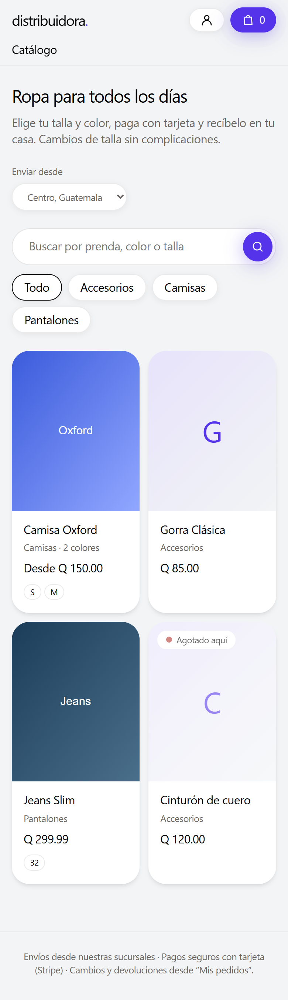

*Figura A-1. Tienda en línea en un teléfono.*

## A1. Crear una cuenta

1. Seleccionar "Iniciar sesión" en la esquina superior derecha y luego el enlace "Crea una".
2. Completar el formulario "Crea tu cuenta": nombre, apellido, correo, contraseña (mínimo 8 caracteres) y su repetición. El teléfono y la dirección de entrega son opcionales; la dirección se propondrá después al finalizar la compra.
3. Presionar "Crear cuenta". La sesión queda iniciada y la tienda regresa a la página desde la que se llegó.

Si el correo ya fue registrado en una sucursal (porque la clienta compró en caja), el sistema muestra: "Ese correo ya está registrado en una de nuestras tiendas. Pide en caja tu código de activación y usa «Activar cuenta» para conservar tu historial", junto con el enlace "Activar mi cuenta". En ese caso debe seguirse la sección [A2](#a2-activar-la-cuenta-con-el-código-de-caja).

## A2. Activar la cuenta con el código de caja

Una clienta que ya compró en una tienda física y dejó su correo en caja puede activar su cuenta en línea y ver también sus compras anteriores.

1. Pedir en caja el código de activación. El personal lo genera desde el panel (ver [B7](#b7-clientes-y-código-web)); tiene el formato `XXXX-XXXX`, sirve una sola vez y vence a las 72 horas.
2. En la tienda, abrir "Iniciar sesión" y seleccionar "Activa tu cuenta con tu código".
3. Completar "Correo registrado en caja", "Código de activación", "Crea tu contraseña" y "Repite la contraseña".
4. Presionar "Activar cuenta". La sesión queda iniciada y en "Mis pedidos" aparecen las compras hechas en mostrador.

## A3. Olvidé mi contraseña

1. En "Iniciar sesión", seleccionar "¿Olvidaste tu contraseña?".
2. Escribir el correo de la cuenta y presionar "Enviarme el enlace". Por seguridad, el mensaje es el mismo exista o no la cuenta: "Si ese correo tiene una cuenta, te enviamos un enlace para crear una contraseña nueva... El enlace vence en 1 hora."
3. Abrir el enlace recibido por correo. Se muestra la página "Crea tu contraseña nueva" con el correo de la cuenta.
4. Escribir la contraseña nueva dos veces y presionar "Guardar contraseña". Al guardarla se cierran las sesiones abiertas en otros dispositivos.

Si el enlace está incompleto o ya venció, la tienda ofrece "Pedir un enlace nuevo". Esta opción también sirve a una clienta registrada en caja que nunca creó contraseña.

## A4. Catálogo y ficha de la prenda

La página principal muestra el catálogo con el título "Ropa para todos los días".

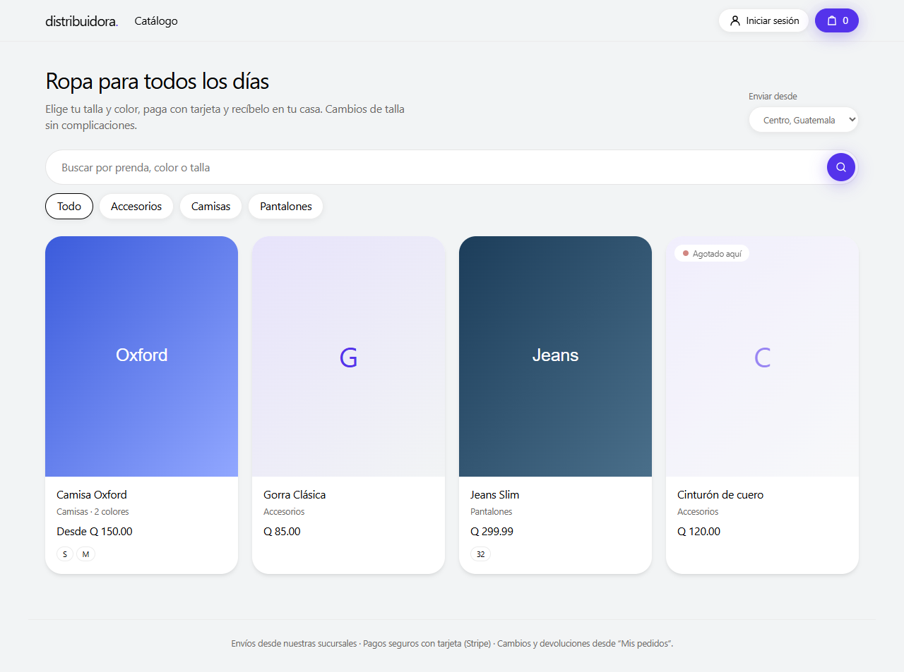

*Figura A-2. Catálogo de la tienda.*

- **Enviar desde:** selector de la sucursal desde la que se despachará el pedido. El stock que se muestra es el de esa sucursal. Si no se elige ninguna, la tienda toma la primera sucursal activa.
- **Buscador:** acepta nombre de prenda, color o talla ("Buscar por prenda, color o talla").
- **Filtros por tipo de prenda:** botones "Todo" y uno por cada tipo registrado.
- **Tarjetas:** cada prenda muestra nombre, tipo, número de colores, precio (o "Desde Q..." si las variantes tienen precios distintos) y las tallas con existencias. La etiqueta "Agotado aquí" indica que la prenda no tiene stock en la sucursal elegida.

Al seleccionar una tarjeta se abre la ficha de la prenda.

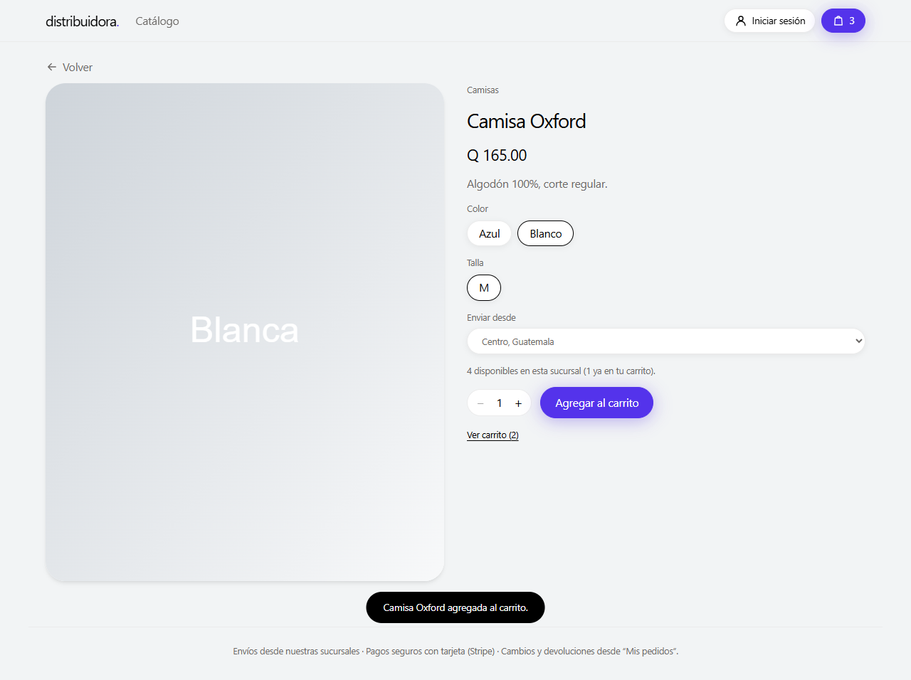

*Figura A-3. Ficha de una prenda con variantes de color y talla.*

1. Elegir el **Color** y luego la **Talla**. El precio y la foto cambian según la variante. Las tallas sin existencias en la sucursal elegida aparecen atenuadas.
2. Revisar el texto de disponibilidad, por ejemplo "4 disponibles en esta sucursal". Si no hay existencias, la ficha indica "Sin existencias de esta talla en la sucursal elegida" y, cuando corresponde, "Disponible en:" con las otras sucursales que sí la tienen.
3. Ajustar la cantidad con los botones "−" y "+" y presionar "Agregar al carrito". Aparece el aviso "[prenda] agregada al carrito".

La cantidad máxima por variante es 20 unidades y nunca supera el stock disponible. Si ya se agregó todo el stock, el botón cambia a "Ya tienes todo el stock en el carrito".

## A5. Carrito

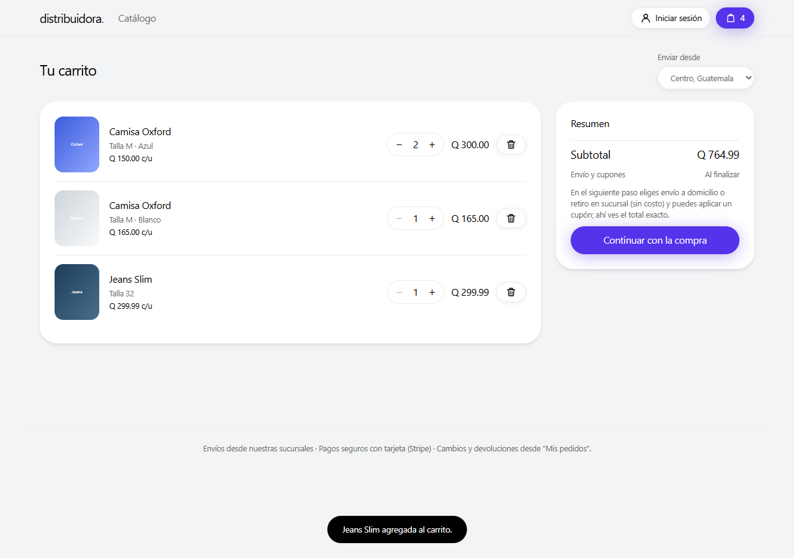

*Figura A-4. Carrito de compras.*

- Cada línea muestra la prenda, la variante, el precio unitario, los controles de cantidad y el botón de papelera para quitarla.
- El carrito se guarda en el navegador, por lo que se conserva al cerrar la página.
- Al abrirlo, la tienda revisa las existencias de la sucursal elegida: actualiza precios que hayan cambiado y marca las líneas con problemas ("Solo quedan N en la sucursal elegida", "Sin existencias en la sucursal elegida" o "Esta prenda ya no está a la venta. Quítala para continuar").
- El resumen indica el subtotal; el envío y los cupones se calculan en el paso siguiente.
- Presionar "Continuar con la compra". Si no hay sesión iniciada, la tienda pide iniciar sesión y luego regresa a este punto.

## A6. Finalizar compra: entrega y cupón

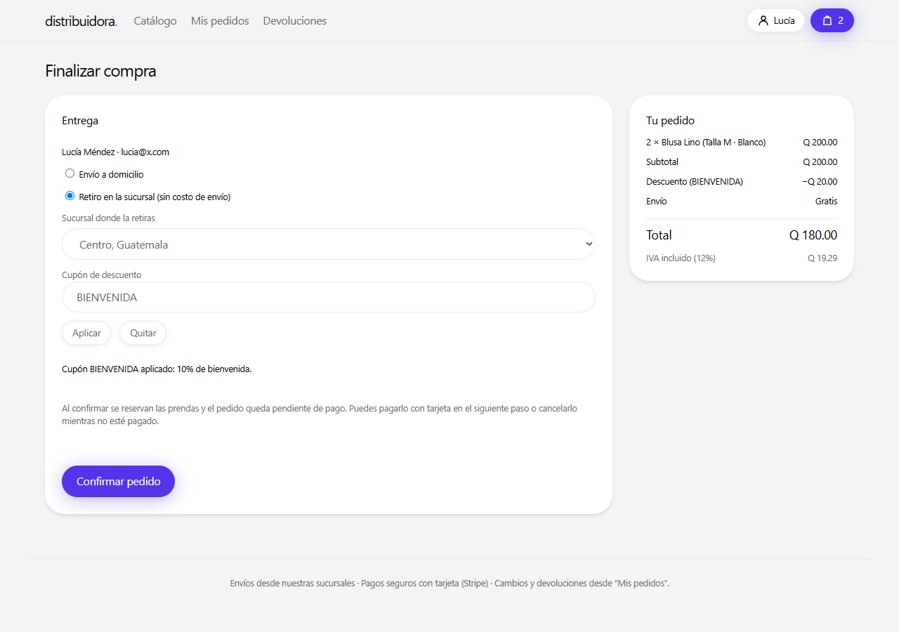

*Figura A-5. Finalizar compra con retiro en sucursal y cupón aplicado.*

1. En **Entrega**, elegir una opción:
   - "Envío a domicilio": se debe escribir la "Dirección de entrega" (se propone la del perfil). El envío cuesta Q 25.00 y es gratis cuando el monto de las prendas, después del descuento, llega a Q 300.00 (valores por defecto del sistema).
   - "Retiro en la sucursal (sin costo de envío)": el selector cambia a "Sucursal donde la retiras".
2. En **Cupón de descuento**, escribir el código y presionar "Aplicar". Si es válido aparece "Cupón [código] aplicado"; si no aplica, se muestra el motivo en rojo. "Quitar" elimina el cupón.
3. Revisar el resumen "Tu pedido": subtotal, descuento, envío, total e IVA incluido. Este cálculo lo hace el servidor con los precios vigentes.
4. Presionar "Confirmar pedido". Las prendas quedan reservadas y el pedido queda "Pendiente de pago". La tienda abre el pedido con el aviso "Pedido #N creado. Ahora completa el pago."

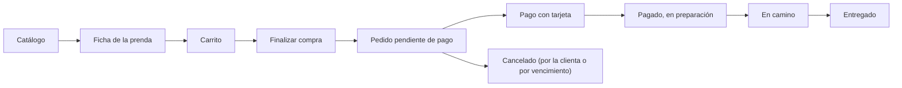

*Figura A-6. Recorrido de una compra en la tienda.*

## A7. Pagar con tarjeta

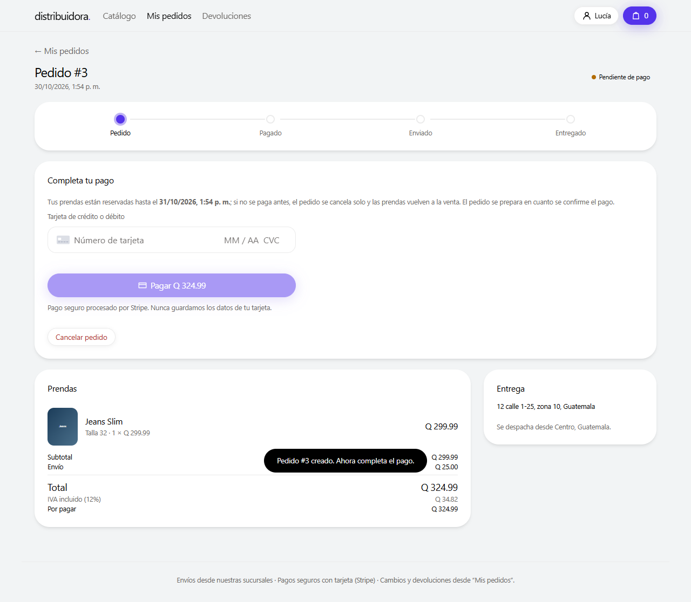

*Figura A-7. Sección de pago del pedido.*

1. En la sección "Completa tu pago", escribir los datos en "Tarjeta de crédito o débito" (número, vencimiento y código de seguridad).
2. Presionar "Pagar Q...". El botón se habilita cuando los datos están completos.
3. Si el pago se aprueba, aparece "¡Pago aprobado! Tu pedido ya está en preparación." y el estado cambia a "Pagado, en preparación". Si la tarjeta es rechazada, se muestra el motivo y el pago puede reintentarse.

El cobro lo procesa Stripe; la tienda no guarda los datos de la tarjeta. En el entorno de pruebas se utiliza la tarjeta de prueba **4242 4242 4242 4242**, con cualquier fecha de vencimiento futura y cualquier código de seguridad. Cuando el servidor funciona en modo de pago simulado, el pago se aprueba al instante con el mensaje "Pago aprobado." (o "Pago aprobado (modo de pruebas)." si la tienda no tiene configurada la clave pública de Stripe).

Si parte del pedido ya se registró en una tienda física y está pendiente de confirmar, la sección lo indica y la tarjeta cobra solo el resto.

## A8. Seguimiento del pedido y plazo de pago

"Mis pedidos" lista todos los pedidos con número, fecha, cantidad de prendas, sucursal, estado y total. Los pedidos pendientes muestran "Págalo antes del [fecha]".

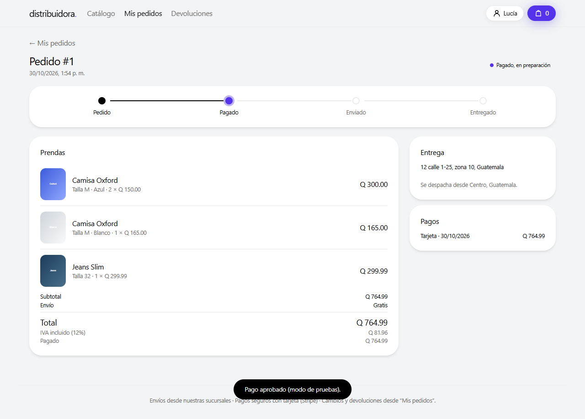

*Figura A-8. Detalle de un pedido pagado.*

Al abrir un pedido se ven la línea de pasos (Pedido, Pagado, Enviado, Entregado), las prendas, el desglose de montos, la dirección de entrega o "Retiro en sucursal", la sucursal de despacho y los pagos realizados.

| Estado que ve la clienta | Significado |
|---|---|
| Pendiente de pago | Las prendas están reservadas; falta pagar. |
| Pagado, en preparación | El pago se confirmó y la sucursal prepara el pedido. |
| En camino | El pedido salió de la sucursal. |
| Entregado | La clienta recibió el pedido. Desde aquí puede solicitar un cambio o una devolución. |
| Cancelado | El pedido se canceló y las prendas volvieron a la venta. |

**Plazo de pago.** Un pedido pendiente debe pagarse dentro de 24 horas (valor por defecto). La fecha límite se muestra en "Completa tu pago". Si vence sin pago, la tienda muestra "El plazo para pagar venció" y el pedido se cancela automáticamente; las prendas vuelven a la venta.

**Cancelar un pedido.** Mientras el pedido esté pendiente, el botón "Cancelar pedido" abre una confirmación; al presionar "Sí, cancelar" las prendas dejan de estar reservadas y, si se había iniciado un pago con tarjeta, también se cancela.

## A9. Solicitar un cambio o una devolución

Cuando el pedido está "Entregado", su detalle muestra la sección "¿Algo no quedó bien?" con la fecha límite. El plazo es de **24 horas desde la entrega** y se permite **una sola solicitud por pedido**.

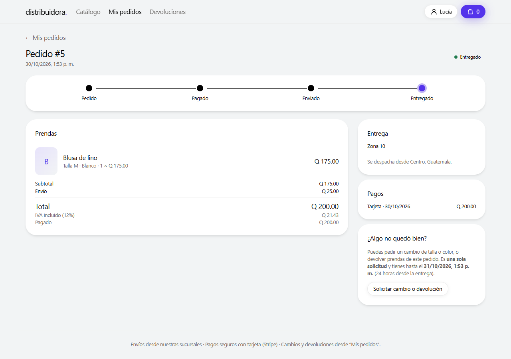

*Figura A-9. Plazo para pedir un cambio o una devolución.*

1. Presionar "Solicitar cambio o devolución".
2. En "¿Qué necesitas?", elegir "Devolver la prenda", "Cambiar por otra talla" o "Cambiar por otro color o variante".
3. Elegir el **Motivo**: "La talla no me queda", "Llegó con un defecto", "Se dañó en el envío", "No es lo que pedí" u "Otro motivo".
4. En **Prendas**, marcar cada prenda incluida, elegir la **Cantidad** y, si es un cambio, la opción de "Cambiar por". Solo se ofrecen variantes de igual o menor precio que lo pagado; si no hay ninguna, la prenda indica "No hay otra talla de esta prenda al mismo precio o menor". Las variantes sin existencias aparecen como "(sin stock por ahora)".
5. Escribir un "Comentario (opcional)" y presionar "Enviar solicitud". Aparece el aviso "Solicitud enviada. Te avisaremos cuando la revisemos."

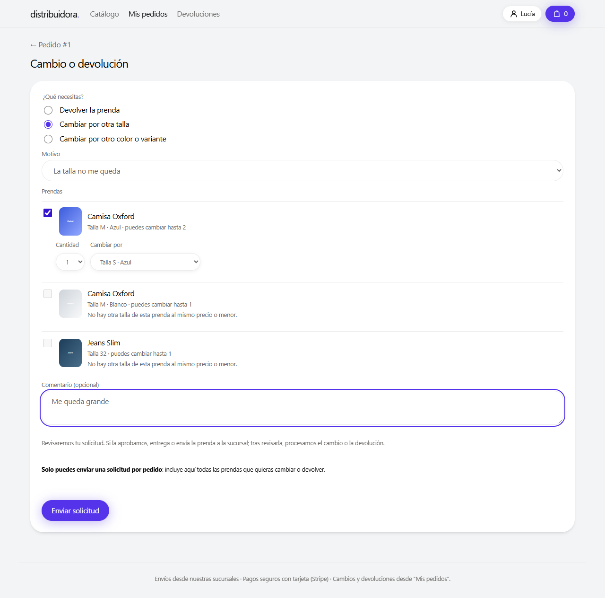

*Figura A-10. Formulario de solicitud de cambio.*

Como la solicitud es única, deben incluirse en ella todas las prendas que se desean cambiar o devolver.

## A10. Seguimiento de la solicitud y reembolsos

La sección "Devoluciones" (título "Cambios y devoluciones") lista las solicitudes. Cada una muestra las prendas, el cambio pedido, el resultado de la revisión, el comentario y la sección "Seguimiento" con cada estado y su fecha.

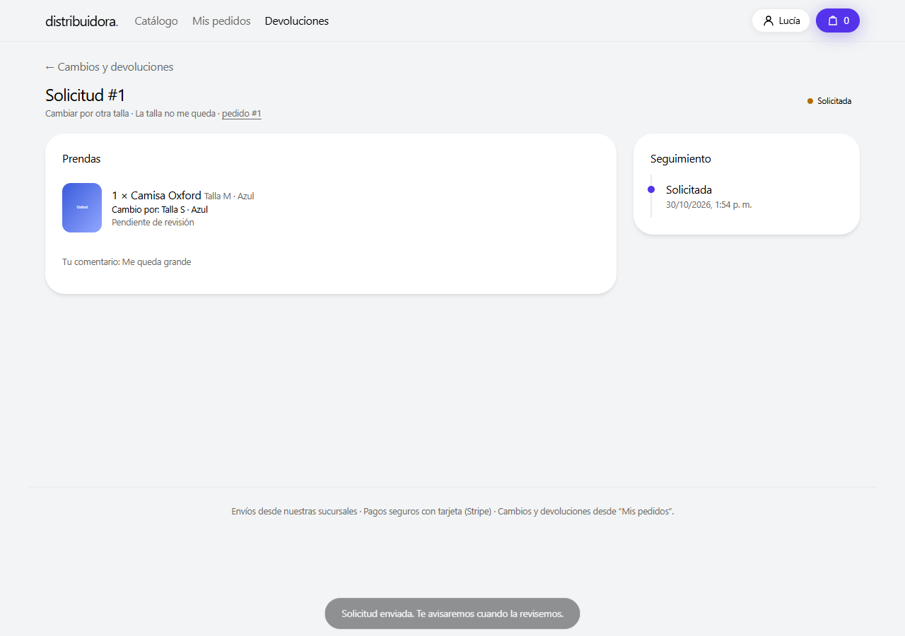

*Figura A-11. Detalle de una solicitud de cambio.*

| Estado | Qué debe hacer la clienta |
|---|---|
| Solicitada | Esperar la revisión de la tienda. |
| Aprobada: envía o lleva la prenda | Entregar o enviar la prenda a la sucursal. |
| Rechazada | La solicitud se cerró; no se admite otra para el mismo pedido. |
| Recibida en tienda / En revisión / Aceptada | La sucursal revisa la prenda. |
| Rechazada tras revisión | La prenda no cumplió las condiciones tras la inspección. |
| Devolución completada / Cambio completado | El proceso terminó. |

**Reembolsos.** Cuando corresponde devolver dinero, el pedido y la solicitud muestran la sección "Tu reembolso" con el monto y lo que debe hacerse:

| Forma de pago original | Mensaje mostrado |
|---|---|
| Tarjeta en línea | "Procesando el reembolso a tu tarjeta" y luego "Devuelto a tu tarjeta. Según tu banco puede tardar de 5 a 10 días hábiles en verse." Si falla: pasar por la sucursal para recibirlo en efectivo. |
| Efectivo en tienda | "Listo para recogerlo en efectivo en la sucursal: acércate a caja." |
| Tarjeta en tienda (POS) | "Se revierte en la tarjeta con la que pagaste en la sucursal." |
| PayPal | "Te lo devolveremos a tu cuenta de PayPal." |

El monto devuelto corresponde a lo pagado por las prendas, con el descuento del cupón repartido proporcionalmente; el costo de envío no se devuelve. En un cambio a una variante más barata se devuelve la diferencia.

## A11. Perfil y cambio de contraseña

En el menú de la cuenta (botón con el nombre de la clienta) se encuentran "Mi perfil", "Mis pedidos", "Devoluciones" y "Cerrar sesión".

- **Mi perfil:** permite modificar nombre, apellido, teléfono y "Dirección de entrega habitual" y guardar con "Guardar cambios". El correo no se modifica desde aquí.
- **Cambiar contraseña:** escribir "Contraseña actual", "Nueva" y "Repite la nueva" y presionar "Cambiar contraseña". La nueva debe ser distinta de la actual; al cambiarla se cierran las sesiones en otros dispositivos.

---

# Parte B. Panel de empleados

El panel es la herramienta interna de las sucursales. A la izquierda hay una barra de íconos (cada ícono muestra su nombre al pasar el cursor); abajo están el avatar con las iniciales del empleado ("Mi cuenta") y el botón "Cerrar sesión". La pantalla inicial es la lista de "Devoluciones y cambios".

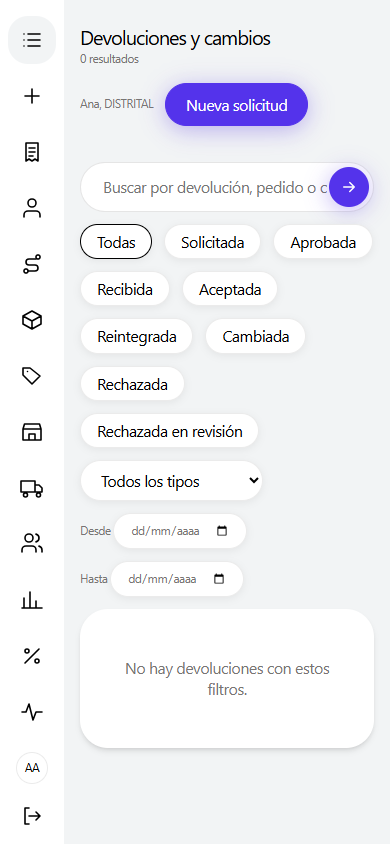

*Figura B-1. Panel de empleados en un teléfono.*

## B1. Puestos y secciones visibles

El gerente distrital trabaja con todas las sucursales; los demás puestos solo con la sucursal que tienen asignada. El servidor valida siempre los permisos, aunque el menú ya oculta lo que no corresponde.

| Sección del menú | Distrital | Administrador | Cajero | Bodeguero |
|---|:-:|:-:|:-:|:-:|
| Devoluciones (consultar) | Sí | Sí | Sí | Sí |
| Nueva solicitud (registrar) | Sí | Sí | Sí | No (el ícono aparece, pero no puede registrar) |
| Pedidos (consultar) | Sí | Sí | Sí | Sí |
| Nueva venta y cobros | Sí | Sí | Sí | No |
| Clientes | Sí | Sí | Sí | No |
| Trazabilidad e Inventario | Sí | Sí | Sí | Sí |
| Catálogo y stock | Sí (edita) | Sí (consulta e ingresa stock) | No | Sí (consulta e ingresa stock) |
| Sucursales | Sí (todas, crea y edita) | Su sucursal | No | Su sucursal |
| Proveedores | Sí | Sí | No | Sí (sin eliminar) |
| Empleados | Sí (todos) | Cajeros y bodegueros de su sucursal | No | No |
| Reportes de ventas | Sí (todas) | Su sucursal | No | No |
| Promociones | Sí | No | No | No |
| Estado del sistema | Sí | No | No | No |

En las tablas siguientes, "Administrador" corresponde al puesto ADMIN (gerente de sucursal).

## B2. Iniciar sesión y cambiar la contraseña

1. Abrir el panel, escribir "Correo" y "Contraseña" y presionar "Iniciar sesión".
2. Si no se tiene cuenta o se olvidó la contraseña, un administrador debe registrar al empleado o asignarle una contraseña temporal (ver [B12](#b12-empleados)).
3. Para cambiar la contraseña, presionar el avatar con las iniciales, abajo a la izquierda. En "Mi cuenta" escribir "Contraseña actual", "Nueva contraseña" y "Repite la nueva contraseña", y presionar "Cambiar contraseña". Las demás sesiones abiertas se cierran.

Si la sesión vence o deja de ser válida, el panel muestra "Tu sesión expiró o ya no es válida. Inicia sesión de nuevo."

## B3. Registrar una venta de mostrador

**Puestos:** Distrital, Administrador, Cajero.

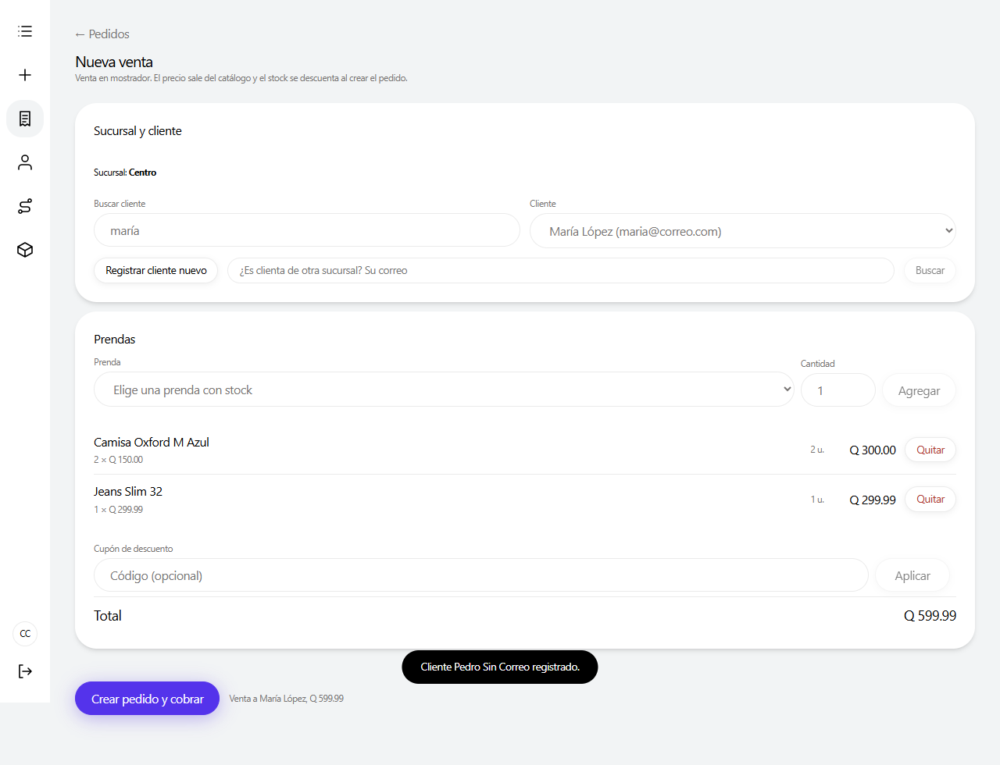

*Figura B-2. Nueva venta de mostrador.*

1. En "Pedidos", presionar "Nueva venta".
2. **Sucursal y cliente.** El cajero y el administrador venden en su sucursal (se muestra "Sucursal: [nombre]"); el distrital elige la sucursal. Escribir en "Buscar cliente" (nombre, correo o teléfono) y elegirlo en "Cliente".
   - Si el cliente no existe, presionar "Registrar cliente nuevo".
   - Si es clienta de otra sucursal, escribir su correo en "¿Es clienta de otra sucursal? Su correo" y presionar "Buscar".
3. **Prendas.** Elegir la prenda en "Prenda" (solo aparecen las que tienen stock en la sucursal, con su precio y unidades disponibles), escribir la "Cantidad" y presionar "Agregar". "Quitar" elimina una línea.
4. **Cupón (opcional).** Escribir el código en "Cupón de descuento" y presionar "Aplicar". Se muestran el subtotal y el descuento; si el cupón no aplica, aparece el motivo.
5. Presionar "Crear pedido y cobrar". El stock se descuenta al crear el pedido y se abre directamente el cobro (ver [B4](#b4-cobrar-y-confirmar-pagos)).

Si otra caja vendió las últimas unidades mientras se armaba la venta, la línea afectada indica "Ahora solo hay N disponibles" y se debe ajustar la cantidad.

## B4. Cobrar y confirmar pagos

**Puestos:** Distrital, Administrador, Cajero.

La lista "Pedidos" permite buscar por número o cliente y filtrar por estado ("Pendiente de pago", "Pagado", "Enviado", "Entregado", "Cancelado"), por origen ("Tienda en línea" o "Mostrador") y, para el distrital, por sucursal.

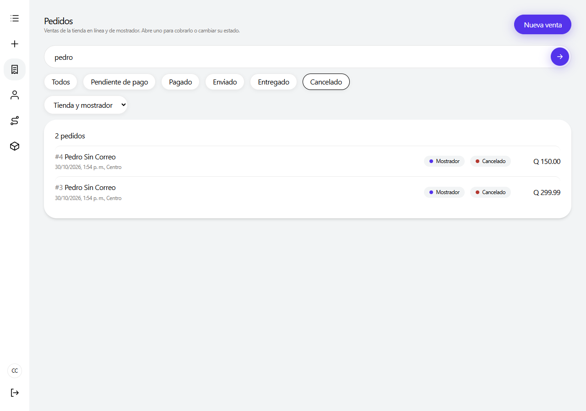

*Figura B-3. Lista de pedidos con filtros.*

Para cobrar un pedido pendiente:

1. Abrir el pedido. La tarjeta superior indica "Falta cobrar Q..." y la fecha en que se cancelaría si no se paga.
2. Presionar "Registrar pago" y elegir el método:
   - **Efectivo:** se registra como cobrado al instante. El campo "Efectivo recibido" calcula el vuelto.
   - **Tarjeta (POS):** cobro en el terminal de la tienda; se registra como cobrado al instante. Se puede anotar el "Número de autorización del voucher".
   - **PayPal:** queda "Por confirmar" hasta verificar que el dinero llegó.
3. Revisar el "Monto a cobrar" (por defecto, el saldo completo; se admiten pagos parciales) y presionar "Cobrar Q...".

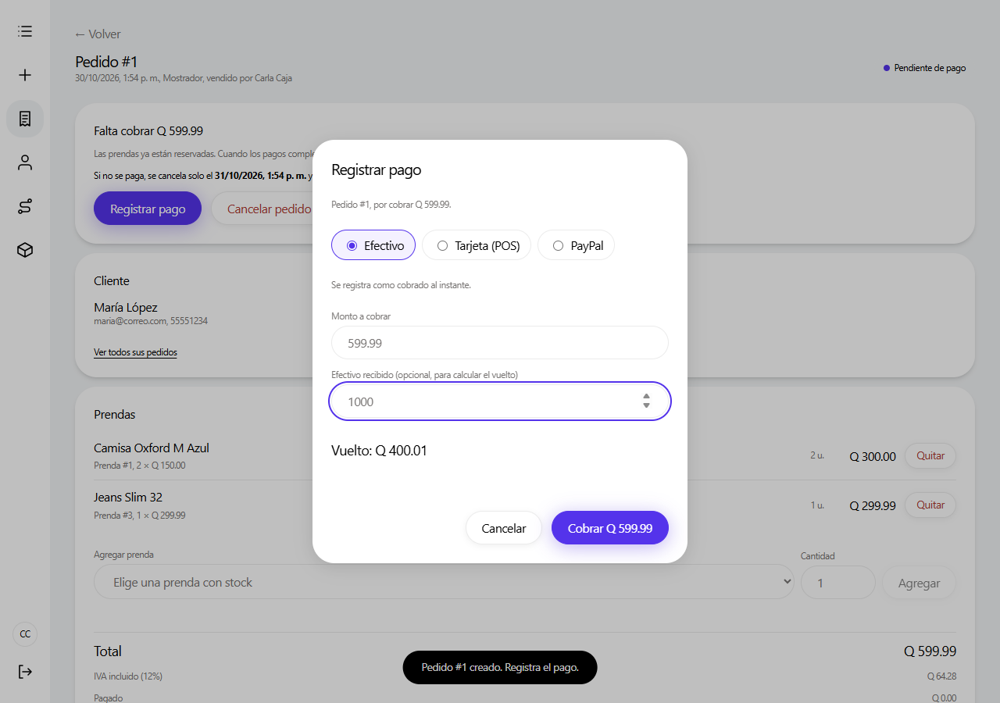

*Figura B-4. Registro de un pago en efectivo con cálculo del vuelto.*

Cuando los pagos completados cubren el total, el pedido pasa solo a "Pagado". En la sección "Pagos" del pedido:

| Botón | Cuándo aparece | Efecto |
|---|---|---|
| "Confirmar" | Pago por confirmar (por ejemplo, PayPal) | Registra que el dinero se recibió. |
| "Anular" | Pago por confirmar | El monto vuelve a quedar por cobrar. |
| "Devolver" | Pago completado en efectivo o POS de un pedido aún pendiente | Registra que se devolvió el dinero ("Ya lo devolví"). |

Mientras el pedido esté pendiente, también pueden quitarse prendas ("Quitar") o agregarse ("Agregar prenda"); el total se recalcula solo. Para cancelar un pedido con pagos, primero deben devolverse o anularse esos pagos.

## B5. Avanzar el estado de un pedido

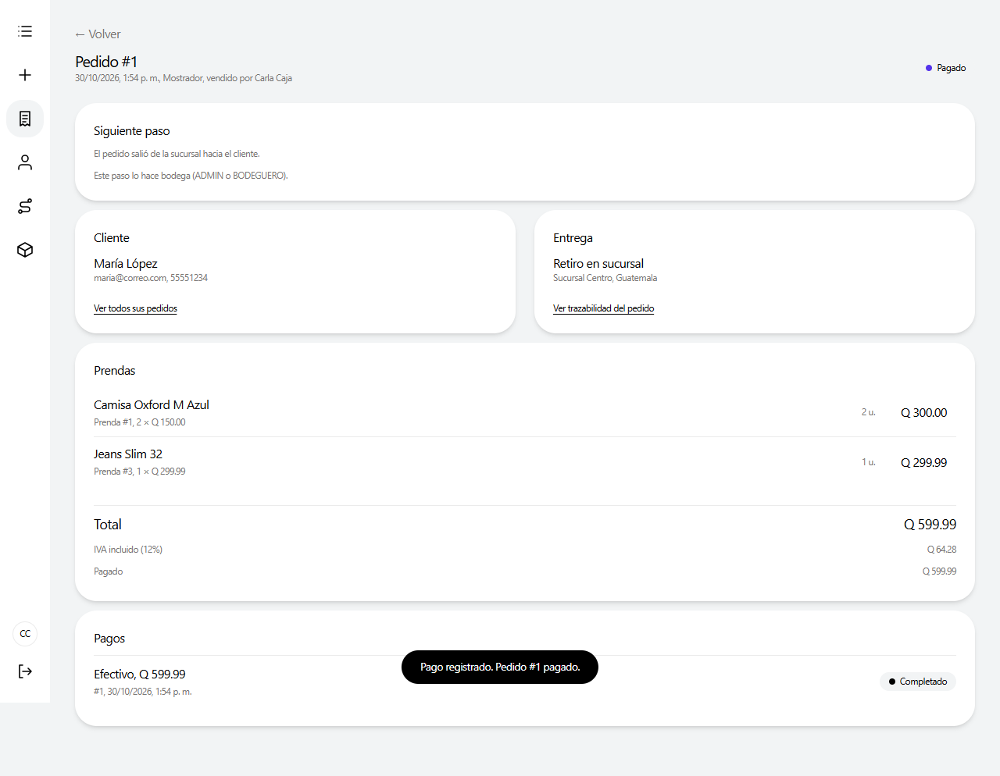

*Figura B-5. Detalle de un pedido pagado.*

La tarjeta "Siguiente paso" muestra la acción que corresponde al estado actual:

| Estado actual | Botón | Quién puede | Resultado |
|---|---|---|---|
| Pendiente de pago | "Registrar pago" | Distrital, Administrador, Cajero | Pasa solo a "Pagado" al cubrirse el total. |
| Pendiente de pago (sin pagos) | "Cancelar pedido" | Distrital, Administrador, Cajero | Las prendas vuelven al stock. No se puede deshacer. |
| Pagado | "Marcar como enviado" | Distrital, Administrador, Bodeguero | El pedido salió hacia el cliente. |
| Enviado | "Marcar como entregado" | Distrital, Administrador, Bodeguero | El cliente lo recibió; desde aquí puede pedir cambios o devoluciones. |

Si el puesto no puede realizar el paso, el panel indica "Este paso lo hace bodega (ADMIN o BODEGUERO)". Cada acción pide confirmación antes de ejecutarse. El enlace "Ver trazabilidad del pedido" muestra los movimientos de inventario asociados.

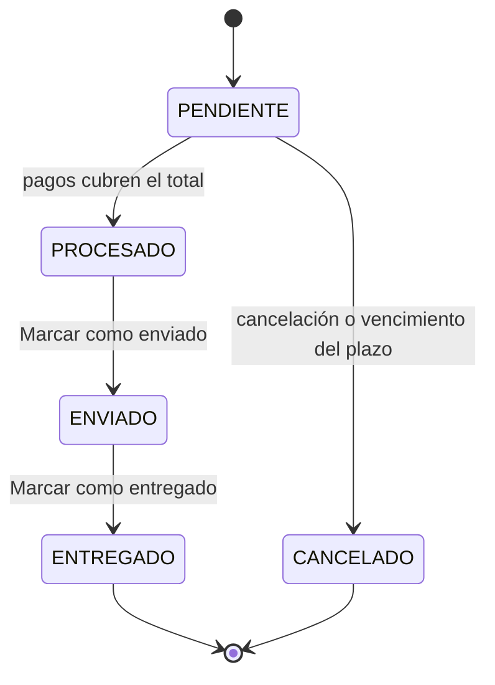

*Figura B-6. Estados de un pedido (en pantalla: Pendiente de pago, Pagado, Enviado, Entregado y Cancelado).*

## B6. Procesar una devolución o un cambio

Las solicitudes llegan desde la tienda o se registran en el panel con "Nueva solicitud". La lista "Devoluciones y cambios" permite buscar por devolución, pedido o cliente y filtrar por estado, tipo y rango de fechas. Para cajeros y gerentes, la parte superior muestra además "Reembolsos por entregar" con el total pendiente.

**Registrar una solicitud en mostrador** (Distrital, Administrador, Cajero): en "Nueva solicitud" elegir el "Cliente" y el "Pedido entregado"; el panel indica el plazo restante. Marcar las prendas (se muestra lo comprado, lo ya solicitado y lo que queda por devolver), la cantidad y, si es cambio, la prenda nueva; elegir "Tipo" y "Motivo" y presionar "Registrar solicitud".

**Procesar la solicitud paso a paso.** Abrir la devolución desde la lista. La ficha muestra cliente, pedido, tipo, motivo, fechas y observación, y los botones del paso que corresponde al puesto. Si el paso lo realiza otro puesto, el panel lo indica ("Siguiente paso: ... Lo realiza ...").

| Paso | Estado de partida | Botón | Quién puede | Qué hacer |
|---|---|---|---|---|
| 1. Aprobar o rechazar | Solicitada | "Aprobar" / "Rechazar" | Distrital, Administrador | Aprobar permite recibir la prenda. Rechazar cierra la solicitud de forma definitiva. |
| 2. Recibir | Aprobada | "Marcar como recibida" | Distrital, Administrador, Bodeguero | Confirmar que la prenda llegó a la sucursal. |
| 3. Revisar | Recibida | "Registrar inspección" | Distrital, Administrador, Bodeguero | Indicar por prenda "Buen estado", "Dañado" o "Defectuoso" y elegir "Aceptar devolución" o "Rechazar". |
| 4a. Reintegrar | Aceptada (devolución) | "Reintegrar a inventario" | Distrital, Administrador, Bodeguero | Cada prenda vuelve al inventario como disponible, dañada o defectuosa según la inspección. |
| 4b. Cambiar | Aceptada (cambio) | "Procesar cambio" | Distrital, Administrador, Bodeguero | Se descuenta la prenda nueva y se reingresa la devuelta. |
| 5. Entregar reembolso | Reintegrada o Cambiada | "Ya lo entregué" / "Entregar en efectivo" | Distrital, Administrador, Cajero | Entregar el dinero a la clienta y confirmarlo. |

Los pasos de aprobación, recepción e inspección admiten una observación opcional. Las secciones "Decisiones" y "Movimientos de inventario" registran quién hizo cada paso y cuándo.

**Entregar el reembolso en caja.** Al completarse una devolución (o un cambio a una variante más barata), la ficha muestra "Reembolso a la clienta: Q...":

- Los reembolsos a la tarjeta en línea los procesa Stripe automáticamente. Si quedan pendientes, el botón "Reintentar en Stripe" consulta de nuevo; si Stripe los rechaza, aparece "Entregar en efectivo".
- Los reembolsos en efectivo, reversión en POS o PayPal quedan "Pendiente". Después de entregar el dinero, presionar "Ya lo entregué", anotar opcionalmente una referencia y confirmar con "Sí, ya lo entregué". Queda registrado con el nombre del empleado.

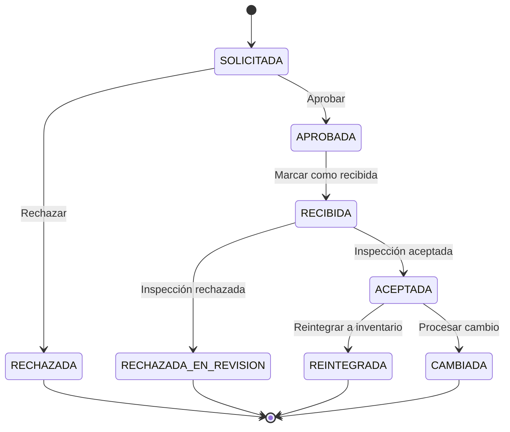

*Figura B-7. Recorrido de una solicitud de cambio o devolución en el panel.*

## B7. Clientes y código web

**Puestos:** Distrital, Administrador, Cajero.

La sección "Clientes" lista los clientes de mostrador y de la tienda en línea, con los filtros "Activos", "Con cuenta web", "Solo mostrador" y "Desactivados", y búsqueda por nombre, correo, teléfono o número. Cada cliente tiene la etiqueta "Cuenta web" o "Mostrador" y los botones "Pedidos", "Editar" y, si aún no tiene cuenta web, "Código web".

- **Nuevo cliente:** nombre y apellido son obligatorios; correo, teléfono y dirección son opcionales. El distrital elige además la "Sucursal donde se registra". Con correo, el cliente podrá activar después su cuenta en línea.
- **Editar:** si el cliente ya tiene cuenta web, su correo no se puede cambiar desde el panel. Solo el distrital y el administrador pueden desactivar o reactivar un cliente ("Cliente activo"); un cliente desactivado no puede comprar ni entrar a la tienda.

**Generar el código web:**

1. Presionar "Código web" en la fila del cliente. El cliente debe tener correo.
2. Presionar "Generar código". Se muestra un código de un solo uso, válido 72 horas.
3. Entregarlo en persona e indicar el camino en la tienda: "Iniciar sesión", luego "Activa tu cuenta con tu código" (ver [A2](#a2-activar-la-cuenta-con-el-código-de-caja)).

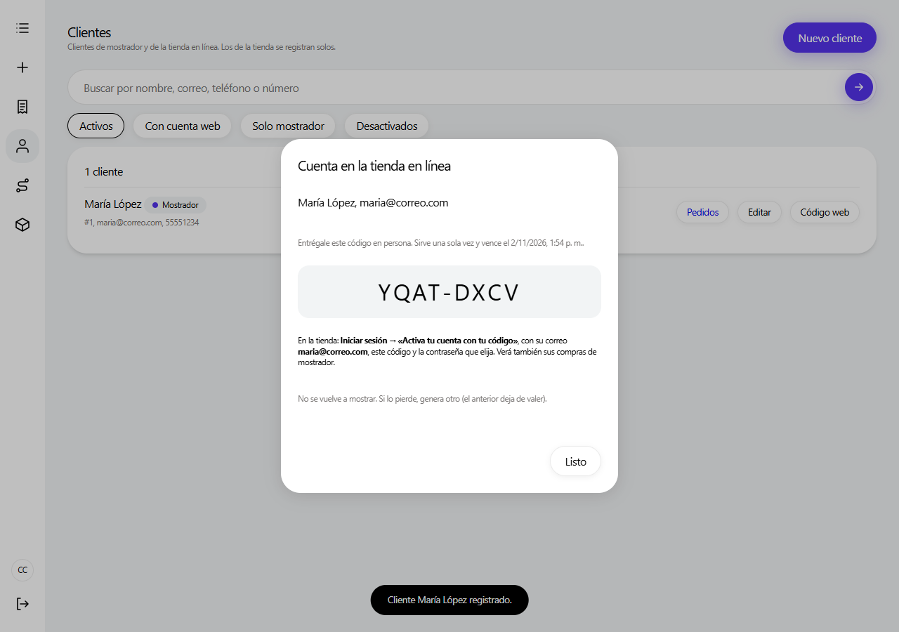

*Figura B-8. Código de activación generado para una clienta de mostrador.*

El código no se vuelve a mostrar. Si se pierde, se genera otro y el anterior deja de valer.

## B8. Catálogo, tipos de prenda y fotos

**Puestos:** el Distrital crea y edita; Administrador y Bodeguero consultan e ingresan stock.

La sección "Catálogo y stock" tiene tres pestañas. El catálogo es único para todas las sucursales.

**Nueva prenda** (Distrital):

1. Completar "Nombre", "Tipo de prenda", "Talla", "Color", "Precio de venta" y "Stock mínimo (alerta de stock crítico)" (5 por defecto).
2. En "Variante de", elegir la prenda base si se registra una variante; dejar "Ninguna, es una prenda base" en caso contrario.
3. Agregar una "Descripción (opcional)" y la foto.
4. Presionar "Registrar prenda".

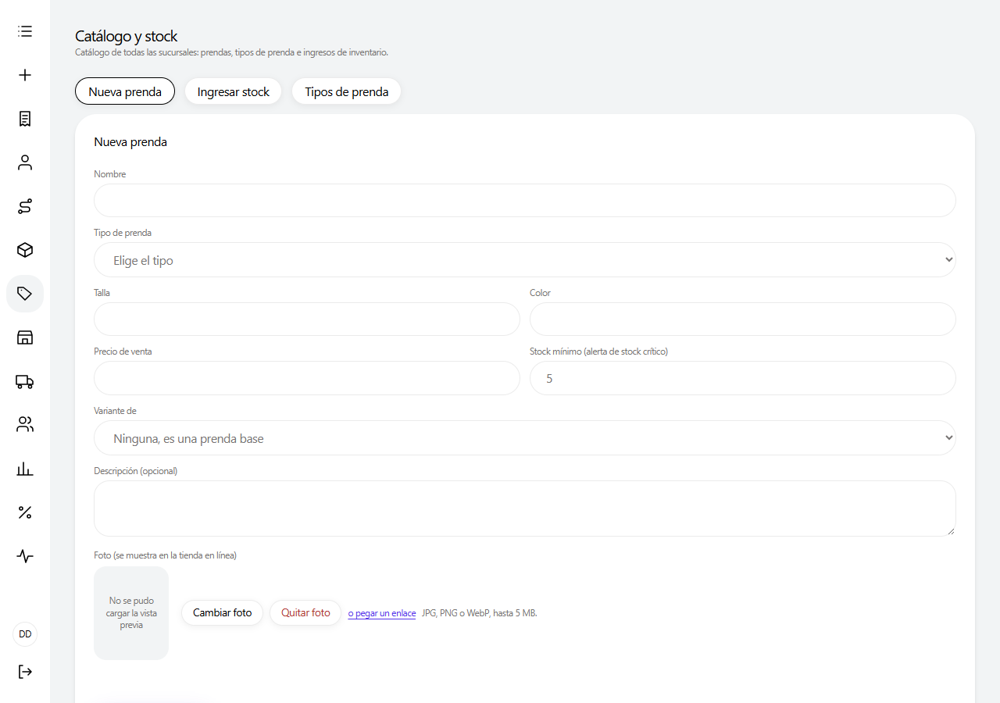

*Figura B-9. Formulario de nueva prenda con la sección de foto.*

**Foto de la prenda.** En "Foto (se muestra en la tienda en línea)", presionar "Subir foto" y elegir un archivo JPG, PNG o WebP de hasta 5 MB (límite indicado en pantalla). También puede usarse "o pegar un enlace". Los botones "Cambiar foto" y "Quitar foto" reemplazan o eliminan la imagen. Una variante sin foto propia muestra en la tienda la foto de su prenda base.

**Prendas registradas.** La lista muestra número, tipo, si es variante y si está inactiva. Con "Editar" se modifican los datos y se puede desactivar la prenda ("Prenda activa"). "Eliminar" solo funciona si la prenda nunca tuvo variantes, inventario, ventas ni devoluciones; si tiene historial, debe desactivarse.

**Tipos de prenda** (Distrital): escribir "Nombre" y "Descripción (opcional)" y presionar "Crear tipo de prenda". Un tipo solo se puede eliminar si ninguna prenda lo usa.

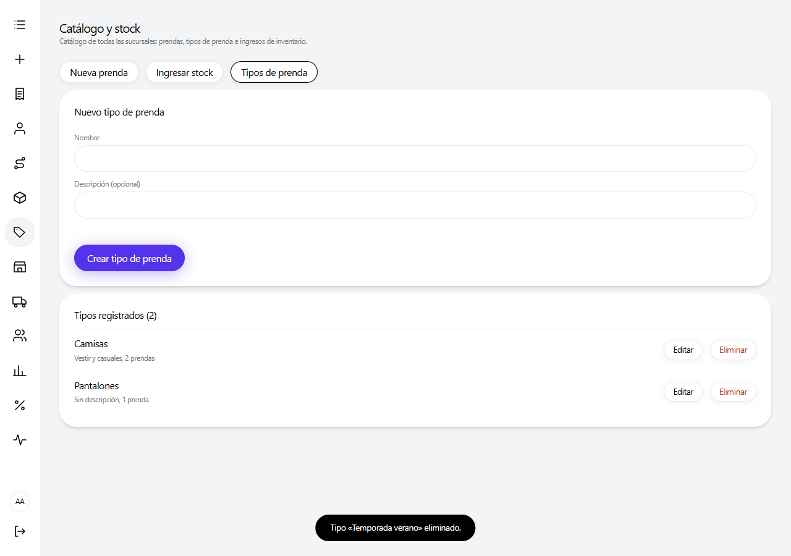

*Figura B-10. Tipos de prenda.*

**Ingresar stock** (Distrital, Administrador, Bodeguero): elegir la "Prenda", la "Sucursal" (solo el distrital; los demás ingresan en la suya), la "Cantidad", el "Lote (opcional)" y el "Estado" (Disponible, Dañada o Defectuosa), y presionar "Ingresar al inventario". Solo las unidades disponibles se venden.

## B9. Inventario y trazabilidad

**Puestos:** todos.

- **Inventario** ("Inventario por estado"): muestra, por prenda y sucursal, las unidades disponibles, dañadas y defectuosas, con totales arriba. Permite buscar por nombre, talla, color o número y filtrar por estado y sucursal.
- **Trazabilidad:** historial de movimientos de inventario. Con "Por pedido" se escribe el número de pedido; con "Por producto" se elige la prenda. Cada movimiento indica el tipo, la prenda, la cantidad, el empleado, la fecha y la observación. Los ajustes de stock, ventas, devoluciones y cambios quedan registrados aquí.

## B10. Sucursales y ajustes de stock

**Puestos:** el Distrital ve todas y puede crearlas, editarlas y eliminarlas; Administrador y Bodeguero ven "Mi sucursal" y ajustan su stock.

- **Nueva sucursal / Editar:** nombre, dirección, ciudad y teléfono opcional. Al desmarcar "Sucursal activa", deja de vender en la tienda en línea y no aparece para ingresar stock, pero conserva su historial.
- **Eliminar:** solo si la sucursal nunca tuvo empleados, inventario ni pedidos.
- **Ver stock:** muestra cada fila de inventario (cada ingreso o lote es una fila) con prenda, lote, estado y cantidad. Se puede buscar, filtrar por estado y activar "Mostrar filas en 0".

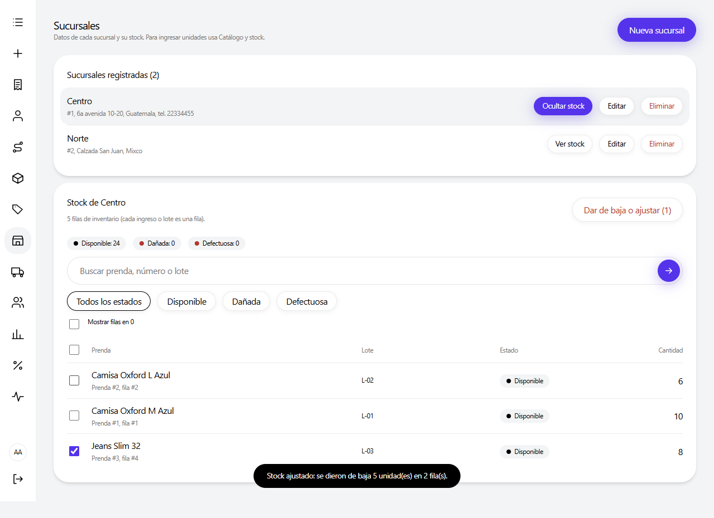

*Figura B-11. Stock de una sucursal y selección de filas para ajustar.*

**Dar de baja o ajustar stock:**

1. Marcar una o varias filas y presionar "Dar de baja o ajustar (N)".
2. En cada fila, el campo "Quedan" propone 0 (dar de baja todo); puede escribirse otra cantidad menor a la actual.
3. Elegir el "Motivo": "Corrección por conteo físico", "Pérdida o extravío", "Robo", "Daño en bodega", "Descarte de prenda dañada o defectuosa" u "Otro motivo (explícalo)". Con "Otro motivo" la observación es obligatoria.
4. Presionar "Confirmar baja". La baja queda registrada en Trazabilidad con el nombre del empleado.

## B11. Proveedores

**Puestos:** Distrital, Administrador, Bodeguero (eliminar: solo Distrital y Administrador).

La sección lista las empresas que surten las prendas, con filtros "Activos", "Desactivados" y "Todos" y búsqueda por empresa, contacto, correo o teléfono. "Nuevo proveedor" pide "Empresa" y, opcionalmente, contacto, teléfono, correo y dirección. Con "Editar" se modifican los datos o se desmarca "Proveedor activo". "Eliminar" borra el proveedor definitivamente; si solo se dejará de trabajar con él, se recomienda desactivarlo.

## B12. Empleados

**Puestos:** Distrital (todo el personal) y Administrador (cajeros y bodegueros de su sucursal).

*Figura B-12. Gestión de empleados.*

- **Nuevo empleado:** nombre, apellido, "Correo (con él inicia sesión)", "Puesto", sucursal (el distrital la elige; el puesto Distrital no tiene sucursal) y "Contraseña inicial" de 8 caracteres como mínimo. La contraseña se entrega en persona.
- **Editar:** permite cambiar los datos, el puesto y la sucursal, y desmarcar "Cuenta activa". Una cuenta desactivada no puede iniciar sesión y su sesión abierta deja de funcionar. Nadie puede cambiar su propio puesto ni desactivarse.
- **Restablecer contraseña / Dar acceso:** asigna una "Contraseña temporal". El empleado debe cambiarla al entrar desde su avatar. Si tenía una sesión abierta, se cierra.

## B13. Promociones y cupones

**Puesto:** Distrital.

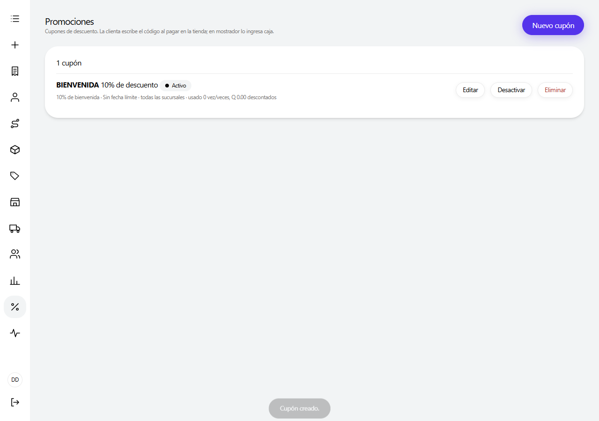

*Figura B-13. Lista de cupones.*

1. Presionar "Nuevo cupón".
2. Completar "Código (lo que escribe la clienta)" (de 3 a 30 letras, números, guiones o guion bajo), "Descripción", "Tipo" ("Porcentaje (%)" o "Monto fijo (Q)") y su valor.
3. Opcionalmente, definir "Compra mínima (Q)", "Usos máximos (vacío = ilimitado)", "Válido desde", "Válido hasta" y "Sucursal" (o "Todas las sucursales").
4. Presionar "Guardar".

Cada cupón muestra su vigencia, alcance, número de usos y el total descontado. "Desactivar" y "Activar" lo suspenden o reanudan. Un cupón ya usado no permite cambiar su código ni su tipo, y solo se puede eliminar si nunca se usó.

## B14. Reportes de ventas y PDF

**Puestos:** Distrital (todas las sucursales o una) y Administrador (su sucursal).

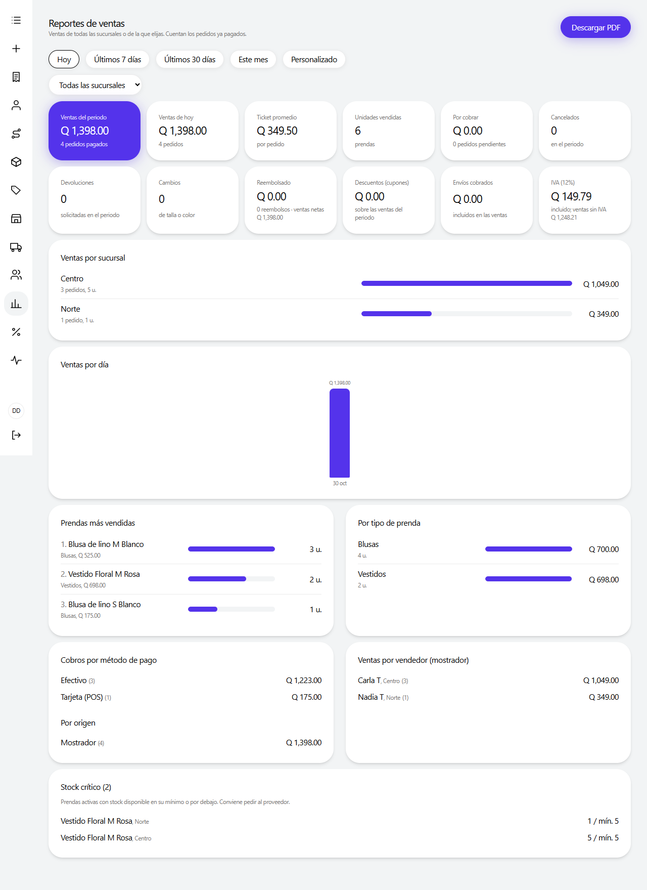

*Figura B-14. Reportes de ventas.*

1. Elegir el periodo: "Hoy", "Últimos 7 días", "Últimos 30 días", "Este mes" o "Personalizado" (con fechas "Desde" y "Hasta").
2. El distrital puede elegir una sucursal o dejar "Todas las sucursales".
3. Revisar los indicadores y las tablas. Las ventas cuentan solo los pedidos ya pagados; los indicadores "Por cobrar" y "Cancelados" muestran aparte los pedidos pendientes y cancelados.
4. Presionar "Descargar PDF" para obtener el reporte con encabezado (sucursal, periodo y quién lo generó), indicadores y todas las tablas, incluidas todas las prendas vendidas.

| Bloque | Contenido |
|---|---|
| Indicadores | Ventas del periodo, ventas de hoy, ticket promedio, unidades vendidas, por cobrar, cancelados, devoluciones, cambios, reembolsado y ventas netas, descuentos por cupones, envíos cobrados e IVA. |
| Ventas por sucursal | Solo para el distrital sin sucursal elegida. |
| Ventas por día | Gráfica de columnas del periodo. |
| Prendas más vendidas y por tipo de prenda | Las diez prendas con más unidades y las ventas por tipo. |
| Cobros por método de pago, por origen y con cupón | Efectivo, tarjeta POS, PayPal, tarjeta en línea; tienda en línea frente a mostrador. |
| Ventas por vendedor (mostrador) | Ventas registradas por cada empleado. |
| Stock crítico | Prendas activas con stock disponible en su mínimo o por debajo. |

## B15. Estado del sistema

**Puesto:** Distrital.

*Figura B-15. Estado del sistema.*

La pantalla permite verificar que el sistema funciona correctamente. El botón "Actualizar" vuelve a consultar la información.

- **Base de datos:** si responde, la latencia, las migraciones aplicadas y la última, la memoria del servidor y la versión de Node.
- **Pendientes y servicios:** pedidos sin pagar, reembolsos pendientes, plazo para pagar un pedido y estado del correo, de los pagos con tarjeta (Stripe), de las fotos (Cloudinary) y de Sentry.
- **Avisos:** en rojo se muestran problemas como "La base de datos no responde", migraciones pendientes, ausencia de SMTP ("las clientas no reciben correos") o reembolsos que Stripe rechazó y esperan entrega en efectivo.
- **Errores del servidor:** lista paginada con código, ruta, mensaje, fecha, usuario y referencia, y el conteo de las últimas 24 horas y 7 días.

---

## Preguntas frecuentes

**¿Por qué una prenda aparece como "Agotado aquí" si sé que hay en otra tienda?**
La tienda muestra el stock de la sucursal elegida en "Enviar desde". En la ficha de la prenda, la línea "Disponible en:" indica las otras sucursales con existencias; basta con cambiar la sucursal en el selector.

**¿Puedo comprar prendas de dos sucursales en el mismo pedido?**
No. Cada pedido se despacha desde una sola sucursal. Al cambiar la sucursal, el carrito se revisa contra las existencias de la nueva.

**¿Cuánto cuesta el envío?**
Con la configuración por defecto, Q 25.00, y es gratis cuando las prendas suman Q 300.00 o más después del descuento. El retiro en sucursal no tiene costo.

**¿Qué pasa si no pago mi pedido?**
Las prendas quedan reservadas durante 24 horas. Si no se paga en ese plazo, el pedido se cancela solo y las prendas vuelven a la venta.

**El cupón no se aplica. ¿Por qué?**
La pantalla muestra el motivo: puede estar inactivo, fuera de vigencia, limitado a otra sucursal, haber alcanzado sus usos máximos o requerir una compra mínima.

**¿Puedo pedir un segundo cambio del mismo pedido?**
No. Se permite una sola solicitud por pedido, dentro de las 24 horas siguientes a la entrega, y una solicitud rechazada también cuenta. Por eso deben incluirse todas las prendas en la misma solicitud.

**¿Por qué no puedo cambiar una prenda por una talla más cara?**
Los cambios solo admiten variantes de igual o menor precio, porque la diferencia no puede cobrarse en línea. Si la variante nueva es más barata, se reembolsa la diferencia.

**¿Cuándo veo el reembolso en mi tarjeta?**
Una vez completado en el sistema, el banco puede tardar de 5 a 10 días hábiles en reflejarlo. Si el reembolso a la tarjeta falla, se entrega en efectivo en la sucursal.

**Compré en tienda y no puedo crear la cuenta con mi correo.**
Ese correo ya existe como cliente de mostrador. Debe pedirse en caja el código de activación y usar "Activa tu cuenta con tu código" (sección [A2](#a2-activar-la-cuenta-con-el-código-de-caja)).

**El sistema dice "Demasiados intentos".**
Para proteger las cuentas, el sistema limita los intentos de inicio de sesión, registro y recuperación de contraseña. Debe esperarse el tiempo indicado en el mensaje antes de volver a intentar.

**Soy empleado y olvidé mi contraseña.**
El panel no envía enlaces de recuperación. Un administrador de la sucursal o el gerente distrital debe asignar una contraseña temporal desde "Empleados", con "Restablecer contraseña".

**No veo una sección del panel que usa un compañero.**
El menú depende del puesto (ver [B1](#b1-puestos-y-secciones-visibles)). Si el puesto es incorrecto, debe pedirse el cambio a un superior; el menú se actualiza al volver a abrir el panel.

**¿Por qué no puedo eliminar una prenda, una sucursal o un cupón?**
El sistema conserva el historial. Las prendas y sucursales con movimientos, y los cupones ya usados, no se eliminan: se desactivan.

**¿Cómo pruebo un pago sin usar una tarjeta real?**
En el entorno de pruebas se usa la tarjeta 4242 4242 4242 4242 con cualquier fecha futura y cualquier código de seguridad. El panel "Estado del sistema" indica si los pagos con tarjeta funcionan en modo simulado.

---

Documentos relacionados: [Roles y permisos](03-roles-y-permisos.md) · [Reglas de negocio](04-reglas-de-negocio.md) · [Seguridad](07-seguridad.md)
