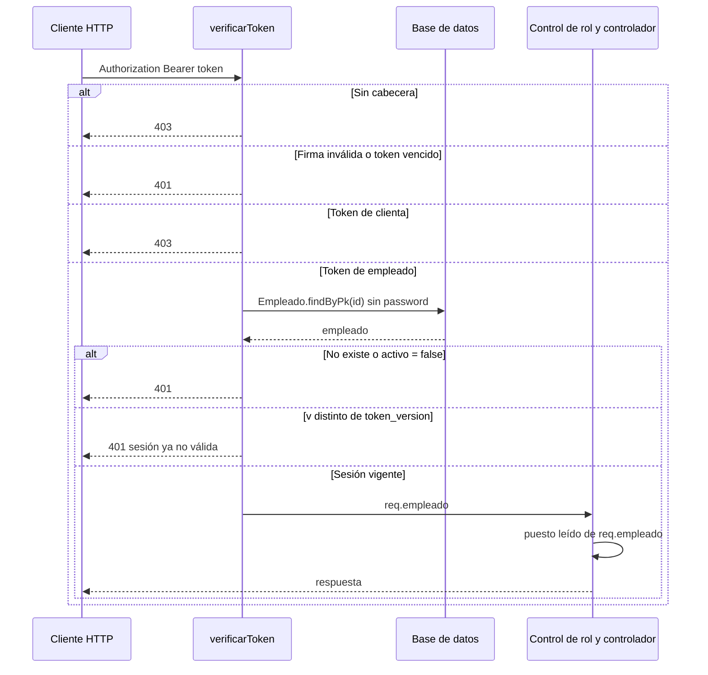
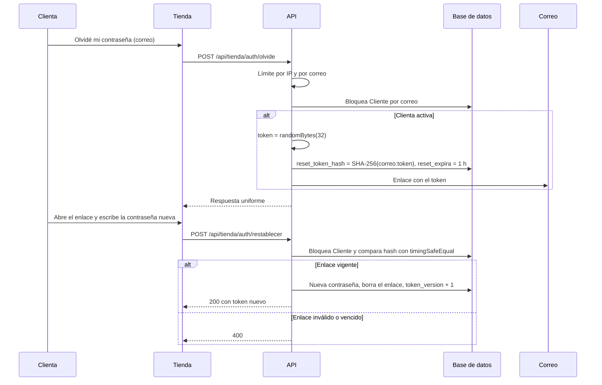
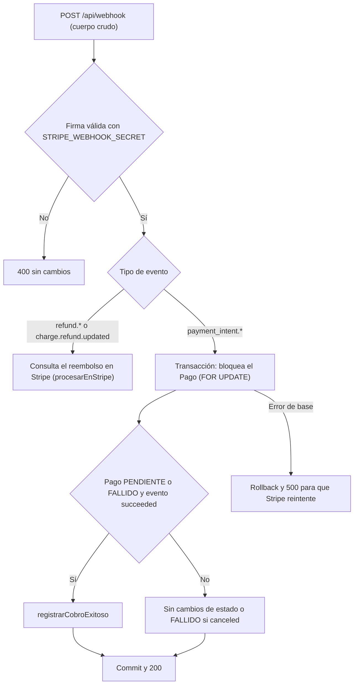
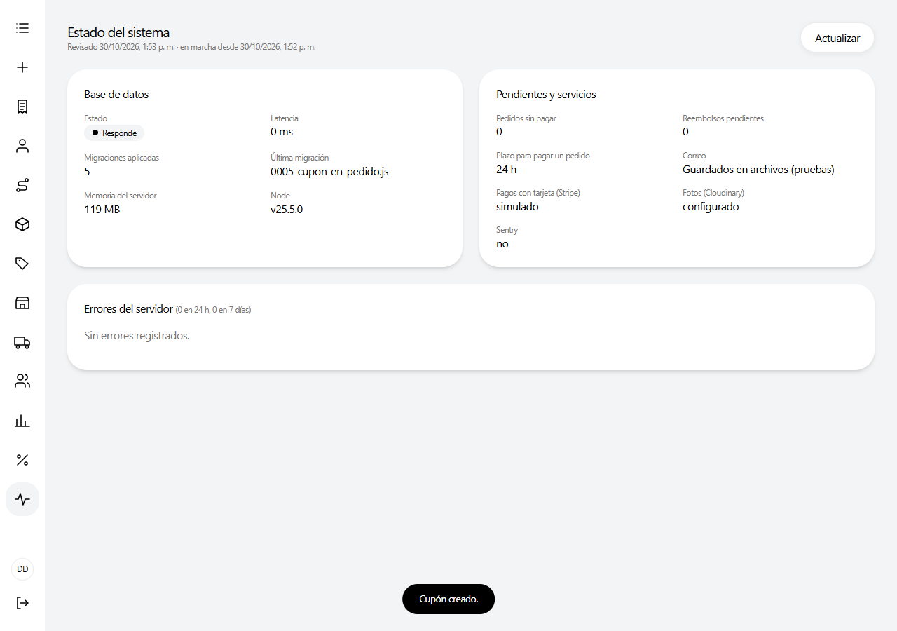

# Seguridad

Este documento describe las medidas de seguridad implementadas en el sistema Distribuidora (API REST, panel de empleados y tienda en línea) e indica, para cada una, el archivo del código en el que se aplica. Su propósito es dejar constancia de qué riesgos se consideraron, cómo se mitigan y qué limitaciones conocidas permanecen. Todo lo expuesto se obtuvo de la lectura de `server.js`, `app/middlewares/`, `app/config/`, `app/controllers/`, `app/utils/`, `app/migraciones/` y de los clientes `frontend/` y `tienda/`. El modelo de roles se detalla en [Roles y permisos](03-roles-y-permisos.md) y la arquitectura general en [Arquitectura](01-arquitectura.md).

## Contenido

1. [Principios generales](#1-principios-generales)
2. [Contraseñas](#2-contraseñas)
3. [Sesiones con JWT](#3-sesiones-con-jwt)
4. [Autorización y alcance por sucursal](#4-autorización-y-alcance-por-sucursal)
5. [Validación de entradas y consultas a la base de datos](#5-validación-de-entradas-y-consultas-a-la-base-de-datos)
6. [Límite de intentos](#6-límite-de-intentos)
7. [Cuentas de clientas: inicio de sesión, activación y restablecimiento](#7-cuentas-de-clientas-inicio-de-sesión-activación-y-restablecimiento)
8. [CORS y cuerpo de las peticiones](#8-cors-y-cuerpo-de-las-peticiones)
9. [Pagos con Stripe](#9-pagos-con-stripe)
10. [Fotos en Cloudinary](#10-fotos-en-cloudinary)
11. [Concurrencia: transacciones y bloqueos](#11-concurrencia-transacciones-y-bloqueos)
12. [Idempotencia de reembolsos](#12-idempotencia-de-reembolsos)
13. [Correos electrónicos](#13-correos-electrónicos)
14. [Manejo y registro de errores](#14-manejo-y-registro-de-errores)
15. [Auditoría](#15-auditoría)
16. [Secretos y configuración](#16-secretos-y-configuración)
17. [Dependencias con avisos de seguridad pendientes](#17-dependencias-con-avisos-de-seguridad-pendientes)
18. [Limitaciones conocidas](#18-limitaciones-conocidas)
19. [Resumen: riesgo, medida y archivo](#19-resumen-riesgo-medida-y-archivo)
20. [Verificación en las pruebas automatizadas](#20-verificación-en-las-pruebas-automatizadas)

---

## 1. Principios generales

- **El servidor es la autoridad.** El panel y la tienda ocultan opciones según el rol o el estado, pero cada endpoint aplica sus propios controles de autenticación, rol, alcance y reglas de negocio. Los montos a cobrar, los precios y los totales se calculan en el servidor a partir del catálogo; nunca se toman del cliente.
- **Estado leído de la base en cada petición.** La existencia de la cuenta, si está activa, su puesto y su versión de sesión se consultan en la base de datos en cada petición autenticada; el contenido del token no se considera suficiente.
- **Respuestas que no revelan información.** Los registros fuera de alcance responden igual que los inexistentes (`404`), y los flujos de inicio de sesión y restablecimiento de contraseña responden de forma uniforme para no revelar qué correos están registrados.
- **Secretos solo en el servidor.** Las claves de Stripe (secreta y de webhook), de Cloudinary, de JWT, de SMTP y de la base de datos solo existen en las variables de entorno del backend.
- **Operaciones atómicas.** Las operaciones que mueven inventario o dinero se ejecutan en transacciones con bloqueo de filas, y la auditoría se registra dentro de la misma transacción.

## 2. Contraseñas

Las contraseñas se almacenan únicamente como hash bcrypt, mediante la biblioteca `bcryptjs`.

| Aspecto | Empleados | Clientas de la tienda |
|---|---|---|
| Validación | `validarPassword` en `app/utils/empleados.js` | `errorPassword` en `app/controllers/tienda_auth.controller.js` |
| Longitud mínima | 8 caracteres | 8 caracteres |
| Longitud máxima | 72 bytes en UTF-8 | 72 bytes en UTF-8 |
| Costo de bcrypt | 10 (`COSTO_BCRYPT`) | 8 |
| Campo | `Empleado.password` | `Cliente.password` |

**Límite de 72 bytes.** bcrypt solo considera los primeros 72 bytes de la contraseña. Si se admitieran contraseñas más largas, cualquier texto con el mismo prefijo de 72 bytes sería aceptado. Por ese motivo ambas validaciones miden la longitud con `Buffer.byteLength(..., "utf8")` y rechazan con `400` lo que excede ese límite.

**Contraseña distinta de la actual.** Al cambiar la propia contraseña (`PUT /api/auth/password` y `PUT /api/tienda/perfil/password`) se exige la contraseña actual y que la nueva sea distinta.

**Exclusión del hash en las respuestas.** Las funciones `publico` (`app/utils/empleados.js`) y `perfilDe` (`app/controllers/tienda_auth.controller.js`) eliminan `password` y `token_version` antes de responder. En el modelo `Cliente` (`app/models/cliente.model.js`) el ámbito por defecto (`defaultScope`) excluye `password`, `codigo_activacion`, `codigo_activacion_expira`, `reset_token_hash`, `reset_expira` y `token_version`; los controladores que los necesitan usan ámbitos explícitos (`conPassword`, `conCodigo`, `conReset`). El middleware `verificarToken` carga al empleado excluyendo el atributo `password`.

**Empleados sin contraseña.** Un empleado dado de alta como ficha (sin contraseña) no puede iniciar sesión; el login lo trata igual que una contraseña incorrecta.

## 3. Sesiones con JWT

### 3.1 Emisión de tokens

Ambos tipos de token se firman con `JWT_SECRET` (biblioteca `jsonwebtoken`) y vencen a las 24 horas (`expiresIn: 86400`).

| Token | Función | Contenido |
|---|---|---|
| Empleado (panel) | `firmarToken` en `app/utils/empleados.js` | `id`, `id_sucursal`, `v` (versión de sesión) |
| Clienta (tienda) | `firmarToken` en `app/controllers/tienda_auth.controller.js` | `id_cliente`, `tipo: "CLIENTE"`, `v` (versión de sesión) |

### 3.2 Separación de tokens de empleado y de clienta

Los dos middlewares de `app/middlewares/authJwt.js` rechazan el token del otro tipo:

- `verificarToken` (rutas del panel) responde `403` si el token tiene `tipo === "CLIENTE"` o no contiene `id`.
- `verificarCliente` (rutas de la tienda) responde `403` si el token no tiene `tipo === "CLIENTE"` o no contiene `id_cliente`.

De esta forma, una sesión de la tienda en línea nunca da acceso al panel de empleados, y viceversa.

### 3.3 Verificación en cada petición

En cada petición autenticada, además de validar la firma y la expiración, el middleware consulta la cuenta en la base de datos:

Los controles de rol (`isDistrital`, `isAdmin`, `isCajero`, `isBodeguero`, construidos con `exigirPuesto`) leen el puesto del registro `Empleado` cargado en esa misma petición, no del token. Un cambio de puesto o una desactivación se aplica, por tanto, de forma inmediata. `verificarCliente` hace la comprobación equivalente sobre `Cliente` (existencia, `activo` y `token_version`).

### 3.4 Cierre de sesiones con `token_version`

`Empleado.token_version` y `Cliente.token_version` (entero, valor por defecto 0) se copian en el campo `v` del token. Cuando el valor de la base aumenta, todos los tokens emitidos antes dejan de ser válidos. Los eventos que lo incrementan son:

| Evento | Archivo | Efecto adicional |
|---|---|---|
| El empleado cambia su propia contraseña | `app/controllers/auth.controller.js` (`cambiarPassword`) | Se devuelve un token nuevo para la sesión actual. |
| Un superior restablece la contraseña de un empleado | `app/controllers/empleado.controller.js` (`restablecerPassword`) | Se cierran todas las sesiones de ese empleado. |
| Un empleado es desactivado | `app/controllers/empleado.controller.js` (`update`) | Los tokens anteriores no vuelven a valer aunque se reactive. |
| Cambia el puesto o la sucursal de un empleado | `app/controllers/empleado.controller.js` (`update`, variable `cambiaAlcance`) | Al volver a entrar, el panel muestra lo que corresponde al nuevo puesto y sucursal. |
| La clienta cambia su contraseña | `app/controllers/tienda_auth.controller.js` (`cambiarPassword`) | Token nuevo para el dispositivo actual; se anula cualquier enlace de restablecimiento pendiente. |
| La clienta restablece su contraseña con el enlace del correo | `app/controllers/tienda_auth.controller.js` (`restablecer`) | Token nuevo; se anulan el enlace y el código de activación. |
| La clienta activa su cuenta web con el código de caja | `app/controllers/tienda_auth.controller.js` (`activar`) | Token nuevo. |
| Una clienta es desactivada desde el panel | `app/controllers/cliente.controller.js` (`update`) | También se anulan el código de activación y el enlace de restablecimiento. |

## 4. Autorización y alcance por sucursal

El modelo completo de roles se describe en [Roles y permisos](03-roles-y-permisos.md). Desde el punto de vista de la seguridad, las medidas relevantes son:

- **Alcance por sucursal** (`app/utils/alcance.js`). El DISTRITAL ve todas las sucursales; ADMIN, CAJERO y BODEGUERO solo la propia (`Empleado.id_sucursal`). Un empleado sin sucursal que no sea DISTRITAL recibe el alcance `-1`, que no coincide con ninguna sucursal.
- **Fuera de alcance equivale a inexistente.** El middleware `exigirAlcance` determina la sucursal del registro solicitado (pedido, pago, detalle, devolución) y, si no pertenece a la sucursal del empleado, responde `404` con el mensaje "No se encontró el registro en tu sucursal.". Se usa en `app/routes/pedido.routes.js`, `pago.routes.js`, `detalle_pedido.routes.js` y `devolucion.routes.js`. Los listados aplican `whereSucursal` y, para clientes, `whereClientesDeSucursal`/`clienteEnAlcance`.
- **Gestión de empleados.** `aplicarReglasDeGestion` (`app/utils/empleados.js`) limita al ADMIN a cajeros y bodegueros de su sucursal; un empleado de otra sucursal responde `404` en `empleado.controller.js`. Nadie puede desactivarse, cambiarse el puesto ni cambiarse de sucursal a sí mismo, y siempre debe quedar al menos un DISTRITAL activo.
- **Pedidos propios en la tienda.** `pedidoPropio` (`app/controllers/tienda.controller.js`) responde `404` si el pedido no pertenece a la clienta del token.
- **Registro de empleados.** `permitirRegistro` (`authJwt.js`) solo admite registro sin token cuando la tabla `Empleado` está vacía; a partir de ahí exige un token de ADMIN o DISTRITAL.

## 5. Validación de entradas y consultas a la base de datos

### 5.1 Identificadores (`validarId`)

`app/middlewares/validarId.js` valida el parámetro `:id` antes de llegar a la base de datos. Solo acepta enteros positivos sin ceros a la izquierda, de hasta 10 dígitos y no mayores que 2 147 483 647 (máximo de `INTEGER` en PostgreSQL), mediante la expresión `^[1-9]\d{0,9}$`. Valores como `abc`, `1e3` o `99999999999` responden `400` ("El identificador no es válido.") en lugar de un `500` con el error interno de la base. Se registra con `router.param("id", ...)` en las rutas de categorías, clientes, cupones, detalles de pedido, empleados, pagos, pedidos, productos, proveedores, reembolsos, sucursales y tienda. La función `esIdValido` se reutiliza para identificadores recibidos en la query o el cuerpo (`devolucion.controller.js`, `reembolso.controller.js`).

### 5.2 Validación de campos

Los controladores validan tipo, obligatoriedad y longitud de los campos antes de guardar: por ejemplo, nombre y apellido hasta 80 caracteres, correo hasta 120 caracteres con formato válido, dirección hasta 200, teléfono hasta 20 y referencia de pago hasta 150. Los puestos se comparan contra la lista cerrada `PUESTOS_VALIDOS` y el campo `activo` debe ser booleano.

### 5.3 Consultas parametrizadas

Las consultas se construyen con Sequelize, que parametriza los valores. Las consultas SQL escritas a mano usan `replacements` (por ejemplo, en `app/middlewares/limitador.js` y `app/utils/monitoreo.js`). Las únicas interpolaciones directas en SQL son constantes del código o valores convertidos con `Number(...)` (por ejemplo, `whereClientesDeSucursal` en `app/utils/alcance.js` y los candados de `app/utils/migrador.js`), de modo que no admiten texto del usuario.

### 5.4 Unicidad de correos

La migración `app/migraciones/0001-esquema-base.js` crea índices únicos sobre `lower(email)` en `Empleado` y `Cliente`, y la aplicación busca los correos sin distinguir mayúsculas. Así no pueden coexistir dos cuentas cuyo correo difiera solo en mayúsculas.

## 6. Límite de intentos

El middleware `limitarIntentos` (`app/middlewares/limitador.js`) limita las peticiones por IP y ruta en los endpoints expuestos a adivinación de contraseñas, enumeración de correos o abuso del envío de correos. Por defecto permite 20 peticiones en una ventana de 15 minutos; al superarse responde `429` con la cabecera `Retry-After` y el mensaje "Demasiados intentos. Vuelve a intentarlo en N minuto(s).".

| Endpoint | Máximo por ventana de 15 min |
|---|---|
| `POST /api/auth/login` | 20 |
| `PUT /api/auth/password` | 10 |
| `POST /api/imagenes/firma` | 60 |
| `POST /api/tienda/auth/registro` | 10 |
| `POST /api/tienda/auth/login` | 20 |
| `POST /api/tienda/auth/activar` | 10 |
| `POST /api/tienda/auth/olvide` | 5 (además, 3 enlaces por correo por hora) |
| `POST /api/tienda/auth/restablecer` | 10 |
| `PUT /api/tienda/perfil/password` | 10 |
| `POST /api/tienda/cotizar` | 300 |

### 6.1 Contadores en la base de datos (`IntentoLimite`)

Los contadores se guardan en la tabla `IntentoLimite` (migración `app/migraciones/0002-intentos-limite.js`, columnas `clave`, `n`, `desde`), por lo que sobreviven a un reinicio y se comparten entre varias instancias del servidor. Cada intento se registra con una sola sentencia atómica `INSERT ... ON CONFLICT DO UPDATE` que suma el intento o reinicia la ventana si ya venció. La clave es un hash SHA-256 de la IP y la ruta, de modo que la IP no se almacena en claro. Una tarea horaria elimina las filas de más de un día. Si la base de datos no responde, se usa un contador en memoria (con un tope de 10 000 claves) para no dejar la ruta sin límite.

### 6.2 Normalización de la ruta y de la IP

- **Ruta.** Express atiende igual `/api/auth/LOGIN`, `/api/auth/login` y `/api/auth/login/`. La función `rutaNormalizada` convierte la ruta a minúsculas y elimina la barra final, de modo que todas las variantes comparten el mismo contador.
- **IPv4.** Se usa la dirección tal cual; una IPv4 mapeada (`::ffff:a.b.c.d`) se reduce a su parte IPv4, de modo que comparte contador con la dirección sin prefijo.
- **IPv6.** Un proveedor asigna a cada conexión una red `/64` completa; cambiar de dirección dentro de ella no debe generar un contador nuevo. La función `ipClave` expande la dirección y conserva solo los primeros cuatro grupos (prefijo `/64`).
- **IP real detrás del proxy.** `server.js` configura `app.set("trust proxy", 1)` para que, detrás del proxy de Render (un salto), `req.ip` sea la IP del cliente y no la del proxy.

### 6.3 Límite por correo en «olvidé mi contraseña»

Además del límite por IP, `olvide` (`tienda_auth.controller.js`) cuenta los intentos por correo mediante `contarIntento("olvide:<correo>", 3600)`. A partir del cuarto pedido en una hora para el mismo correo (`MAX_ENLACES_POR_HORA = 3`) se devuelve la misma respuesta, pero no se envía otro enlace ni se invalida el que ya existe. Así se evita que un tercero llene el buzón de otra persona.

## 7. Cuentas de clientas: inicio de sesión, activación y restablecimiento

### 7.1 Inicio de sesión en tiempo constante

Tanto el login de empleados (`auth.controller.js`) como el de clientas (`tienda_auth.controller.js`) comparan siempre un hash bcrypt, aunque el correo no exista: en ese caso se compara contra un hash ficticio (`HASH_FICTICIO`) generado al arrancar con el mismo costo que los hashes reales (10 para empleados y 8 para clientas). La respuesta tarda lo mismo y el mensaje es idéntico ("Correo o contraseña incorrectos." en el panel; "Email o contraseña incorrectos." en la tienda), por lo que no puede deducirse qué correos están registrados. La comprobación de cuenta desactivada se hace después de validar la contraseña.

### 7.2 Registro en la tienda

El registro (`POST /api/tienda/auth/registro`) no permite tomar una ficha existente: si el correo ya pertenece a una clienta registrada en mostrador, se le indica que solicite en caja su código de activación, porque el registro no verifica que el correo sea de quien se registra.

### 7.3 Activación con código de caja

Una clienta de mostrador crea su contraseña con un código de un solo uso generado por caja (`POST /api/clientes/:id/codigo-web`, `cliente.controller.js`):

- El código tiene 8 caracteres tomados de `crypto.randomBytes` sobre un alfabeto sin caracteres confusos, y vence a las 72 horas.
- Solo se guarda su hash SHA-256 (`codigo_activacion`); el código se muestra una sola vez al cajero.
- La comparación usa `crypto.timingSafeEqual`, dentro de una transacción con bloqueo de la fila del cliente.
- Correo inexistente, código incorrecto o vencido producen el mismo mensaje.
- Al activarse, el código se borra y se incrementa `token_version`.

### 7.4 Restablecimiento de contraseña

Características implementadas en `tienda_auth.controller.js`:

| Característica | Implementación |
|---|---|
| Token aleatorio | `crypto.randomBytes(32)` en hexadecimal (64 caracteres). |
| Solo se guarda el hash | `reset_token_hash = SHA-256("<correo en minúsculas>:<token>")`. |
| Hash ligado al correo | Si caja corrige el correo de la ficha, el enlace enviado a la dirección anterior deja de coincidir; además `cliente.controller.js` borra el enlace pendiente al cambiar el correo o desactivar la cuenta. |
| Vigencia | 60 minutos (`MINUTOS_RESET`), en `reset_expira`. |
| Un solo uso | Al usarse se borran `reset_token_hash` y `reset_expira`; pedir un enlace nuevo reemplaza al anterior. |
| Comparación segura | Formato validado (`^[0-9a-f]{64}$`) y `crypto.timingSafeEqual`, con la fila bloqueada. |
| Respuesta uniforme | `olvide` siempre responde el mismo texto, exista o no la cuenta, esté o no desactivada. |
| Cierre de sesiones | Se incrementa `token_version` y se envía un aviso de "contraseña cambiada". |
| Enlace fuera de los logs | Sin SMTP en producción, `app/utils/correo.js` imprime el enlace sin la query, para que el token no quede en los registros. |

## 8. CORS y cuerpo de las peticiones

### 8.1 CORS restringido

`server.js` configura el paquete `cors` con una lista explícita de orígenes tomada de `CORS_ORIGIN` (separados por coma; por defecto `http://localhost:8081` y `http://localhost:8082`). En producción deben indicarse los dominios del panel y de la tienda. Solo se expone la cabecera `X-Request-Id`. Las sesiones viajan en la cabecera `Authorization` y no en cookies, por lo que el navegador no las adjunta automáticamente en peticiones de otros sitios. CORS limita a los navegadores; los controles de autenticación descritos se aplican igual a cualquier cliente HTTP.

### 8.2 Cuerpos comprimidos rechazados

`bodyParser.json`, `bodyParser.urlencoded` y el `express.raw` del webhook se configuran con `inflate: false`. Una petición con `Content-Encoding` comprimido se rechaza con `415` ("No se aceptan cuerpos comprimidos."), mediante el manejador de `app/utils/monitoreo.js`. Ningún cliente del sistema envía cuerpos comprimidos, y esta configuración evita la denegación de servicio descrita en la [sección 17](#17-dependencias-con-avisos-de-seguridad-pendientes). Los cuerpos que exceden el límite por defecto de body-parser responden `413` y los JSON mal formados `400`.

## 9. Pagos con Stripe

### 9.1 Webhook con firma sobre el cuerpo crudo

La firma de Stripe se calcula sobre los bytes exactos del cuerpo. Por eso `server.js` registra `app/routes/webhook.routes.js` **antes** de `bodyParser.json`, y la ruta `POST /api/webhook` recibe el cuerpo crudo con `express.raw({ type: "application/json", inflate: false })`. El controlador (`app/controllers/webhook.controller.js`) valida el evento con `stripe.webhooks.constructEvent(req.body, firma, STRIPE_WEBHOOK_SECRET)` y responde `400` si la firma no es válida.

Dentro del webhook, el pago se busca por `id_transaccion_externa` y se bloquea; solo un pago en `PENDIENTE` o `FALLIDO` pasa a `COMPLETADO`, de modo que un evento repetido no registra un cobro dos veces. Un error de base de datos devuelve `500` para que Stripe reintente la notificación.

### 9.2 La confirmación no confía en el navegador

`POST /api/tienda/pedidos/:id/pago/confirmar` (`tienda.controller.js`) no acepta del cliente el resultado del pago: consulta el `PaymentIntent` en Stripe (`stripe.paymentIntents.retrieve`) y solo registra el cobro si su estado es `succeeded`. El monto del `PaymentIntent` lo calcula el servidor a partir del saldo del pedido.

### 9.3 Claves secretas solo en el servidor

| Variable | Dónde se usa |
|---|---|
| `STRIPE_SECRET_KEY` | `app/config/stripe.config.js` (backend) |
| `STRIPE_WEBHOOK_SECRET` | `app/controllers/webhook.controller.js` (backend) |
| `VITE_STRIPE_PUBLISHABLE_KEY` | `tienda/src/config/env.js` (clave publicable, apta para el navegador) |

Vite incorpora en el código entregado al navegador todas las variables con prefijo `VITE_`. Por eso los clientes solo definen `VITE_API_URL` y, en la tienda, `VITE_STRIPE_PUBLISHABLE_KEY`; ninguna clave secreta lleva ese prefijo. La plantilla `.env.example` lo advierte expresamente: "La clave secreta NUNCA va en el frontend".

### 9.4 Tiempo de espera hacia Stripe

`stripe.config.js` fija `timeout: 15000` y `maxNetworkRetries: 1`. Algunas llamadas a Stripe se realizan con filas bloqueadas y una conexión de la base ocupada; con los valores por defecto de la biblioteca, una caída de Stripe podía retener conexiones durante minutos y agotar el pool.

## 10. Fotos en Cloudinary

Las fotos de las prendas se suben desde el navegador directamente a Cloudinary, con una **subida firmada** generada por el backend (`app/config/cloudinary.config.js`, `app/controllers/imagen.controller.js`):

- `POST /api/imagenes/firma` exige token de empleado, puesto DISTRITAL y está sujeto al límite de 60 intentos por ventana.
- La firma (SHA-1 de los parámetros ordenados más `CLOUDINARY_API_SECRET`) fija la carpeta `distribuidora/prendas`, los formatos permitidos `jpg, jpeg, png, webp` y la marca de tiempo. El navegador recibe la firma, nunca el secreto.
- `POST /api/imagenes/descartar` (solo DISTRITAL) borra como máximo 20 URL por petición y solo si son de este cloud y de la carpeta de prendas (`publicIdDe`), y ninguna prenda las usa. Los enlaces externos pegados a mano nunca se borran.
- En la base de datos solo se guarda la URL (`Producto.imagen_url`).

## 11. Concurrencia: transacciones y bloqueos

Las operaciones que mueven inventario o dinero se ejecutan en transacciones de Sequelize con bloqueo de filas (`lock: t.LOCK.UPDATE`, es decir, `SELECT ... FOR UPDATE`).

| Riesgo | Medida | Archivo |
|---|---|---|
| Vender dos veces la misma unidad | `descontarStockVenta` bloquea los lotes `DISPONIBLE` y comprueba el stock dentro de la transacción. Las líneas se agrupan por producto y se procesan en orden de `id_producto` para que todas las ventas bloqueen en el mismo orden y no se produzcan interbloqueos. | `app/utils/facturacion.js` |
| Cobrar más que el total del pedido | El pedido se bloquea y el saldo se calcula descontando pagos completados y pendientes (`totalComprometido`); un monto mayor se rechaza. | `app/controllers/pago.controller.js` |
| Dos intentos de pago con tarjeta simultáneos | Orden de bloqueo fijo Pago → Pedido en `iniciarPago`, `confirmarPago`, `cancelarPedido` y el webhook. Un `PaymentIntent` en curso se reutiliza (doble clic o recarga); si otra petición creó uno que no está bloqueado, se responde `409`. | `app/controllers/tienda.controller.js` |
| Cobro confirmado sobre un pedido cancelado o ya pagado | `registrarCobroExitoso` bloquea el pedido; si ya no está `PENDIENTE` o el monto excede el saldo, el pago se registra y se crea automáticamente un reembolso a la tarjeta. | `app/utils/facturacion.js`, `app/utils/reembolsos.js` |
| Acaparar stock con pedidos sin pagar | Máximo 3 pedidos pendientes por clienta (`MAX_PEDIDOS_PENDIENTES`), contados con la fila del cliente bloqueada, y máximo 20 unidades por prenda. | `app/controllers/tienda.controller.js` |
| Superar el límite de usos de un cupón | `usarCupon` bloquea el cupón antes de validarlo y sumar el uso. | `app/utils/cupones.js` |
| Dos solicitudes de devolución simultáneas | El pedido se bloquea; la segunda solicitud ve a la primera. | `app/controllers/devolucion.controller.js` |
| Dos registros iniciales con la base vacía | Candado `pg_advisory_xact_lock(727001)`; solo el primero queda como DISTRITAL. | `app/controllers/auth.controller.js` |
| Quedar sin ningún DISTRITAL utilizable | `activosConAcceso` bloquea a los empleados activos antes de aplicar cambios. | `app/utils/empleados.js`, `app/controllers/empleado.controller.js` |
| Validar un enlace o código dos veces | La fila del cliente se bloquea al activar, restablecer o cambiar la contraseña. | `app/controllers/tienda_auth.controller.js` |
| Dos instancias aplicando migraciones | Candado de transacción en una conexión dedicada. | `app/utils/migrador.js` |

Antes de cancelar un `PaymentIntent` (operación irreversible que no se deshace con un rollback), `cancelarPedido` valida todas las condiciones que podrían impedir la cancelación.

## 12. Idempotencia de reembolsos

`procesarEnStripe` (`app/utils/reembolsos.js`) ejecuta en Stripe los reembolsos a tarjeta pendientes y está diseñado para que ningún reintento produzca un doble reembolso:

1. **Reserva de la fila.** Un `UPDATE` condicional marca `procesando_desde`; solo lo logra una petición a la vez (la reserva caduca a los 2 minutos).
2. **Consulta antes de crear.** Si ya se guardó el id de Stripe, solo se consulta. Si no se guardó (respuesta perdida o caída), se buscan en Stripe reembolsos previos del mismo `PaymentIntent` con `metadata.id_reembolso` antes de crear uno nuevo, porque la clave de idempotencia de Stripe dura solo 24 horas.
3. **Clave de idempotencia.** La creación usa `idempotencyKey: "reembolso-<id_reembolso>"`.
4. **Escritura condicional.** El resultado solo se escribe si la fila sigue en `PENDIENTE`, sin sobrescribir lo que haya resuelto otro proceso.
5. **Errores definitivos.** Respuestas 400, 402 o 404 de Stripe marcan el reembolso como `FALLIDO` para entregarlo en efectivo en caja; los errores de red, 409, 429 y 5xx se reintentan en la revisión periódica.

`reembolsarPagoStripe` no crea un segundo reembolso si ya existe uno `PENDIENTE` o `COMPLETADO` para el mismo pago, y la llamada a Stripe se hace después del commit (`t.afterCommit`). Los avisos por correo de reembolso se envían una sola vez, desde el punto en que la escritura condicional tiene éxito.

## 13. Correos electrónicos

El envío se concentra en `app/utils/correo.js`:

- **Escape de HTML.** La plantilla aplica `escapar` (sustituye `& < > " '`) al título, a cada párrafo, al texto del botón y a la URL del enlace. Un nombre o una dirección de entrega con etiquetas HTML se muestra como texto y no se interpreta.
- **Direcciones restringidas.** Solo se envía a direcciones simples que cumplen `DIRECCION_SIMPLE` (sin comillas, comentarios, `;`, `<` ni `>`) y de hasta 120 caracteres. El destinatario se pasa a nodemailer como objeto `{ name: "", address }`. La misma expresión (`EMAIL_VALIDO`) valida los correos en el registro de la tienda, de modo que nunca se acepta una dirección a la que después no se podría escribir.
- **Envío que no rompe operaciones.** `enviar` nunca lanza excepciones, y los avisos (`app/utils/notificaciones.js`) se programan después del commit y verifican que el pedido esté realmente en el estado anunciado.
- **Avisos de configuración.** En producción, si falta SMTP o `TIENDA_URL`, el servidor lo advierte en la consola al arrancar.

## 14. Manejo y registro de errores

### 14.1 Respuestas sin detalles internos

`app/utils/monitoreo.js` define el manejador final de errores de Express:

- Los errores 5xx responden "Error interno del servidor (referencia `<id>`)." junto con el identificador de la petición; la pila nunca se envía al cliente.
- JSON mal formado (`400`), cuerpo comprimido (`415`) y cuerpo demasiado grande (`413`) tienen mensajes fijos.
- Las rutas `/api` inexistentes responden `404` en JSON en lugar de la página HTML de Express.

En la tienda, `responderError` (`tienda.controller.js`) devuelve el mensaje de los errores previstos (400, 404, 409) y un mensaje genérico para los inesperados, dejando el detalle real en el registro de errores. Los flujos de cuentas de clientas (`olvide`, `restablecer`, `cambiarPassword`) también responden mensajes genéricos ante un error interno.

### 14.2 Registro de errores sin cuerpos ni query

Cada petición recibe un identificador (`crypto.randomUUID`) devuelto en la cabecera `X-Request-Id`. Toda respuesta 5xx y toda excepción no controlada se guarda en la tabla `ErrorServidor` (migración `app/migraciones/0003-errores-servidor.js`) con: `request_id`, `metodo`, `ruta`, `estado`, `mensaje`, `pila` y `usuario` (`empleado:<id>` o `cliente:<id>`).

- **Nunca se guarda el cuerpo de la petición**, que puede contener contraseñas.
- **La ruta se guarda sin la query** (`rutaDe` corta en `?`), porque podría contener correos o tokens.
- Los textos se recortan a longitudes máximas y los registros se eliminan a los 30 días.
- Los errores solo los consulta el DISTRITAL (`GET /api/salud/errores`), y esa consulta no devuelve la pila. `GET /api/salud` es público y solo informa si la API y la base responden.
- Sentry es opcional (`SENTRY_DSN`) y se inicializa con `sendDefaultPii: false`.

*Figura 1. Pantalla "Estado del sistema" (solo DISTRITAL): estado de la base de datos, servicios externos y errores del servidor registrados en las últimas 24 horas y 7 días.*

## 15. Auditoría

Las acciones sensibles se registran en la tabla de auditoría (modelo `app/models/auditoria.model.js`) con `id_empleado`, `accion`, `tabla_afectada`, `registro_afectado_id` y `detalles`.

- **Atomicidad.** `registrarAuditoria` (`app/utils/auditoria.js`) acepta la transacción de la operación: la fila de auditoría se confirma o se revierte junto con ella, por lo que no queda constancia de algo que falló ni una operación sin su registro.
- **Acceso restringido.** `GET /api/auditoria` y `POST /api/auditoria` exigen el puesto DISTRITAL (`app/routes/auditoria.routes.js`). No existen endpoints para modificar ni eliminar registros.
- **Autoría no falsificable.** En una auditoría manual, `id_empleado` se toma siempre del token y no del cuerpo de la petición.
- **Sin secretos.** Los detalles describen la acción (por ejemplo, "Empleado #5 cambió su contraseña.") y nunca incluyen contraseñas, tokens ni códigos.

Algunas acciones registradas relacionadas con la seguridad:

| Acción | Origen |
|---|---|
| `EMPLEADO_REGISTRO_INICIAL`, `EMPLEADO_REGISTRADO` | Alta de empleados (`auth.controller.js`) |
| `EMPLEADO_ACTUALIZADO` | Cambios de datos, puesto, sucursal o estado, con el detalle de los cambios (`empleado.controller.js`) |
| `EMPLEADO_PASSWORD_CAMBIADA`, `EMPLEADO_PASSWORD_RESTABLECIDA` | Contraseñas de empleados |
| `CLIENTE_CODIGO_WEB_GENERADO`, `CLIENTE_CUENTA_WEB_ACTIVADA` | Código de activación de caja |
| `CLIENTE_RESTABLECIMIENTO_SOLICITADO`, `CLIENTE_PASSWORD_RESTABLECIDA`, `CLIENTE_PASSWORD_CAMBIADA` | Contraseñas de clientas (`tienda_auth.controller.js`) |
| `CLIENTE_ACTUALIZADO` | Cambios a la ficha de la clienta (`cliente.controller.js`) |
| `PAGO_INTENTO_FALLIDO`, `PAGO_REQUIERE_REEMBOLSO` | Webhook y cobros que no corresponden |
| `REEMBOLSO_CREADO`, `REEMBOLSO_COMPLETADO`, `REEMBOLSO_FALLIDO` | Reembolsos (`app/utils/reembolsos.js`) |

## 16. Secretos y configuración

- Los secretos se leen de variables de entorno. `server.js` carga `.env.production` o `.env.development` según `NODE_ENV`.
- El `.gitignore` del backend excluye `.env`, `.env.development` y `.env.production`; los de `frontend/` y `tienda/` excluyen `.env` y `.env.*`, salvo `.env.example`.
- `.env.example` documenta todas las variables sin valores reales. Las sensibles son `DB_PASSWORD`, `JWT_SECRET`, `STRIPE_SECRET_KEY`, `STRIPE_WEBHOOK_SECRET`, `CLOUDINARY_API_SECRET`, `SMTP_PASS` y `SENTRY_DSN`.
- La conexión a PostgreSQL usa SSL salvo que `DB_SSL` sea `false` (necesario solo para una base local sin SSL).
- El modo de pagos simulado se activa únicamente con el valor de prueba `sk_test_clave_de_prueba_universidad` de `STRIPE_SECRET_KEY`; con una clave real, los cobros pasan por Stripe.

## 17. Dependencias con avisos de seguridad pendientes

Al momento de redactar este documento, dos dependencias tienen avisos publicados cuya versión corregida aún no se ha instalado. En ambos casos el código aplica una mitigación que evita la condición vulnerable; la actualización sigue pendiente.

| Paquete | Versión instalada | Corregido en | Avisos | Mitigación aplicada |
|---|---|---|---|---|
| `nodemailer` | 10.1.0 (fijada en `package.json`) | 10.1.4 | GHSA-8c8m-p3m8-cjg8, GHSA-m943-m63m-w62w, GHSA-85x2-q946-cp5h (fallos del analizador de direcciones que pueden desviar un correo a otro destinatario) | `DIRECCION_SIMPLE` en `app/utils/correo.js`: solo se envía a direcciones simples sin comillas, comentarios, `;`, `<` ni `>`, y la misma regla valida los correos al registrarlos. |
| `body-parser` | 2.3.0 (también la usa Express 5.2.1) | 2.4.0 | GHSA-27r3-jxmh-p828 (denegación de servicio con cuerpos comprimidos) | `inflate: false` en `bodyParser.json`, `bodyParser.urlencoded` (`server.js`) y `express.raw` del webhook (`app/routes/webhook.routes.js`); los cuerpos comprimidos se rechazan con `415`. |

La acción recomendada es actualizar ambos paquetes a las versiones corregidas y volver a ejecutar las pruebas automatizadas (`npm run test:todo`). Las mitigaciones pueden mantenerse después de la actualización, ya que no afectan el funcionamiento.

## 18. Limitaciones conocidas

Se documentan con fines de transparencia los siguientes aspectos que no forman parte de las medidas anteriores:

- **Almacenamiento del token en el navegador.** El panel y la tienda guardan la sesión en `localStorage` (`frontend/src/services/session.js`, `tienda/src/services/session.js`), accesible para el código JavaScript del mismo origen. El efecto de un token expuesto se acota con la expiración de 24 horas y con `token_version`, que permite cerrar las sesiones cambiando la contraseña.
- **Mensajes de error internos en algunos controladores.** El manejador final, `responderError` de `tienda.controller.js` y los flujos `olvide`, `restablecer` y `cambiarPassword` de `tienda_auth.controller.js` ocultan los detalles internos, pero varios controladores del panel (por ejemplo, `empleado.controller.js` y `auth.controller.js`) y las funciones `registro`, `activar`, `login`, `perfil` y `actualizarPerfil` de `tienda_auth.controller.js` responden en sus errores 500 el texto de la excepción (`error.message`). Entre ellas hay rutas que no exigen sesión: el login del panel, el registro inicial de empleados y el registro, la activación y el login de la tienda.
- **Mensajes de Stripe.** Cuando falla la comunicación con Stripe, la respuesta `502` incluye el mensaje de error de Stripe.
- **Duración de la sesión fija.** Los tokens se firman con `expiresIn: 86400` en el código; la variable `JWT_EXPIRES_IN` de `.env.example` y `app/config/auth.config.js` no intervienen en la firma.
- **Límite por correo dependiente de la base.** Si la base no responde, `contarIntento` devuelve `null` y no se aplica el límite por correo de «olvidé mi contraseña»; el límite por IP sigue activo con el contador en memoria.
- **Cabeceras HTTP de seguridad.** La API no agrega cabeceras adicionales como las que proporciona `helmet`.
- **Costo de bcrypt.** Las contraseñas de clientas usan costo 8 y las de empleados costo 10.

## 19. Resumen: riesgo, medida y archivo

| Riesgo | Medida | Archivo |
|---|---|---|
| Robo de contraseñas desde la base | Hash bcrypt (costo 10 empleados, 8 clientas); el hash nunca se devuelve | `app/utils/empleados.js`, `app/controllers/tienda_auth.controller.js`, `app/models/cliente.model.js` |
| Contraseñas que "funcionan" con cualquier sufijo | Límite de 72 bytes, mínimo 8 caracteres | `app/utils/empleados.js`, `app/controllers/tienda_auth.controller.js` |
| Sesión válida tras cambio de contraseña, desactivación o cambio de puesto/sucursal | `token_version` comparado en cada petición | `app/middlewares/authJwt.js`, `app/controllers/empleado.controller.js`, `app/controllers/cliente.controller.js` |
| Token de clienta usado en el panel (o al revés) | Campo `tipo: "CLIENTE"` y rechazo cruzado | `app/middlewares/authJwt.js` |
| Puesto obsoleto en el token | Empleado y puesto leídos de la base en cada petición | `app/middlewares/authJwt.js` |
| Acceso a datos de otra sucursal | `exigirAlcance`, `whereSucursal`; `404` fuera de alcance | `app/utils/alcance.js`, `app/routes/*.routes.js` |
| Acceso a pedidos de otra clienta | `pedidoPropio` responde `404` | `app/controllers/tienda.controller.js` |
| Ids malformados que provocan errores internos | `validarId` / `esIdValido` | `app/middlewares/validarId.js` |
| Inyección SQL | Consultas parametrizadas y `replacements`; interpolación solo de constantes o `Number()` | `app/middlewares/limitador.js`, `app/utils/alcance.js`, `app/utils/monitoreo.js` |
| Fuerza bruta y abuso de correos | `limitarIntentos` en la tabla `IntentoLimite`; ruta normalizada, IPv6 `/64`, límite por correo | `app/middlewares/limitador.js`, `app/migraciones/0002-intentos-limite.js`, `app/routes/auth.routes.js`, `app/routes/tienda.routes.js` |
| Enumeración de correos | Login en tiempo constante con hash ficticio y mensajes uniformes | `app/controllers/auth.controller.js`, `app/controllers/tienda_auth.controller.js` |
| Toma de cuenta con enlace de restablecimiento | Token aleatorio de 32 bytes, hash ligado al correo, 1 h, un solo uso, `timingSafeEqual` | `app/controllers/tienda_auth.controller.js` |
| Toma de una ficha de mostrador | Activación solo con código de caja (hash, 72 h, un solo uso) o por correo | `app/controllers/cliente.controller.js`, `app/controllers/tienda_auth.controller.js` |
| Peticiones desde sitios no autorizados | CORS con lista de orígenes | `server.js` |
| Notificaciones de pago falsificadas | Firma del webhook sobre el cuerpo crudo | `app/routes/webhook.routes.js`, `app/controllers/webhook.controller.js`, `server.js` |
| Pedido marcado como pagado desde el navegador | Confirmación consultando el `PaymentIntent` en Stripe | `app/controllers/tienda.controller.js` |
| Filtración de claves secretas | Claves solo en el backend; frontends solo con variables `VITE_` públicas | `app/config/stripe.config.js`, `app/config/cloudinary.config.js`, `tienda/src/config/env.js`, `.gitignore` |
| Subidas arbitrarias a Cloudinary | Subida firmada con carpeta y formatos fijos; firma solo para DISTRITAL | `app/config/cloudinary.config.js`, `app/routes/imagen.routes.js` |
| Venta doble de la misma unidad | Transacción y bloqueo de lotes en orden fijo | `app/utils/facturacion.js` |
| Pago doble o mayor al total | Bloqueo Pago → Pedido, saldo comprometido, reutilización del `PaymentIntent`, reembolso automático del excedente | `app/controllers/pago.controller.js`, `app/controllers/tienda.controller.js`, `app/utils/facturacion.js` |
| Reembolso duplicado | Reserva de fila, búsqueda por metadata, `idempotencyKey`, escritura condicional | `app/utils/reembolsos.js` |
| HTML inyectado en correos | `escapar` en la plantilla | `app/utils/correo.js` |
| Desvío de correos por fallos de nodemailer | `DIRECCION_SIMPLE` | `app/utils/correo.js` |
| Denegación de servicio con cuerpos comprimidos | `inflate: false`, respuesta `415` | `server.js`, `app/routes/webhook.routes.js`, `app/utils/monitoreo.js` |
| Exposición de la pila o de detalles internos | Manejador final con mensaje genérico y referencia | `app/utils/monitoreo.js`, `app/controllers/tienda.controller.js` |
| Datos privados en los registros | Sin cuerpo ni query; retención de 30 días; Sentry sin PII | `app/utils/monitoreo.js`, `app/migraciones/0003-errores-servidor.js` |
| Acciones sin trazabilidad | Auditoría en la misma transacción, solo DISTRITAL, autor tomado del token | `app/utils/auditoria.js`, `app/routes/auditoria.routes.js`, `app/controllers/auditoria.controller.js` |

## 20. Verificación en las pruebas automatizadas

Las pruebas descritas en [Pruebas](08-pruebas.md) incluyen verificaciones específicas de estas medidas. Entre ellas:

- `tests/api/cuentas.test.js`: solo se guarda el hash del enlace y vence en aproximadamente 1 hora; el enlace es de un solo uso y el anterior deja de valer al pedir otro; enlace vencido, de otra cuenta o con formato inválido responden `400`; contraseña de más de 72 bytes responde `400`; cambiar o restablecer la contraseña cierra las otras sesiones; desactivar a una clienta cierra sus sesiones aunque luego se reactive; corregir el correo invalida el enlace enviado al anterior; más de 3 enlaces por hora al mismo correo no se envían; las variantes de mayúsculas o de barra final comparten el contador; el cuerpo comprimido se rechaza con `415`; y «olvidé mi contraseña» responde `429` al superar el límite.
- `tests/api/monitoreo.test.js`: el 21.º intento desde la misma IP responde `429` con `Retry-After`; las rutas `/api` inexistentes responden `404` en JSON; los errores se registran sin la query; y el detalle del sistema exige token.
- `tests/api/modulo2.test.js` y `tests/api/tienda.test.js`: el webhook con firma inválida responde `400`, y un webhook tardío es idempotente (sin reembolso ni cobro doble).
