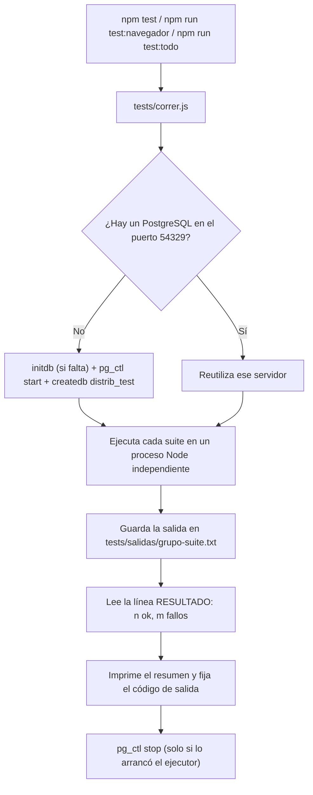
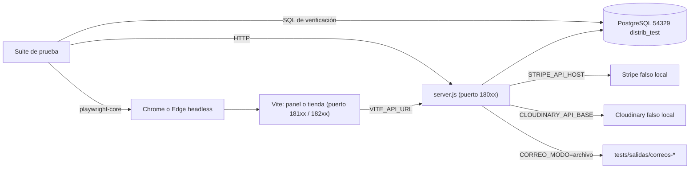

# Pruebas

Este documento describe cómo se verifica el sistema Distribuidora: la estrategia de pruebas de extremo a extremo, la infraestructura desechable sobre la que se ejecutan, los requisitos y comandos para correrlas, la ubicación de los resultados, el contenido de cada suite y el último resultado obtenido. Se describe además la revisión adversarial de código aplicada durante el desarrollo y las categorías de defectos que permitió encontrar y corregir. Todo lo descrito corresponde al contenido de la carpeta `tests/` del repositorio.

## Contenido

1. [Objetivo y alcance](#1-objetivo-y-alcance)
2. [Estrategia de pruebas](#2-estrategia-de-pruebas)
3. [Requisitos](#3-requisitos)
4. [Ejecución](#4-ejecución)
5. [Resultados y artefactos](#5-resultados-y-artefactos)
6. [Suites de API](#6-suites-de-api)
7. [Suites de navegador](#7-suites-de-navegador)
8. [Último resultado](#8-último-resultado)
9. [Revisión adversarial de código](#9-revisión-adversarial-de-código)
10. [Cómo agregar una suite](#10-cómo-agregar-una-suite)
11. [Documentos relacionados](#11-documentos-relacionados)

---

## 1. Objetivo y alcance

Las pruebas comprueban que el sistema completo se comporta según las reglas de negocio descritas en [Reglas de negocio](04-reglas-de-negocio.md) y los permisos descritos en [Roles y permisos](03-roles-y-permisos.md). No se limitan a funciones aisladas: cada suite arranca el servidor real (`server.js`) sobre una base PostgreSQL real y lo ejercita por HTTP, como lo harían el panel, la tienda o Stripe.

| Grupo | Carpeta | Qué se ejercita | Suites | Verificaciones |
|---|---|---|---|---|
| API | `tests/api/` | La API REST por HTTP, la base de datos, las migraciones, los scripts de respaldo y la colección de Postman | 13 | 1006 |
| Navegador | `tests/navegador/` | El panel de empleados y la tienda en línea en Chrome o Edge sin interfaz visible, conectados a la API | 6 | 206 |
| **Total** | | | **19** | **1212** |

Una **verificación** es una comprobación individual con nombre (por ejemplo, «pago mayor al saldo -> 400»). Cada suite cuenta sus verificaciones correctas y fallidas y las informa al ejecutor.

---

## 2. Estrategia de pruebas

### 2.1 Pruebas de extremo a extremo

Cada suite es un programa Node.js independiente que:

1. Comprueba que sus puertos estén libres; si alguno está ocupado, se detiene con un mensaje que empieza por `ABORTADO` en lugar de interactuar con un proceso ajeno. Esta comprobación está presente en 16 de las 19 suites; `api/modulo2`, `api/tienda` y `navegador/tienda` no la realizan.
2. Borra y recrea el esquema `public` de la base de pruebas (`DROP SCHEMA public CASCADE; CREATE SCHEMA public;`).
3. Arranca `server.js` como proceso hijo con variables de entorno propias de la prueba. El servidor aplica las migraciones al arrancar, igual que en producción (ver [Arquitectura](01-arquitectura.md)).
4. Inserta los datos mínimos (sucursales, tipos de prenda, prendas, inventario) mediante SQL directo o mediante la propia API, y obtiene tokens de cada puesto (DISTRITAL, ADMIN, CAJERO, BODEGUERO) y de clientas.
5. Ejecuta los escenarios por HTTP y comprueba tanto la respuesta (código de estado y cuerpo) como el estado resultante en la base de datos (stock por lote, movimientos, pagos, auditoría).
6. Detiene sus procesos e imprime la línea `RESULTADO: n ok, m fallos`.

Este enfoque permite verificar invariantes que solo se observan con todas las piezas integradas, por ejemplo que `Pedido.total` coincida con la suma de los subtotales menos el descuento más el envío, que ningún lote quede con stock negativo o que ningún pedido tenga reembolsos por más de lo cobrado.

### 2.2 Base de datos desechable

El módulo `tests/soporte/postgres.js` administra un clúster PostgreSQL exclusivo para las pruebas:

| Elemento | Valor |
|---|---|
| Carpeta de datos | `tests/.pgdata` (excluida del repositorio por `.gitignore`) |
| Puerto | `54329` |
| Usuario | `tester`, autenticación `trust` (sin contraseña) |
| Base | `distrib_test` |
| Codificación | UTF8, `--locale=C` |
| Registro del servidor | `tests/salidas/postgres.log` |

Si el clúster no existe, se crea con `initdb`; luego se arranca con `pg_ctl start`, se espera hasta 30 segundos a que acepte conexiones y se crea la base con `createdb`. Si el puerto 54329 ya está escuchando, el ejecutor reutiliza ese servidor y no lo detiene al terminar; si lo arrancó él mismo, lo detiene con `pg_ctl stop -m fast`.

Las pruebas **nunca** se conectan a la base configurada en los archivos `.env` del proyecto: cada suite fija `DB_HOST=localhost`, `DB_PORT=54329`, `DB_USER=tester` y `DB_NAME=distrib_test` en el entorno del servidor que arranca. La suite de Postman agrega una comprobación de identidad: antes de ejecutar la colección consulta `GET /api/sucursales` y aborta si la respuesta no es una lista vacía, lo que confirma que el servidor es el de la base recién vaciada.

### 2.3 Puertos propios

Ninguna suite usa los puertos de desarrollo del proyecto (8080 para la API, 8081 para el panel y 8082 para la tienda). Cada una tiene puertos fijos en el rango 18070-18299 (incluidos el Cloudinary falso y el servidor de imágenes), y los servidores falsos de Stripe usan los puertos 12111, 12131 y 12133.

| Suite | Puertos |
|---|---|
| `api/cuentas` | API 18072 |
| `api/fotos` | API 18091, API sin Cloudinary 18092, Cloudinary falso 18093 |
| `api/gestion` | API 18085 |
| `api/migraciones` | API 18074 y 18075 (dos servidores simultáneos) |
| `api/modulo2` | API 18080 |
| `api/monitoreo` | API 18078 |
| `api/postman` | API 18090 |
| `api/promociones` | API 18079 |
| `api/reembolsos` | API 18070, Stripe falso 12131 |
| `api/sucursales` | API 18089 |
| `api/tienda` | API 18080, API en modo simulado 18081, Stripe falso 12111 |
| `api/vencimientos` | API 18076 y 18077, Stripe falso 12133 |
| `api/ventas` | API 18088 |
| `navegador/fotos` | API 18094, panel 18195, Cloudinary falso 18096 |
| `navegador/panel` | API 18086, panel 18187 |
| `navegador/promociones` | API 18071, panel 18171, tienda 18271 |
| `navegador/sucursales` | API 18098, panel 18199, tienda 18299 |
| `navegador/tienda` | API 18280, tienda 18282, tienda con clave pública de Stripe 18283, servidor de imágenes 18290 |
| `navegador/ventas` | API 18096, panel 18197, tienda 18297 |

Las suites se ejecutan una tras otra, por lo que dos suites pueden compartir un puerto (por ejemplo, `api/modulo2` y `api/tienda` usan 18080) sin conflicto.

### 2.4 Servicios externos simulados

Ninguna prueba se comunica con servicios reales. Cada integración se sustituye por un equivalente local:

| Servicio | Sustituto en las pruebas | Mecanismo |
|---|---|---|
| Stripe (cobros) | Servidor HTTP local que simula `payment_intents` (crear, consultar, cancelar) | El backend acepta `STRIPE_API_HOST`, `STRIPE_API_PORT` y `STRIPE_API_PROTOCOL` (en `app/config/stripe.config.js`) para apuntar a otro servidor sin cambiar código |
| Stripe (reembolsos) | Servidor local propio de la suite `api/reembolsos`, que simula `payment_intents` (crear, consultar) y `refunds` (crear, consultar, listar por PaymentIntent) y respeta la cabecera `Idempotency-Key` | La suite puede forzar respuestas `pending`, `succeeded`, error 500, rechazo 400 o «respuesta perdida» |
| Stripe (modo simulado) | Clave `sk_test_clave_de_prueba_universidad` | Con esa clave el backend completa el pago al instante sin llamar a Stripe (`STRIPE_SIMULADO`) |
| Webhook de Stripe | Eventos firmados con `stripe.webhooks.generateTestHeaderString` y el secreto de prueba | Se verifica la firma real sobre el cuerpo crudo |
| Cloudinary | `tests/soporte/cloudinary-falso.js` | Atiende `image/upload` e `image/destroy`, verifica las firmas igual que el servicio real (SHA-1 de los parámetros ordenados más el secreto) y registra subidas, borrados y rechazos; el backend lo usa mediante `CLOUDINARY_API_BASE` |
| Correo (SMTP) | Modo `archivo` del módulo `app/utils/correo.js` | Con `CORREO_MODO=archivo` cada correo se guarda como JSON en `CORREO_CARPETA`; la suite lee esos archivos para comprobar destinatario, etiqueta, asunto, texto, HTML y enlace del botón |
| Imágenes del catálogo | Servidor HTTP local en `navegador/tienda` | Sirve imágenes de prueba, incluida una inexistente para comprobar el recuadro de respaldo |

La única verificación que depende de internet es la de `navegador/tienda` que comprueba que el formulario de tarjeta de Stripe (`CardElement`) se monta, porque carga el script desde `js.stripe.com`. La suite de Postman descarga `newman@6.2.1` mediante `npx` la primera vez que se ejecuta.

### 2.5 Pruebas en navegador

Las suites de `tests/navegador/` usan `playwright-core` (versión 1.63.0, dependencia de desarrollo) para controlar un Chrome o Edge ya instalado en modo *headless*, sin descargar navegadores propios. Cada suite:

- arranca la API, y el panel (`frontend/`) o la tienda (`tienda/`) con `npx vite --port <puerto> --strictPort`, pasando `VITE_API_URL` para que apunten a la API de prueba;
- abre contextos con resolución de escritorio (1280 x 900, `locale` es-GT) y, en varias suites, contextos de móvil (por ejemplo 390 x 844 con `isMobile`) para comprobar que la página no tenga desplazamiento horizontal;
- registra los errores de JavaScript (`pageerror`) y los errores de consola, y termina con una verificación de ausencia de errores de JavaScript (por ejemplo, «sin errores de JavaScript en consola»);
- toma capturas de pantalla en `tests/salidas/capturas/`.

### 2.6 Flujo de una ejecución





---

## 3. Requisitos

| Requisito | Detalle |
|---|---|
| Node.js y dependencias | Ejecutar `npm install` en la raíz (incluye `playwright-core`) y en `frontend/` y `tienda/` para las suites de navegador |
| PostgreSQL instalado | Se usan sus programas `initdb`, `pg_ctl` y `createdb`, además de `pg_dump` y `pg_restore` en la suite de migraciones y respaldos |
| `PG_BIN` (opcional) | Carpeta `bin` de PostgreSQL. Si no se define, en Windows se usa la versión más reciente encontrada en `C:/Program Files/PostgreSQL/<versión>/bin`; si no existe, se usan los programas del `PATH` |
| Chrome o Edge | Solo para las suites de navegador |
| `CHROME_PATH` (opcional) | Ruta del ejecutable del navegador. Si no se define, se buscan las rutas habituales de Chrome en Windows (64 y 32 bits), Edge en Windows, `google-chrome`, `chromium` y `chromium-browser` en Linux, y Chrome en macOS |
| Puertos libres | Los indicados en la [sección 2.3](#23-puertos-propios) y el 54329 |
| Internet | Solo para la verificación del formulario de tarjeta de Stripe y para la primera descarga de `newman` |

No se necesita ningún archivo `.env` ni credencial real: cada suite define sus propias variables con valores de prueba.

---

## 4. Ejecución

| Comando | Qué ejecuta |
|---|---|
| `npm test` | Las 13 suites de `tests/api/` |
| `npm run test:navegador` | Las 6 suites de `tests/navegador/` |
| `npm run test:todo` | Las 19 suites |
| `node tests/correr.js api/ventas` | Solo las suites cuyo nombre contiene `api/ventas` |
| `node tests/correr.js navegador` | Todas las suites cuyo nombre contiene `navegador` |
| `node tests/correr.js tienda` | `api/tienda` y `navegador/tienda` |

Cuando se indica un filtro (un argumento que no empieza por `--`), el ejecutor busca en ambos grupos, `api` y `navegador`, y conserva las suites cuya ruta relativa contiene el texto. Las suites se ejecutan en orden alfabético dentro de cada grupo.

Durante la ejecución, por cada suite se muestran su nombre, las primeras 15 líneas que indiquen un fallo (líneas que empiezan por `FAIL` o contienen `Error:` o `excepción`) y su línea de resultado. Al final se imprime un resumen como el siguiente:

```text
━━━ Resumen
✓ api/cuentas.test.js               50 ok    0 fallos  …s
✓ api/fotos.test.js                 19 ok    0 fallos  …s
…
Total: 1212 verificaciones correctas, 0 fallos. Detalle en tests/salidas/.
```

Una suite que termina con un código de salida distinto de cero se cuenta con al menos un fallo aunque no haya impreso su línea `RESULTADO`. El ejecutor termina con código 1 si hay cualquier fallo, lo que permite usarlo en procesos automáticos.

---

## 5. Resultados y artefactos

Todo lo que generan las pruebas queda en `tests/salidas/`, carpeta excluida del repositorio por `.gitignore`.

| Ubicación | Contenido |
|---|---|
| `tests/salidas/api-<suite>.txt` y `navegador-<suite>.txt` | Salida completa de cada suite, con cada verificación marcada `ok` o `FAIL` |
| `tests/salidas/*-servidor*.log`, `server-*.log`, `migraciones-*.log`, `monitoreo-*.log`, `ui-*.log` | Registro del servidor de la API o de Vite arrancado por cada suite |
| `tests/salidas/postgres.log` | Registro del PostgreSQL de pruebas |
| `tests/salidas/postman.txt` | Informe completo de `newman` |
| `tests/salidas/correos-<suite>/` | Correos generados en modo archivo, uno por archivo JSON |
| `tests/salidas/capturas/` | Capturas de pantalla de las suites de navegador (catálogo, carrito, pedido pagado, diálogos del panel, reportes, vistas móviles) y los PDF de reportes descargados |
| `tests/salidas/respaldos-prueba/` | Respaldos creados por la suite de migraciones (nunca la carpeta `respaldos/` del proyecto) |

Cuando una verificación falla, su línea `FAIL` incluye un extracto de la respuesta o del estado observado, lo que suele bastar para localizar la causa sin volver a ejecutar.

---

## 6. Suites de API

Cada suite de `tests/api/` arranca su propio servidor y verifica un área funcional. La tabla resume su alcance; los apartados siguientes detallan lo que cubre cada una.

| Suite | Qué verifica | Verificaciones |
|---|---|---|
| `cuentas` | Cuentas de la tienda: restablecimiento de contraseña, cierre de sesiones y correos de cada estado del pedido | 50 |
| `fotos` | Fotos de prendas con Cloudinary: firma, subida, cambio, eliminación y funcionamiento sin configuración | 19 |
| `gestion` | Gestión del panel: empleados, tipos de prenda, sucursales, bajas de stock, auditoría y proveedores | 133 |
| `migraciones` | Migraciones con Umzug, respaldo y restauración | 30 |
| `modulo2` | Facturación dinámica y estados del pedido: FIFO, totales, pagos, transiciones, devoluciones y webhook | 118 |
| `monitoreo` | Salud, monitoreo de errores, paginación y límite de intentos persistido | 45 |
| `postman` | Colección de Postman completa ejecutada con `newman` (118 peticiones) | 137 |
| `promociones` | Costo de envío, cupones, IVA, reembolsos con descuento y reportes | 65 |
| `reembolsos` | Reembolsos por Stripe y en caja, reintentos, idempotencia y concurrencia | 80 |
| `sucursales` | Alcance distrital frente a sucursal, catálogo distrital, devoluciones (una vez, 24 h) y reportes | 117 |
| `tienda` | Tienda en línea: registro, catálogo, pedidos, pago con tarjeta, cancelaciones y devoluciones | 91 |
| `vencimientos` | Cancelación automática de pedidos pendientes de pago | 27 |
| `ventas` | Ventas de mostrador, cobros, listado de pedidos, clientes, código de activación web y proveedores | 94 |

### 6.1 `cuentas`

- **Olvidé mi contraseña:** misma respuesta exista o no la cuenta; el correo lleva un enlace a `TIENDA_URL` con un token de 64 caracteres hexadecimales; en la base solo se guarda su hash con vencimiento de aproximadamente una hora; pedir otro enlace invalida el anterior; el enlace es de un solo uso y vence.
- **Validaciones:** contraseña corta, contraseña de más de 72 bytes, token de otra cuenta o con formato inválido (400 y no 500).
- **Sesiones:** al restablecer o cambiar la contraseña se cierran las sesiones anteriores (`token_version`); desactivar y reactivar a una clienta no revive sus sesiones; un enlace pendiente deja de valer si cambia la contraseña o si caja corrige el correo.
- **Clienta de mostrador:** crea su contraseña con el enlace y conserva su ficha; una cuenta desactivada no recibe enlaces.
- **Correos del pedido:** pagado (en línea y en caja), enviado, entregado (con el plazo de una sola solicitud), cancelado y solicitud de devolución; un pago rechazado no envía correo de pagado; el HTML de los correos escapa los datos.
- **Seguridad:** direcciones con comillas o `>` rechazadas, máximo 3 enlaces por hora al mismo correo, variantes de mayúsculas o barra final de la ruta comparten el contador de intentos, cuerpos comprimidos rechazados (415) y límite de intentos (429).

### 6.2 `fotos`

- `GET /api/imagenes/config` informa si la subida está habilitada y el tamaño máximo (5 MB).
- Solo el DISTRITAL obtiene firma de subida; la firma incluye carpeta `distribuidora/prendas`, formatos `jpg,jpeg,png,webp` y nunca el secreto.
- El Cloudinary falso rechaza una firma alterada y acepta la del backend.
- Cambiar o quitar la foto de una prenda borra la anterior de Cloudinary, salvo que otra variante la siga usando; los enlaces externos o de otra cuenta de Cloudinary nunca se borran; descartar solo elimina las subidas que ninguna prenda usa; eliminar una prenda sin historial borra su foto.
- Sin las variables `CLOUDINARY_*` la subida queda deshabilitada (firma 503 con explicación) y se puede seguir pegando un enlace.

### 6.3 `gestion`

- **Migración automática** sobre una base envejecida: agrega `Empleado.activo` y el valor `AJUSTE_SALIDA`.
- **Registro y sesión de empleados:** registro inicial simultáneo (solo uno queda con el puesto inicial), correo en minúsculas, mismo mensaje para correo inexistente y clave incorrecta, longitud de contraseña entre 8 y 72, cambio de contraseña con cierre de las demás sesiones y hash bcrypt de costo 10.
- **Empleados:** permisos por puesto, lista blanca de campos editables, un administrador no puede desactivarse ni quitarse el puesto, cambiar el puesto o desactivar cierra la sesión, restablecimiento de contraseña, fichas sin acceso y unicidad de correo sin distinguir mayúsculas en la base; desactivación cruzada simultánea que mantiene al menos un DISTRITAL con acceso.
- **Tipos de prenda y sucursales:** validaciones de nombre y longitud, duplicados sin distinguir mayúsculas (400 y no 500), eliminación bloqueada (409) si hay prendas, empleados o inventario asociados, altas simultáneas «Gorras»/«GORRAS».
- **Bajas de stock:** validación de cantidades, motivos y filas; detección de `cantidad_actual` desactualizada (409 sin aplicar cambios); un movimiento `AJUSTE_SALIDA` por fila con empleado y motivo; bajas simultáneas y venta simultánea con baja sin stock negativo ni doble descuento.
- **Auditoría y proveedores:** acceso restringido por puesto y registro a nombre del empleado del token.

### 6.4 `migraciones`

- Sobre una base vacía, el servidor aplica todas las migraciones de `app/migraciones/` antes de escuchar y las registra en `SequelizeMeta`; en un segundo arranque informa que la base está al día.
- Sobre una base anterior a las migraciones agrega lo que falta sin borrar columnas que no están en los modelos (lo que habría hecho `sync alter`).
- Si un modelo cambia sin migración, el servidor avisa en el registro sin modificar la base; `migrar.js estado` lo informa sin mostrar la contraseña.
- `migrar.js deshacer` revierte solo la última migración y rechaza deshacer la línea base; `migrar.js aplicar` las reaplica.
- Dos servidores que arrancan a la vez sobre una base vacía aplican cada migración una sola vez gracias al candado.
- **Respaldo y restauración:** el respaldo rota según `RESPALDOS_MAX` y no deja archivos `.parcial`; restaurar exige `--base` con el nombre correcto, guarda antes un respaldo de seguridad, funciona aunque se haya creado después una tabla con llave foránea, y rechaza archivos que no son respaldos sin tocar la base.

### 6.5 `modulo2`

- **Creación de pedidos:** estado inicial `PENDIENTE` aunque el cuerpo indique otro, precio tomado del catálogo, `id_empleado` tomado del token, descuento FIFO por lote con movimientos `VENTA`, rechazo completo (sin pedido ni stock descontado) si falla cualquier línea.
- **Detalles:** agregar y quitar líneas recalcula el total y devuelve el stock con movimiento `CANCELACION`; cinco altas concurrentes dejan un total consistente.
- **Pagos y transiciones:** pagos parciales, confirmación, exceso por 0,01 rechazado, paso automático a `PROCESADO` al completar el total, y la secuencia obligatoria `PROCESADO -> ENVIADO -> ENTREGADO`; `ENTREGADO` y `CANCELADO` son estados finales.
- **Devoluciones** sobre pedidos entregados con su historial de movimientos.
- **Webhook de Stripe:** firma inválida (400), `payment_failed`, evento firmado que completa el pago y cobro sobre un pedido ya pagado que se marca `REEMBOLSADO` con reembolso a la tarjeta.
- **Regresiones de la revisión adversarial** (ver [sección 9](#9-revisión-adversarial-de-código)).
- **Invariantes finales:** `Pedido.total = SUM(subtotal)` en todos los pedidos y ningún lote con stock negativo.

### 6.6 `monitoreo`

- `GET /api/salud` es público y no expone datos internos; el detalle solo es visible para el DISTRITAL e incluye migraciones, pendientes y modo de los servicios sin secretos.
- Cada respuesta lleva `X-Request-Id`; las rutas inexistentes y el JSON mal formado responden en JSON.
- Un error 500 queda registrado en `ErrorServidor` con ruta, estado, usuario e identificador de petición, sin la cadena de consulta.
- Parámetros de filtro o paginación inválidos responden 400 y no llenan el registro de errores.
- Paginación de clientes y pedidos (25 por página, búsqueda en el servidor, comodines de `LIKE` tratados literalmente, alcance por sucursal); sin `?pagina` se conserva la respuesta como arreglo completo.
- **Límite de intentos:** el intento 21 desde la misma IP recibe 429 con `Retry-After`; los contadores se guardan en la tabla `IntentoLimite` sin la IP en claro, sobreviven a un reinicio, se liberan pasada la ventana de 15 minutos y, si la tabla no responde, se usa un contador en memoria.
- El servidor arranca aunque `SENTRY_DSN` esté definido sin el paquete instalado.

### 6.7 `postman`

Ejecuta la colección `postman/distribuidora-backend.postman_collection.json` completa con `newman` contra un servidor sobre la base vacía. El último resultado fue de 118 peticiones y 137 aserciones sin fallos. El número de verificaciones informado corresponde a las aserciones correctas; los fallos suman peticiones y aserciones fallidas. La colección se describe en [API](05-api.md).

### 6.8 `promociones`

- **Envío:** costo de 25 a domicilio, gratis desde 300 calculado después del descuento, y sin costo con retiro en sucursal.
- **Cupones:** validaciones, código en mayúsculas, compra mínima, vigencia, usos, sucursal, cupón del 100 %, monto fijo; dos compras simultáneas con un cupón de un uso (solo una lo obtiene); el uso se libera al cancelar el pedido; un cupón usado no cambia de código ni se elimina; editar un cupón no altera pedidos ya creados.
- **Desglose:** subtotal, descuento, envío e IVA incluido en la tienda y en el panel; en mostrador no hay envío; agregar o quitar líneas recalcula descuento y envío.
- **Reembolsos:** se devuelve lo efectivamente pagado por la prenda (descuento prorrateado) y nunca el envío.
- **Reportes:** descuentos, envíos, IVA, reembolsos entregados, ventas netas y ventas por cupón.

### 6.9 `reembolsos`

- Reintegrar una devolución de un pedido pagado con Stripe crea un reembolso sobre el PaymentIntent correcto, por el monto en centavos y con clave de idempotencia, y lo informa por correo.
- Estados de Stripe `pending`, `succeeded`, error 500 y rechazo 400: el reembolso queda `PENDIENTE` o `FALLIDO` según corresponda, sin revertir la devolución; un reembolso fallido puede entregarse en efectivo en caja.
- Reintentos: dos reintentos simultáneos producen una sola llamada a Stripe, todos los intentos usan la misma clave de idempotencia y, si la respuesta se perdió, el reintento encuentra el reembolso existente por sus metadatos y no devuelve dos veces.
- Caja: reembolsos en efectivo, reversión en POS y PayPal; pagos mixtos (300 por POS y 100 en efectivo); dos cajeros simultáneos (solo uno lo entrega).
- Cambio por una variante más barata: se reembolsa la diferencia acordada al solicitarlo; un cambio por una variante más cara se rechaza.
- Alcance por sucursal, permisos por puesto, validación de filtros e identificadores.
- Invariante final: ningún pedido tiene reembolsos por más de lo cobrado.

### 6.10 `sucursales`

- Reglas de alta y edición de empleados según puesto: el ADMIN solo gestiona cajeros y bodegueros de su sucursal; el DISTRITAL gestiona a todos.
- Catálogo (tipos de prenda y prendas), sucursales y auditoría reservados al DISTRITAL.
- Alcance por sucursal de inventario, clientes, pedidos, pagos y trazabilidad (los recursos de otra sucursal responden 404 o 403); una clienta de otra sucursal se encuentra por correo exacto.
- Devoluciones: una sola solicitud por pedido (incluso con solicitudes simultáneas y aunque la primera se rechace) dentro de las 24 horas posteriores a la entrega, en el panel y en la tienda.
- Reportes: ventas del periodo, ticket promedio, prendas vendidas, métodos de pago, saldo por cobrar, devoluciones; días calculados en hora de Guatemala; validación de periodos.
- Correcciones al arrancar: completar `fecha_entrega` desde la auditoría, promover un ADMIN si no existe ningún DISTRITAL y recuperar la sucursal de clientes que no la tienen.

### 6.11 `tienda`

- Registro e inicio de sesión de clientas, perfil, separación entre tokens de clienta y de empleado.
- Catálogo agrupado por variantes activas, stock disponible por sucursal activa, filtros por categoría y búsqueda por color.
- Pedidos: carrito vacío, máximo 20 unidades por prenda, sucursal o prenda inactiva, máximo 3 pedidos pendientes por clienta, total calculado por el servidor.
- Pago con tarjeta contra el Stripe falso: creación y reutilización del PaymentIntent, confirmación, estado `processing`, webhook tardío idempotente, PaymentIntent cancelado en Stripe, cancelación del pedido con pago en curso, cobro del resto cuando ya hay pagos en caja.
- Devoluciones y cambios desde la tienda, con historial `SOLICITADA -> APROBADA -> RECIBIDA -> ACEPTADA -> CAMBIADA`.
- Validación de `imagen_url`, CORS para la tienda, modo de pago simulado y límite de intentos de registro.
- Invariantes finales de total y de cobro.

### 6.12 `vencimientos`

Se arranca el servidor con `PLAZO_PEDIDO_PENDIENTE_HORAS=1` y `VENCIMIENTO_INTERVALO_MIN=0.02` (revisión aproximadamente cada segundo).

- La tienda y el panel informan hasta cuándo se puede pagar (`pago_vence`).
- Un pedido vencido sin pagos se cancela, devuelve el stock, queda auditado y se notifica por correo.
- Un intento de tarjeta reciente (menos de 30 minutos) o un cobro en proceso en Stripe impiden la cancelación; si Stripe ya cobró, se registra el cobro y el pedido pasa a `PROCESADO`.
- Pagos parciales en efectivo y PayPal por confirmar mantienen el pedido `PENDIENTE` para que lo resuelva caja.
- El stock se devuelve y el correo se envía una sola vez por pedido; `PLAZO_PEDIDO_PENDIENTE_HORAS=0` desactiva el vencimiento.

### 6.13 `ventas`

- Migración automática sobre una base envejecida (métodos `EFECTIVO` y `TARJETA`, columnas del código de activación e índice de correo).
- Clientes: alta, edición, validación de correo, permisos por puesto, listado sin hashes ni códigos.
- Venta de mostrador y cobros con `EFECTIVO`, `TARJETA` (POS) y `PAYPAL` (por confirmar), saldos pagado, por confirmar y por cobrar; paso a `PROCESADO`; despacho por el BODEGUERO.
- Cancelación y devolución de pagos: no se cancela con cobros activos, devolución concurrente del mismo pago aplicada una sola vez, PayPal no se devuelve desde caja.
- Filtros del listado de pedidos (origen, sucursal, fecha en hora de Guatemala, cliente y estado).
- Código de activación web `XXXX-XXXX`: solo se guarda su hash, vence, se invalida al generar otro o al desactivar, no se reutiliza y permite a la clienta de mostrador ver sus compras en la tienda.
- Proveedores: alta, edición, permisos y auditoría.

---

## 7. Suites de navegador

| Suite | Qué verifica | Verificaciones |
|---|---|---|
| `fotos` | Subir, cambiar, quitar y cancelar fotos de prendas en el panel con el Cloudinary falso | 15 |
| `panel` | Tipos de prenda, sucursales, bajas de stock, empleados y Mi cuenta, por puesto y en móvil | 60 |
| `promociones` | Promociones, Estado del sistema, paginación de clientes, checkout con cupón y retiro en sucursal, venta con cupón | 17 |
| `sucursales` | Distrital frente a gerente de sucursal, reportes con PDF, alcance por sucursal y regla de devoluciones | 35 |
| `tienda` | Recorrido completo de compra en la tienda, en escritorio y móvil, y montaje del formulario de Stripe | 29 |
| `ventas` | Pedidos, Nueva venta, cobro, estados, clientes con código web, proveedores y activación en la tienda | 50 |

### 7.1 `navegador/fotos`

Comprueba en el formulario de prenda del panel que se rechacen archivos que no son imagen, que al subir aparezcan la vista previa (en versión optimizada) y las acciones «Cambiar foto» y «Quitar foto», que cambiar antes de guardar o cancelar la edición descarte la subida no usada, que al guardar se borre la foto anterior y que también se pueda pegar un enlace. Verifica además que Cloudinary nunca reciba una firma inválida.

### 7.2 `navegador/panel`

- Menú según puesto: el ADMIN ve Sucursales y Empleados; el BODEGUERO ve Sucursales sin acciones de edición y tipos de prenda en solo lectura; el CAJERO no ve Sucursales ni Empleados y recibe un aviso de permisos si entra por URL.
- Tipos de prenda: cantidad de prendas que usan cada tipo, edición con error de nombre repetido dentro del diálogo, explicación cuando un tipo en uso no puede eliminarse.
- Sucursales: alta, edición, desactivación y explicación cuando una sucursal con historial no puede eliminarse.
- Bajas de stock: selección de filas, resumen recalculado, motivo obligatorio, cantidad mayor a la actual bloqueada, aplicación en la base, error claro si el stock cambió mientras se editaba, y registro «Baja por ajuste» en la trazabilidad.
- Empleados y Mi cuenta: alta con confirmación de contraseña, edición de puesto, bloqueo de puesto y estado al editarse a sí mismo, restablecimiento y cambio de contraseña.
- Sesión: un empleado desactivado con sesión abierta vuelve al inicio de sesión con aviso; una sesión guardada se actualiza con el puesto vigente (`/yo`).
- Vistas móviles sin desplazamiento horizontal y ausencia de errores de JavaScript.

### 7.3 `navegador/promociones`

El DISTRITAL crea un cupón en Promociones y consulta Estado del sistema (base, migraciones y servicios). La lista de clientes se pagina de 25 en 25 con búsqueda en el servidor. En la tienda, el checkout muestra el envío a domicilio y el IVA incluido, el retiro en sucursal sin envío ni dirección, el aviso de un cupón inválido y el descuento de uno válido; el pedido resultante muestra el desglose. En el panel, Nueva venta aplica el cupón sin envío y el detalle del pedido muestra subtotal, descuento e IVA.

### 7.4 `navegador/sucursales`

- El DISTRITAL ve los reportes de todas las sucursales con desglose por sucursal, filtra por sucursal y periodo, y descarga un PDF válido.
- El ADMIN de sucursal ve el reporte solo de su sucursal (cuadrado contra la base), descarga su PDF, ve el catálogo en solo lectura con stock de su sucursal, solo empleados de su sucursal y solo puede dar de alta cajeros o bodegueros.
- La cajera de otra sucursal no ve a la clienta en su lista, pero la encuentra por correo.
- La regla de devoluciones (una solicitud, 24 horas) se muestra y se aplica en Nueva solicitud del panel y en la tienda, incluso si se entra directo al formulario.
- Vistas móviles sin desplazamiento horizontal.

### 7.5 `navegador/tienda`

Recorre la compra completa: catálogo con prendas agrupadas y recuadro de respaldo para imágenes rotas, filtros, ficha con talla sin stock y aviso de otra sucursal, carrito con total, registro desde el checkout con regreso al pago, dirección precargada, pedido pendiente, pago aprobado en modo simulado, cancelación, pedido entregado con sus cuatro pasos, solicitud de cambio de talla y lista de mis pedidos. Repite el catálogo y la ficha en un contexto móvil y, con una clave pública de Stripe de prueba, comprueba que el formulario de tarjeta se monte y que el botón de pago permanezca deshabilitado hasta completar la tarjeta.

### 7.6 `navegador/ventas`

- CAJERO: alta de cliente («Mostrador»), generación del código `XXXX-XXXX`, Nueva venta en su sucursal fija con límite de stock, cobro en efectivo con cálculo del vuelto, pago parcial con tarjeta, confirmación de PayPal, agregar y quitar prendas, cancelación, explicación cuando un cobro impide cancelar y devolución del cobro en efectivo.
- Listado de pedidos con filtro por estado en la URL y búsqueda por cliente.
- BODEGUERO: marca pedidos como enviados y entregados, gestiona proveedores sin poder eliminarlos y no ve acciones de cobro.
- ADMIN: elimina proveedores y ve todo el menú.
- Tienda: el registro con un correo de caja sugiere activar la cuenta; el código incorrecto muestra error; la cuenta activada ve su compra de mostrador.

---

## 8. Último resultado

Resultado de la última ejecución completa (`npm run test:todo`), tomado de las salidas en `tests/salidas/`:

| Grupo | Suite | Verificaciones correctas | Fallos |
|---|---|---:|---:|
| API | `cuentas` | 50 | 0 |
| API | `fotos` | 19 | 0 |
| API | `gestion` | 133 | 0 |
| API | `migraciones` | 30 | 0 |
| API | `modulo2` | 118 | 0 |
| API | `monitoreo` | 45 | 0 |
| API | `postman` | 137 | 0 |
| API | `promociones` | 65 | 0 |
| API | `reembolsos` | 80 | 0 |
| API | `sucursales` | 117 | 0 |
| API | `tienda` | 91 | 0 |
| API | `vencimientos` | 27 | 0 |
| API | `ventas` | 94 | 0 |
| Navegador | `fotos` | 15 | 0 |
| Navegador | `panel` | 60 | 0 |
| Navegador | `promociones` | 17 | 0 |
| Navegador | `sucursales` | 35 | 0 |
| Navegador | `tienda` | 29 | 0 |
| Navegador | `ventas` | 50 | 0 |
| **Subtotal API** | | **1006** | **0** |
| **Subtotal navegador** | | **206** | **0** |
| **Total** | | **1212** | **0** |

---

## 9. Revisión adversarial de código

Además de las pruebas, durante el desarrollo se aplicó una revisión adversarial del código. El procedimiento tuvo dos papeles separados:

1. **Revisores independientes**, que leían el código de un módulo con el objetivo explícito de encontrar defectos y describían, para cada uno, un escenario concreto de fallo (datos de entrada, orden de operaciones y resultado incorrecto).
2. **Verificadores**, que intentaban refutar cada hallazgo leyendo el código o reproduciéndolo. Solo los hallazgos que resistían ese intento se consideraban confirmados.

Los hallazgos confirmados se corrigieron y se agregaron verificaciones que reproducen el escenario original, para que el defecto no reaparezca. En las suites `api/modulo2` y `api/tienda` esas verificaciones están agrupadas en secciones que la salida titula «Regresiones de la revisión» (en el código, «Regresiones de la revisión adversarial») y llevan en su nombre el número del hallazgo, por ejemplo `[#0]`, `[#4]` o `[#13]`. En las demás suites, las comprobaciones de concurrencia y de seguridad cumplen la misma función.

Los defectos encontrados y corregidos se agrupan en cuatro categorías. Los ejemplos corresponden a verificaciones presentes en las suites:

| Categoría | Tipo de defecto | Ejemplos verificados |
|---|---|---|
| Concurrencia | Operaciones simultáneas que duplicaban efectos o se bloqueaban mutuamente | Tres eliminaciones simultáneas del mismo detalle devuelven el stock una sola vez; ventas cruzadas simultáneas sin interbloqueo (*deadlock*); pagar y cancelar a la vez sin error 500; bajas simultáneas sin doble descuento; un cupón de un uso no se otorga dos veces; dos reintegros o dos entregas de reembolso simultáneos se aplican una sola vez; dos servidores no aplican dos veces una migración |
| Dinero | Montos, saldos o estados de pago incorrectos | Montos con tres decimales rechazados; pagos pendientes que sumados exceden el total; quitar una línea que deja el total por debajo de lo pagado; cancelar un pedido que Stripe ya cobró (409 y registro del cobro); cobro con tarjeta solo por el resto; reembolsos con descuento prorrateado y sin el envío; ningún pedido con reembolsos por más de lo cobrado |
| Seguridad | Accesos indebidos, exposición de datos o abuso de servicios | Permisos por puesto y por sucursal en cada recurso; sesiones cerradas al cambiar contraseña, puesto o estado; enlaces y códigos de un solo uso guardados como hash; direcciones de correo que podrían alterar las cabeceras; escape de HTML en correos; variantes de ruta que eludían el límite de intentos; cuerpos comprimidos; detalle de salud y registro de errores sin secretos ni consultas |
| Interfaz | Comportamientos de las pantallas que contradecían las reglas o confundían al usuario | Botones que no deben mostrarse según el puesto; puesto y estado bloqueados al editarse a sí mismo; explicación cuando una acción no está permitida (tipo en uso, sucursal con historial, plazo de devolución vencido); detección de stock cambiado durante una baja; vistas móviles sin desplazamiento horizontal; ausencia de errores de JavaScript |

La revisión adversarial no garantiza la ausencia de defectos; reduce la probabilidad de los que se pueden encontrar leyendo el código con intención crítica, y las verificaciones de regresión aseguran que los ya corregidos sigan corregidos.

---

## 10. Cómo agregar una suite

Las convenciones que el ejecutor espera se deducen de `tests/correr.js` y de las suites existentes:

1. Crear un archivo `tests/api/<nombre>.test.js` o `tests/navegador/<nombre>.test.js`; el ejecutor toma cualquier archivo terminado en `.test.js`.
2. Elegir puertos propios que no usen otras suites ni los de desarrollo (8080, 8081 y 8082), y abortar si están ocupados.
3. Conectarse al PostgreSQL de pruebas (`localhost:54329`, usuario `tester`, base `distrib_test`), vaciar el esquema y arrancar `server.js` con variables de entorno de prueba, sin depender de archivos `.env`.
4. Usar servicios simulados: el Stripe falso o la clave del modo simulado, `tests/soporte/cloudinary-falso.js` y `CORREO_MODO=archivo` con una carpeta dentro de `tests/salidas/`.
5. Registrar cada comprobación con una función `check(nombre, condición, información)` que imprima `ok` o `FAIL`.
6. Imprimir al final la línea `RESULTADO: <n> ok, <m> fallos` y terminar con código distinto de cero si hubo fallos.
7. Detener en un bloque `finally` todos los procesos arrancados.

---

## 11. Documentos relacionados

- [Arquitectura](01-arquitectura.md): componentes, migraciones al arrancar y servicios externos.
- [Modelo de datos](02-modelo-de-datos.md): tablas que las pruebas consultan para verificar el estado.
- [Roles y permisos](03-roles-y-permisos.md): permisos por puesto y alcance por sucursal que las suites comprueban.
- [Reglas de negocio](04-reglas-de-negocio.md): pedidos, pagos, devoluciones, reembolsos, cupones, envío, IVA y vencimientos.
- [API](05-api.md): endpoints y colección de Postman.
- [Seguridad](07-seguridad.md): medidas cuyo funcionamiento se verifica en las suites.
- [Despliegue y operación](09-despliegue-y-operacion.md): migraciones, respaldos y monitoreo en producción.
