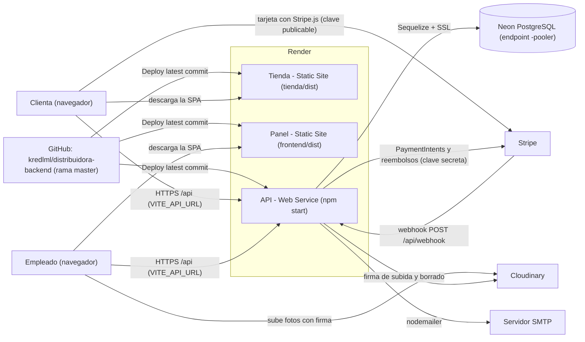
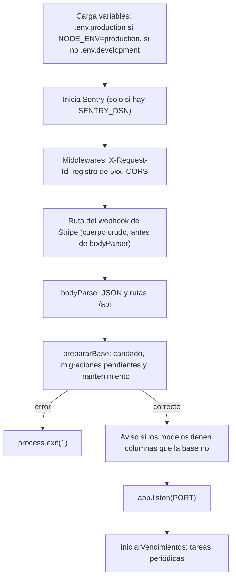
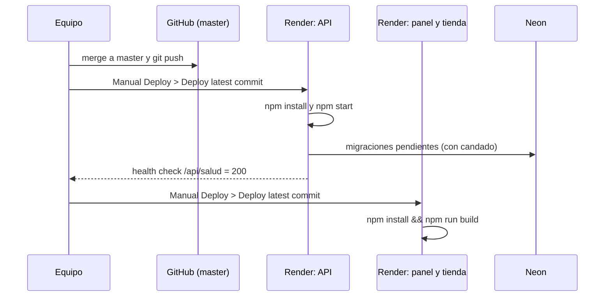
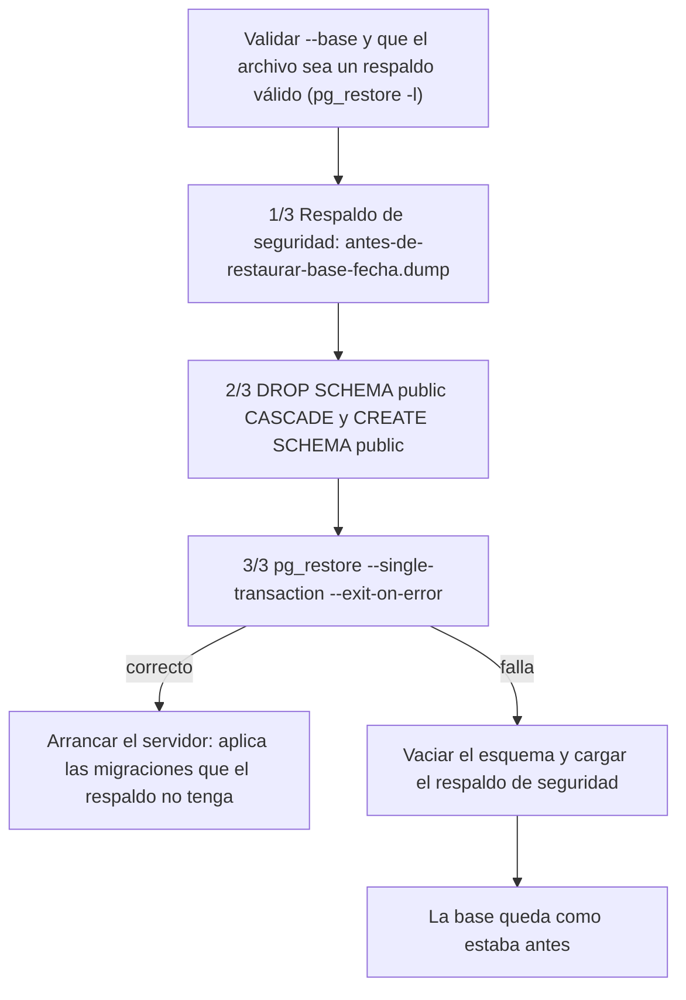

# Despliegue y operación

Este documento describe cómo está publicado el sistema Distribuidora en Render, el procedimiento para volver a publicarlo desde cero o para publicar una actualización, todas las variables de entorno que el sistema reconoce, las limitaciones del plan gratuito y las tareas de operación: migraciones de la base de datos, respaldos y restauración, monitoreo, tareas periódicas del servidor y solución de los problemas más frecuentes. Todo lo descrito corresponde al código del repositorio (`server.js`, `app/utils/migrador.js`, `app/utils/esquema.js`, `app/migraciones/`, `scripts/`, `app/utils/monitoreo.js`, `app/controllers/salud.controller.js` y la configuración de los dos frontends).

## Contenido

1. [Arquitectura de despliegue](#1-arquitectura-de-despliegue)
2. [Requisitos previos](#2-requisitos-previos)
3. [Publicación en Render paso a paso](#3-publicación-en-render-paso-a-paso)
4. [Variables de entorno](#4-variables-de-entorno)
5. [Limitaciones del plan gratuito](#5-limitaciones-del-plan-gratuito)
6. [Migraciones de la base de datos](#6-migraciones-de-la-base-de-datos)
7. [Respaldos y restauración](#7-respaldos-y-restauración)
8. [Monitoreo](#8-monitoreo)
9. [Tareas periódicas](#9-tareas-periódicas)
10. [Solución de problemas frecuentes](#10-solución-de-problemas-frecuentes)
11. [Documentos relacionados](#11-documentos-relacionados)

---

## 1. Arquitectura de despliegue

El sistema se publica como tres servicios de Render construidos a partir del mismo repositorio público (`https://github.com/kredlml/distribuidora-backend`, rama `master`). Cada servicio usa una carpeta distinta del repositorio como directorio raíz.

| Servicio | Tipo en Render | Directorio raíz | Dirección pública |
|---|---|---|---|
| API REST | Web Service (Node) | raíz del repositorio | https://distribuidora-api-r6rw.onrender.com |
| Panel de empleados | Static Site | `frontend` | https://distribuidora-panel.onrender.com |
| Tienda en línea | Static Site | `tienda` | https://distribuidora-tienda.onrender.com |

Los dos frontends son archivos estáticos (HTML, CSS y JavaScript generados por `vite build`) que el navegador descarga y que después se comunican directamente con la API. La API es el único componente que se conecta a la base de datos y que usa claves secretas de los servicios externos.



Puntos relevantes de esta arquitectura:

- **Neon con pooler.** La API se conecta al endpoint con pooler (PgBouncer en modo transacción) que Neon publica con el sufijo `-pooler` en el nombre del host. Por esa razón los candados de PostgreSQL del sistema son candados de transacción (`pg_advisory_xact_lock`), que funcionan detrás de un pooler, y los respaldos usan la conexión directa (ver [Respaldos y restauración](#7-respaldos-y-restauración)).
- **Proxy de Render.** `server.js` establece `app.set("trust proxy", 1)` para que `req.ip` sea la IP real del cliente y no la del proxy de Render; el límite de intentos de inicio de sesión y registro depende de ese valor.
- **Fotos.** El navegador del empleado sube la foto directamente a Cloudinary con una firma generada por la API (`app/config/cloudinary.config.js`); la clave secreta de Cloudinary nunca sale del servidor y la base solo guarda la URL.
- **Pagos.** La tienda usa Stripe.js con la clave publicable; la clave secreta y el secreto del webhook solo existen en la API.

### 1.1 Arranque de la API

Al iniciarse con `npm start` (`node server.js`), la API ejecuta la siguiente secuencia. Si la base de datos no queda al día, el proceso termina con código 1 y no atiende peticiones.



En Render no existe un archivo `.env.production`: `dotenv` no encuentra el archivo y las variables se toman de las definidas en la sección *Environment* del servicio. `dotenv` no sobrescribe variables que ya existen en el entorno.

---

## 2. Requisitos previos

| Requisito | Uso |
|---|---|
| Cuenta de GitHub con acceso al repositorio público | Origen del código de los tres servicios. |
| Cuenta de Render | Hospedaje de la API, el panel y la tienda. |
| Proyecto en Neon con una base PostgreSQL | Base de datos. Se necesitan el host con pooler, el usuario, la contraseña y el nombre de la base. |
| Cuenta de Stripe (modo de pruebas) | Clave secreta `sk_test_…`, clave publicable `pk_test_…` y secreto del webhook `whsec_…`. Opcional: con la clave simulada `sk_test_clave_de_prueba_universidad` los cobros se aprueban al instante sin llamar a Stripe. |
| Cuenta de Cloudinary | Nombre de la nube, API key y API secret. Opcional: sin estas tres variables el panel solo permite pegar un enlace de imagen. |
| Servidor SMTP | Envío de correos a las clientas. Opcional: sin `SMTP_HOST` los correos solo se muestran en la consola. |
| Node.js 18 o superior | Express 5 lo requiere y el código usa `fetch` global (borrado de fotos en Cloudinary). |
| PostgreSQL cliente (`pg_dump`, `pg_restore`) en el equipo de operación | Solo para respaldos y restauración. |

---

## 3. Publicación en Render paso a paso

El orden recomendado es: base de datos, API, frontends, enlace entre servicios (CORS y enlaces de correo), webhook de Stripe, primer usuario y verificación.

### 3.1 Base de datos en Neon

1. Crear un proyecto en Neon y una base de datos.
2. Copiar los datos de conexión del endpoint **con pooler** (host con `-pooler` en el nombre). Esos valores se usan en `DB_HOST`, `DB_USER`, `DB_PASSWORD` y `DB_NAME`.
3. No es necesario crear tablas: la API aplica las migraciones al arrancar por primera vez (ver [Migraciones](#6-migraciones-de-la-base-de-datos)).

### 3.2 API (Web Service)

1. En Render, elegir **New > Web Service** y conectar el repositorio público `https://github.com/kredlml/distribuidora-backend`.
2. Configurar el servicio:

| Campo de Render | Valor |
|---|---|
| Branch | `master` |
| Root Directory | (vacío: raíz del repositorio) |
| Runtime | Node |
| Build Command | `npm install` |
| Start Command | `npm start` |
| Health Check Path (Advanced) | `/api/salud` |
| Instance Type | Free |

`package-lock.json` está excluido en `.gitignore`, por lo que el comando de construcción es `npm install` y no `npm ci`.

3. En **Environment**, definir las variables de la API (la lista completa y sus valores por defecto están en [Variables de entorno](#4-variables-de-entorno)). Como mínimo:

| Variable | Valor en producción |
|---|---|
| `NODE_ENV` | `production` |
| `DB_HOST`, `DB_USER`, `DB_PASSWORD`, `DB_NAME` | Datos del endpoint con pooler de Neon. |
| `JWT_SECRET` | Cadena larga y aleatoria. Firma las sesiones de empleados y clientas. |
| `CORS_ORIGIN` | `https://distribuidora-panel.onrender.com,https://distribuidora-tienda.onrender.com` |
| `TIENDA_URL` | `https://distribuidora-tienda.onrender.com` |
| `STRIPE_SECRET_KEY` | Clave secreta de Stripe (o la clave simulada). |
| `STRIPE_WEBHOOK_SECRET` | Secreto del webhook (se obtiene en el paso [3.5](#35-webhook-de-stripe)). |
| `CLOUDINARY_CLOUD_NAME`, `CLOUDINARY_API_KEY`, `CLOUDINARY_API_SECRET` | Credenciales de Cloudinary. |
| `SMTP_HOST`, `SMTP_PORT`, `SMTP_USER`, `SMTP_PASS`, `CORREO_REMITENTE` | Datos del servidor de correo. |

`PORT` no se define: Render la asigna y `server.js` la lee (`process.env.PORT || 8080`).

4. Crear el servicio. En el registro (*Logs*) del primer despliegue deben aparecer las líneas `[migración] aplicada 0001-esquema-base.js …` hasta `0005-cupon-en-pedido.js` y, al final, `Servidor corriendo en el puerto … [Ambiente: production].`
5. Verificar `https://distribuidora-api-r6rw.onrender.com/api/salud`: debe responder con `"estado": "ok"` y `"base": "ok"`.

### 3.3 Panel y tienda (Static Sites)

Los dos frontends se publican igual; solo cambian el directorio raíz y las variables.

1. En Render, elegir **New > Static Site** y conectar el mismo repositorio.
2. Configurar cada sitio:

| Campo de Render | Panel de empleados | Tienda en línea |
|---|---|---|
| Branch | `master` | `master` |
| Root Directory | `frontend` | `tienda` |
| Build Command | `npm install && npm run build` | `npm install && npm run build` |
| Publish Directory | `dist` | `dist` |

3. Definir las variables de entorno de construcción:

| Variable | Panel | Tienda | Valor |
|---|---|---|---|
| `VITE_API_URL` | Sí | Sí | `https://distribuidora-api-r6rw.onrender.com` (sin `/` final; el código la elimina si se escribe). |
| `VITE_STRIPE_PUBLISHABLE_KEY` | No | Sí | Clave publicable `pk_test_…` de la misma cuenta que `STRIPE_SECRET_KEY`. Puede quedar vacía si la API usa la clave simulada. |

Las variables `VITE_*` se incorporan al código durante `vite build`: cambiarlas no tiene efecto hasta volver a construir el sitio.

4. En la pestaña **Redirects/Rewrites** de cada sitio, agregar la regla:

| Source | Destination | Action |
|---|---|---|
| `/*` | `/index.html` | Rewrite |

Ambas aplicaciones usan `BrowserRouter` de React Router: rutas como `/pedidos/15` o `/perfil` no existen como archivos y, sin esta regla, Render responde 404 al recargar la página o al abrir un enlace directo.

`vite.config.js` de ambos frontends define además `preview: { host: true, allowedHosts: true }`, lo que permite, como alternativa, servirlos como Web Service con `npm run preview` bajo un dominio `*.onrender.com`. La forma recomendada es Static Site, que no consume horas de instancia ni se suspende.

### 3.4 Enlace entre servicios: CORS_ORIGIN y TIENDA_URL

Una vez creados los dos sitios se conocen sus direcciones definitivas, que deben registrarse en la API:

- **`CORS_ORIGIN`**: lista separada por comas de los orígenes que pueden llamar a la API. Cada origen se compara de forma exacta (esquema y dominio, sin `/` final); los espacios alrededor de las comas se eliminan. Si no se define, la API solo acepta `http://localhost:8081` y `http://localhost:8082`.
- **`TIENDA_URL`**: dirección pública de la tienda. Los botones de los correos (seguimiento del pedido, restablecer contraseña) apuntan a ella. En producción, si falta, la API escribe en el registro `[correo] ATENCIÓN: falta TIENDA_URL…`.

Después de guardar los cambios, la API debe volver a desplegarse para que los lea.

### 3.5 Webhook de Stripe

El webhook es necesario cuando se usa una clave real de Stripe (`sk_test_…` o `sk_live_…`). Con la clave simulada no se usa.

1. En el panel de Stripe, ir a **Developers > Webhooks > Add endpoint**.
2. URL del endpoint: `https://distribuidora-api-r6rw.onrender.com/api/webhook`.
3. Seleccionar los eventos que procesa `app/controllers/webhook.controller.js`:

| Evento | Efecto en el sistema |
|---|---|
| `payment_intent.succeeded` | Registra el cobro exitoso del pago (estado PENDIENTE o FALLIDO pasa a COMPLETADO) y el pedido avanza. |
| `payment_intent.payment_failed` | Deja constancia en la auditoría (`PAGO_INTENTO_FALLIDO`); el pago sigue PENDIENTE porque la clienta puede reintentar con otra tarjeta. |
| `payment_intent.canceled` | Marca como FALLIDO el pago que seguía PENDIENTE, porque ese PaymentIntent ya no podrá cobrarse. |
| `refund.created`, `refund.updated`, `refund.failed`, `charge.refund.updated` | Vuelve a consultar en Stripe el reembolso pendiente correspondiente y actualiza su estado. |

4. Copiar el **Signing secret** (`whsec_…`) en la variable `STRIPE_WEBHOOK_SECRET` de la API y volver a desplegarla.

La ruta del webhook se registra en `server.js` antes de `bodyParser.json` y usa `express.raw`, porque la firma de Stripe se valida sobre el cuerpo sin procesar. Una firma inválida se responde con 400.

### 3.6 Primer usuario DISTRITAL

Con la base vacía, la ruta `POST /api/auth/registro` acepta un registro sin sesión y el primer empleado registrado queda siempre con puesto DISTRITAL y sin sucursal (`app/controllers/auth.controller.js`). Se puede enviar desde la colección de Postman (`postman/`) con `nombre`, `apellido`, `email` y `password`. A partir de ese momento los demás empleados se registran desde la pantalla Empleados del panel. Además, si no existe ningún DISTRITAL activo, en cada arranque el mantenimiento promueve a DISTRITAL a los ADMIN sin sucursal o, si no hay, al ADMIN activo más antiguo (ver [Tareas periódicas](#9-tareas-periódicas)).

### 3.7 Verificación

| Verificación | Resultado esperado |
|---|---|
| `GET https://distribuidora-api-r6rw.onrender.com/api/salud` | `{"estado":"ok","base":"ok",…}` |
| Abrir la tienda y recargar una ruta interna | La página carga (regla de reescritura activa). |
| Iniciar sesión en el panel | Sin errores de CORS en la consola del navegador. |
| Panel > Estado del sistema (DISTRITAL) | Base "Responde", 0 migraciones pendientes y los servicios con el estado esperado. |
| Compra de prueba con la tarjeta `4242 4242 4242 4242` (modo de pruebas de Stripe) | El pedido pasa a pagado; en Stripe el evento del webhook figura como entregado. |

### 3.8 Publicar una actualización



Se despliega primero la API, para que las migraciones y los endpoints nuevos estén disponibles antes de que los frontends los usen. Antes de una actualización con migraciones se recomienda un respaldo (`npm run respaldo`).

---

## 4. Variables de entorno

La plantilla de la API es `.env.example` (sin valores reales). En desarrollo se copia a `.env.development`; en un servidor propio, a `.env.production`. Ambos archivos están excluidos en `.gitignore`. En Render las variables se definen en la sección *Environment* de cada servicio.

### 4.1 API

| Variable | Descripción | Valor por defecto |
|---|---|---|
| **Servidor** | | |
| `NODE_ENV` | Ambiente. Con `production` se carga `.env.production` y se activan los avisos de correo sin configurar. | `development` (se lee `.env.development`) |
| `PORT` | Puerto HTTP. Render lo asigna. | `8080` |
| `CORS_ORIGIN` | Orígenes permitidos (panel y tienda), separados por coma. | `http://localhost:8081,http://localhost:8082` |
| **Base de datos** | | |
| `DB_HOST` | Host de PostgreSQL (en Neon, el endpoint con `-pooler`). | — (obligatoria) |
| `DB_PORT` | Puerto de PostgreSQL. | `5432` |
| `DB_USER` | Usuario. | — (obligatoria) |
| `DB_PASSWORD` | Contraseña. | — |
| `DB_NAME` | Nombre de la base. | — (obligatoria) |
| `DB_DIALECT` | Dialecto de Sequelize. | `postgres` |
| `DB_SSL` | SSL activado salvo que valga `false` (bases locales sin SSL). | activado |
| `DB_POOL_MAX` | Conexiones máximas del pool de Sequelize. | `5` |
| `DB_LOG_SQL` | `true` muestra cada consulta SQL en consola (depuración). | `false` |
| `DB_HOST_DIRECTO` | Host sin pooler para `pg_dump`/`pg_restore`. En Neon se deduce quitando `-pooler` del host. | deducido de `DB_HOST` |
| **Sesiones** | | |
| `JWT_SECRET` | Secreto con el que se firman y verifican los tokens de empleados y clientas. | — (obligatoria) |
| `JWT_EXPIRES_IN` | Presente en `.env.example` y en `app/config/auth.config.js`; en la versión actual los tokens se emiten con una vigencia fija de 86400 s (24 h) en `app/utils/empleados.js` y `app/controllers/tienda_auth.controller.js`, por lo que esta variable no altera la vigencia. | `86400` en la plantilla |
| **Stripe** | | |
| `STRIPE_SECRET_KEY` | Clave secreta. El valor `sk_test_clave_de_prueba_universidad` activa el modo simulado (cobros aprobados al instante sin llamar a Stripe). | — |
| `STRIPE_WEBHOOK_SECRET` | Secreto de firma del webhook (`whsec_…`). | — |
| `STRIPE_API_HOST`, `STRIPE_API_PORT`, `STRIPE_API_PROTOCOL` | Opcionales: apuntan el cliente de Stripe a un servidor de pruebas (p. ej. stripe-mock). No van en producción. | API real de Stripe |
| **Cloudinary** | | |
| `CLOUDINARY_CLOUD_NAME`, `CLOUDINARY_API_KEY`, `CLOUDINARY_API_SECRET` | Credenciales para firmar subidas y borrar fotos de la carpeta `distribuidora/prendas`. Sin las tres, el panel solo admite pegar un enlace. | — |
| `CLOUDINARY_API_BASE` | Opcional: base de la API de Cloudinary (usada por las pruebas). | `https://api.cloudinary.com` |
| **Correo** | | |
| `SMTP_HOST` | Servidor SMTP. Sin él no se envía ningún correo. | — |
| `SMTP_PORT` | Puerto SMTP; con `465` se usa conexión segura directa. | `587` |
| `SMTP_USER`, `SMTP_PASS` | Credenciales SMTP (si no hay usuario, se conecta sin autenticación). | — |
| `CORREO_REMITENTE` | Remitente de los correos. | `Distribuidora <no-responder@distribuidora.local>` |
| `TIENDA_URL` | Dirección pública de la tienda para los enlaces de los correos. | `http://localhost:8082` |
| `CORREO_MODO` | `smtp`, `consola` o `archivo` (guarda cada correo como JSON; lo usan las pruebas). | `smtp` si hay `SMTP_HOST`; si no, `consola` |
| `CORREO_CARPETA` | Carpeta del modo `archivo`. | `correos/` en el directorio de trabajo |
| **Reglas del negocio** | | |
| `HORAS_PLAZO_DEVOLUCION` | Horas desde la entrega para solicitar un cambio o devolución (valores menores o iguales a 0 se ignoran). | `24` |
| `PLAZO_PEDIDO_PENDIENTE_HORAS` | Horas para pagar un pedido pendiente antes de cancelarlo; `0` desactiva el vencimiento. | `24` |
| `VENCIMIENTO_INTERVALO_MIN` | Minutos entre revisiones de pedidos vencidos y reembolsos pendientes. | `10` |
| `ENVIO_COSTO` | Costo del envío a domicilio de la tienda en línea. | `25` |
| `ENVIO_GRATIS_DESDE` | Monto (después del descuento) desde el que el envío es gratis; `0` = nunca gratis. | `300` |
| `IVA_PORCENTAJE` | IVA incluido en los precios, desglosado en pedidos y reportes. | `12` |
| `ZONA_HORARIA_NOMBRE` | Zona horaria de reportes y vigencia de cupones. | `America/Guatemala` |
| `ZONA_HORARIA_TIENDA` | Desfase horario usado en los filtros por fecha de pedidos. | `-06:00` |
| **Monitoreo** | | |
| `SENTRY_DSN` | DSN de Sentry. Requiere el paquete `@sentry/node`, que no forma parte de las dependencias. | — (desactivado) |
| **Respaldos** | | |
| `PG_BIN` | Carpeta `bin` de PostgreSQL si `pg_dump` no está en el PATH. En Windows se busca la versión más nueva en `C:/Program Files/PostgreSQL`. | búsqueda automática |
| `RESPALDOS_DIR` | Carpeta de los respaldos. | `respaldos/` en la raíz del proyecto |
| `RESPALDOS_MAX` | Cantidad de respaldos normales que se conservan (mínimo 1). | `14` |

### 4.2 Panel y tienda

Ambos frontends leen su configuración en `src/config/env.js`; las plantillas son `frontend/.env.example` y `tienda/.env.example`.

| Variable | Aplicación | Descripción | Valor por defecto |
|---|---|---|---|
| `VITE_API_URL` | Panel y tienda | URL base de la API, sin `/` final. | `http://localhost:8080` |
| `VITE_STRIPE_PUBLISHABLE_KEY` | Tienda | Clave publicable de Stripe de la misma cuenta que `STRIPE_SECRET_KEY`. Puede quedar vacía con la clave simulada. | vacía |

Ninguna clave secreta debe definirse con prefijo `VITE_`: todo lo que lleva ese prefijo queda visible en el código que descarga el navegador.

---

## 5. Limitaciones del plan gratuito

| Limitación | Consecuencia en el sistema | Cómo se maneja |
|---|---|---|
| El Web Service gratuito se suspende tras 15 minutos sin peticiones. | La primera petición después de la suspensión tarda en responder mientras la instancia vuelve a arrancar (incluye la revisión de migraciones). El panel o la tienda pueden mostrar un error de conexión en ese intervalo. | Abrir `/api/salud` antes de una demostración y esperar la respuesta; luego usar el sistema normalmente. |
| Mientras la API está suspendida no se ejecuta ningún temporizador. | Los pedidos vencidos y los reembolsos pendientes no se procesan durante la suspensión. | Se procesan en la primera revisión tras el arranque, unos 5 segundos después de que la API vuelve a escuchar (ver [Tareas periódicas](#9-tareas-periódicas)). |
| Despliegues manuales. | Un `git push` a `master` no publica por sí solo en este proyecto. | Cada servicio se actualiza con **Manual Deploy > Deploy latest commit**, empezando por la API. |
| Sistema de archivos efímero. | Lo escrito en disco por la API (p. ej. correos en modo `archivo`) se pierde en cada reinicio o despliegue. | En producción se usa `CORREO_MODO` `smtp`; los respaldos se generan desde un equipo de operación, no en Render. |

Los Static Sites no se suspenden: el panel y la tienda cargan de inmediato aunque la API esté despertando.

---

## 6. Migraciones de la base de datos

El esquema de la base se maneja con migraciones controladas mediante Umzug (`app/utils/migrador.js`). Reemplazan a `sequelize.sync({ alter: true })`, que en cada arranque comparaba modelos y base y podía borrar columnas o cambiar tipos sin aviso.

### 6.1 Funcionamiento

- Cada archivo de `app/migraciones/` cuyo nombre cumple el patrón `NNNN-nombre.js` (cuatro dígitos, guion y nombre) es una migración. Se ordenan por nombre y cada una se aplica una sola vez.
- Las migraciones aplicadas quedan anotadas en la tabla **`SequelizeMeta`** (una fila por nombre de archivo).
- El servidor aplica las pendientes en cada arranque, antes de escuchar peticiones (`prepararBase`). Si una falla, el servidor no arranca.
- **Candado.** Todo ocurre bajo un candado de transacción de PostgreSQL (`pg_advisory_xact_lock` con la clave `74210531`) tomado en una conexión dedicada. Si arrancan dos instancias a la vez, la segunda espera a la primera hasta 300 segundos (`lock_timeout`). Al ser un candado de transacción, se libera con `COMMIT` y funciona detrás del pooler de Neon.
- Bajo el mismo candado se ejecuta el mantenimiento de datos (`app/utils/mantenimiento.js`).
- Después se comparan los modelos con la base (`diferencias` en `app/utils/esquema.js`). Si un modelo tiene una columna o un valor de ENUM que la base no tiene, se escribe en el registro `[migración] ATENCIÓN: los modelos tienen columnas que la base no: …`. La base no se modifica en ese caso.

| Migración | Contenido |
|---|---|
| `0001-esquema-base.js` | Línea base: crea las tablas, columnas y valores de ENUM que falten a partir de los modelos, e índices únicos sin distinguir mayúsculas (correo de empleado, correo de cliente y nombre de tipo de prenda). No se puede deshacer. |
| `0002-intentos-limite.js` | Tabla `IntentoLimite` para el límite de intentos. |
| `0003-errores-servidor.js` | Tabla `ErrorServidor` para el registro de errores. |
| `0004-envio-cupones.js` | Tabla `Cupon` y columnas `costo_envio`, `descuento` e `id_cupon` en `Pedido`. |
| `0005-cupon-en-pedido.js` | Copia del cupón en el pedido (`cupon_tipo`, `cupon_valor`, `cupon_minimo`) y relleno de los pedidos existentes. |

### 6.2 Comandos

Los comandos usan la misma configuración que el servidor: `.env.production` si `NODE_ENV=production`; si no, `.env.development`.

| Comando | Acción |
|---|---|
| `npm run migrar` | Aplica las migraciones pendientes y el mantenimiento (lo mismo que hace el servidor al arrancar). |
| `npm run migrar:estado` | Lista las migraciones aplicadas y pendientes, y avisa si algún modelo tiene columnas sin migración. |
| `node scripts/migrar.js deshacer` | Revierte la **última** migración aplicada, si tiene función `down`. Conviene hacer un respaldo antes. La línea base `0001` no se puede deshacer. |

En PowerShell, para operar sobre la configuración de producción: `$env:NODE_ENV="production"; npm run migrar:estado`.

### 6.3 Escribir una migración nueva

Toda migración debe ser **idempotente**: debe poder ejecutarse dos veces sin fallar. En una base nueva la línea base `0001` ya crea el esquema de los modelos actuales y después se ejecutan las demás, que encontrarán sus columnas ya creadas. Para eso `app/utils/esquema.js` ofrece ayudas "si no existe":

| Ayuda | Efecto |
|---|---|
| `asegurarColumna(sequelize, tabla, campo, definicion)` | Agrega la columna solo si no existe. |
| `asegurarValoresEnum(sequelize, tabla, campo, valores)` | Agrega a la columna ENUM los valores que falten. |
| `asegurarModelo(sequelize, modelo)` | Crea la tabla de un modelo o le agrega las columnas que falten. Nunca borra ni cambia tipos. |

Procedimiento:

1. Modificar el modelo en `app/models/`.
2. Crear el archivo con el número siguiente; por ejemplo, para una columna hipotética `horario` en `Sucursal`, `app/migraciones/0006-horario-sucursal.js`:

```js
// Horario de atención de la sucursal (ejemplo). Idempotente.
const { asegurarColumna } = require("../utils/esquema");

exports.up = async ({ sequelize, Sequelize }) => {
  await asegurarColumna(sequelize, "Sucursal", "horario", { type: Sequelize.STRING(100), allowNull: true });
};

exports.down = async ({ sequelize }) => {
  await sequelize.query(`ALTER TABLE "Sucursal" DROP COLUMN IF EXISTS horario`);
};
```

3. Ejecutar `npm run migrar:estado` para ver la migración como pendiente, y `npm run migrar` (o reiniciar el servidor) para aplicarla.

Reglas a respetar:

- La función `up` recibe `{ db, sequelize, qi, Sequelize }` (modelos, conexión, `QueryInterface` y la clase Sequelize).
- Una columna `NOT NULL` agregada a una tabla con datos necesita valor por defecto.
- Las migraciones no se ejecutan dentro de una transacción (`ALTER TYPE … ADD VALUE` no lo permite en versiones antiguas de PostgreSQL).
- Una migración ya aplicada en producción no se edita: cualquier corrección va en una migración nueva.
- `down` es opcional; sin ella, `deshacer` responde con un error.

---

## 7. Respaldos y restauración

Los scripts `scripts/respaldo.js` y `scripts/restaurar.js` usan `pg_dump` y `pg_restore` con la misma configuración de base que el servidor (`scripts/pg.js`). La contraseña se entrega por la variable `PGPASSWORD`, nunca en la línea de comandos, y el modo SSL sigue a `DB_SSL`.

**Conexión directa.** `pg_dump` y `pg_restore` no deben pasar por un pooler en modo transacción, porque sus ajustes de sesión podrían aplicarse en otra conexión. Por eso los scripts usan `DB_HOST_DIRECTO` si está definido o, si el host es de Neon (`*.neon.tech`) y contiene `-pooler.`, el mismo host sin `-pooler`. Si el host resultante sigue pareciendo un pooler, se muestra un aviso.

La versión de `pg_dump` del equipo debe ser igual o más reciente que la versión de PostgreSQL de la base.

### 7.1 Respaldo

```
npm run respaldo
```

- Genera `respaldos/<base>-AAAAMMDD-HHMMSS.dump` en formato *custom* de `pg_dump` (comprimido, con `--no-owner --no-privileges`).
- El archivo se escribe primero como `.dump.parcial` y solo se renombra al terminar correctamente, de modo que un respaldo interrumpido no se confunde con uno válido.
- **Rotación:** se conservan los últimos `RESPALDOS_MAX` respaldos normales de esa base (14 por defecto); los más antiguos se borran. También se eliminan restos `.parcial` de más de 6 horas. Los respaldos con prefijo `antes-de-restaurar-` no entran en la rotación.
- La carpeta `respaldos/` está excluida del repositorio.

Para respaldar la base de producción desde PowerShell: `$env:NODE_ENV="production"; npm run respaldo` (requiere un `.env.production` local con los datos de Neon).

### 7.2 Programar el respaldo diario en Windows

```
schtasks /Create /SC DAILY /ST 23:00 /TN "Respaldo distribuidora" /TR "cmd /c cd /d <carpeta del proyecto> && npm run respaldo"
```

La tarea se ejecuta todos los días a las 23:00 en el equipo donde se registra; ese equipo debe estar encendido y tener `pg_dump` disponible.

### 7.3 Restauración

```
npm run restaurar -- respaldos/<archivo>.dump --base <DB_NAME>
```

La restauración **reemplaza todo el contenido** de la base. El parámetro `--base` debe coincidir con `DB_NAME` de la configuración activa; si no coincide, el script termina sin tocar nada. Antes de ejecutarla se debe detener el servidor.



Al vaciar el esquema también se elimina lo que el respaldo no contiene (tablas nuevas y la propia `SequelizeMeta`), por lo que, al arrancar, el servidor detecta y aplica las migraciones posteriores al respaldo.

---

## 8. Monitoreo

### 8.1 Endpoints de salud

| Endpoint | Acceso | Respuesta |
|---|---|---|
| `GET /api/salud` | Público (lo usa el health check de Render) | 200 con `estado`, `base`, `latencia_base_ms` y `hora` si la base responde a `SELECT 1`; 503 con `"estado": "degradado"` si no. No expone datos internos. |
| `GET /api/salud/detalle` | DISTRITAL | Hora de arranque, versión de Node, memoria, latencia de la base, migraciones (aplicadas, pendientes, última), columnas faltantes, errores de las últimas 24 h y 7 días, pedidos y reembolsos pendientes, reembolsos fallidos y estado de los servicios (correo, Stripe, Cloudinary, Sentry, plazo de vencimiento). |
| `GET /api/salud/errores?pagina=N` | DISTRITAL | Errores registrados en `ErrorServidor`, del más reciente al más antiguo, paginados. |

El servicio Stripe se informa como `simulado`, `real (pruebas)`, `real (producción)` (clave `sk_live_`) o `sin configurar`.

### 8.2 Pantalla Estado del sistema

El panel ofrece al DISTRITAL la pantalla **Estado del sistema** (`frontend/src/pages/Sistema/Sistema.jsx`), que consulta los dos endpoints protegidos y muestra avisos cuando la base no responde, hay migraciones sin aplicar, faltan columnas en la base, no hay SMTP configurado o existen reembolsos rechazados por Stripe que esperan entrega en efectivo.


*Estado del sistema: la base responde, hay 5 migraciones aplicadas (última `0005-cupon-en-pedido.js`), no hay pedidos sin pagar ni reembolsos pendientes, el plazo para pagar es de 24 h, el correo está en modo archivo (pruebas), Stripe en modo simulado, Cloudinary configurado, Sentry desactivado y no hay errores registrados.*

### 8.3 Registro de errores (ErrorServidor)

`app/utils/monitoreo.js` instala en `server.js` las siguientes piezas:

| Pieza | Función |
|---|---|
| `idDePeticion` | Asigna un UUID a cada petición y lo devuelve en la cabecera `X-Request-Id` (expuesta por CORS para que los frontends puedan leerla). |
| `registrarRespuestas5xx` | Guarda en `ErrorServidor` toda respuesta con estado 500 o superior: fecha, id de petición, método, ruta sin la cadena de consulta, estado, mensaje, pila (si existe) y usuario (`empleado:N` o `cliente:N`). Nunca guarda el cuerpo de la petición, que puede contener contraseñas. |
| `noEncontrado` | Responde en JSON a las rutas `/api` inexistentes (404). |
| `manejadorDeErrores` | Convierte los errores no controlados en respuestas JSON: 400 para JSON inválido, 415 para cuerpos comprimidos, 413 para cuerpos demasiado grandes y 500 con el texto `Error interno del servidor (referencia <id>)`. La pila nunca se envía al cliente. |
| `vigilarProceso` | Registra promesas rechazadas sin manejar y excepciones no controladas. Ante una excepción no controlada registra el error y termina el proceso, que Render vuelve a iniciar. |

La referencia que recibe el usuario en un error 500 coincide con el `request_id` guardado, lo que permite localizar el registro exacto en la pantalla Estado del sistema. Los registros de más de 30 días se eliminan automáticamente.

### 8.4 Sentry (opcional)

Si se define `SENTRY_DSN`, el servidor inicia Sentry antes que Express y envía cada error registrado como mensaje de nivel `error`, con el `request_id` como etiqueta, sin datos personales (`sendDefaultPii: false`) y sin trazas de rendimiento. El paquete `@sentry/node` no está en las dependencias: para activarlo en Render se debe agregar al `package.json` (`npm install @sentry/node`) y volver a desplegar. Si el DSN está definido pero falta el paquete, el servidor sigue funcionando y lo advierte en el registro.

### 8.5 Registro de Render

Los mensajes de operación aparecen en *Logs* del servicio de la API con prefijos que facilitan su búsqueda: `[migración]`, `[mantenimiento]`, `[vencimientos]`, `[reembolsos]`, `[correo]`, `[monitoreo]` y `[cloudinary]`.

---

## 9. Tareas periódicas

La API ejecuta tareas en segundo plano sin servicios externos de programación. Todas se detienen mientras la instancia de Render está suspendida.

| Tarea | Frecuencia | Detalle | Código |
|---|---|---|---|
| Mantenimiento de datos | En cada arranque, después de las migraciones | Completa `fecha_entrega` de pedidos ENTREGADOS antiguos a partir de la auditoría; garantiza que exista un DISTRITAL activo (promueve a los ADMIN sin sucursal o, si no hay, al ADMIN activo más antiguo, y lo registra en la auditoría); asigna sucursal a clientes de mostrador que no la tenían. | `app/utils/mantenimiento.js` |
| Vencimiento de pedidos pendientes | Cada `VENCIMIENTO_INTERVALO_MIN` minutos (10); la primera revisión unos 5 s después del arranque | Cancela hasta 200 pedidos PENDIENTES por revisión cuyo plazo (`PLAZO_PEDIDO_PENDIENTE_HORAS`) venció, libera el stock reservado, cancela el cobro iniciado en Stripe y notifica a la clienta. Omite pedidos con algún pago completado, con pagos de caja por confirmar o con un cobro con tarjeta iniciado hace menos de 30 minutos; si Stripe ya había cobrado, registra el cobro en lugar de cancelar. | `app/utils/vencimientos.js` |
| Reintento de reembolsos a tarjeta | En la misma revisión que el vencimiento | Vuelve a consultar en Stripe hasta 50 reembolsos PENDIENTES creados hace más de 5 minutos. | `app/utils/reembolsos.js` |
| Limpieza de `ErrorServidor` | Cada 6 horas | Elimina los errores de más de 30 días. | `app/utils/monitoreo.js` |
| Limpieza de `IntentoLimite` | Cada hora, desde el primer uso del limitador | Elimina los contadores de intentos de más de un día. | `app/middlewares/limitador.js` |

La revisión de vencimientos y reembolsos usa un candado de transacción con la clave `74210532` en modo "intentar": si hubiera varias instancias de la API, solo una revisa y las demás no esperan, sino que lo intentan en la siguiente vuelta.

---

## 10. Solución de problemas frecuentes

| Síntoma | Causa probable | Solución |
|---|---|---|
| En la consola del navegador aparece *blocked by CORS policy* y el panel o la tienda no cargan datos. | El origen del sitio no está en `CORS_ORIGIN`, tiene `/` final, usa `http` en lugar de `https`, o la API no se volvió a desplegar después del cambio. | Definir `CORS_ORIGIN=https://distribuidora-panel.onrender.com,https://distribuidora-tienda.onrender.com` (sin `/` final) y volver a desplegar la API. |
| Al recargar una página interna del panel o la tienda aparece *Not Found* (404). | Falta la regla de reescritura del Static Site. | Agregar en *Redirects/Rewrites* la regla `/*` → `/index.html` con acción **Rewrite**. |
| Un cambio subido a GitHub no aparece en el sistema publicado. | El cambio está en otra rama (por ejemplo `documentacion`) o no se ejecutó el despliegue manual. | Verificar que el servicio use la rama `master`, unir el cambio a `master` y ejecutar **Manual Deploy > Deploy latest commit**. |
| La primera petición tarda mucho o el panel muestra un error de conexión y luego funciona. | La API estaba suspendida por inactividad (plan gratuito). | Abrir `https://distribuidora-api-r6rw.onrender.com/api/salud`, esperar la respuesta y reintentar. |
| Las variables `VITE_API_URL` o `VITE_STRIPE_PUBLISHABLE_KEY` se cambiaron, pero el sitio sigue usando los valores anteriores. | Las variables de Vite se fijan al construir. | Ejecutar un nuevo despliegue del Static Site. |
| Las clientas no reciben correos. | No hay `SMTP_HOST` (modo `consola`), `CORREO_MODO` está forzado a `consola` o `archivo`, las credenciales SMTP son incorrectas, o el proveedor de hospedaje restringe los puertos SMTP salientes en el plan contratado. | Revisar el servicio "Correo" en Estado del sistema y el registro (`[correo] ATENCIÓN: no hay SMTP configurado…`); definir `SMTP_HOST`, `SMTP_PORT`, `SMTP_USER`, `SMTP_PASS` y quitar `CORREO_MODO`; verificar que el plan de Render permita conexiones salientes al puerto SMTP usado. |
| Los enlaces de los correos llevan a `localhost`. | Falta `TIENDA_URL`. | Definir `TIENDA_URL=https://distribuidora-tienda.onrender.com` y volver a desplegar la API. |
| La API no arranca y el registro muestra `[migración] No se pudo preparar la base de datos: …`. | Datos de conexión incorrectos, la base no responde o una migración falló. | Revisar las variables `DB_*` y el mensaje; corregir la migración en un archivo nuevo si es necesario y volver a desplegar. |
| Los pagos con tarjeta quedan pendientes y Stripe muestra fallas de entrega del webhook (400). | `STRIPE_WEBHOOK_SECRET` no corresponde al endpoint, o la URL del webhook es incorrecta. | Copiar de nuevo el *Signing secret* del endpoint `…/api/webhook` y volver a desplegar la API. |
| `npm run respaldo` informa que no se pudo ejecutar `pg_dump` o que la versión del servidor no coincide. | `pg_dump` no está instalado o es más antiguo que la base. | Instalar una versión de PostgreSQL igual o superior a la de Neon o indicar su carpeta `bin` en `PG_BIN`. |
| Estado del sistema advierte "Faltan en la base: …". | Se modificó un modelo sin escribir la migración correspondiente. | Escribir una migración idempotente (sección [6.3](#63-escribir-una-migración-nueva)) y desplegar. |

---

## 11. Documentos relacionados

- [Arquitectura](01-arquitectura.md): componentes, capas del backend y flujo de una compra.
- [Modelo de datos](02-modelo-de-datos.md): tablas que crean las migraciones.
- [Reglas de negocio](04-reglas-de-negocio.md): vencimiento de pedidos, reembolsos, envío e IVA.
- [API](05-api.md): endpoints, incluidos los de salud y el webhook.
- [Seguridad](07-seguridad.md): manejo de secretos, sesiones y límite de intentos.
- [Pruebas](08-pruebas.md): ejecución de las pruebas antes de desplegar.
